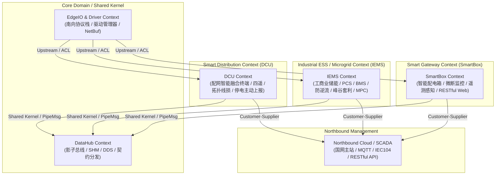

# EdgeOS 战略限界上下文地图 (Context Map)

> **版本**: 1.0.0 (AEP-351 / Phase 3.5)  
> **状态**: Accepted / Active  
> **架构基准**: Domain-Driven Design (DDD), Clean Architecture & Four Planes Isolation

---

## 1. 全局架构战略全景 (Strategic Overview)

EdgeOS 是一个面向高确定性、高并发、长生命周期（10~15年）的工业边缘计算与能源物联网操作系统。为防范跨业务线领域模型腐化（Anti-Corruption），系统划分为四大核心限界上下文（Bounded Contexts），并严格定义各上下文之间的协作与集成模式。

---

## 2. 限界上下文定义 (Bounded Contexts)

### 2.1 基础共享内核 (Shared Kernel: DataHub & Core Infrastructure)
- **定位**: 跨所有业务子域的高性能物理共享内核与影子内存总线。
- **职责**:
  - 维护零拷贝 POSIX 共享内存环形缓冲区 (`shm_ring_t`) 与 64 字节原子对齐消息 (`PipeMsg`)；
  - 维护各测点影子内存表 (`shadow_table`) 与 Sequence Lock 无锁读写机制；
  - 提供多后端路由（SHM 单机零拷贝、CycloneDDS 分布式发布订阅、MQTT 云端桥接）；
  - 承载全局契约运行时（TagID 哈希寻址、量纲换算、动态分块 Hot-Schema）。
- **上下游关系**: 所有产品域（DCU / IEMS / SmartBox）对 DataHub 均为 **Shared Kernel (共享内核)** 关系。

### 2.2 配电智能融合终端上下文 (DCU Context)
- **业务定位**: 国家电网 / 南方电网低压配电网台区智能化核心节点（能源控制器 / TTU）。
- **核心聚合**:
  - **台区拓扑与分支线损聚合 (DistributionArea & LineLoss)**: 16 分支动态线损分析、相别拓扑识别；
  - **四遥测控聚合 (Telecontrol: YC/YX/YK/YT)**: 16-DI 遥信采集、8-DO 遥控分合闸与防误闭锁；
  - **停电主动上报与 SOE 事件聚合 (OutageDetector & SOE)**: 超级电容掉电毫秒级侦测、事件顺序记录；
  - **规约管理与国密安全聚合 (DLT698 & ESAM)**: DLT698.45 树状对象字典、0xF001 安全 DFU 升级、SM2/SM3/SM4 硬件加密。
- **详见**: [cmd/dcu/CONTEXT.md](cmd/dcu/CONTEXT.md)

### 2.3 工商业储能与微电网上下文 (IEMS Context)
- **业务定位**: 工商业光储充综合微电网、集装箱储能系统（BESS）与多源能量管理系统。
- **核心聚合**:
  - **储能集装箱与电池安全聚合 (ESSContainer & BMS)**: 电芯级电压/温度极值追踪、SOC/SOH 估计、热失控分级预警；
  - **变流器协调与并离网聚合 (PCSCluster & GridCoupling)**: PQ 恒功率、VF 孤岛黑启动、VSG 虚拟同步机与下垂控制；
  - **微电网能量调度聚合 (EnergySchedule & MPC)**: 防逆流（Zero Export）、动态峰谷套利（TOU Arbitrage）、需量削峰控制。
- **详见**: [cmd/iems/CONTEXT.md](cmd/iems/CONTEXT.md)

### 2.4 智能配电箱与边缘网关上下文 (SmartBox Context)
- **业务定位**: 建筑用电、智慧园区、微断路器集中监控与边缘网关。
- **核心聚合**:
  - **微断感知与电气火灾聚合 (SmartPanel & CircuitBreaker)**: 漏电电流、线缆温度、过载保护；
  - **多协议接入与管理聚合 (GatewayChannel & RestBridge)**: Modbus/DLT645 转换、RESTful API 矩阵与反向代理。
- **详见**: [cmd/smart_box/CONTEXT.md](cmd/smart_box/CONTEXT.md)

---

## 3. 上下文映射关系 (Context Relationships)

| 源上下文 | 目标上下文 | 关系模式 | 交互通道 | 契约与防腐机制 |
|---|---|---|---|---|
| **EdgeIO (南向驱动)** | **业务产品域 (DCU/IEMS)** | **Upstream-Downstream + ACL** | `NetBuf` / 回调 | 通过生成式注册表与 ACL 防腐层解耦，业务层不直接触碰协议栈原始私有指针 |
| **业务产品域** | **DataHub (影子总线)** | **Shared Kernel (共享内核)** | SHM / VTable | 严格以 64B `PipeMsg`、全局唯一 TagID 与契约查表库交互 |
| **业务产品域** | **Northbound Cloud** | **Customer-Supplier** | RESTful / MQTT / 104 | 统一采用带 MTT 时间戳的标准 Envelope 结构与 IEC 规约帧 |

---

## 4. 统一语言与术语演化公约 (Ubiquitous Language Charter)

1. **TagID 唯一真理源**: 所有领域测点必须由 `contracts/schema/domains/*.yaml` 统一定义，严禁业务代码私设魔数；
2. **物理真实性 (Physical Truth Only)**: 严禁使用 Mock 或写死常数，所有遥测必须溯源至物理寄存器或 DataHub 偏移量；
3. **四平面严格隔离**: Foundation、Control Plane、Compute Plane、Execution Plane 严禁跨平面强耦合私有结构体。
