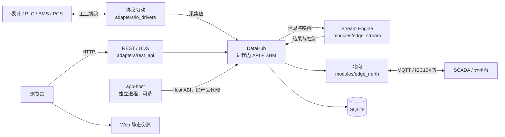

# EdgeOS / EdgeC

EdgeC 是面向工业边缘设备的 C11 运行时。一个产品进程把现场总线采集、数据通道、计算管线、北向上送和管理接口装配在一起。仓库里有三个产品（IEMS、DCU、SmartBox）、一个可选的 WASM 应用宿主、Vue 前端和跨语言 SDK。

仓库里的代码能说明实现边界，不能说明交付状态。功能是否可用以 `acceptance/` 的验收结果为准。

## 系统边界与数据流



| 单元 | 实际形态 | 说明 |
| --- | --- | --- |
| 产品进程 | `build/products/<product>/` 下的单个二进制 | 每台设备运行一个产品。产品决定启用哪些模块和驱动。 |
| DataHub | 产品进程内 API 加 POSIX 共享内存 | 消息环与影子数据。它不是独立服务，也没有监听端口。 |
| app-host | 独立进程，WAMR 运行时 | 只在启用 WASM 应用时启动。与产品进程之间用 socketpair 通信。 |
| Web 前端 | Vue/Vite 构建出的静态资源 | 由部署方式决定托管在哪，产品进程不强制提供它。 |
| Go 代码 | 工具与服务 | 只在与对应工具或部署组合一起使用时参与运行。 |

## 关键代码位置

| 你要找的东西 | 起点 |
| --- | --- |
| 产品入口 | `cmd/iems/main.c`，装配在 `cmd/iems/iems_app.c` |
| 产品组合根 | `cmd/<product>/`，每个产品各有一份 |
| 端口定义 | `foundation/include/` 下的 `*_port.h` 与类型头 |
| DataHub | `modules/edge_core/include/datahub.h` |
| 驱动与总线 | `adapters/io_drivers/`，编排在 `modules/edge_io/` |
| 北向 | `modules/edge_north/`，传输实现见 `adapters/mqtt_transport/` |
| REST 与 UDS | `adapters/rest_api/` |
| WASM 宿主与应用 ABI | `modules/edge_app_host/`、`cmd/app-host/`、`sdk/wit/` |
| 本地存储 | `adapters/sqlite_adapters/` |
| SDK | `sdk/c/`、`sdk/python/`、`sdk/go/`、`sdk/js/`，一致性测试在 `sdk/conformance/` |

## 主要目录

| 路径 | 用途 |
| --- | --- |
| `cmd/` | 产品与程序入口：`iems`、`dcu`、`smart_box`、`app-host`、`edgeos-launcher` 等 |
| `modules/` | 18 个可复用运行时模块，例如 `edge_core`、`edge_io`、`edge_stream`、`edge_north`、`edge_app_host` |
| `adapters/` | 9 个适配层：平台、驱动、SQLite、REST、MQTT、MCP、流算法等 |
| `foundation/` | 基础类型、算法、协议编解码与缓冲池，不含 IO 与全局状态 |
| `sdk/` | WASM ABI/WIT 与 C、Python、Go、JavaScript SDK |
| `web/` | Vue/Vite 前端、共享 Core 与前端测试 |
| `tests/`、`fuzz/`、`acceptance/` | 单元与集成测试、模糊测试、产品验收台架 |
| `docs/` | 设计、ADR、开发手册与协议资料 |
| `go/` | Go 工具与服务代码 |

## 构建与测试

需要 CMake、Ninja、C11 编译器、Python 3，以及 `CMakeLists.txt` 中查找的依赖：libuv、cJSON、SQLite、ZLIB、zlog、Paho MQTT、CURL、QuickJS、iwasm、cmocka、OpenSSL。依赖安装与目标平台有关。交叉编译用 `cmake/toolchains/` 下对应的工具链文件。

```bash
# 配置并构建 C 核心，关闭前端可跳过 Web 构建
cmake -S . -B build -G Ninja -DCMAKE_BUILD_TYPE=Release -DENABLE_WEB_BUILD=OFF
cmake --build build -j"$(nproc)"

# 全部 CTest 用例，当前 327 项（ctest -N 可查）
ctest --test-dir build --output-on-failure

# 架构与卫生守卫，正反夹具加活树检查
python3 ci/scripts/run_guard_selftest.py
```

产品二进制落在 `build/products/<product>/`。`./test.sh` 是已配置 `build/` 的 C 单元测试入口。产品验收由独立的 `test-platform` 按 `acceptance/testplatform.sha` 固定版本驱动，当前 19 个任务分布在 `dcu`、`iems`、`smart_box` 三个产品下：

```bash
./test.sh
TESTPLATFORM=/path/to/test-platform ./acceptance/run.sh
```

前端单独构建：

```bash
cd web
npm ci
npm run test:unit
npm run build:all
```

## 运行时要注意的行为

- **WASM 应用默认经 `edgeos-launcher` 启动，launcher 拒绝非 root 调用方。** 本地以普通用户调试应用时不会启动成功。设 `EDGEC_LAUNCHER=0` 可以绕过 launcher 直接拉起 app-host，同时失去 uid、cgroup 与 seccomp 隔离。
- **产品 stdout 是行缓冲。** 入口调用 `setvbuf(stdout, NULL, _IOLBF, 0)`，状态行接管道也能及时出现。验收台架不允许用 `stdbuf` 掩盖缓冲问题，`check_iems_stdout_line_buffered.py` 会拦。
- **构建不改写已跟踪文件。** `cmake/WebBuild.cmake` 用 `npm ci`，干净工作树构建后 `git status` 应为空。
- **控制写必须带解析出的从站地址。** 地址来自 `poll_tasks`/`inventory`，写死会打在共享 RS485 总线上的错误表计。`check_iems_control_slave.py` 会拦。

## 产品与架构约定

- 产品组合根位于 `cmd/<product>/`，只做装配与生命周期。产品领域逻辑归产品目录自己维护。
- 模块之间通过消费者定义的端口通信，实现放在 `adapters/`。依赖方向由 `check_plane_isolation.py`、`check_component_boundary.py` 强制。
- ADR-0010 已决定废除全局中心化契约编译器和全局数字 TagID。`contracts/` 不是新的全局产品点表来源，见 [`docs/adr/0010-eliminate-global-contracts-and-tagid.md`](docs/adr/0010-eliminate-global-contracts-and-tagid.md)。
- WASM ABI 的当前约定与已知限制见 [`sdk/README.md`](sdk/README.md) 和 [`docs/wasm_micro_app_guide.md`](docs/wasm_micro_app_guide.md)。设计目标不等于已交付能力。

## 进一步阅读

- [开发手册](docs/EDGEOS_DEV_HANDBOOK.md)
- [IEMS 上下文](cmd/iems/CONTEXT.md)
- [Web 前端说明](web/README.md)
- [SDK ABI 与一致性测试](sdk/README.md)
- [设计决策（ADR）](docs/adr/)
- [开发路线图](ROADMAP.md)
