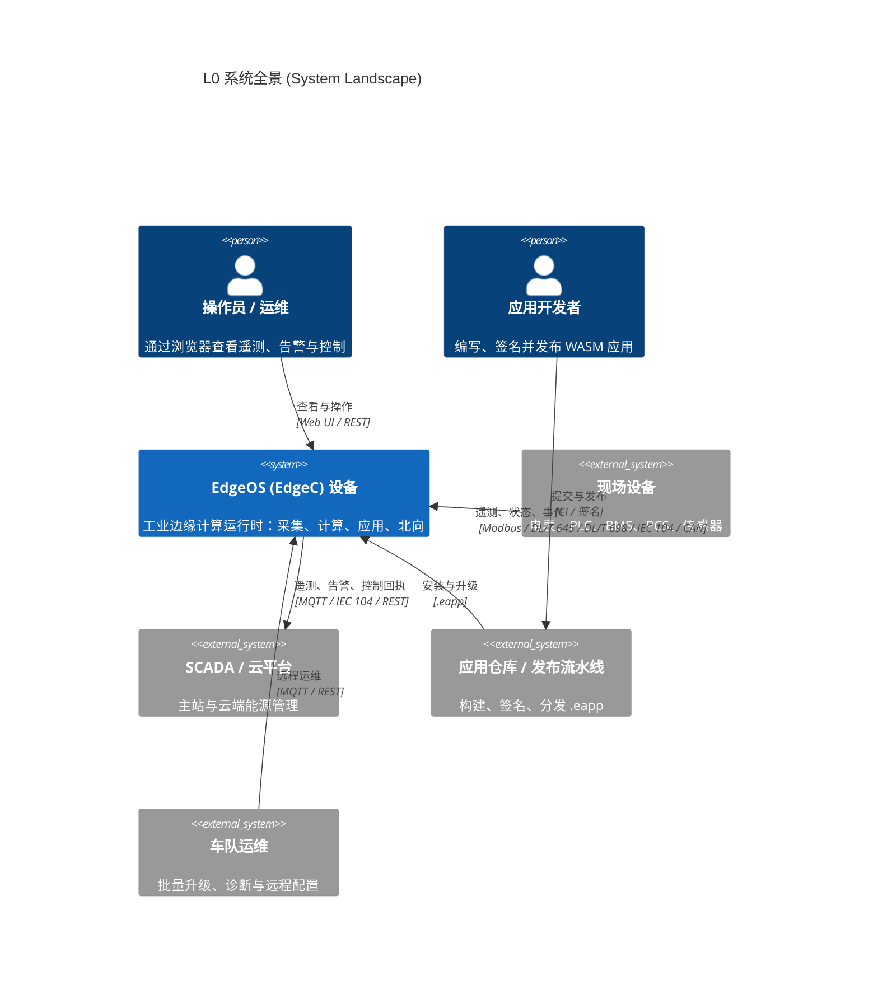
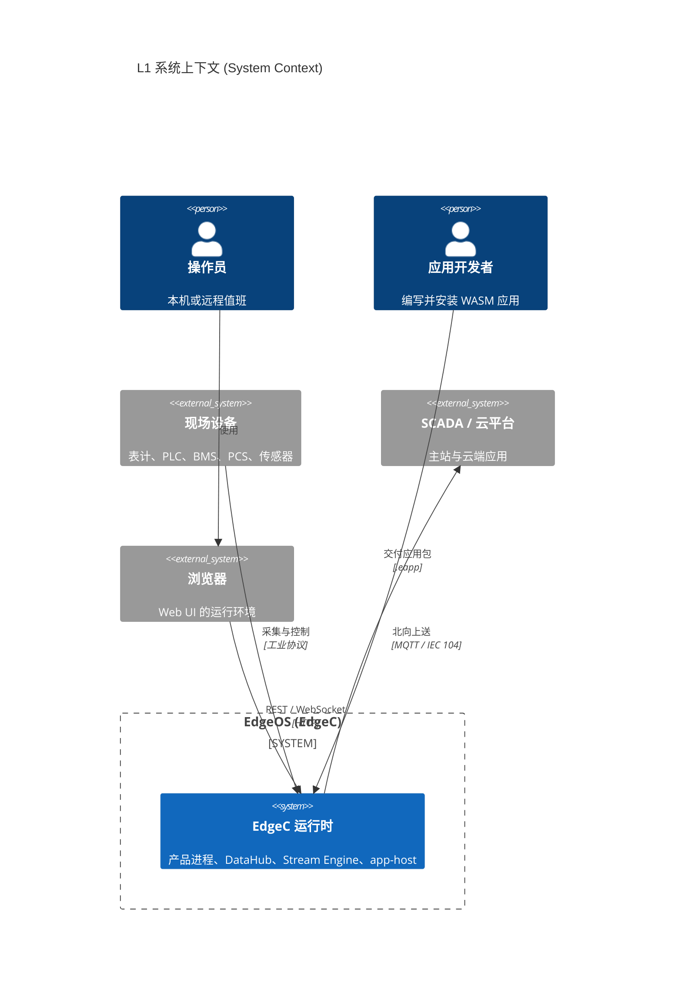
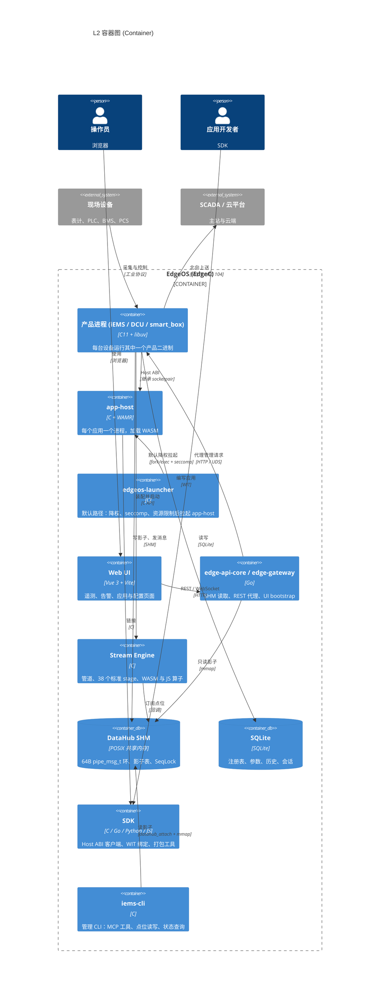
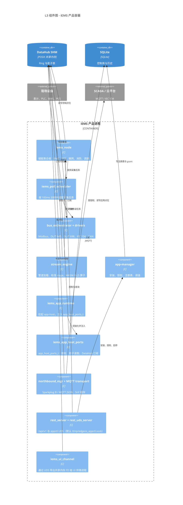
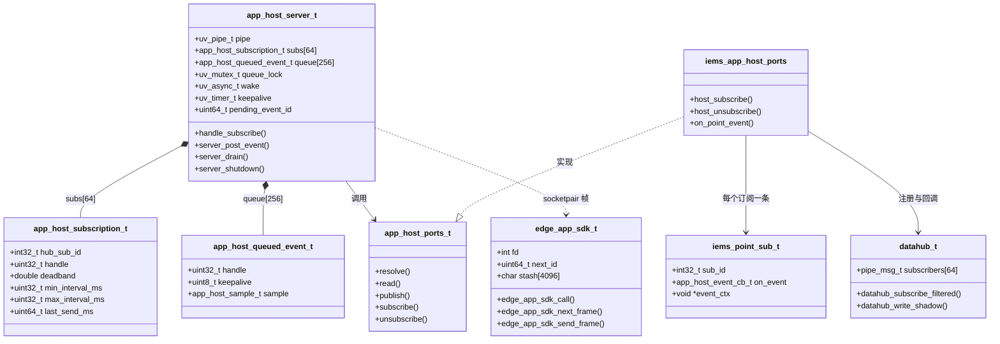
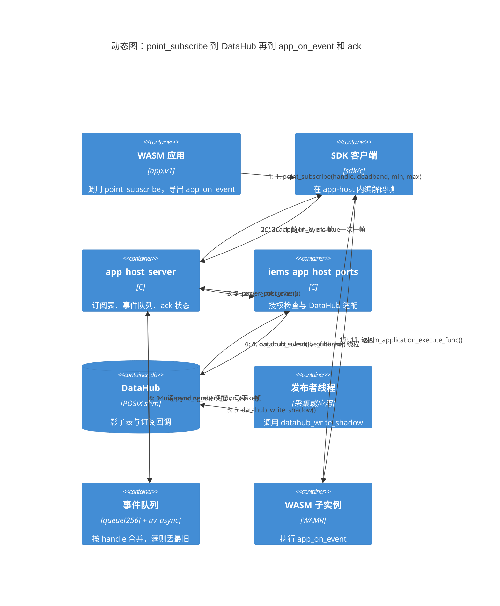
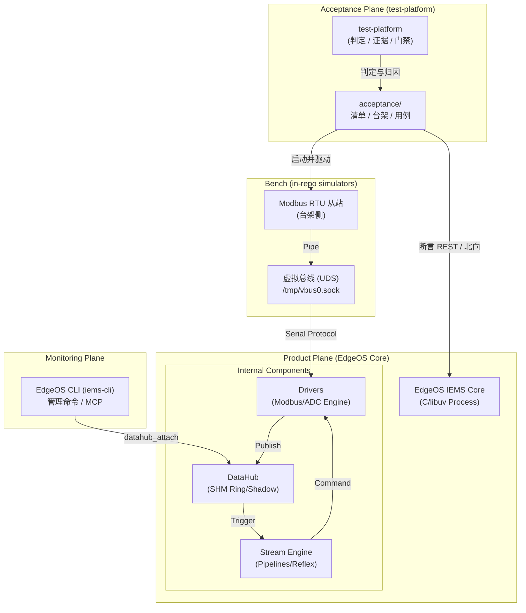

# EdgeOS (EdgeC) - 工业级边缘计算核心运行时 SDK


EdgeOS 是一个面向 **工业物联网 (IIoT)**、**能源管理系统 (EMS)** 和 **智能电网融合终端** 的边缘计算 SDK。它采用 C11 标准构建，核心基于 `libuv` 事件循环，目标是在 15 年以上的生命周期内持续运行。

---

## 🏗️ 1. 核心架构设计 (Microkernel & Clean Architecture)

EdgeOS 遵循微内核、整洁架构（Clean Architecture）与领域驱动设计（DDD）规范。系统按四个平面组织，并另设基础层与产品面。依赖方向遵循依赖倒置原则（DIP）与消费者定接口原则：

### 1.1 系统平面分布

| 平面                | 产物/目录                                  | 职责描述                                                                         |
| :------------------ | :----------------------------------------- | :------------------------------------------------------------------------------- |
| **Foundation (L0)** | `contract_data_types.h`                    | **基础类型定义**。定义标量、时间戳、质量码与无外部依赖的通用数据结构。          |
| **Foundation (L1)** | `libedge_foundation.a`、`libedge_netbuf.a` | **基础库**。基础类型、内存池与通用数据结构。                                   |
| **Control Plane**   | `libedge_core.a`                           | **决策中枢**。DataHub、Arbiter、Scheduler、Params 与控制循环。                   |
| **Compute Plane**   | `libedge_stream.a`                         | **计算引擎**。Stream Engine、Pipeline 实时计算、WASM 与 JS 算子沙箱。           |
| **Execution Plane** | `libedge_io.a`、`libedge_api.a`            | **南向执行**。总线编排、协议驱动、Request 模型与 API 端口。                      |
| **Product Plane**   | `cmd/<product>/`                           | **产品专属聚合根与组合根**。DCU、IEMS、SmartBox 自治领域模型与事件编排。         |

---

## 🧭 2. C4 架构模型 (C4 Model)

C4 用不同缩放级别讲不同读者的故事。Simon Brown 的原话是：

> The different levels of zoom allow you to tell different stories to different audiences.

这句话来自 [C4 diagrams](https://c4model.com/diagrams)，方法背景见 [C4 model](https://c4model.com/)。

| 图 | 级别 | 读者 | 一句话故事 |
| --- | --- | --- | --- |
| 系统全景 | L0 | 产品与新人 | EdgeC 在完整现场与供应链中的位置：设备、主站、应用发布、车队运维。 |
| 系统上下文 | L1 | 架构师与集成商 | 只画 EdgeC 的边界，标出直接使用它和与它交换数据的一方。 |
| 容器图 | L2 | 开发者与运维 | 一个请求会经过哪些进程、共享内存和数据库。 |
| 组件图 | L3 | 模块所有者 | iEMS 容器内的模块如何通过端口协作。 |
| 代码图 | L4 | 该路径维护者 | 订阅链路的结构体、所有权与依赖，谁持有队列，谁只做适配。 |
| 动态图 | Dynamic | 功能开发者 | 订阅、发布、投递、ack 的顺序与线程切换。 |
| 部署图 | Deployment | 运维与现场集成 | 一台设备上的进程、共享内存、SQLite 与北向连接。 |

L0 与 L1 不重复：L0 讲完整生态，L1 只讲 EdgeC 的边界。L4 与 Dynamic 不重复：L4 讲静态结构与所有权，Dynamic 讲运行时顺序。

### 2.1 L0 系统全景

级别：L0。读者：产品与新人。

故事：把 EdgeC 放回完整的现场与供应链，看清设备、主站、应用发布和车队运维各自的位置。



### 2.2 L1 系统上下文

级别：L1。读者：架构师与集成商。

故事：只画系统边界，标出用户、现场设备、主站和浏览器。



### 2.3 L2 容器图

级别：L2。读者：开发者与运维。

故事：把可部署单元和共享存储分开，看清一个请求会经过哪些进程。



### 2.4 L3 组件图

级别：L3。读者：模块所有者。

故事：打开 iEMS 产品容器，看清聚合根、采集、流计算、应用运行时和北向如何通过端口协作。



### 2.5 L4 代码图

级别：L4。读者：该路径维护者。

故事：下到结构体、所有权与依赖，看清谁持有订阅表和队列，谁只做适配，谁只做编解码。



静态结构读完后，再看下一张动态图理解运行时顺序。

### 2.6 Dynamic 动态图

级别：Dynamic。读者：功能开发者。

故事：把一次订阅、一次发布、一次投递和一次 ack 串起来，标出线程切换与有界队列。



### 2.7 Deployment 部署图

级别：Deployment。读者：运维与现场集成。

故事：落到一台设备，看产品进程、launcher、每应用一个 app-host、共享内存、SQLite 和北向连接。

```mermaid
C4Deployment
    title 部署图：单台边缘设备

    Deployment_Node(dev, "边缘设备", "aarch64 Linux") {
        Deployment_Node(prod, "产品进程", "systemd") {
            Container(iems, "iems / dcu / smart_box", "C11 + libuv", "聚合根、采集、北向、REST")
        }
        Container(launcher, "edgeos-launcher", "C", "默认路径：降权与 seccomp 后 exec app-host")
        Deployment_Node(host_a, "app-host (应用 A)", "WAMR") {
            Container(wasm_a, "应用 A", "WASM", "app_on_event")
        }
        Deployment_Node(host_b, "app-host (应用 B)", "WAMR") {
            Container(wasm_b, "应用 B", "WASM", "app_on_event")
        }
        Deployment_Node(shm, "DataHub SHM 段", "POSIX shm") {
            ContainerDb(shadow, "影子表", "shadow_table", "SeqLock 快照")
            ContainerDb(ring, "Ring", "shm_ring_t", "64B pipe_msg_t 环")
        }
        ContainerDb(sqlite, "SQLite 文件", "SQLite", "控制库、参数、历史")
        Container(go_api, "edge-api-core / edge-gateway", "Go", "读取 SHM、代理 REST")
        Container(web, "Web UI 静态文件", "Vue 3", "SPA")
        Container(cli, "iems-cli", "C", "MCP、点位读写、状态查询")
    }

    Deployment_Node(pc, "操作员工作站", "浏览器") {
        Container(browser, "浏览器", "Chrome / Edge", "打开 Web UI")
    }
    System_Ext(field, "现场总线", "RS485 / CAN / Ethernet")
    System_Ext(cloud, "SCADA / 云平台", "MQTT / IEC 104")
    Person(operator, "操作员", "值班与运维")

    Rel(field, iems, "Modbus / DL/T 645/698 / CAN")
    Rel(iems, cloud, "MQTT / IEC 104")
    Rel(iems, launcher, "请求拉起")
    Rel(launcher, host_a, "exec + seccomp")
    Rel(launcher, host_b, "exec + seccomp")
    Rel(iems, host_a, "Host ABI", "socketpair")
    Rel(iems, host_b, "Host ABI", "socketpair")
    Rel(iems, shadow, "读写影子表")
    Rel(iems, ring, "写入 pipe_msg_t")
    Rel(go_api, shadow, "只读 mmap")
    Rel(go_api, web, "代理静态文件")
    Rel(browser, go_api, "REST / WS", "HTTP")
    Rel(operator, browser, "使用")
    Rel(cli, shadow, "mmap")
```

## 🏛️ 3. 领域驱动自治与事件驱动架构 (DDD & EDA, ADR-0010)

基于 **ADR-0010 (No-TagID, No-Contract, No-Contract-Compiler)**，系统移除了全局中心化 YAML 契约编译器与统一连续数字 TagID，改为 **产品聚合根自治**、**强类型领域方法** 与 **自描述领域事件广播**。

```
                                  ┌─────────────────────────────┐
                                  │   北向网络 / 外部消费端      │
                                  │   (MQTT / REST / Web UI)    │
                                  └──────────────▲──────────────┘
                                                 │ 统一标准 JSON / 领域语义
                                  ┌──────────────┴──────────────┐
                                  │      北向协议适配层 (ACL)    │
                                  └──────────────▲──────────────┘
                                                 │ 领域事件广播 (dcu_domain_event_t) / 强类型调用
┌────────────────────────────────────────────────┴────────────────────────────────────────────────┐
│ 产品专属聚合根 / 编排组合根 (cmd/<product>/)                                                    │
│                                                                                                 │
│   ┌─────────────────────────────────────────┐       ┌───────────────────────────────────────┐   │
│   │   领域模型与业务状态机 (Aggregate Root)   │       │   动态散列槽位分发 (No-Array Slot Map) │   │
│   │   • DCU: 电力 698 32-bit OAD / 645 DI   │ ◄───► │   • 动态散列算术映射 (Zero Static Table)  │   │
│   │   • IEMS: 工业寄存器 / BMS 拓扑         │       │   • 设备与测点槽位完全动态隔离        │   │
│   │   • 业务不变量校验与控制防误动作拦截    │       └──────────────────┬────────────────────┘   │
│   └────────────────────▲────────────────────┘                          │ 槽位索引               │
│                        │ 强类型领域方法 (feed / control)                │                        │
│   ┌────────────────────┴────────────────────┐       ┌──────────────────▼────────────────────┐   │
│   │   南向防腐适配层 (ACL Adapter)          │       │   DataHub 影子存储与 IPC 通道         │   │
│   │   • 协议自描述规约直通                  │       │   • 无锁 SeqLock 高频读瞬时快照       │   │
│   │   • 动态参数与量纲解析                  │       │   • POSIX SHM Ring 零拷贝进程间通信   │   │
│   └────────────────────▲────────────────────┘       └───────────────────────────────────────┘   │
└────────────────────────┼────────────────────────────────────────────────────────────────────────┘
                         │ 原始工业报文 / 帧驱动
┌────────────────────────┴────────────────────────────────────────────────────────────────────────┐
│ 南向工业协议栈与驱动模板 (foundation/edge_codec & edge_io)                                      │
│ (DL/T 698.45, DL/T 645, Modbus RTU/TCP, IEC 104, CAN 协议，纯 C 算法，100% 零业务依赖)        │
└─────────────────────────────────────────────────────────────────────────────────────────────────┘
```

### 3.1 核心设计原则

1. **聚合根自治 (Aggregate Root Autonomy)**：
   - 彻底废除全局 YAML 契约与离线编译器，彻底消除 Go 语言编译链依赖；
   - 每个产品在 `cmd/<product>/` 维护专属聚合根（如 `dcu_node_t`），内部使用行业原生领域标识（如电力 DCU 原生使用 32-bit OAD 与 645 DI，储能 IEMS 使用电池簇寄存器），**彻底消灭 OAD ↔ TagID 的双重运行时翻译开销**。
2. **强类型领域方法防护业务不变量**：
   - 南向采集与北向控制严禁直接穿透物理底层数据表；
   - 采集输入调用强类型领域方法（如 `dcu_node_feed_meter_reading`），由聚合根自治执行电表建档校验、越限告警判定与防爆刷控制；
   - 遥控执行调用控制领域方法（如 `dcu_node_execute_control`），内置防误操作白名单拦截。
3. **自描述领域事件广播（微服务架构就绪）**：
   - 聚合根产生状态变更时，对外派发统一自描述领域事件（`dcu_domain_event_t`）；
   - 通过挂接事件回调，无论未来服务是单体运行、还是拆分为独立进程/微服务容器，均可通过消息总线（MQTT、UDS、RPC）直接解耦对接。
4. **DataHub 角色归位为 Outbound 通道**：
   - DataHub 不再充当全局集中式“上帝测点字典”；
   - 降级为聚合根背后的**高性能发布与影子存储通道**（提供 POSIX SHM Ring 零拷贝跨进程 IPC、无锁 SeqLock 瞬时快照及 DDS 跨节点发布）；
   - 槽位映射全面采用**动态算术散列分发**，彻底消灭单机集中式静态数组点表。
5. **南向协议自描述直通**：
   - 充分发挥规约自身自描述特性（如 DL/T 698.45 报文自带 32-bit OAD 与 ASN.1 类型），解码器解析后直通领域方法，无需冗余静态表。

---

## 🛠️ 4. 开发、构建与架构门禁

### 4.1 纯 C 构建 (Zero-Go Dependency)

ADR-0010 移除全局契约编译器后，C 核心可以直接用 CMake 与 Ninja 构建，不需要外部脚本或 Go 运行时：

```bash
# 1. 全量编译 (CCache 加速增量构建)
cmake -B build -G Ninja
ninja -C build

# 2. 运行架构门禁与无契约防退化守护
./scripts/check_architecture_layers.sh
./scripts/check_generated_drift.sh

# 3. 运行全量单元与集成测试套件 (309 项 CTest 用例)
./test.sh
```

### 4.2 CI 架构防腐与防退化门禁 (Architecture Guards)

CI 流水线内建了整洁架构守卫脚本（`check_architecture_layers.sh`），执行 15 项门禁校验：
- **聚合根边界封装 (Aggregate Root Boundary)**：禁止任何外部代码跨层篡改聚合根私有状态；
- **组合根唯一性 (Composition Root Exclusivity)**：全局生命周期装配严格收敛于组合根；
- **开闭原则守护 (OCP Gate)**：禁止在核心路由层出现单体静态数组或庞大的硬编码 switch-case；
- **单一职责守护 (SRP Gate)**：物理隔离领域逻辑、南向驱动防腐层与存储持久化；
- **无全局契约防退化守卫 (ADR-0010 Guard)**：严格校验全局 0 编译器、0 全局 contracts.h 污染。

## 🚀 5. 核心演进 (Omnis Sprint 4 Highlights)

### 5.1 Master/Slave 对称双平面架构 (AEP-403)

EdgeC 协议栈具备完整的双向对称架构，分别支撑下行主动抄读（Master）与上行被动响应（Slave）：

- **Master Plane (主站调度平面)**: `MasterEngine` 通过 `edge_req_t` 支持标准驱动抄读、Raw I/O 透传与无状态调度，实现单通道 in-flight ≤ 1 异步事务。
- **Slave Plane (从站响应平面)**: `SlaveEngine` 专为 IEC104 Slave、Modbus Slave 及对端仿真设计。外部主站读请求通过 Consumer Port `edge_driver_read_shadow` 从 DataHub 影子寄存器无锁提取；写请求强制通过 `_slave_is_write_allowed` ACL 鉴权与 Edge-Guard DPI 深度报文检测，严禁旁路改写业务聚合根。
  > 详细架构时序与接入指南见 [Slave Plane 架构规范](docs/design/slave_plane_architecture.md)。

### 5.2 高性能内存调度器

为了支撑 10kHz 级采样与大规模采集并存：

- **内存镜像队列**: 弃用 `uv_periodic` 中的同步 SQL 查询，改用 `queue.h` 实现的内存镜像任务链表。
- **零抖动触发**: 调度分辨率达 100ms，任务检索耗时从毫秒级降至微秒级，保障了 DSP 算法的实时性。

### 5.3 管理 CLI

`iems-cli` 是产品伴随的管理命令行，提供 MCP 工具调用、点位读写与状态查询：

- `mcp list` / `mcp call`：列出并调用已注册的工业 MCP 工具。
- `tag read` / `tag write`：按 TagID 读写 DataHub 影子点位。
- `status`：打印运行时健康摘要。

### 🌐 5.4 Web UI & REST API 实施进度 (对齐 web_ui_ia.md)

| 模块          | 核心特性          | 后端 API                 | 前端 View          | 状态        |
| :------------ | :---------------- | :----------------------- | :----------------- | :---------- |
| **测点与元数据** | 元数据自适应驱动渲染 | `/api/v1/contracts`      | `ContractStore`    | ✅ 完成     |
| **Dashboard** | 实时健康监测      | `/api/v1/system/health`  | `Dashboard.vue`    | ✅ 完成     |
| **Pipelines** | 实时运行拓扑      | `/api/v1/pipelines`      | `PipelineList.vue` | ✅ 完成     |
| **数据分析**  | 历史曲线/影子点查 | `/api/v1/data/query`     | `DataCurves.vue`   | ✅ 完成     |
| **参数管理**  | KV 参数双向读写   | `/api/v1/system/config`  | `SystemConfig.vue` | ✅ 完成     |
| **任务调度**  | 时钟状态/任务清单 | `/api/v1/time/status`    | `Scheduling.vue`   | ⚠️ 部分完成 |
| **设备管理**  | 拓扑展现/通信统计 | `/api/v1/devices`        | `DeviceList.vue`   | ⚠️ 部分完成 |
| **持久化**    | 数据库指标监控    | `/api/v1/storage/status` | `Storage.vue`      | ✅ 完成     |

---

## 📅 6. 验收台架与本地UI

验收与核心产品之间划分为三个平面：验收面 (Acceptance Plane)、产品面 (Product Plane) 和 监控面 (Monitoring Plane)。



角色详细说明：

1. Acceptance Plane (验收面)

- `acceptance/`: 每个产品一个目录，放台架 (`bench.py`)、用例 (`*_product.py`) 与清单。台架负责建虚拟总线、起从站、并判定产品二进制是否过期。
- `test-platform`: 独立的判定/证据/归因门禁，版本由 `acceptance/testplatform.sha` 锁定；升级 = 改这一行的一次 PR。
- Virtual Bus: 使用 Unix Domain Socket 模拟 RS485/CAN 总线，使 C 端代码无需修改即可运行。

2. Product Plane (产品面 - EdgeOS)

- EdgeOS IEMS: 待测的二进制核心程序。它通过环境变量（如 OMNIS_BUS_0_DEV）识别“总线”在哪里。
- DataHub: 高性能 Outbound 发布与影子存储通道。提供 POSIX SHM Ring 零拷贝进程间通信与 SeqLock 瞬时快照。
- Stream Engine: 处理业务逻辑。例如“发现电压 > 264V 则拉掉继电器”的 REFLEX 逻辑就在此运行。

3. 验收判定（test-platform）

- 台架用例直接改从站寄存器（例如把电压抬到 280V），观察 IEMS 是否检测到并触发保护。
- 判定、证据与归因都在平台里；本仓库只提供台架与用例。

4. Monitoring Plane (监控面 - iems-cli)

- `iems-cli`: 一个独立的管理命令行。
- 关系: 它用 `datahub_attach` 按共享内存名字直接映射 DataHub，读取影子值并执行管理命令。这证明 EdgeOS 的多进程数据共享能力。

数据流向示例（过压保护场景）：

1.  验收台架（`acceptance/`，test-platform）发送 set VOLTAGE 285。
2.  台架的 Modbus 从站更新虚拟寄存器。
3.  IEMS Drivers 轮询总线，读到 285V，写入 DataHub。
4.  Stream Engine 被唤醒，触发 REFLEX 逻辑，产生“关断继电器”指令。
5.  IEMS Drivers 执行指令，通过虚拟总线写入 Modbus Actor。
6.  iems-cli 读取同一个 DataHub 影子值，显示电压与继电器状态。

---

## ⚡ 7. 高频采样与波形分析 (Sprint 5 Ion)

为了满足工业级波形分析（如谐波监测、暂态捕捉）的需求，EdgeOS 在 Sprint 5 引入了代号为 **"Ion"** 的高频数据处理架构，支持千万级（10MHz）采样吞吐。

### 7.1 零拷贝所有权转移机制

针对 10MHz 采样率下的 CPU 瓶颈，系统弃用了传统的字节流拷贝，改用基于 **匿名内存 (memfd)** 的所有权转移协议：

1.  **8 缓冲环池**：仿真端（Python Actor）预分配 8 个 1MB 的 `memfd` 块，形成循环缓冲。
2.  **FD 动态分发**：利用 Unix Domain Socket 的 `SCM_RIGHTS` 控制消息，将内存文件描述符从 Actor 发送至 Core 进程。
3.  **零拷贝映射**：Core 进程在独立线程接收 FD 后，直接通过 `mmap` 将数据映射到本地地址空间，避免了跨进程的数据拷贝。

### 7.2 信号合成与工况引擎 (Python Side)

波形仿真端随 `tools/matrix` 一并移出本仓库，现由 `test-platform` 提供；本节 6.1 / 6.3 描述的生产侧机制不受影响。

### 7.3 原生 DSP 算子与管线逻辑

系统引入了 **Native C 算子** 以应对极高吞吐的计算需求：

- **`dsp_rms` 算子**：直接在 `TYPE_REF` 内存引用上执行平方和根计算，产出 `ADC_VOLTAGE_RMS` 业务点位。
- **管线协同**：`dsp_processor` 管线负责高频计算，其产出的有效值可直接触发 `overvoltage_protection` 等业务保护管线，实现了从“原始波形”到“业务控制”的毫秒级闭环。

### 7.4 性能参考

| 指标           | 性能表现        | 备注                         |
| :------------- | :-------------- | :--------------------------- |
| **采样频率**   | 100kHz - 10MHz  | 取决于宿主机系统调度性能     |
| **缓冲区管理** | 8 块 memfd 循环 | 提供 ~200ms 抖动容差         |
| **跨进程延迟** | < 1ms           | 基于 SCM_RIGHTS 所有权转移   |
| **内存拷贝**   | 0 拷贝          | 计算过程直接在共享映射区进行 |

---

## 🌐 8. 微服务自治、契约融合与构建优化 (Sprint 6/7 Dynamic Mesh)

为了支持边缘智能算法的自治演进，我们在 Sprint 6/7 引入了 **“动态微服务网络与契约融合 (Dynamic Mesh & Contract Fusion)”** 架构，实现了南向与北向平面的安全无缝联调。

### 8.1 动态微服务注册与契约融合 (TSK-01 & TSK-01.1)

在传统的边缘系统中，新增算法微服务通常需要修改网关代码并重启网关。EdgeOS 引入了热插拔的契约自描述架构：
- **`/api/v1/internal/registry` 注册端点**：外部微服务（如 Go 编写的算法微服务）在启动时，主动向 `edge-gateway` 汇报自身的 `Prefix`、`Port` 以及自定义的 **`Tags` (点表元数据)** 和 **`UIConfigs` (前端大盘渲染配置)**。
- **内存 Schema 融合 (Schema Fusion)**：网关内部持有读写锁保护的融合表，在不重启网关的前提下，动态将新注册的测点注入全局点表字典（fusedTags），将卡片编排注入 BFF 缓冲池，瞬间完成路由热加载与点位扩容。

### 8.2 BFF 引导与自适应渲染 (TSK-03)

为了避免前端页面加载时因串行请求多个微服务的契约配置而产生过多网络往返（RTT），网关设计了统一的 BFF 引导接口：
- **`GET /api/v1/ui/bootstrap` 端点**：前端 HMI 仅需一次 RTT，即可获取静态编译点表与所有动态注册服务上报的 Fused Tags 及 UI 排版，大盘据此实现自适应的即插即用渲染。

### 8.3 C 侧引擎死锁治理与线程安全保障

在 WASM 热装载与高频定时任务（如 100ms 级的 `on_tick`）并发执行的环境中，系统对计算流拓扑的并发访问做了加固：
- **修复 uninitialized `pipe_mutex` 缺陷**：补齐了 C 服务引擎在 `stream_engine_create_ex` 中缺失的 `uv_mutex_init`，彻底消灭了获取拓扑 `/api/v1/stream/topology` 时的未定义行为挂挂起死锁。
- **保护 `pipeline_add_stage` 临界区**：利用 `pipe_mutex` 同步动态 stage 挂载与后台计算线程的队列遍历，修复了 `stream_dump.c` 中的**指针退化（array decay）无限循环 Bug**，保障了拓扑热装载与实时流计算的物理确定性。

### 8.4 构建系统性能与稳定性双向优化 (Build Optimization)

为加速本地调试、缩短闭环时间并提高构建在资源受限容器内的成功率，构建系统新增了以下特性：
- **CCache 原生集成**：CMakeLists 自动检测并优先使用本地 `ccache` 缓存编译，缩短后续增量与重新配置构建的时间。
- **ENABLE_WEB_BUILD 条件构建**：新增 CMake 选项 `-DENABLE_WEB_BUILD=ON/OFF`。当专注于 C 侧后台调试时，可选择关闭 npm 和 Vite 静态前端构建，省去每次编译时重复执行前端 bundler 的开销。
- **链接并行度控制**：通过降低 Ninja 的链接并行度（如 `-j2`）约束 `ld` 并发数，避免容器环境因并发链接耗尽内存。

---

## 👵 9. 智能养老健康终端协同 (Smart Box System - Sprint 8)

为了响应适老化健康监护和家庭安全防卫需求，EdgeOS 衍生并集成了 **Smart Box** 养老智能监护系统，打通了物理控制底座、Web API 慢车道网关及 Wasm 实时边缘 AI 算子的完整协同机制：

### 9.1 物理控制底座 (C 语言实现)
底座代码位于 `cmd/smart_box/main.c`，利用 `libuv` 维持高性能事件循环：
- **指示灯渲染**：读取 DataHub 状态更新红、黄、绿三色 GPIO（23/24/25），控制指示状态。
- **物理 SOS 紧急求救**：epoll 边缘触发（GPIO 26）下降沿中断，判定大按钮按下并立即触发本地报警。
- **隐私沙盒断电**：当隐私模式激活时，拉低 GPIO 29 和 31 强制切断摄像头和麦克风的 VCC 物理供电。
- **电池监测**：通过 I2C 1 (地址 `0x34`) 轮询 AXP209 PMIC 电池电源状态。
- **南向多协议外设接入**：支持 NFC 读卡（PN532 SPI）、外骨骼康复控制（Modbus RTU串口）和 BLE GATT 心率手环的驱动交互。

### 9.2 Web API 与业务网关 (Go 语言实现)
网关代码位于 `go/cmd/smart-box-gateway/main.go`，提供慢车道数据与安全合规逻辑：
- **GDPR 被遗忘权与零擦除**：`/api/v1/privacy/purge` 事务内删除用户记录并在事务外加全局锁执行 `VACUUM;` 强制磁盘数据页重置归零。
- **AES-256-GCM 敏感数据加密**：本地数据均采用对称加密算法混淆并进行消息认证。
- **区块链存证锚定**：计算哈希并使用 ECDSA 私钥对存证信息进行 64 字节对齐的 Base64 编码签名存储。

### 9.3 C↔Go 双轨通信 (UDS 二进制 IPC)
底座与网关之间采用 UNIX Domain Socket (`/tmp/smart_box_ipc.sock`) 建立高可靠性的二进制字节帧交互通道：
- **帧字节布局**：
  `Magic (0x5342 - "SB") | MsgType (1B) | Length (1B) | Payload (NB) | Checksum (1B, XOR)`
- **主要消息定义**：
  - `MsgType == 2`：NFC 扫卡发现外设并发送 NDEF JSON 报文，网关自动在 SQLite 库的 `devices` 表中注册设备。
  - `MsgType == 3`：SOS 紧急求助事件。

### 9.4 边缘实时 Wasm AI 算子
跌倒与健康状态分析通过嵌入式安全 Wasm 容器（基于 WAMR 沙箱）在 `modules/edge_stream/src/wasm_runtime/rehab_companion.c` 中运转：
- **跌倒判定**：采用 **SVM (信号矢量幅值) + SMA (信号幅值面积)** 双指标算法判定瞬间空中失重（连续 10 次 $SVM < 0.2G$）、强碰撞（$SVM > 3.2G$）与碰撞后人体动力学静躺昏迷状态（$SMA < 0.4G$），有效清除了由于床铺跌落、拾物弯腰等产生的误报。
- **心率异常监控**：心率低于 50 或高于 140 BPM 时实时触发系统状态告警和红灯闪烁。

