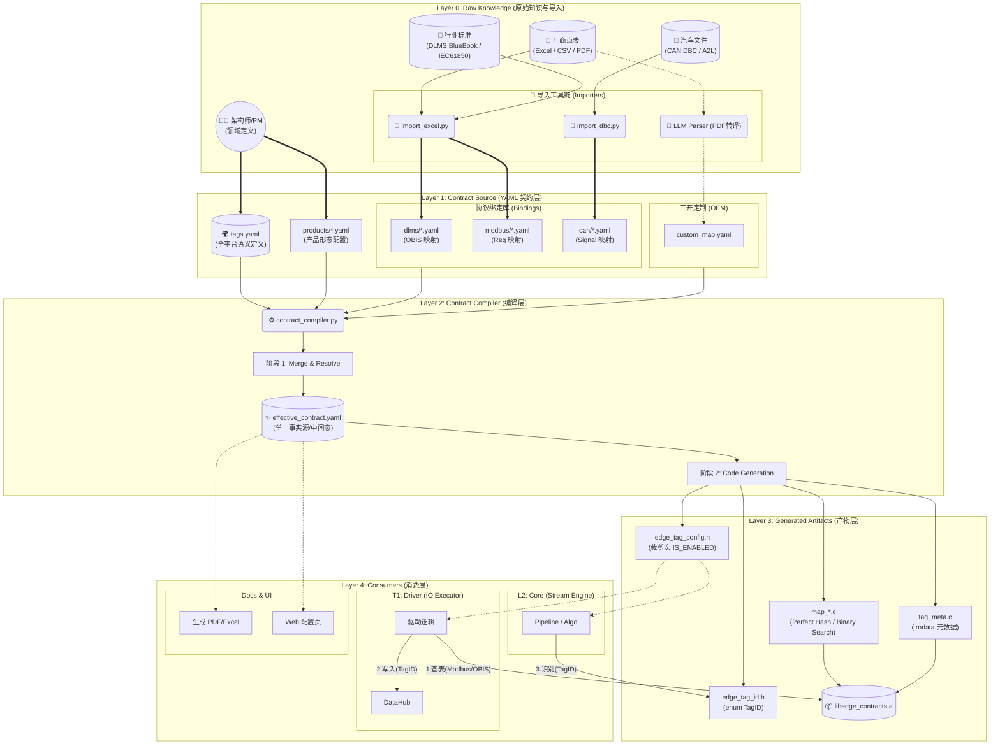

# EdgeOS (EdgeC) - 工业级边缘计算核心运行时 SDK


EdgeOS 是一个专为 **工业物联网 (IIoT)**、**能源管理系统 (EMS)** 和 **智能电网融合终端** 打造的高性能、确定性、事件驱动型边缘计算 SDK。它采用 C11 标准构建，核心基于 `libuv` 事件循环，旨在 15 年以上的超长生命周期内提供稳如磐石的服务。

---

## 🏗️ 1. 核心架构设计 (The "Four Planes" Architecture)

遵循 **core_v2.md** 规范，系统划分为四个物理隔离的逻辑平面，通过严密的契约层进行解耦。

### 1.1 系统平面分布
| 平面 | 库产物 | 职责描述 |
| :--- | :--- | :--- |
| **Foundation (L0)** | `contract_data_types.h` | **数据宪法**。定义元数据与协议映射的静态 Schema，不依赖任何库。 |
| **Foundation (L1)** | `libedge_core.a` | **核心底座**。包含 DataHub (总线)、NetBuf (内存池)、Params (参数中心)。 |
| **Control Plane** | `libedge_main_loop.a` | **决策中枢**。Arbiter (仲裁器)、Scheduler (调度器)、REST Server。 |
| **Compute Plane** | `libedge_stream_engine.a` | **计算引擎**。Stream Engine、Pipeline 调度、有状态 JS/Lua 算法。 |
| **Execution Plane** | `libedge_io_executor.a` | **南向执行**。基于 **Request 模型** 的场景化调度核心，解耦协议逻辑与 I/O 链路。 |

---

## 📜 2. 契约治理体系 (Contract Governance v2.0)

EdgeOS 采用“契约驱动开发 (CDD)”模式，通过 YAML 定义系统的“数据宪法”，并自动生成高性能的 C 语言查表代码。

### 2.1 契约四级模型 (Sprint 4 Omnis)
| 层级 | 文件路径 | 职责描述 |
| :--- | :--- | :--- |
| **L1: 全局语义** | `contracts/schema/tags.yaml` | **定义“是什么”**。规定 TagID、名称、单位、类型及 UI 展现元数据。 |
| **L2: 协议绑定** | `contracts/bindings/` | **定义“怎么拿”**。规定特定设备型号（如 Chint_DTSU666）的寄存器映射。 |
| **L3: 产品定制** | `cmd/<prod>/extension.yaml` | **定义“我要谁”**。配置功能裁剪及产品特有的逻辑扩展。 |
| **L4: 物理拓扑** | `cmd/<prod>/world.yaml` | **定义“在哪跑”**。描述真实/仿真环境的总线连接、设备地址及硬件模拟参数。 |

### 2.2 实战指南：新增一个“机柜温度”测点

#### 第一步：在全局字典中定义语义 (`tags.yaml`)
```yaml
- id: 1006
  name: CABINET_TEMP
  type: float
  unit: "C"
  attributes:
    ui: { group: "Environment", min: -20, max: 80, precision: 1 }
    northbound: { storage: "trend" }
```

#### 第二步：在 Modbus 点表中绑定物理地址 (`bindings/modbus/xxx.yaml`)
```yaml
mappings:
  - tag: CABINET_TEMP
    addr: 0x0100  # 对应硬件 256 寄存器
    scale: 0.1    # 原始值 255 -> 25.5 C
```

#### 第三步：在产品中启用该测点 (`extension.yaml`)
```yaml
enabled_tags:
  - CABINET_TEMP
```

#### 第四步：在 C 语言驱动中引用 (自动感知)
```c
// 驱动层无需修改代码，编译后自动支持：
float scale;
edge_tag_id_t id = edge_lookup_modbus(0x0100, &scale); 
// id 会自动变为 1006 (TAG_CABINET_TEMP)
```

### 2.3 全生命周期架构图 (v2.1)



---

## 🛠️ 3. 开发与构建

### 3.1 环境设置
为了获得完整的 Python 智能提示并确保契约编译器运行正常，建议初始化本地环境：
1. **一键配置**：运行 `bash tools/setup_env.sh`。
2. **IDE 适配**：将解释器路径设为 `./.venv/bin/python`。

### 3.2 目录规范
*   `src/core/`: 跨 Loop 核心组件。
*   `src/main_loop/`: 控制平面实现。
*   `src/stream_engine/`: 计算平面实现。
*   `src/io_executor/`: 执行平面实现。
*   `contracts/`: 全局契约定义文件。

### 3.2 构建专业布局
构建系统（CMake）会自动将产物组织为工业级布局：
```text
build/
├── sdk/lib/               # 通用 SDK 静态库
├── products/              # 产品隔离沙箱 (bin, lib, generated)
└── tests/                 # 统一测试套件
```

### 3.3 快速编译与测试
```bash
./build.sh          # 自动化生成契约代码、编译、并运行全量单元测试
./test.sh --omnis   # [推荐] 启动全链路仿真测试，包含 Matrix Server、内核引擎及交互式 UI
```

## 🚀 4. 核心演进 (Omnis Sprint 4 Highlights)

### 4.1 Request 模型场景化架构
`MasterEngine` 已进化为纯粹的任务调度器，通过 `edge_req_t` 接口支持多种业务场景：
*   **Legacy Driver**: 兼容现有的契约化驱动，支持 Modbus/DLMS 周期性抄读。
*   **Raw I/O**: 支持透传原始字节流，专为混沌工程和非标协议调试设计。
*   **无状态调度**: 引擎不再硬编码驱动逻辑，符号在运行时由 `main.c` 动态注入。

### 4.2 高性能内存调度器
为了支撑 10kHz 级采样与大规模采集并存：
*   **内存镜像队列**: 弃用 `uv_periodic` 中的同步 SQL 查询，改用 `queue.h` 实现的内存镜像任务链表。
*   **零抖动触发**: 调度分辨率达 100ms，任务检索耗时从毫秒级降至微秒级，保障了 DSP 算法的实时性。

### 4.3 交互式 TUI 仿真终端
`iems-cli` 伴生进程提供了基于 `ncursesw` 的 LCD 模拟界面：
*   **硬件无关 HAL**: 支持从仿真环境平滑迁移至真实工业串口屏。
*   **多页交互**: 提供实时仪表盘、测点清单、告警监测，支持 UTF-8 工业图标显示。

### 🌐 4.4 Web UI & REST API 实施进度 (对齐 web_ui_ia.md)

| 模块 | 核心特性 | 后端 API | 前端 View | 状态 |
| :--- | :--- | :--- | :--- | :--- |
| **核心宪法** | 元数据驱动渲染 | `/api/v1/contracts` | `ContractStore` | ✅ 完成 |
| **Dashboard** | 实时健康监测 | `/api/v1/system/health` | `Dashboard.vue` | ✅ 完成 |
| **Pipelines** | 实时运行拓扑 | `/api/v1/pipelines` | `PipelineList.vue` | ✅ 完成 |
| **数据分析** | 历史曲线/影子点查 | `/api/v1/data/query` | `DataCurves.vue` | ✅ 完成 |
| **参数管理** | KV 参数双向读写 | `/api/v1/system/config` | `SystemConfig.vue` | ✅ 完成 |
| **任务调度** | 时钟状态/任务清单 | `/api/v1/time/status` | `Scheduling.vue` | ⚠️ 部分完成 |
| **设备管理** | 拓扑展现/通信统计 | `/api/v1/devices` | `DeviceList.vue` | ⚠️ 部分完成 |
| **持久化** | 数据库指标监控 | `/api/v1/storage/status` | `Storage.vue` | ✅ 完成 |

---

## 📅 5. 路线图与待办事项 (TODO)

### 🚀 核心功能
- [x] **契约治理 v2.0**：实现类型与数据的物理隔离。
- [x] **Request 场景模型**：实现 MasterEngine 与业务逻辑的彻底解耦。
- [x] **高性能调度**：基于内存镜像的任务队列，消除 SQL 轮询抖动。
- [x] **UI HAL 架构**：支持 Unicode 图标的交互式 LCD 模拟器。
- [ ] **Lua/QuickJS 动态算法引擎**：支持有状态算法的在线热加载。

### 🌐 北向交互
- [x] **元数据下发接口**：`/api/v1/contracts` 接口已实装。
- [ ] **SQLite 历史点查 API**：完善曲线与账本查询。
- [ ] **Web UI 门户**：基于 Vue/React 实现动态元数据驱动的 HMI。

### 🛡️ 质量硬化
- [x] **100% 测试覆盖**：19 个核心测试用例全部 PASS。
- [ ] **抗跳变极限压测**：模拟 NTP 剧烈跳变下的冻结一致性。
- [ ] **全链路零拷贝**：跨线程数据交换全面切换为 `net_buf_t`。

---
