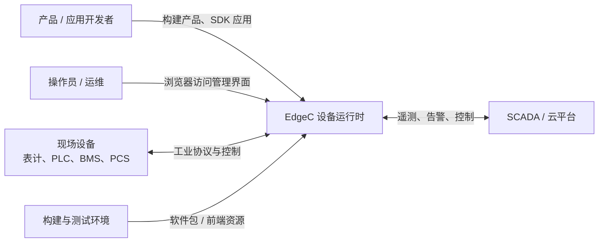
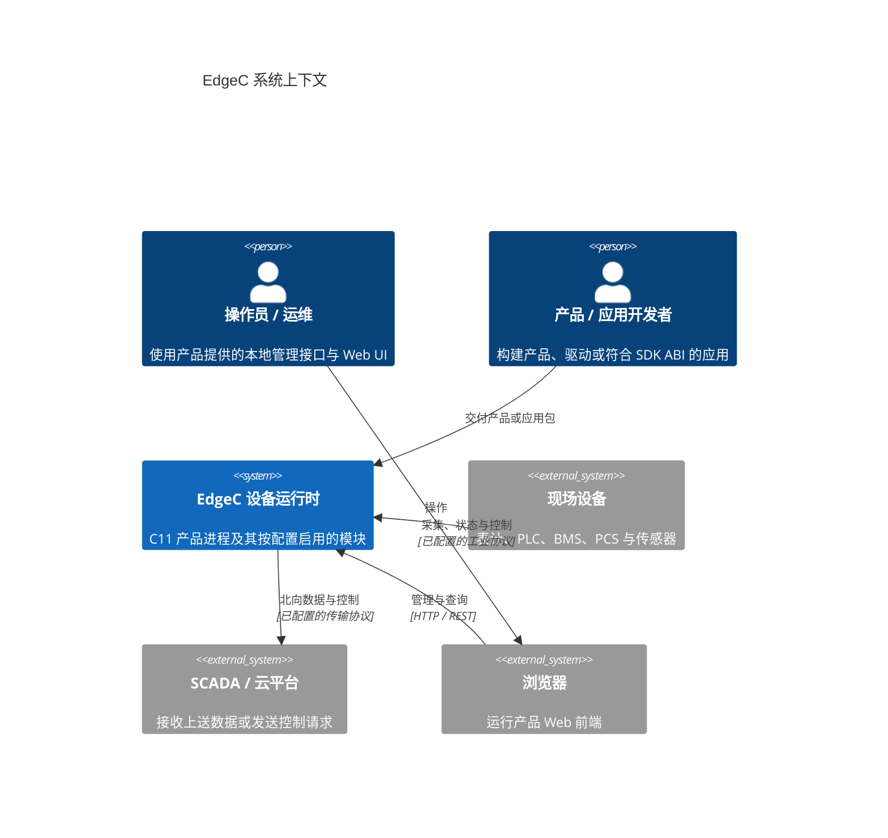
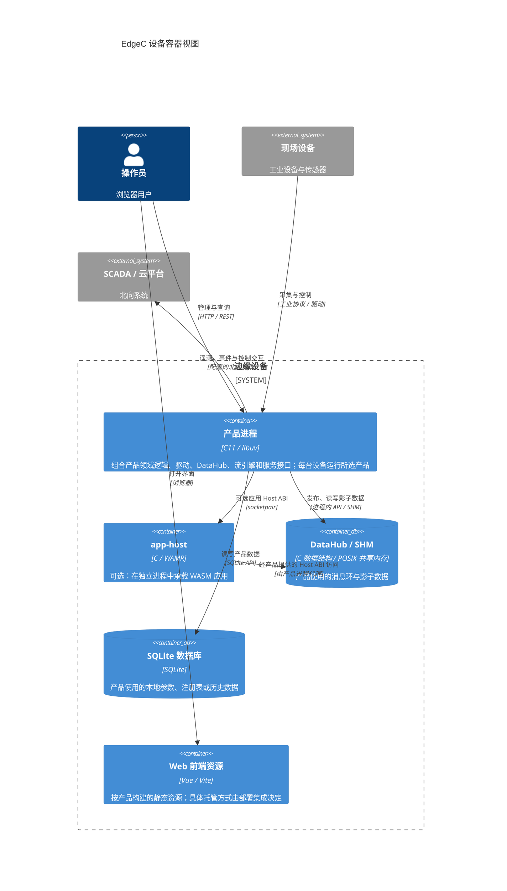
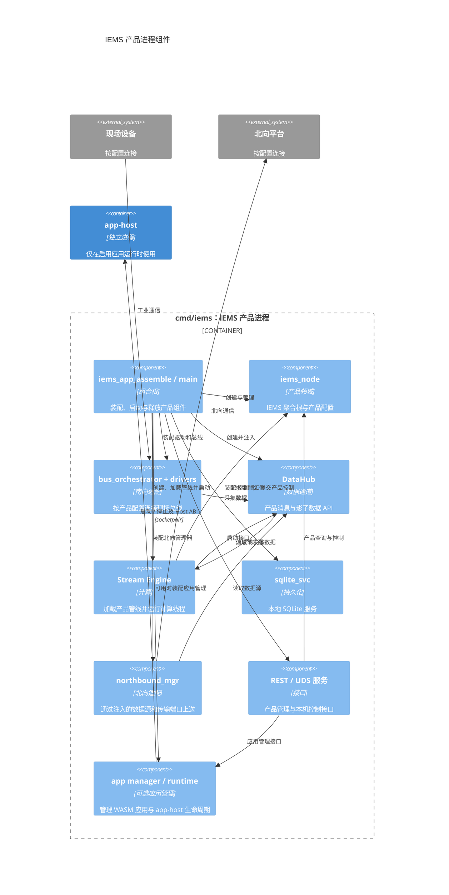
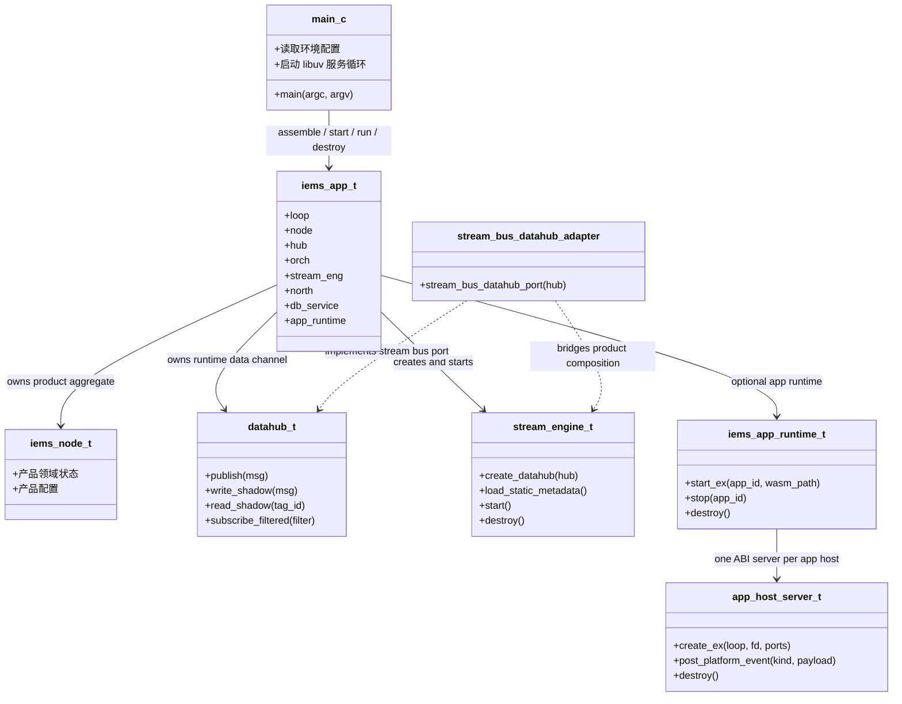
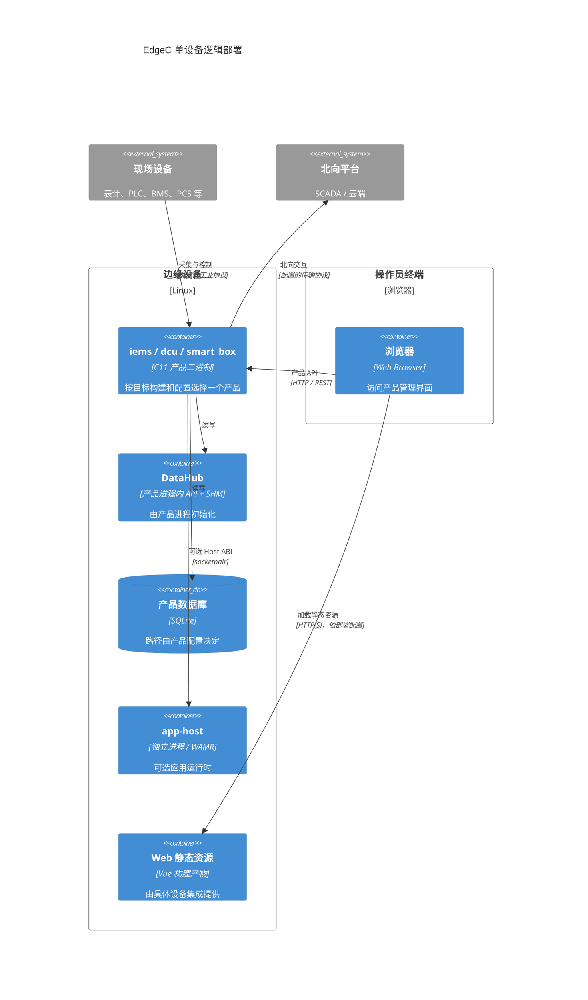

# EdgeOS / EdgeC

EdgeC 是面向工业边缘设备的 C11 运行时与 SDK，提供产品进程、工业通信接入、数据处理、REST 管理接口和可选的 WASM 应用宿主。仓库同时包含 IEMS、DCU、SmartBox 等产品代码，以及 Vue Web 前端、Go 工具/服务和跨语言应用 SDK；这些部分并不都作为一个必需的生产部署单元运行。

> 当前代码和文档仍在演进。架构图描述的是仓库可见的实现边界，不代表所有产品功能或部署组合都已达到生产验收状态。

## 架构一览（C4）

下面的图按系统、容器、组件、代码和运行时视角逐层放大。产品进程是运行时核心；外部现场设备和北向平台通过产品适配器交互。Go 服务只在相应工具或部署组合中使用，不能据此推断为所有设备的必需生产服务。

### L0：系统全景



### L1：系统上下文



### L2：容器与部署单元

图中 DataHub 是产品进程使用的数据通道和共享内存区域，不是独立服务进程。WASM `app-host` 是可选的独立进程；产品代码通过 socketpair 与其通信。Web 前端是独立构建的静态资源，由具体部署方式提供。



### L3：IEMS 产品进程组件

这是 `cmd/iems/iems_app.c` 的装配视图。不同产品有各自的组合根和模块组合，不能把此图直接套用到 DCU 或 SmartBox。



### L4：关键代码关系



### 运行时交互：南向采集到流计算

```mermaid
C4Dynamic
    title IEMS 遥测处理路径

    Container_Ext(field, "现场设备", "设备", "响应产品采集请求")
    Container(bus, "bus_orchestrator / driver", "C", "协议驱动与总线编排")
    Container(hub, "DataHub", "C / SHM", "消息与影子数据")
    Container(stream, "Stream Engine", "C", "监听数据并执行管线")
    Container(node, "iems_node", "C", "产品领域逻辑")

    Rel_Index(1, bus, field, "发起采集 / 接收响应", "工业协议")
    Rel_Index(2, bus, hub, "发布采集值", "DataHub API")
    Rel_Index(3, hub, stream, "更新消息并通知监听者", "ring / libuv async")
    Rel_Index(4, stream, node, "向产品控制端口提交管线结果", "注入的回调")
    Rel_Index(5, node, bus, "经产品控制路径发起执行", "产品端口 / 驱动")
```

### Deployment：单设备逻辑部署



## 主要目录

| 路径 | 用途 |
| --- | --- |
| `cmd/` | 产品与程序入口，包括 `iems`、`dcu`、`smart_box`、`app-host` 和 launcher。 |
| `modules/` | 可复用运行时模块，例如 `edge_core`、`edge_io`、`edge_stream`、`edge_api`、`edge_app_host`。 |
| `adapters/` | 将模块端口连接到平台、驱动、SQLite、REST 和 MQTT 等实现。 |
| `foundation/` | 通用基础类型、算法、协议编解码与缓冲池。 |
| `sdk/` | WASM 应用 ABI/WIT 与 C、Python、Go、JavaScript SDK。 |
| `web/` | Vue/Vite 前端、产品包、共享 Core、构建工具和前端测试。 |
| `tests/`、`fuzz/`、`acceptance/` | 单元/集成测试、模糊测试与产品验收台架。 |
| `docs/` | 设计、ADR、开发手册和协议资料。 |
| `go/` | Go 工具和服务代码；具体服务用途以各自文档和启动方式为准。 |

## 构建与测试

核心使用 CMake 构建，默认启用 Web 前端构建。需要 CMake、Ninja、C11 编译器、Python 3，以及 `CMakeLists.txt` 中查找的本地/第三方依赖（包括 libuv、cJSON、SQLite、ZLIB、zlog、Paho MQTT、CURL、QuickJS、iwasm、cmocka 和 OpenSSL）。依赖安装与目标平台有关。交叉编译请使用 `cmake/toolchains/` 中对应的工具链文件。

```bash
# 配置并构建 C 核心；关闭前端可避免此步骤调用 Web 构建
cmake -S . -B build -G Ninja -DCMAKE_BUILD_TYPE=Release -DENABLE_WEB_BUILD=OFF
cmake --build build -j2

# 运行 CTest 测试
ctest --test-dir build --output-on-failure

# 运行架构与卫生守卫（正反夹具 + 活树检查）
python3 ci/scripts/run_guard_selftest.py
```

若要运行 Web 前端测试或构建，请进入 `web/` 并用仓库锁文件安装依赖：

```bash
cd web
npm ci
npm run test:unit
npm run build:all
```

`./test.sh` 提供已配置 `build/` 的 C 单元测试入口。产品验收由独立的 `test-platform` 按 `acceptance/testplatform.sha` 固定版本驱动：

```bash
./test.sh
./test.sh --omnis
```

## 产品与架构约定

- 产品组合根位于 `cmd/<product>/`；IEMS 的入口与装配分别见 `cmd/iems/main.c`、`cmd/iems/iems_app.c`。
- 共享模块依赖通过消费者定义的端口和 `adapters/` 注入，产品领域逻辑由产品自身维护。
- ADR-0010 已决定废除全局中心化契约编译器和全局数字 TagID 的架构方向；`contracts/` 不应被当作新的全局产品点表来源。参见 [`docs/adr/0010-eliminate-global-contracts-and-tagid.md`](docs/adr/0010-eliminate-global-contracts-and-tagid.md)。
- WASM 应用 ABI 的当前约定和已知限制见 [`sdk/README.md`](sdk/README.md) 与 [`docs/wasm_micro_app_guide.md`](docs/wasm_micro_app_guide.md)。不要将设计目标或未接通的 ABI 能力当作已交付功能。

## 进一步阅读

- [开发手册](docs/EDGEOS_DEV_HANDBOOK.md)
- [IEMS 上下文](cmd/iems/CONTEXT.md)
- [Web 前端说明](web/README.md)
- [SDK ABI 与一致性测试](sdk/README.md)
- [设计决策（ADR）](docs/adr/)
- [开发路线图](ROADMAP.md)
