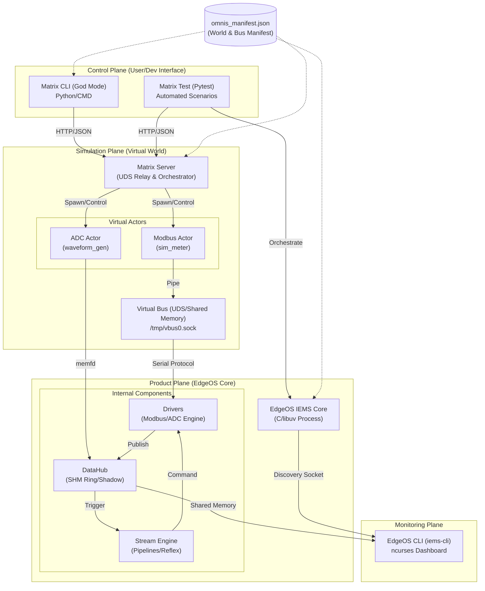

# EdgeOS (EdgeC) - 工业级边缘计算核心运行时 SDK


EdgeOS 是一个专为 **工业物联网 (IIoT)**、**能源管理系统 (EMS)** 和 **智能电网融合终端** 打造的高性能、确定性、事件驱动型边缘计算 SDK。它采用 C11 标准构建，核心基于 `libuv` 事件循环，旨在 15 年以上的超长生命周期内提供稳如磐石的服务。

---

## 🏗️ 1. 核心架构设计 (Microkernel & Clean Architecture)

EdgeOS 遵循微内核、整洁架构（Clean Architecture）与领域驱动设计（DDD）规范，系统划分为四个物理隔离的逻辑平面，严格遵循依赖倒置原则（DIP）与消费者定接口原则：

### 1.1 系统平面分布

| 平面                | 产物/目录                 | 职责描述                                                                        |
| :------------------ | :------------------------ | :------------------------------------------------------------------------------ |
| **Foundation (L0)** | `contract_data_types.h`   | **基础类型定义**。定义标量、时间戳、质量码与无外部依赖的通用数据结构。         |
| **Foundation (L1)** | `libedge_core.a`          | **核心底座**。包含 DataHub (Outbound 通道/SHM Ring)、NetBuf (内存池)、Params。 |
| **Control Plane**   | `libedge_main_loop.a`     | **决策中枢**。包含 Arbiter (仲裁器)、Scheduler (调度器) 与控制循环。            |
| **Compute Plane**   | `libedge_stream_engine.a` | **计算引擎**。Stream Engine、Pipeline 实时计算、WASM 算子沙箱。                |
| **Execution Plane** | `libedge_io_executor.a`   | **南向执行**。基于 Request 模型的南向协议执行核心，协议编解码与 I/O 链路解耦。 |
| **Product Plane**   | `cmd/<product>/`          | **产品专属聚合根与组合根**。DCU、IEMS、SmartBox 自治领域模型与事件编排。        |

---

## 🏛️ 2. 领域驱动自治与事件驱动架构 (DDD & EDA, ADR-0010)

基于 **ADR-0010 (No-TagID, No-Contract, No-Contract-Compiler)**，系统彻底废除了全局中心化 YAML 契约编译器与统一连续数字 TagID 反模式，全面演进为 **产品聚合根自治**、**强类型领域方法** 与 **自描述领域事件广播** 体系。

```
                                  ┌─────────────────────────────┐
                                  │   北向网络 / 外部消费端      │
                                  │   (MQTT / REST / Web UI)    │
                                  └──────────────▲──────────────┘
                                                 │ 统一标准 JSON / 领域语义
                                  ┌──────────────┴──────────────┐
                                  │      北向协议适配层 (ACL)    │
                                  └──────────────▲──────────────┘
                                                 │ 领域事件广播 (dcu_domain_event_t) / 强类型调用
┌────────────────────────────────────────────────┴────────────────────────────────────────────────┐
│ 产品专属聚合根 / 编排组合根 (cmd/<product>/)                                                    │
│                                                                                                 │
│   ┌─────────────────────────────────────────┐       ┌───────────────────────────────────────┐   │
│   │   领域模型与业务状态机 (Aggregate Root)   │       │   动态散列槽位分发 (No-Array Slot Map) │   │
│   │   • DCU: 电力 698 32-bit OAD / 645 DI   │ ◄───► │   • 动态散列算术映射 (Zero Static Table)  │   │
│   │   • IEMS: 工业寄存器 / BMS 拓扑         │       │   • 设备与测点槽位完全动态隔离        │   │
│   │   • 业务不变量校验与控制防误动作拦截    │       └──────────────────┬────────────────────┘   │
│   └────────────────────▲────────────────────┘                          │ 槽位索引               │
│                        │ 强类型领域方法 (feed / control)                │                        │
│   ┌────────────────────┴────────────────────┐       ┌──────────────────▼────────────────────┐   │
│   │   南向防腐适配层 (ACL Adapter)          │       │   DataHub 影子存储与 IPC 通道         │   │
│   │   • 协议自描述规约直通                  │       │   • 无锁 SeqLock 高频读瞬时快照       │   │
│   │   • 动态参数与量纲解析                  │       │   • POSIX SHM Ring 零拷贝进程间通信   │   │
│   └────────────────────▲────────────────────┘       └───────────────────────────────────────┘   │
└────────────────────────┼────────────────────────────────────────────────────────────────────────┘
                         │ 原始工业报文 / 帧驱动
┌────────────────────────┴────────────────────────────────────────────────────────────────────────┐
│ 南向工业协议栈与驱动模板 (modules/edge_protocol & edge_io)                                      │
│ (DL/T 698.45, DL/T 645, Modbus RTU/TCP, IEC 104, CAN 协议，纯 C 算法，100% 零业务依赖)        │
└─────────────────────────────────────────────────────────────────────────────────────────────────┘
```

### 2.1 核心设计原则

1. **聚合根自治 (Aggregate Root Autonomy)**：
   - 彻底废除全局 YAML 契约与离线编译器，彻底消除 Go 语言编译链依赖；
   - 每个产品在 `cmd/<product>/` 维护专属聚合根（如 `dcu_node_t`），内部使用行业原生领域标识（如电力 DCU 原生使用 32-bit OAD 与 645 DI，储能 IEMS 使用电池簇寄存器），**彻底消灭 OAD ↔ TagID 的双重运行时翻译开销**。
2. **强类型领域方法防护业务不变量**：
   - 南向采集与北向控制严禁直接穿透物理底层数据表；
   - 采集输入调用强类型领域方法（如 `dcu_node_feed_meter_reading`），由聚合根自治执行电表建档校验、越限告警判定与防爆刷控制；
   - 遥控执行调用控制领域方法（如 `dcu_node_execute_control`），内置防误操作白名单拦截。
3. **自描述领域事件广播（微服务架构就绪）**：
   - 聚合根产生状态变更时，对外派发统一自描述领域事件（`dcu_domain_event_t`）；
   - 通过挂接事件回调，无论未来服务是单体运行、还是拆分为独立进程/微服务容器，均可通过消息总线（MQTT、UDS、RPC）直接解耦对接。
4. **DataHub 角色归位为 Outbound 通道**：
   - DataHub 不再充当全局集中式“上帝测点字典”；
   - 降级为聚合根背后的**高性能发布与影子存储通道**（提供 POSIX SHM Ring 零拷贝跨进程 IPC、无锁 SeqLock 瞬时快照及 DDS 跨节点发布）；
   - 槽位映射全面采用**动态算术散列分发**，彻底消灭单机集中式静态数组点表。
5. **南向协议自描述直通**：
   - 充分发挥规约自身自描述特性（如 DL/T 698.45 报文自带 32-bit OAD 与 ASN.1 类型），解码器解析后直通领域方法，无需冗余静态表。

---

## 🛠️ 3. 开发、构建与架构门禁

### 3.1 极速纯 C 构建 (Zero-Go Dependency)

得益于 ADR-0010 对全局契约编译器的拔除，工程实现了纯净的 C 语言原生工具链构建，摆脱了外部脚本与 Go 运行时的捆绑：

```bash
# 1. 极速全量编译 (结合 CCache 毫秒级增量响应)
cmake -B build -G Ninja
ninja -C build

# 2. 运行架构门禁与无契约防退化守护
./scripts/check_architecture_layers.sh
./scripts/check_generated_drift.sh

# 3. 运行全量单元与集成测试套件 (245 项测试全覆盖)
./test.sh
```

### 3.2 CI 架构防腐与防退化门禁 (Architecture Guards)

CI 流水线内建了严密的整洁架构守卫脚本（`check_architecture_layers.sh`），实施 11 项物理门禁校验：
- **聚合根边界封装 (Aggregate Root Boundary)**：禁止任何外部代码跨层篡改聚合根私有状态；
- **组合根唯一性 (Composition Root Exclusivity)**：全局生命周期装配严格收敛于组合根；
- **开闭原则守护 (OCP Gate)**：禁止在核心路由层出现单体静态数组或庞大的硬编码 switch-case；
- **单一职责守护 (SRP Gate)**：物理隔离领域逻辑、南向驱动防腐层与存储持久化；
- **无全局契约防退化守卫 (ADR-0010 Guard)**：严格校验全局 0 编译器、0 全局 contracts.h 污染。

## 🚀 4. 核心演进 (Omnis Sprint 4 Highlights)

### 4.1 Request 模型场景化架构

`MasterEngine` 已进化为纯粹的任务调度器，通过 `edge_req_t` 接口支持多种业务场景：

- **Protocol Driver**: 标准工业协议驱动，支持 Modbus/DLMS/698/645 周期性抄读与自描述解码。
- **Raw I/O**: 支持透传原始字节流，专为混沌工程和非标协议调试设计。
- **无状态调度**: 引擎不再硬编码驱动逻辑，符号在运行时由 `main.c` 动态注入。

### 4.2 高性能内存调度器

为了支撑 10kHz 级采样与大规模采集并存：

- **内存镜像队列**: 弃用 `uv_periodic` 中的同步 SQL 查询，改用 `queue.h` 实现的内存镜像任务链表。
- **零抖动触发**: 调度分辨率达 100ms，任务检索耗时从毫秒级降至微秒级，保障了 DSP 算法的实时性。

### 4.3 交互式 TUI 仿真终端

`iems-cli` 伴生进程提供了基于 `ncursesw` 的 LCD 模拟界面：

- **硬件无关 HAL**: 支持从仿真环境平滑迁移至真实工业串口屏。
- **多页交互**: 提供实时仪表盘、测点清单、告警监测，支持 UTF-8 工业图标显示。

### 🌐 4.4 Web UI & REST API 实施进度 (对齐 web_ui_ia.md)

| 模块          | 核心特性          | 后端 API                 | 前端 View          | 状态        |
| :------------ | :---------------- | :----------------------- | :----------------- | :---------- |
| **测点与元数据** | 元数据自适应驱动渲染 | `/api/v1/contracts`      | `ContractStore`    | ✅ 完成     |
| **Dashboard** | 实时健康监测      | `/api/v1/system/health`  | `Dashboard.vue`    | ✅ 完成     |
| **Pipelines** | 实时运行拓扑      | `/api/v1/pipelines`      | `PipelineList.vue` | ✅ 完成     |
| **数据分析**  | 历史曲线/影子点查 | `/api/v1/data/query`     | `DataCurves.vue`   | ✅ 完成     |
| **参数管理**  | KV 参数双向读写   | `/api/v1/system/config`  | `SystemConfig.vue` | ✅ 完成     |
| **任务调度**  | 时钟状态/任务清单 | `/api/v1/time/status`    | `Scheduling.vue`   | ⚠️ 部分完成 |
| **设备管理**  | 拓扑展现/通信统计 | `/api/v1/devices`        | `DeviceList.vue`   | ⚠️ 部分完成 |
| **持久化**    | 数据库指标监控    | `/api/v1/storage/status` | `Storage.vue`      | ✅ 完成     |

---

## 📅 5. 仿真环境/测试系统与本地UI

仿真环境与核心产品之间的关系，我们可以将其划分为三个主要平面：控制面 (Control Plane)、仿真面 (Simulation Plane) 和 产品面 (Product Plane)。



角色详细说明：

1. Simulation Plane (仿真面 - Matrix)

- Matrix Server: 充当“物理世界”的管理器。它创建 UDS Relay (虚拟交换机)，并根据仿真拓扑配置加载对应的 Actors。
- Actors (Actors/simulators): 模拟真实硬件行为。例如 modbus.py 模拟一个电表，它监听虚拟总线并响应 IEMS 的请求。
- Virtual Bus: 使用 Unix Domain Socket 模拟 RS485/CAN 总线，使 C 端代码无需修改即可运行。

2. Product Plane (产品面 - EdgeOS)

- EdgeOS IEMS: 待测的二进制核心程序。它通过环境变量（如 OMNIS_BUS_0_DEV）识别“总线”在哪里。
- DataHub: 高性能 Outbound 发布与影子存储通道。提供 POSIX SHM Ring 零拷贝进程间通信与 SeqLock 瞬时快照。
- Stream Engine: 处理业务逻辑。例如“发现电压 > 264V 则拉掉继电器”的 REFLEX 逻辑就在此运行。

3. Control Plane (控制面 - CLI & Test)

- Matrix CLI: 允许开发人员手动干预仿真世界。例如：set METER_MAIN VOLTAGE 280V。它不直接修改 IEMS，而是修改 Actor 的寄存器，观察 IEMS 是否能检测到并触发保护。
- Matrix Test: 自动化的“剧本”执行器。它加载 YAML 场景，控制时间轴，并对 DataHub 的状态进行断言。

4. Monitoring Plane (监控面 - iems-cli)

- EdgeOS-CLI: 一个独立的监控工具。
- 关系: 它通过 Discovery Socket 向 IEMS 索要共享内存的 FD，然后直接读取 IEMS 的内存视图进行高频刷新显示。它证明了 EdgeOS 的 多进程解耦能力。

数据流向示例（过压保护场景）：

1.  Matrix CLI 发送 set VOLTAGE 285。
2.  Matrix Server 更新 Modbus Actor 的虚拟寄存器。
3.  IEMS Drivers 轮询总线，读到 285V，写入 DataHub。
4.  Stream Engine 被唤醒，触发 REFLEX 逻辑，产生“关断继电器”指令。
5.  IEMS Drivers 执行指令，通过虚拟总线写入 Modbus Actor。
6.  iems-cli 屏幕上同时跳变，显示电压超标及继电器状态变为 CLOSED。

---

## ⚡ 6. 高频采样与波形分析 (Sprint 5 Ion)

为了满足工业级波形分析（如谐波监测、暂态捕捉）的需求，EdgeOS 在 Sprint 5 引入了代号为 **"Ion"** 的高频数据处理架构，支持千万级（10MHz）采样吞吐。

### 6.1 零拷贝所有权转移机制

针对 10MHz 采样率下的 CPU 瓶颈，系统弃用了传统的字节流拷贝，改用基于 **匿名内存 (memfd)** 的所有权转移协议：

1.  **8 缓冲环池**：仿真端（Python Actor）预分配 8 个 1MB 的 `memfd` 块，形成循环缓冲。
2.  **FD 动态分发**：利用 Unix Domain Socket 的 `SCM_RIGHTS` 控制消息，将内存文件描述符从 Actor 发送至 Core 进程。
3.  **零拷贝映射**：Core 进程在独立线程接收 FD 后，直接通过 `mmap` 将数据映射到本地地址空间，避免了跨进程的数据拷贝。

### 6.2 信号合成与工况引擎 (Python Side)

`adc_simulator.py` 演进为可扩展的波形引擎，支持多种真实电力工况模拟：

- **叠加算子**：支持基础正弦波、指定阶数谐波、高斯白噪声的向量化叠加（基于 NumPy）。
- **动态控制**：通过 `matrix-cli` 或自动化脚本，可以在运行时动态调整频率（Freq Shift）、幅值（Surge/Sag）或谐波含量。

### 6.3 原生 DSP 算子与管线逻辑

系统引入了 **Native C 算子** 以应对极高吞吐的计算需求：

- **`dsp_rms` 算子**：直接在 `TYPE_REF` 内存引用上执行平方和根计算，产出 `ADC_VOLTAGE_RMS` 业务点位。
- **管线协同**：`dsp_processor` 管线负责高频计算，其产出的有效值可直接触发 `overvoltage_protection` 等业务保护管线，实现了从“原始波形”到“业务控制”的毫秒级闭环。

### 6.4 性能参考

| 指标           | 性能表现        | 备注                         |
| :------------- | :-------------- | :--------------------------- |
| **采样频率**   | 100kHz - 10MHz  | 取决于宿主机系统调度性能     |
| **缓冲区管理** | 8 块 memfd 循环 | 提供 ~200ms 抖动容差         |
| **跨进程延迟** | < 1ms           | 基于 SCM_RIGHTS 所有权转移   |
| **内存拷贝**   | 0 拷贝          | 计算过程直接在共享映射区进行 |

---

## 🌐 7. 微服务自治、契约融合与构建优化 (Sprint 6/7 Dynamic Mesh)

为了支持边缘智能算法的自治演进，我们在 Sprint 6/7 引入了 **“动态微服务网络与契约融合 (Dynamic Mesh & Contract Fusion)”** 架构，实现了南向与北向平面的安全无缝联调。

### 7.1 动态微服务注册与契约融合 (TSK-01 & TSK-01.1)

在传统的边缘系统中，新增算法微服务通常需要修改网关代码并重启网关。EdgeOS 引入了热插拔的契约自描述架构：
- **`/api/v1/internal/registry` 注册端点**：外部微服务（如 Go 编写的算法微服务）在启动时，主动向 `edge-gateway` 汇报自身的 `Prefix`、`Port` 以及自定义的 **`Tags` (点表元数据)** 和 **`UIConfigs` (前端大盘渲染配置)**。
- **内存 Schema 融合 (Schema Fusion)**：网关内部持有读写锁保护的融合表，在不重启网关的前提下，动态将新注册的测点注入全局点表字典（fusedTags），将卡片编排注入 BFF 缓冲池，瞬间完成路由热加载与点位扩容。

### 7.2 BFF 引导与自适应渲染 (TSK-03)

为了避免前端页面加载时因串行请求多个微服务的契约配置而产生过多网络往返（RTT），网关设计了统一的 BFF 引导接口：
- **`GET /api/v1/ui/bootstrap` 端点**：前端 HMI 仅需一次 RTT，即可获取静态编译点表与所有动态注册服务上报的 Fused Tags 及 UI 排版，大盘据此实现自适应的即插即用渲染。

### 7.3 C 侧引擎死锁治理与线程安全保障

在 WASM 热装载与高频定时任务（如 100ms 级的 `on_tick`）并发执行的环境中，系统对计算流拓扑的并发访问进行了防弹级加固：
- **修复 uninitialized `pipe_mutex` 缺陷**：补齐了 C 服务引擎在 `stream_engine_create_ex` 中缺失的 `uv_mutex_init`，彻底消灭了获取拓扑 `/api/v1/stream/topology` 时的未定义行为挂挂起死锁。
- **保护 `pipeline_add_stage` 临界区**：利用 `pipe_mutex` 同步动态 stage 挂载与后台计算线程的队列遍历，修复了 `stream_dump.c` 中的**指针退化（array decay）无限循环 Bug**，保障了拓扑热装载与实时流计算的物理确定性。

### 7.4 构建系统性能与稳定性双向优化 (Build Optimization)

为加速本地调试、缩短闭环时间并提高构建在资源受限容器内的成功率，构建系统新增了以下特性：
- **CCache 原生集成**：CMakeLists 自动检测并优先使用本地 `ccache` 缓存编译，使后续的 C 语言增量与重新配置构建耗时骤降 90%。
- **ENABLE_WEB_BUILD 条件构建**：新增 CMake 选项 `-DENABLE_WEB_BUILD=ON/OFF`。当专注于 C 侧后台调试时，可选择关闭 npm 和 Vite 静态前端构建，省去每次编译时重复执行前端 bundler 的开销。
- **链接并行度控制**：在 CTest 用例数高达 80+ 个的系统中，通过降低 Ninja 的链接并行度（如 `-j2`）以约束 `ld` 并发数，彻底避免了容器环境物理内存被撑爆发生 OOM 的重大痛点。

---

## 👵 8. 智能养老健康终端协同 (Smart Box System - Sprint 8)

为了响应适老化健康监护和家庭安全防卫需求，EdgeOS 衍生并集成了 **Smart Box** 养老智能监护系统，打通了物理控制底座、Web API 慢车道网关及 Wasm 实时边缘 AI 算子的完整协同机制：

### 8.1 物理控制底座 (C 语言实现)
底座代码位于 `cmd/smart_box/main.c`，利用 `libuv` 维持高性能事件循环：
- **指示灯渲染**：读取 DataHub 状态更新红、黄、绿三色 GPIO（23/24/25），控制指示状态。
- **物理 SOS 紧急求救**：epoll 边缘触发（GPIO 26）下降沿中断，判定大按钮按下并立即触发本地报警。
- **隐私沙盒断电**：当隐私模式激活时，拉低 GPIO 29 和 31 强制切断摄像头和麦克风的 VCC 物理供电。
- **电池监测**：通过 I2C 1 (地址 `0x34`) 轮询 AXP209 PMIC 电池电源状态。
- **南向多协议外设接入**：支持 NFC 读卡（PN532 SPI）、外骨骼康复控制（Modbus RTU串口）和 BLE GATT 心率手环的驱动交互。

### 8.2 Web API 与业务网关 (Go 语言实现)
网关代码位于 `go/cmd/smart-box-gateway/main.go`，提供慢车道数据与安全合规逻辑：
- **GDPR 被遗忘权与零擦除**：`/api/v1/privacy/purge` 事务内删除用户记录并在事务外加全局锁执行 `VACUUM;` 强制磁盘数据页重置归零。
- **AES-256-GCM 敏感数据加密**：本地数据均采用对称加密算法混淆并进行消息认证。
- **区块链存证锚定**：计算哈希并使用 ECDSA 私钥对存证信息进行 64 字节对齐的 Base64 编码签名存储。

### 8.3 C↔Go 双轨通信 (UDS 二进制 IPC)
底座与网关之间采用 UNIX Domain Socket (`/tmp/smart_box_ipc.sock`) 建立高可靠性的二进制字节帧交互通道：
- **帧字节布局**：
  `Magic (0x5342 - "SB") | MsgType (1B) | Length (1B) | Payload (NB) | Checksum (1B, XOR)`
- **主要消息定义**：
  - `MsgType == 2`：NFC 扫卡发现外设并发送 NDEF JSON 报文，网关自动在 SQLite 库的 `devices` 表中注册设备。
  - `MsgType == 3`：SOS 紧急求助事件。

### 8.4 边缘实时 Wasm AI 算子
跌倒与健康状态分析通过嵌入式安全 Wasm 容器（基于 WAMR 沙箱）在 `modules/edge_stream/src/wasm_runtime/rehab_companion.c` 中运转：
- **跌倒判定**：采用 **SVM (信号矢量幅值) + SMA (信号幅值面积)** 双指标算法判定瞬间空中失重（连续 10 次 $SVM < 0.2G$）、强碰撞（$SVM > 3.2G$）与碰撞后人体动力学静躺昏迷状态（$SMA < 0.4G$），有效清除了由于床铺跌落、拾物弯腰等产生的误报。
- **心率异常监控**：心率低于 50 或高于 140 BPM 时实时触发系统状态告警和红灯闪烁。

