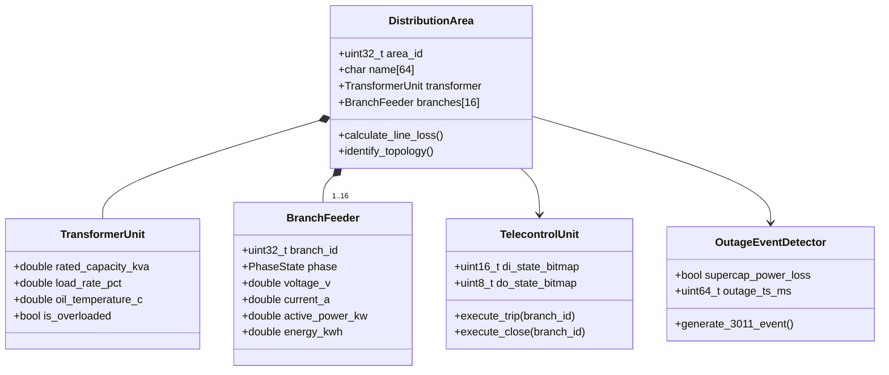

# DCU 限界上下文规范 (Smart Distribution Controller Context)

> **所属域**: 配电智能融合终端 / 低压能源控制器 (TTU)  
> **设计模式**: Domain-Driven Design (DDD) & Clean Architecture  
> **代码物理路径**: `cmd/dcu/`

---

## 1. 领域模型全景 (Domain Model Overview)

DCU 领域负责国网/南网台区低压配电网的智能化监控、四遥测控、多分支拓扑与线损分析、停电主动上报及 DLT698.45 / ESAM 国密安全规约交互。

---

## 2. 核心聚合根与实体 (Aggregates & Entities)

### 2.1 台区与线损聚合根 (`DistributionArea`)
- **实体属性**:
  - `area_id`: 台区唯一编码；
  - `transformer`: 配电变压器物理实体（容量、负载率、顶层油温、三相不平衡度）；
  - `branches[16]`: 16 路低压出线分支实体（各相电压、电流、有功功率、反向功率、累计电量）；
- **领域服务/行为**:
  - `calculate_line_loss()`: 动态计算供入电量与供出电量差值，判定异常线损；
  - `identify_topology()`: 基于载波/微功率无线特征识别用户表计所挂载的出线与相位。

### 2.2 四遥测控实体 (`TelecontrolUnit`)
- **遥信 (YX / DI)**: 16 路无源干接点输入状态与防抖过滤；
- **遥控 (YK / DO)**: 8 路继电器分合闸输出、双确认机制与闭锁逻辑；
- **遥测 (YC)**: 电压、电流、频率、功率因数、谐波畸变率 (THD)；
- **遥调 (YT)**: 有载分接开关 (OLTC) 档位与电容器无功补偿投切。

### 2.3 停电与事件记录实体 (`OutageDetector` / `SOERecord`)
- **停电侦测**: 毫秒级电容失电捕获、生成 DLT698 `3011` 事件；
- **SOE 记录**: 包含精确微秒级时间戳、事件类型（过流跳闸、相失压、温度超限）与前后物理快照。

---

## 3. 统一语言对照表 (Ubiquitous Language Dictionary)

| 术语 (中文) | 英文术语 (Ubiquitous Term) | 代码符号 / 结构体 | 头文件 / 规约标识 | 业务定义与含义 |
|---|---|---|---|---|
| **台区节点** | DCU Node / Distribution Area | `dcu_node_t` | `cmd/dcu/dcu_node.h` | DCU 产品运行态聚合根，统一持有档案、存储、轮询与 DataHub |
| **分支线损与拓扑** | Branch Line Loss & Topology | `dcu_topology_engine_t`、`dcu_substation_analytics_t` | `cmd/dcu/dcu_topology_lineloss.h` | 出线端供电量与用户表总售电量的线损分析及相别拓扑识别 |
| **四遥测控** | Telecontrol (4-Tele) | `dcu_telecontrol_manager_t` | `cmd/dcu/dcu_peripheral_telecontrol.h` | 遥测(YC)、遥信(YX)、遥控(YK)、遥调(YT)的统称与防误闭锁 |
| **停电主动上报** | Outage Proactive Report | `dcu_outage_detector_t` | `cmd/dcu/dcu_outage_detector.h` / DLT698 `0x3011` | 终端掉电瞬间利用超级电容侦测并生成停电事件 |
| **事件顺序记录** | Sequence of Events (SOE) | `dcu_soe_event_engine_t`、`dcu_soe_event_record_t` | `cmd/dcu/dcu_soe_event_engine.h` | 带有精确时标的开关变位、失压或过流告警历史记录 |
| **国密安全单元** | ESAM Security Module | `dcu_esam_t` | `cmd/dcu/dcu_security.h` / DLT698 `0xF100` | 软件模拟保留 C API；698 面无硬件来源，按类定义如实回 DAR 5 |
| **时段费率** | TOU Tariff | `dcu_tou_tariff_table_t` | `cmd/dcu/dcu_dlt698_mgmt_engine.h` | 尖峰平谷不同时段的电价与计费模板 |
| **698 对象与类型值** | 698 Object & Typed Value | `dcu_698_object_t`、`dcu_value_t` | `cmd/dcu/dcu_698_object_model.h`、`cmd/dcu/dcu_698_var.h` | DL/T 698.45 接口类对象行、掩码与带量纲/A-XDR 标签的值模型 |

---

## 4. 当前实现与 698 覆盖状态

本节只写与 `feat/dcu` 代码一致的事实，细节见所列文件与设计文档。计划与排期不在本文件维护。

### 4.1 模块分组

对应 `cmd/dcu/CMakeLists.txt` 中 `dcu_app_lib`（49 个源文件）与入口 `cmd/dcu/main.c`（共 50 个编译单元）：

| 分组 | 文件 | 职责 |
|---|---|---|
| 组合根与运行支撑 | `cmd/dcu/main.c`、`cmd/dcu/dcu_node.c`、`cmd/dcu/dcu_pipeline_adapter.c`、`cmd/dcu/dcu_clock_port.c`、`cmd/dcu/dcu_runtime_self_exit.c` | 装配、生命周期、聚合根、流管道接入、系统时钟端口与自退出 |
| 采集与南向驱动 | `cmd/dcu/dcu_inventory.c`、`cmd/dcu/dcu_poller.c`、`cmd/dcu/dcu_driver_adapter.c`、`cmd/dcu/dcu_bus_adapter.c`、`cmd/dcu/dcu_bus_source.c`、`cmd/dcu/dcu_twin_source.c`、`cmd/dcu/dcu_relay_map.c` | 档案加载、轮询、驱动注入、总线源、数字孪生合成源与继电器映射 |
| 存储与持久化 | `cmd/dcu/dcu_storage.c`、`cmd/dcu/dcu_task_store.c`、`cmd/dcu/dcu_scheme_store.c`、`cmd/dcu/dcu_report_scheme_store.c`、`cmd/dcu/dcu_rule_store.c` | 最新值、冻结、事件、档案、任务/采集方案/上报方案/规则表（SQLite） |
| 698 对象模型与北向 | `cmd/dcu/dcu_north_adapter.c`、`cmd/dcu/dcu_north_source.c`、`cmd/dcu/dcu_router.c`、`cmd/dcu/dcu_698_object_model.c`、`cmd/dcu/dcu_698_class_acq.c`、`cmd/dcu/dcu_698_class_event.c`、`cmd/dcu/dcu_698_class_control.c`、`cmd/dcu/dcu_698_axdr.c`、`cmd/dcu/dcu_698_scheme_axdr.c`、`cmd/dcu/dcu_698_param.c`、`cmd/dcu/dcu_698_appconn.c`、`cmd/dcu/dcu_698_var.c`、`cmd/dcu/dcu_698_record.c`、`cmd/dcu/dcu_698_freeze.c`、`cmd/dcu/dcu_698_freeze_cfg.c`、`cmd/dcu/dcu_698_report.c`、`cmd/dcu/dcu_698_rules.c`、`cmd/dcu/dcu_comm_info.c`、`cmd/dcu/dcu_dlt698_mgmt_engine.c` | 698 从站通道、对象表、类处理器、A-XDR 编解码、Class 8 参数、Class 20 ACL、记录分页、冻结、主动上报、规则缓存、云北向取数 |
| 业务与分析引擎 | `cmd/dcu/dcu_topology_lineloss.c`、`cmd/dcu/dcu_topology_phase_id.c`、`cmd/dcu/dcu_outage_detector.c`、`cmd/dcu/dcu_soe_event_engine.c`、`cmd/dcu/dcu_event_monitor.c`、`cmd/dcu/dcu_load_control.c`、`cmd/dcu/dcu_peripheral_telecontrol.c`、`cmd/dcu/dcu_data_fusion_engine.c`、`cmd/dcu/dcu_vertical_tasks.c`、`cmd/dcu/dcu_horizontal_tasks.c` | 线损、相别拓扑、停电、SOE、事件监测、负荷控制、四遥、数据融合、纵横向任务（另含独立测试的电能质量引擎 `cmd/dcu/dcu_power_quality.c`） |
| 运维与安全 | `cmd/dcu/dcu_heartbeat.c`、`cmd/dcu/dcu_app_daemon.c`、`cmd/dcu/dcu_discovery.c`、`cmd/dcu/dcu_security.c` | 心跳、应用守护、表计搜表发现、软件 ESAM 安全接口 |

### 4.2 698 北向覆盖

从站在 `cmd/dcu/dcu_north_adapter.c` 的 `dcu_north_slave_attach` 装配（`bus_orchestrator_setup_slave` 位于 `:112`），UDS 监听 `DCU_NORTH_SOCK`（缺省 `/tmp/dcu_north_slave.sock`）；云北向在同一文件的 `dcu_north_cloud_attach`（`:163`）。两者均在 `cmd/dcu/main.c:180-181` 接线。

| 服务 | 状态 | 依据 |
|---|---|---|
| 帧校验（HCS 与 FCS） | 已实现（含 CBMC 证明） | `foundation/src/protocol/dlt698_codec.c`（`dlt698_decode_frame_ex`、`dlt698_calculate_fcs`） |
| GET-Request-Normal | 已实现（优先 `resolve_axdr`，标量回落 `resolve`） | `adapters/io_drivers/src/driver_dlt698.c`（`_handle_get_request`）、`cmd/dcu/dcu_698_axdr.c`（`dcu_north_resolve_axdr`） |
| GET-Request-NormalList | 已实现，逐项 ACL 校验与结果/DAR 应答 | `adapters/io_drivers/src/driver_dlt698.c`（`_handle_get_request`、`DLT698_CHOICE_GET_NORMAL_LIST`） |
| GET-Request-Record（RSD / RCSD） | 已实现，支持记录分页流式应答 | `adapters/io_drivers/src/driver_dlt698.c`（`_handle_get_record`）、`cmd/dcu/dcu_698_record.c`（`dcu_698_record_begin` / `dcu_698_record_row` / `dcu_698_record_end`） |
| SET-Request（Normal） | 已实现（Class 8 白名单参数与事件属性走 `accept_axdr`） | `adapters/io_drivers/src/driver_dlt698.c`（`_handle_set_request`）、`cmd/dcu/dcu_698_axdr.c`（`dcu_north_accept_axdr`）、`cmd/dcu/dcu_698_param.c` |
| ACTION-Request（Normal） | 已实现（档案/任务/方案/规则/冻结/控制按 OI 路由，未实现方法如实回 DAR 2/5） | `adapters/io_drivers/src/driver_dlt698.c`（`_req_slave_exchange` `DLT698_SVC_ACTION_REQ`）、`cmd/dcu/dcu_north_adapter.c`（`dcu_north_accept_action`） |
| CONNECT-Request | 已实现（建立 Class 20 会话并加载对象列表 ACL） | `adapters/io_drivers/src/driver_dlt698.c`（`_handle_connect`） |
| RELEASE-Request | 已实现（释放会话并复位待确认上报状态） | `adapters/io_drivers/src/driver_dlt698.c`（`_handle_release`） |
| REPORT.notification / REPORT-Response | 已实现（活动连接周期轮询、单帧待确认防堆叠与超时解锁） | `adapters/io_drivers/src/driver_dlt698.c`（`dlt698_req_tick`、`DLT698_SVC_REPORT_RES`）、`cmd/dcu/dcu_698_report.c`（`dcu_698_report_next`） |
| Class 20（`0x4400`）ACL | 已实现（`0x44000200` 对象列表为唯一权限源，未授权直接 DAR 3） | `cmd/dcu/dcu_698_appconn.c`（`dcu_698_appconn_object_list`、`dcu_698_appconn_resolve`）、`adapters/io_drivers/src/driver_dlt698.c`（`_acl_check`） |

对象表在 `cmd/dcu/dcu_698_object_model.c`（**132** 行，含 11 个 Class 8 白名单参数 OI）；Class 20 ACL 在 `cmd/dcu/dcu_698_appconn.c` 广告 **126** 个对象（上限 `EDGE_SLAVE_ACL_MAX_OBJECTS = 224`，`0x4400` 作为对象表外例外特判）。类型化读取在 `cmd/dcu/dcu_698_var.c`，从站端口定义在 `foundation/include/edge_slave_plane.h`（详见 `docs/adr/0013-698-slave-axdr-port.md`、`docs/adr/0014-698-slave-record-port.md`、`docs/adr/0015-appconn-session-acl.md`、`docs/adr/0016-variable-value-shapes.md`、`docs/adr/0017-698-slave-report-port.md`）。

### 4.3 CBMC 形式化证明

- 清单：`formal/manifest/dcu.tsv`
- 线束：`formal/cbmc/dlt698_decode.c`（CBMC 5.12，`--unwind 33`，`max_len 32`）
- 覆盖目标：`foundation/src/protocol/dlt698_codec.c` 的 `dlt698_decode_frame_ex` 与 `dlt698_calculate_fcs`
- 验证模式：`proof`（缓冲区越界与契约码，2740 properties）、`cover`（合法帧解码路径可达，防空洞证明）、`function`（`fcs_reject` 入口验证合法帧接受且损坏 HCS/FCS 必拒绝）
- 负例变异：`formal/cbmc/negative/dlt698_guard_mutation.sh`（由 `ci/scripts/check_formal.sh` 与 `ci/scripts/check_formal_negative.sh` 校验）

### 4.4 设计文档

- 北向现状与缺口：`docs/design/NORTHBOUND_ARCHITECTURE.md` 4.4 节
- 对象模型与 A-XDR：`docs/design/DCU_698_OBJECT_MODEL.md`
- 标准—产品差异与偏差：`docs/design/DCU_698_CLASS_RECONCILIATION.md`、`docs/design/DCU_698_DEVIATIONS.md`
- OI 目录与 OAD 状态：`docs/design/DCU_698_OI_CATALOG.md`、`docs/design/DCU_698_OAD_STATUS.md`
- 迁移与排期：`docs/plans/2026-11-21-dcu-698-production-plan.md`
