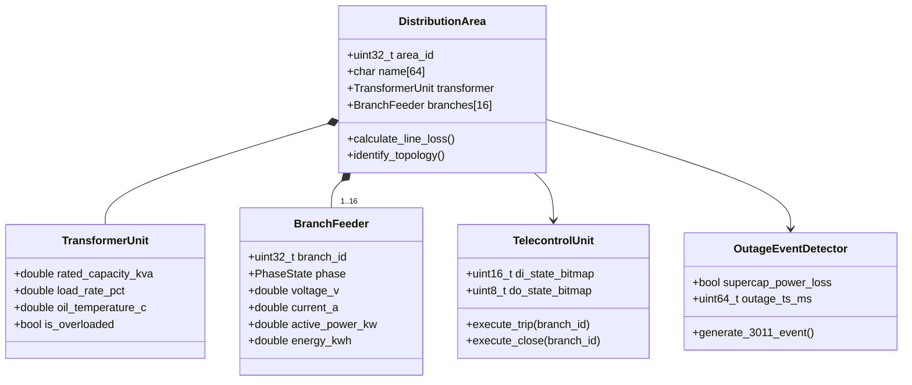

# DCU 限界上下文规范 (Smart Distribution Controller Context)

> **所属域**: 配电智能融合终端 / 低压能源控制器 (TTU)  
> **设计模式**: Domain-Driven Design (DDD) & Clean Architecture  
> **代码物理路径**: `cmd/dcu/`

---

## 1. 领域模型全景 (Domain Model Overview)

DCU 领域负责国网/南网台区低压配电网的智能化监控、四遥测控、多分支拓扑与线损分析、停电主动上报及 DLT698.45 / ESAM 国密安全规约交互。

---

## 2. 核心聚合根与实体 (Aggregates & Entities)

### 2.1 台区与线损聚合根 (`DistributionArea`)
- **实体属性**:
  - `area_id`: 台区唯一编码；
  - `transformer`: 配电变压器物理实体（容量、负载率、顶层油温、三相不平衡度）；
  - `branches[16]`: 16 路低压出线分支实体（各相电压、电流、有功功率、反向功率、累计电量）；
- **领域服务/行为**:
  - `calculate_line_loss()`: 动态计算供入电量与供出电量差值，判定异常线损；
  - `identify_topology()`: 基于载波/微功率无线特征识别用户表计所挂载的出线与相位。

### 2.2 四遥测控实体 (`TelecontrolUnit`)
- **遥信 (YX / DI)**: 16 路无源干接点输入状态与防抖过滤；
- **遥控 (YK / DO)**: 8 路继电器分合闸输出、双确认机制与闭锁逻辑；
- **遥测 (YC)**: 电压、电流、频率、功率因数、谐波畸变率 (THD)；
- **遥调 (YT)**: 有载分接开关 (OLTC) 档位与电容器无功补偿投切。

### 2.3 停电与事件记录实体 (`OutageDetector` / `SOERecord`)
- **停电侦测**: 毫秒级电容失电捕获、生成 DLT698 `3011` 事件；
- **SOE 记录**: 包含精确微秒级时间戳、事件类型（过流跳闸、相失压、温度超限）与前后物理快照。

---

## 3. 统一语言对照表 (Ubiquitous Language Dictionary)

| 术语 (中文) | 英文术语 (Ubiquitous Term) | 代码符号 / 结构体 | 物理量纲 / 数据类型 | 业务定义与含义 |
|---|---|---|---|---|
| **台区** | Distribution Area | `dcu_area_t` | - | 一台变压器供电范围内的低压用电网络区域 |
| **分支线损** | Branch Line Loss | `dcu_lineloss_t` | `%` / `double` | 出线端供电量与用户表总售电量的能量损耗比 |
| **四遥** | Telecontrol (4-Tele) | `dcu_telecontrol_t` | Bitmaps | 遥测(YC)、遥信(YX)、遥控(YK)、遥调(YT)的统称 |
| **停电主动上报** | Outage Proactive Report | `dcu_outage_detector_t` | DLT698 `0x3011` | 终端掉电瞬间利用超级电容向主站主动推送停电告警 |
| **事件顺序记录** | Sequence of Events (SOE) | `dcu_soe_event_t` | Struct + Timestamp | 带有毫秒/微秒级时间标标的开关变位或告警历史记录 |
| **国密安全单元** | ESAM Security Module | `edge_esam_driver_t` | APDU / ISO7816 | 国网标准化加密芯片，负责 SM2/3/4 APDU 认证与验签 |
| **时段费率** | TOU Tariff | `dcu_tariff_engine_t` | DLT698 `0x4000` | 尖峰平谷不同时段的阶梯电价与计费模板 |

---

## 4. 当前实现与 698 覆盖状态

本节只写与代码一致的事实，细节见所列文件与设计文档。计划与排期不在本文件维护。

### 4.1 模块分组

| 分组 | 文件 | 职责 |
|---|---|---|
| 组合根 | `cmd/dcu/main.c`、`dcu_node.c` | 装配、生命周期、聚合根 |
| 采集 | `dcu_inventory.c`、`dcu_poller.c`、`dcu_driver_adapter.c`、`dcu_bus_adapter.c`、`dcu_bus_source.c` | 档案加载、轮询、驱动注入、总线 |
| 存储 | `dcu_storage.c` | 最新值、冻结、事件、档案（SQLite） |
| 698 北向 | `dcu_north_adapter.c`、`dcu_north_source.c`、`dcu_router.c`、`dcu_698_object_model.c`、`dcu_698_var.c` | 从站通道、对象表、类型化读取、云北向取数 |
| 业务 | `dcu_topology_lineloss.c`、`dcu_topology_phase_id.c`、`dcu_outage_detector.c`、`dcu_soe_event_engine.c`、`dcu_event_monitor.c`、`dcu_load_control.c`、`dcu_peripheral_telecontrol.c` | 线损、拓扑、停电、SOE、负荷控制、四遥 |
| 运维 | `dcu_heartbeat.c`、`dcu_app_daemon.c`、`dcu_discovery.c`、`dcu_security.c` | 心跳、守护、发现、安全 |

### 4.2 698 北向覆盖

从站在 `cmd/dcu/dcu_north_adapter.c:112` 装配，UDS 监听 `DCU_NORTH_SOCK`（缺省 `/tmp/dcu_north_slave.sock`）；云北向在同一文件的 `dcu_north_cloud_attach`。两者都在 `cmd/dcu/main.c:179-180` 接线。

| 服务 | 状态 | 依据 |
|---|---|---|
| 帧校验（HCS 与 FCS） | 已实现 | `foundation/src/protocol/dlt698_codec.c` |
| GET-Request-Normal | 已实现 | `adapters/io_drivers/src/driver_dlt698.c:295` |
| GET-Request-NormalList | 已实现，逐项回 DAR | 同文件 `:261` |
| ACTION | 驱动已实现；DCU 产品钩子对方法回失败，按 DAR=2 应答 | `:315`、`cmd/dcu/dcu_north_adapter.c:74` |
| SET-Request | 未实现（D1-14） | 驱动无 SET 分支 |
| GET-Record 与 RSD | 未实现（D1-15） | 无对应代码 |
| REPORT.notification | 未实现（D1-16） | 无对应代码 |
| Class 20 与 4400 应用连接 | 未实现（D1-17） | 无对应代码 |

对象表在 `dcu_698_object_model.{h,c}`（29 个 OI，含 11 个 Class 8 参数 OI），类型化读取在 `dcu_698_var.{h,c}`，从站 A-XDR 端口见 ADR `docs/adr/0013-698-slave-axdr-port.md`。

### 4.3 设计文档

- 北向现状与缺口：`docs/design/NORTHBOUND_ARCHITECTURE.md` 4.4 节
- 对象模型与 A-XDR：`docs/design/DCU_698_OBJECT_MODEL.md`
- 迁移与排期：`docs/plans/2026-11-21-dcu-698-production-plan.md`
