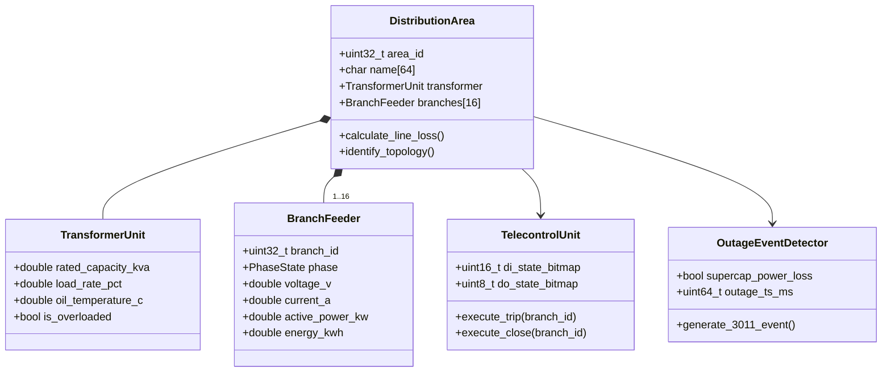

# DCU 限界上下文规范 (Smart Distribution Controller Context)

> **所属域**: 配电智能融合终端 / 低压能源控制器 (TTU)  
> **设计模式**: Domain-Driven Design (DDD) & Clean Architecture  
> **代码物理路径**: `cmd/dcu/`

---

## 1. 领域模型全景 (Domain Model Overview)

DCU 领域负责国网/南网台区低压配电网的智能化监控、四遥测控、多分支拓扑与线损分析、停电主动上报及 DLT698.45 / ESAM 国密安全规约交互。

---

## 2. 核心聚合根与实体 (Aggregates & Entities)

### 2.1 台区与线损聚合根 (`DistributionArea`)
- **实体属性**:
  - `area_id`: 台区唯一编码；
  - `transformer`: 配电变压器物理实体（容量、负载率、顶层油温、三相不平衡度）；
  - `branches[16]`: 16 路低压出线分支实体（各相电压、电流、有功功率、反向功率、累计电量）；
- **领域服务/行为**:
  - `calculate_line_loss()`: 动态计算供入电量与供出电量差值，判定异常线损；
  - `identify_topology()`: 基于载波/微功率无线特征识别用户表计所挂载的出线与相位。

### 2.2 四遥测控实体 (`TelecontrolUnit`)
- **遥信 (YX / DI)**: 16 路无源干接点输入状态与防抖过滤；
- **遥控 (YK / DO)**: 8 路继电器分合闸输出、双确认机制与闭锁逻辑；
- **遥测 (YC)**: 电压、电流、频率、功率因数、谐波畸变率 (THD)；
- **遥调 (YT)**: 有载分接开关 (OLTC) 档位与电容器无功补偿投切。

### 2.3 停电与事件记录实体 (`OutageDetector` / `SOERecord`)
- **停电侦测**: 毫秒级电容失电捕获、生成 DLT698 `3011` 事件；
- **SOE 记录**: 包含精确微秒级时间戳、事件类型（过流跳闸、相失压、温度超限）与前后物理快照。

---

## 3. 统一语言对照表 (Ubiquitous Language Dictionary)

| 术语 (中文) | 英文术语 (Ubiquitous Term) | 代码符号 / 结构体 | 物理量纲 / 数据类型 | 业务定义与含义 |
|---|---|---|---|---|
| **台区** | Distribution Area | `dcu_area_t` | - | 一台变压器供电范围内的低压用电网络区域 |
| **分支线损** | Branch Line Loss | `dcu_lineloss_t` | `%` / `double` | 出线端供电量与用户表总售电量的能量损耗比 |
| **四遥** | Telecontrol (4-Tele) | `dcu_telecontrol_t` | Bitmaps | 遥测(YC)、遥信(YX)、遥控(YK)、遥调(YT)的统称 |
| **停电主动上报** | Outage Proactive Report | `dcu_outage_detector_t` | DLT698 `0x3011` | 终端掉电瞬间利用超级电容向主站主动推送停电告警 |
| **事件顺序记录** | Sequence of Events (SOE) | `dcu_soe_event_t` | Struct + Timestamp | 带有毫秒/微秒级时间标标的开关变位或告警历史记录 |
| **国密安全单元** | ESAM Security Module | `edge_esam_driver_t` | APDU / ISO7816 | 国网标准化加密芯片，负责 SM2/3/4 APDU 认证与验签 |
| **时段费率** | TOU Tariff | `dcu_tariff_engine_t` | DLT698 `0x4000` | 尖峰平谷不同时段的阶梯电价与计费模板 |
