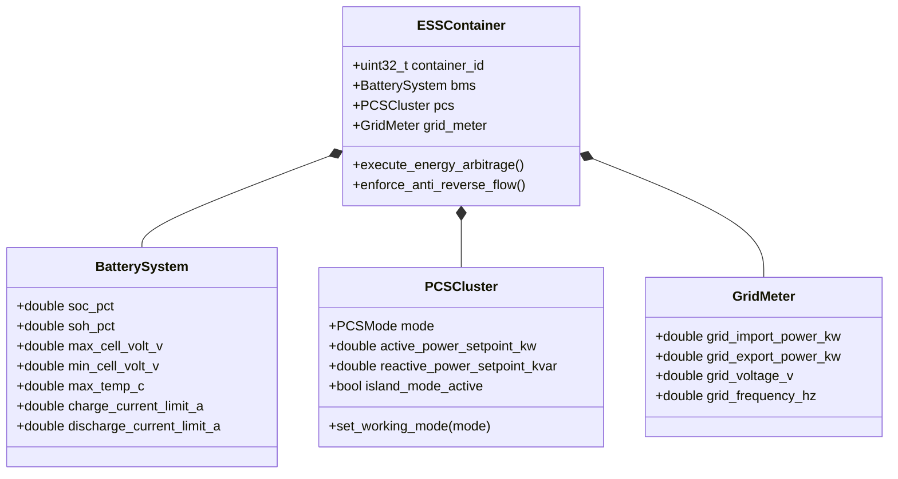

# IEMS 限界上下文规范 (Industrial Energy Management System Context)

> **所属域**: 工商业光储充综合微电网 / 储能能量管理系统 (BESS EMS)  
> **设计模式**: Domain-Driven Design (DDD) & Clean Architecture  
> **代码物理路径**: `cmd/iems/`

---

## 1. 领域模型全景 (Domain Model Overview)

IEMS 领域负责工商业储能集装箱（BESS）、光伏逆变器、双向变流器（PCS）、电池管理系统（BMS）与微电网能量协调控制（防逆流、峰谷套利、需量削峰、微网孤岛保护）。

---

## 2. 核心聚合根与实体 (Aggregates & Entities)

### 2.1 储能系统聚合根 (`ESSContainer`)
- **实体属性**:
  - `container_id`: 储能柜/集装箱全局唯一标识；
  - `bms`: 电池管理系统实体（SOC/SOH、电芯极值、充放电安全包络线）；
  - `pcs`: 双向储能变流器实体（工作模式、有功/无功设定值、并网/离网状态）；
  - `grid_meter`: 并网点双向计量电表（关口功率、正反向有功、频率）；
- **领域行为/控制策略**:
  - `enforce_anti_reverse_flow()`: 防逆流策略，当关口逆向功率接近阈值时毫秒级下调 PCS 放电功率或光伏出力；
  - `execute_energy_arbitrage()`: 峰谷价差套利，谷期充电、峰期放电；
  - `enforce_peak_shaving()`: 变压器需量控制，超过变压器安全容量时强制储能放电顶峰。

### 2.2 电池安全包络线值对象 (`BatteryEnvelope`)
- **荷电状态 (SOC)**: `0.0% ~ 100.0%`，运行区间严格限制在安全窗口（如 `10% ~ 90%`）；
- **健康状态 (SOH)**: 电池容量衰减率与内阻增长追踪；
- **热失控预警**: 电芯最高温升速率、单体电芯电压极差（`Delta_V > 50mV` 告警）。

### 2.3 变流器工作模式 (`PCSMode`)
- `PCS_MODE_PQ`: 恒功率模式（并网调度主力模式）；
- `PCS_MODE_VF`: 恒压恒频独立微电网/黑启动模式；
- `PCS_MODE_VSG`: 虚拟同步发电机模式（提供电网惯量支撑）；
- `PCS_MODE_DROOP`: 下垂控制模式（频率/电压下垂调节）。

---

## 3. 统一语言对照表 (Ubiquitous Language Dictionary)

| 术语 (中文) | 英文术语 (Ubiquitous Term) | 代码符号 / 结构体 | 物理量纲 / 数据类型 | 业务定义与含义 |
|---|---|---|---|---|
| **储能变流器** | Power Conversion System (PCS) | `iems_pcs_t` | - | 双向交直流变换装置，负责电池与电网之间的能量双向流动 |
| **电池管理系统** | Battery Management System (BMS) | `iems_bms_t` | - | 监测电芯电压、温度、均衡状态并计算充放电极限功率的系统 |
| **荷电状态** | State of Charge (SOC) | `soc` | `%` / `double` | 电池当前剩余电量占额定可用容量的百分比 |
| **健康状态** | State of Health (SOH) | `soh` | `%` / `double` | 电池当前实际满充容量占出厂额定容量的健康百分比 |
| **防逆流控制** | Anti-Reverse Flow / Zero Export | `iems_anti_reverse_t` | `kW` / `double` | 防止储能或光伏向上一级电网反向倒送电的控制闭环 |
| **削峰填谷** | Peak Shaving & Valley Filling | `iems_arbitrage_t` | `kW` / `double` | 低电价/低负荷时充电，高电价/高负荷时放电的经济调度 |
| **并网点关口表** | Point of Common Coupling (PCC) Meter | `iems_pcc_meter_t` | `kW` / `double` | 用户微电网与公用电网物理连接点的双向电能计量表 |
| **模型预测控制** | Model Predictive Control (MPC) | `iems_mpc_engine_t` | Algorithm | 基于滚动时域优化与状态预测的多目标能量优化算法 |
