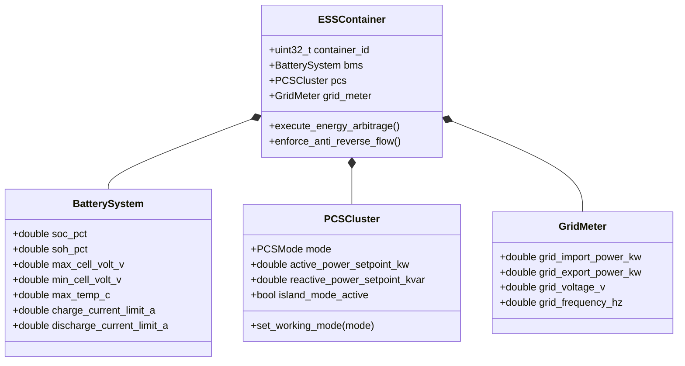

# IEMS 限界上下文规范 (Industrial Energy Management System Context)

> **所属域**: 工商业光储充综合微电网 / 储能能量管理系统 (BESS EMS)  
> **设计模式**: Domain-Driven Design (DDD) & Clean Architecture  
> **代码物理路径**: `cmd/iems/`

---

## 1. 领域模型全景 (Domain Model Overview)

IEMS 领域负责工商业储能集装箱（BESS）、光伏逆变器、双向变流器（PCS）、电池管理系统（BMS）与微电网能量协调控制（防逆流、峰谷套利、需量削峰、微网孤岛保护）。

---

## 2. 核心聚合根与实体 (Aggregates & Entities)

### 2.1 储能系统聚合根 (`ESSContainer`)
- **实体属性**:
  - `container_id`: 储能柜/集装箱全局唯一标识；
  - `bms`: 电池管理系统实体（SOC/SOH、电芯极值、充放电安全包络线）；
  - `pcs`: 双向储能变流器实体（工作模式、有功/无功设定值、并网/离网状态）；
  - `grid_meter`: 并网点双向计量电表（关口功率、正反向有功、频率）；
- **领域行为/控制策略**:
  - `enforce_anti_reverse_flow()`: 防逆流策略，当关口逆向功率接近阈值时毫秒级下调 PCS 放电功率或光伏出力；
  - `execute_energy_arbitrage()`: 峰谷价差套利，谷期充电、峰期放电；
  - `enforce_peak_shaving()`: 变压器需量控制，超过变压器安全容量时强制储能放电顶峰。

### 2.2 电池安全包络线值对象 (`BatteryEnvelope`)
- **荷电状态 (SOC)**: `0.0% ~ 100.0%`，运行区间严格限制在安全窗口（如 `10% ~ 90%`）；
- **健康状态 (SOH)**: 电池容量衰减率与内阻增长追踪；
- **热失控预警**: 电芯最高温升速率、单体电芯电压极差（`Delta_V > 50mV` 告警）。

### 2.3 变流器工作模式 (`PCSMode`)
- `PCS_MODE_PQ`: 恒功率模式（并网调度主力模式）；
- `PCS_MODE_VF`: 恒压恒频独立微电网/黑启动模式；
- `PCS_MODE_VSG`: 虚拟同步发电机模式（提供电网惯量支撑）；
- `PCS_MODE_DROOP`: 下垂控制模式（频率/电压下垂调节）。

---

## 3. 统一语言对照表 (Ubiquitous Language Dictionary)

| 术语 (中文) | 英文术语 (Ubiquitous Term) | 代码符号 / 结构体 | 物理量纲 / 数据类型 | 业务定义与含义 |
|---|---|---|---|---|
| **储能变流器** | Power Conversion System (PCS) | `iems_pcs_t` | - | 双向交直流变换装置，负责电池与电网之间的能量双向流动 |
| **电池管理系统** | Battery Management System (BMS) | `iems_bms_t` | - | 监测电芯电压、温度、均衡状态并计算充放电极限功率的系统 |
| **荷电状态** | State of Charge (SOC) | `soc` | `%` / `double` | 电池当前剩余电量占额定可用容量的百分比 |
| **健康状态** | State of Health (SOH) | `soh` | `%` / `double` | 电池当前实际满充容量占出厂额定容量的健康百分比 |
| **防逆流控制** | Anti-Reverse Flow / Zero Export | `iems_anti_reverse_t` | `kW` / `double` | 防止储能或光伏向上一级电网反向倒送电的控制闭环 |
| **削峰填谷** | Peak Shaving & Valley Filling | `iems_arbitrage_t` | `kW` / `double` | 低电价/低负荷时充电，高电价/高负荷时放电的经济调度 |
| **并网点关口表** | Point of Common Coupling (PCC) Meter | `iems_pcc_meter_t` | `kW` / `double` | 用户微电网与公用电网物理连接点的双向电能计量表 |
| **模型预测控制** | Model Predictive Control (MPC) | `iems_mpc_engine_t` | Algorithm | 基于滚动时域优化与状态预测的多目标能量优化算法 |

---

## 4. 应用程序装配与生命周期编排 (App Assembler & Lifecycle)

对齐 Clean Architecture 与 Composition Root 纯粹性要求，`cmd/iems/main.c` 仅作为极简编排入口（<80 行），负责环境配置解析与信号循环。系统装配全流程收敛于 `cmd/iems/iems_app.c`：

| 装配阶段 | 核心组件 | 职责描述 |
|---|---|---|
| **Phase 1: 聚合根装配** | `iems_node_t` | 实例化领域聚合根，组装 BMS、PCS、Coordinator、FireSafety、PCSDispatcher 子聚合 |
| **Phase 2: 数据底座与可靠性** | `datahub_t` | 启动指标导出、Write-Ahead Log (WAL) 持久化、快照恢复与周期性内存压实 (Compaction) |
| **Phase 3: 调度总线与驱动** | `bus_orchestrator_t`, `driver_manager_t` | 注入 ModbusRTU/IEC104 等驱动适配，根据通道清单配置 Master/Slave 物理总线与 I/O 内存池 |
| **Phase 4: 本地持久化与流计算** | `sqlite_svc_t`, `stream_engine_t` | 加载本地时序数据库，装配 StreamEngine 计算管道与自律控制回调 |
| **Phase 5: 微运行时与北向互联** | `wasm_mgr`, `northbound_mgr_t` | 初始化 WASM 边缘微运行时沙箱，构建双轨 MQTT 遥测上报与 REST API 服务 |
| **Phase 6: 伴随通道与定时驱动** | `uv_pipe_t`, `uv_timer_t` | 开放 UI 伴随 Socket，启动总线重连、任务加载、影子寄存器心跳巡检定时器 |

---

## 5. 控制写路径白名单与聚合根守卫 (Control Write Whitelist)

根据 ADR-0010 与防逆流/微网安全要求，**任何改变物理设备状态或目标功率的写操作，严禁直接旁路下发**。

### 5.1 控制写入口白名单
| 目标语义 | 合法入口 API (聚合根领域方法) | 保护的不变量 |
|---|---|---|
| **PCS 充放电功率调度** | `iems_node_dispatch_power(node, target_kw, &actual_kw)` | 消防联动闭锁、BMS三级热失控跳闸、BMS二级降额、SOC边界截断、多机分摊 |
| **微网/储能紧急跳闸** | `iems_node_emergency_trip(node, reason)` | 立即置位消防阶段三释放、断开高压主接触器、PCS模式置 FAULT 并停机归零 |
| **BMS 状态遥测更新** | `iems_node_update_bms_rack(node, ...)` | 多簇单体极差均衡校验、系统平均 SOC 刷新、簇间热失控安全不变量重估 |

### 5.2 物理下发与 CI 门禁规则
- 业务/流计算下发控制时（`_iems_stream_submit_control`），必须首先调用 `iems_node_dispatch_power`；
- 只有经过领域裁决允许的功率（`actual_kw`），才允许通过 `edge_api_write_tag` 写入南向寄存器；
- CI 门禁（`ci/scripts/check_aggregate_boundary.py`）严格扫描源码：
  1. 禁止在 `cmd/` 任何业务代码中直接对 `IEMS_TAG_PCS_CONTROL` 触发 `datahub_publish`（必须由聚合根触发）；
  2. 禁止在 `cmd/` 非授权适配器中直接调用 `edge_api_write_tag`；
  3. 禁止解引用 `iems_node_t` 内部私有子聚合结构体。

---

## 6. 控制环路延迟预算与看门狗规范 (Control Loop Latency Budget & Watchdog - AEP-407)

工商业储能与微电网涉及高压电气与消防安全，控制闭环必须有明确的截止时间（Deadline）与超限降级行为。

### 6.1 控制环路延迟预算表
| 控制环路场景 | 触发源 | 决策与执行链条 | 截止时间预算 (P99) | 超时/卡顿降级行为 (Fail-Safe) |
|---|---|---|---|---|
| **紧急跳闸 / 消防联动** | 气体释放 / 烟雾传感器 / 硬件急停 | 传感器中断 → `iems_node_emergency_trip` → PCS 停机 & 高压脱扣 | **≤ 5 ms** (5000 μs) | 硬件硬线直跳；软件状态标记 FAULT 并报警 |
| **防逆流安全闭环** | PCC 关口表功率倒送 | DataHub 变位 → `iems_node_dispatch_power` → PCS PQ 控功率 | **≤ 10 ms** (10000 μs) | 触发看门狗降级，强制 PCS 功率归零并闭锁 |
| **BMS 热失控保护** | 电芯温度 > 55°C / 压差 > 500mV | 遥测帧到达 → `iems_node_update_bms_rack` → 聚合根评估 → 裁决阻断 | **≤ 10 ms** (10000 μs) | 强制拒绝下发充放电，PCS 停机 |
| **变压器需量削峰** | 变压器负荷越限 | 遥测计算 → 需量控制器 → 储能顶峰放电下发 | **≤ 100 ms** (100000 μs) | 保持前次安全值；若超 500ms 则进入保护降额 |
| **峰谷价差套利调度** | 阶梯电价时钟 / 运筹计划 | 计划触发 → MPC 求解分摊 → 各 PCS 单元分配 | **≤ 500 ms** (500000 μs) | 放弃本轮优化，维持当前基线模式 |

### 6.2 看门狗监测与降级防护机制
1. **高精度耗时追踪**:
   - 每次调用 `iems_node_dispatch_power` 或 `iems_node_emergency_trip` 时，记录单步耗时（微秒）；
   - 更新聚合根内部统计 `last_cycle_us` 与 `max_cycle_us`。
2. **看门狗安全降级 (Watchdog Degradation)**:
   - 默认看门狗安全预算为 **10000 μs (10 ms)**；
   - 若单步耗时超出预算，自动累计 `watchdog_trips` 并置位 `watchdog_degraded = true`；
   - 处于降级状态期间，所有后续写调度强制拒绝（返回 `-4`）并将输出功率置零（0.0 kW），确保电气设备处于零功耗安全态；
   - 需由外部健康监控明确调用 `iems_node_reset_watchdog_degrade` 后方可恢复正常调度。

