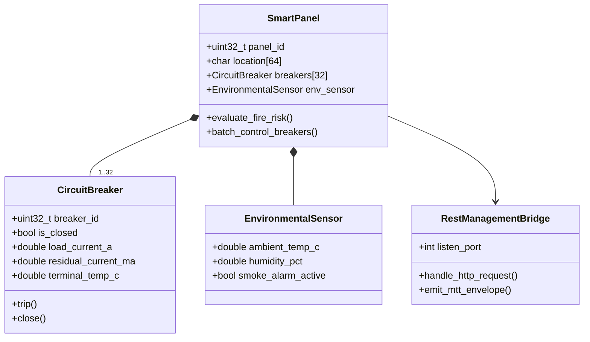

# SmartBox 限界上下文规范 (Smart Gateway & Panel Context)

> **所属域**: 智能配电箱 / 智慧微断集中器 / 边缘物联感知网关  
> **设计模式**: Domain-Driven Design (DDD) & Clean Architecture  
> **代码物理路径**: `cmd/smart_box/`

---

## 1. 领域模型全景 (Domain Model Overview)

SmartBox 领域负责智慧建筑/园区低压配电箱内微型断路器（MCB）群控、电气火灾监测（漏电电流、线缆接头温度）、通道规约转换与基于 Web/RESTful API 的设备运维管理。

---

## 2. 核心聚合根与实体 (Aggregates & Entities)

### 2.1 智能配电箱聚合根 (`SmartPanel`)
- **实体属性**:
  - `panel_id`: 配电箱唯一标识；
  - `breakers[32]`: 32 路智能微型断路器实体（状态、电流、漏电流、端子温度）；
  - `env_sensor`: 箱体环境传感器（箱内温湿度、烟感）；
- **领域行为**:
  - `evaluate_fire_risk()`: 电气火灾风险综合评估，当漏电电流或端子温度持续超标时触发预警或脱扣；
  - `batch_control_breakers()`: 批量照明/动力回路分合闸联动。

### 2.2 智能微断实体 (`CircuitBreaker`)
- **运行状态**: 分闸、合闸、故障跳闸、就地手动闭锁；
- **遥测物理量**: 负载电流 (`A`)、剩余漏电电流 (`mA`)、接线端子温度 (`℃`)、累计电能 (`kWh`)。

---

## 3. 统一语言对照表 (Ubiquitous Language Dictionary)

| 术语 (中文) | 英文术语 (Ubiquitous Term) | 代码符号 / 结构体 | 物理量纲 / 数据类型 | 业务定义与含义 |
|---|---|---|---|---|
| **智能配电箱** | Smart Distribution Panel | `smart_panel_t` | - | 具备数字化微断与物联感知能力的终端配电箱 |
| **微型断路器** | Miniature Circuit Breaker (MCB) | `smart_mcb_t` | - | 具备短路保护、过载保护及遥控分合闸的微断开关 |
| **剩余漏电电流** | Residual / Leakage Current | `residual_current_ma` | `mA` / `double` | 穿过剩余电流互感器的相线与中性线矢量电流差值 |
| **端子温度** | Terminal Temperature | `terminal_temp_c` | `℃` / `double` | 断路器接线端子物理触点表面温度，用于火灾早报警 |
| **统一响应信封** | MTT Response Envelope | `api_envelope_t` | JSON / REST | 符合规范包含 `code`, `message`, `data`, `meta(mtt_ts)` 的统一报文 |
