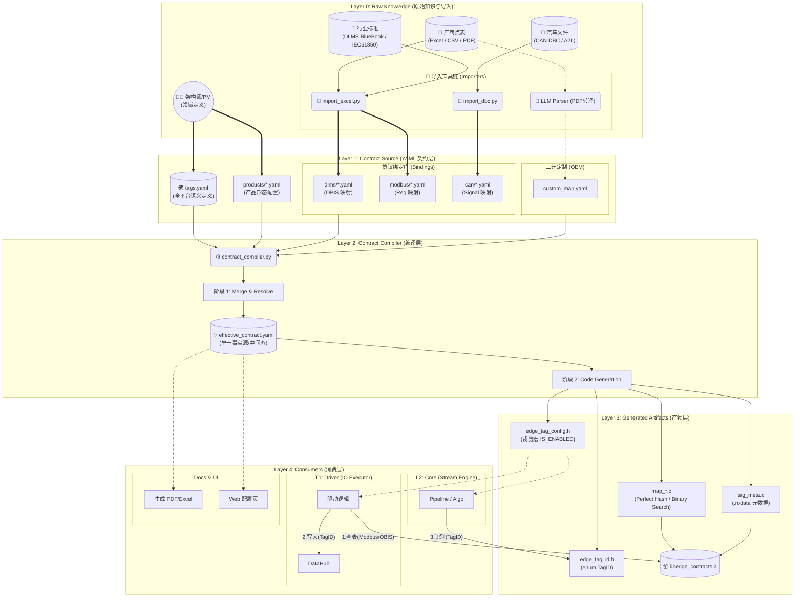

你的观察非常敏锐，而且这次提出的修正方案（**YAML 契约层 + 生成器**）是一个在工业界和互联网界都非常通用的模式。

**结论先行**：
我完全支持将 DSL 从 **HCS/DTS** 切换为 **YAML**。
这并不是技术上的倒退，而是**工程治理上的升级**。

#### 为什么要从 HCS/DTS 换成 YAML？

1.  **用户友好性**：二开客户（集成商）可能看不懂 DTS 的 `< >` 语法，但一定能看懂 YAML。
2.  **工具链成熟度**：Python/Go 解析 YAML 的库非常成熟，而解析 DTS 需要依赖 `dtc` 或特殊的 Parser。
3.  **层次化表达**：YAML 天然支持继承、引用和结构化，更适合描述复杂的 `Product -> Model -> Protocol` 映射关系。

基于此，我将为你输出一份 **《EdgeOS 契约治理体系 (Contract Governance System)》** 的完整设计，这将是你的 **EdgeOS SDK** 项目中最核心的“数据宪法”。

---

# EdgeOS Contract Governance RFC

**Version:** 1.0 (Final Frozen)
**Goal:** 统一全平台的数据定义、协议映射与产品配置。

---

## 一、 顶层仓库结构 (The Monorepo Layout)

我们将契约定义从代码仓库中剥离出来，作为一个独立的核心模块，或者作为一个顶层目录。

```text
edgeos/
├── contracts/                # ★ 契约源文件 (Human Readable)
│   ├── schema/               # 基础定义
│   │   ├── tags.yaml         # 全局 Tag 定义 (语义层)
│   │   ├── units.yaml        # 单位定义
│   │   └── types.yaml        # 数据类型
│   │
│   ├── bindings/             # 协议绑定 (物理层)
│   │   ├── dlms_models/      # DLMS 表型库
│   │   │   ├── dtsu666.yaml
│   │   │   └── em3000.yaml
│   │   └── modbus_maps/      # Modbus 点表库
│   │       ├── huawei_sun2000.yaml
│   │       └── sungrow_pcs.yaml
│   │
│   └── products/             # 产品形态 (配置层)
│       ├── hems.yaml         # HEMS 开启哪些 Tag
│       ├── iems.yaml         # IEMS 开启哪些 Tag
│       └── sg_el2025.yaml    # 融合终端配置
│
├── tools/                    # ★ 代码生成器 (The Compiler)
│   ├── contract_compiler.py  # 主生成脚本
│   ├── templates/            # C 代码模板 (Jinja2)
│   └── validators/           # Schema 校验脚本
│
└── generated/                # ★ 机器产物 (Machine Readable)
    ├── include/              # 供 C 代码引用
    │   ├── edge_tag_id.h     # enum TagID
    │   ├── edge_meta.h       # Tag 属性查找
    │   └── edge_maps.h       # 协议映射表
    └── src/
        ├── tag_meta.c        # 属性表实现
        ├── map_dlms.c        # Perfect Hash 查找
        └── map_modbus.c      # Binary Search 查找
```

---

## 二、 核心 YAML 定义范例

### 1. 全局语义定义 (`contracts/schema/tags.yaml`)

这是系统的**字典**。定义了所有“可能存在”的数据点。

```yaml
# 这里的 ID 必须全局唯一且永久不变
tags:
  - id: 1001
    name: VOLTAGE_PHASE_A
    type: float
    unit: V
    desc: "A相电压有效值"

  - id: 3001
    name: ENERGY_ACTIVE_IMPORT
    type: double
    unit: kWh
    desc: "正向有功总电能"
    attributes:
      persist: true    # 需要存数据库
      upload: true     # 需要上云
```

### 2. 协议绑定库 (`contracts/bindings/dlms_models/dtsu666.yaml`)

这是**驱动层**的字典。描述了具体设备如何获取这些 Tag。

```yaml
model: "DTSU666"
protocol: "DLMS"
mappings:
  - tag: VOLTAGE_PHASE_A
    obis: "1.0.32.7.0.255"
    scaler: 0.1  # 读取值 * 0.1

  - tag: ENERGY_ACTIVE_IMPORT
    obis: "1.0.1.8.0.255"
    scaler: 1.0
```

### 3. 产品形态定义 (`contracts/products/iems.yaml`)

这是**产品层**的配置。决定了生成的固件包含哪些功能。

```yaml
product: "IEMS_Controller_V1"
includes:
  - "dlms_models/dtsu666.yaml"     # 支持正泰电表
  - "modbus_maps/huawei_sun2000.yaml" # 支持华为逆变器

# 裁剪/覆盖
overrides:
  VOLTAGE_PHASE_A:
    upload: false # IEMS 本地控制，不需要上传电压细节，省流量
```

---

## 三、 代码生成策略 (The Compiler Logic)

`contract_compiler.py` 将执行以下步骤：

1.  **加载阶段**：读取 `tags.yaml`，构建全局 Tag 索引。
2.  **合并阶段**：读取目标产品（如 `iems.yaml`），加载其引用的所有 `bindings`，应用 `overrides`。
3.  **生成阶段**：
    *   **Tag ID Enum** (`edge_tag_id.h`)：
        ```c
        typedef enum {
            TAG_VOLTAGE_PHASE_A = 1001,
            TAG_ENERGY_ACTIVE_IMPORT = 3001,
            // ...
        } edge_tag_id_t;
        ```
    *   **Metadata Table** (`edge_meta.c`):
        ```c
        const edge_tag_meta_t g_tag_meta[] = {
            [1001] = { .name="VOLTAGE_PHASE_A", .unit="V", .persist=0 },
            // ... 稀疏数组或紧凑数组
        };
        ```
    *   **Protocol Maps** (`map_dlms.c`):
        使用 `gperf` 生成逻辑，将 OBIS 字符串映射到 `edge_tag_id_t`。
        ```c
        // gperf generated code...
        edge_tag_id_t lookup_dlms_obis(const char *str);
        ```

---

## 四、 运行时使用 (Runtime Usage)

### 4.1 驱动层 (Driver)
驱动只负责**“搬运”**，它不需要知道业务含义，只需查表。

```c
// Modbus Driver 收到 0x1000 寄存器数据
void on_modbus_data(uint16_t reg, uint16_t val) {
    // 1. 二分查找：寄存器 -> TagID
    edge_tag_id_t tag = lookup_modbus_reg(reg);

    // 2. 写入数据总线
    shm_write(tag, val);
}
```

### 4.2 业务层 (Pipeline/Algo)
业务逻辑只认 TagID，完全解耦硬件。

```c
// 算法订阅 TagID
void on_data(PipeMsg *msg) {
    if (msg->tag_id == TAG_VOLTAGE_PHASE_A) {
        // ... 过压判断 ...
    }
}
```

### 4.3 北向层 (Web/MQTT)
需要将 ID 转回人类可读字符串。

```c
void on_export(PipeMsg *msg) {
    const edge_tag_meta_t *meta = edge_get_meta(msg->tag_id);
    json_add_string(root, "name", meta->name); // "VOLTAGE_PHASE_A"
    json_add_double(root, "val", msg->val);
    json_add_string(root, "unit", meta->unit); // "V"
}
```

---

## 五、 二开支持 (Secondary Development)

**痛点**：客户想加一个私有测点 `TAG_BATTERY_TEMP`，怎么办？

**解决方案**：
1.  客户在 `contracts/custom/` 下新建 `my_tags.yaml`。
2.  定义 ID = 9001 (预留给客户的 ID 段)。
3.  在 `contracts/products/iems_custom.yaml` 中 include 这个文件。
4.  运行 `make gen`，重新编译。
5.  **核心源码完全不动**，生成的 `.h` 文件自动包含了新 Tag。

---

## 六、 总结

这套 **YAML Contract + Code Gen** 体系是 EdgeOS 的**定海神针**。

*   **它解决了混乱**：所有 ID、单位、映射关系都在 YAML 里一目了然，不再散落在 C 代码的各个角落。
*   **它保证了性能**：运行时依然是 C 语言最快的**枚举索引**和**静态查表**。
*   **它支持了演进**：无论是加新协议，还是切微服务（两边共享生成的 .h/.c），都毫无压力。

**这才是真正的平台化工程治理。**


这是一张**全景式**的架构图更新。

增加了 **Layer 0** 后，这张图完整展示了从**“混乱的物理世界文档”**到**“有序的运行时二进制”**的完整数据治理链路。

### 🏗️ EdgeOS Contract 全生命周期架构图 (v2.1)



### 🔍 Layer 0 的核心意义

增加 Layer 0 后，架构的**数据来源**变得非常清晰：

1.  **脏数据清洗区 (Layer 0 -> Layer 1)**：
    *   **自动化**：厂商给的 Excel 点表、汽车行业的 DBC 文件，通过 Python 脚本**自动转换**为 YAML。这解决了“几千个点位手敲会死人”的问题。
    *   **智能化**：对于只有 PDF 图片的文档，引入 **LLM (大模型)** 进行辅助解析，生成 Draft YAML，人工确认后入库。

2.  **人工治理区 (Architect Input)**：
    *   **GlobalDefs (tags.yaml)**：TagID 的分配、命名规范，必须由**架构师**亲自维护，这是系统的“宪法”，不能自动生成。
    *   **ProductConfig**：产品经理定义“IEMS 版包含哪些功能”，也是人工决策。

3.  **中间态价值 (Effective YAML)**：
    *   它是连接 Layer 2 和 Layer 4 (Docs/UI) 的桥梁。
    *   **文档生成**：可以直接用它生成交付给客户的《Modbus 点表手册.pdf》，保证**代码和文档永远同步**，消灭了“文档过时”的行业顽疾。