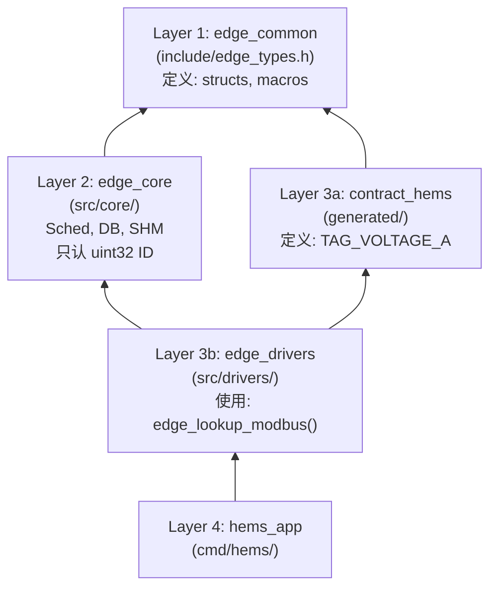
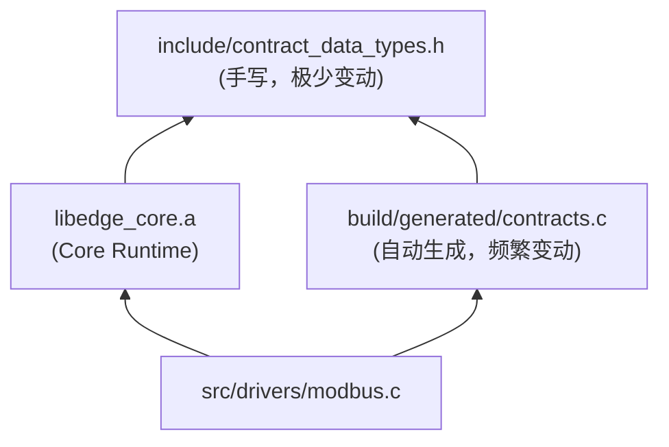

## 多个产品在cmd下  如何将此脚本集成到cmakelists.txt
这是一个非常经典的 **“多模块构建系统设计”** 问题。

在 CMake 中，要优雅地解决“多产品 + 代码生成 + 依赖隔离”，最佳实践是封装一个 **CMake 函数（Function）**。

这样，每个产品（`cmd/hems`、`cmd/iems`）只需要调用一行命令，就能自动完成“生成代码 -> 编译库 -> 链接”的全过程，互不干扰。

---

### 📐 1. 总体设计思路

1.  **封装逻辑**：在 `cmake/` 目录下创建一个 `EdgeContract.cmake` 模块，把调用 Python 脚本、生成文件、定义 Library 的脏活累活全包进去。
2.  **隔离产物**：生成的代码放在 `build/generated/${product_name}` 下，确保 HEMS 和 IEMS 的头文件物理隔离。
3.  **产品调用**：在 `cmd/hems/CMakeLists.txt` 中，只需调用 `edge_add_contract(...)`。

---

### 📂 2. 目录结构微调

```text
edgeos/
├── CMakeLists.txt             # 根构建文件
├── cmake/
│   └── EdgeContract.cmake     # [核心] 封装好的构建函数
├── tools/
│   └── contract_compiler.py   # 生成器脚本
├── contracts/                 # YAML 源文件
├── cmd/
│   ├── hems/
│   │   └── CMakeLists.txt     # HEMS 专用构建文件
│   ├── iems/
│   │   └── CMakeLists.txt     # IEMS 专用构建文件
```

---

### 🛠️ 3. 核心 CMake 模块 (`cmake/EdgeContract.cmake`)

这个文件是“魔法”发生的地方。它定义了一个函数 `edge_add_contract`。

```cmake
# cmake/EdgeContract.cmake

find_package(Python3 REQUIRED COMPONENTS Interpreter)

# ------------------------------------------------------------------------------
# 函数: edge_add_contract
# 目标: 为指定产品生成契约代码，并创建一个静态库目标
# 参数:
#   TARGET_NAME:  生成的库名称 (例如 contract_hems)
#   PRODUCT_YAML: 产品配置文件路径 (contracts/products/hems.yaml)
#   LOCAL_YAML:   (可选) 本地扩展文件路径
# ------------------------------------------------------------------------------
function(edge_add_contract TARGET_NAME PRODUCT_YAML LOCAL_YAML)

    # 1. 定义路径变量
    set(TOOL_PATH "${CMAKE_SOURCE_DIR}/tools/contract_compiler.py")
    set(SCHEMA_PATH "${CMAKE_SOURCE_DIR}/contracts/schema/tags.yaml")

    # 定义输出目录 (位于 Build 目录下，按 Target 隔离)
    set(GEN_DIR "${CMAKE_CURRENT_BINARY_DIR}/generated")
    set(OUT_HEADER "${GEN_DIR}/contracts.h")
    set(OUT_SOURCE "${GEN_DIR}/contracts.c")
    set(OUT_EFFECTIVE "${GEN_DIR}/effective_contract.yaml")

    # 2. 构建 Python 命令行参数
    set(CMD_ARGS
        "${TOOL_PATH}"
        "--schema" "${SCHEMA_PATH}"
        "--product" "${PRODUCT_YAML}"
        "--out" "${GEN_DIR}"
    )

    # 如果有本地扩展，加上参数
    if(NOT "${LOCAL_YAML}" STREQUAL "")
        list(APPEND CMD_ARGS "--local" "${LOCAL_YAML}")
    endif()

    # 3. 定义自定义命令 (生成代码)
    # 只要 YAML 变了，make 时就会自动重新运行 Python
    add_custom_command(
        OUTPUT "${OUT_HEADER}" "${OUT_SOURCE}" "${OUT_EFFECTIVE}"
        COMMAND "${Python3_EXECUTABLE}" ${CMD_ARGS}
        DEPENDS "${TOOL_PATH}" "${SCHEMA_PATH}" "${PRODUCT_YAML}" "${LOCAL_YAML}"
        COMMENT "Generating Contract for ${TARGET_NAME}..."
        VERBATIM
    )

    # 4. 定义 C 语言静态库目标
    # 这样其他模块只需 link 这个库，就能自动包含头文件路径
    add_library(${TARGET_NAME} STATIC "${OUT_SOURCE}")

    # 5. 设置头文件搜索路径 (INTERFACE 属性会自动传递给使用者)
    target_include_directories(${TARGET_NAME}
        PUBLIC
        "${GEN_DIR}"            # 包含 contracts.h
    )

    # 6. (可选) 清理时删除生成目录
    set_property(DIRECTORY APPEND PROPERTY ADDITIONAL_CLEAN_FILES "${GEN_DIR}")

endfunction()
```

---

### ⚙️ 4. 根目录 `CMakeLists.txt`

根目录负责设置路径并包含子产品。

```cmake
cmake_minimum_required(VERSION 3.15)
project(EdgeOS_Suite VERSION 3.0.0 LANGUAGES C)

# 1. 引入自定义模块
list(APPEND CMAKE_MODULE_PATH "${CMAKE_SOURCE_DIR}/cmake")
include(EdgeContract)

# 2. 引入基础依赖 (Vendor)
# ... (参考之前的 vendor 配置) ...

# 3. 增加产品子目录
# 这里可以根据命令行开关决定编译哪些产品
option(BUILD_PRODUCT_HEMS "Build HEMS" ON)
option(BUILD_PRODUCT_IEMS "Build IEMS" ON)

if(BUILD_PRODUCT_HEMS)
    add_subdirectory(cmd/hems)
endif()

if(BUILD_PRODUCT_IEMS)
    add_subdirectory(cmd/iems)
endif()
```

---

### 🏗️ 5. 产品级 `CMakeLists.txt` (以 HEMS 为例)

这就是产品开发者每天面对的文件，非常干净。

**文件：`cmd/hems/CMakeLists.txt`**

```cmake
# 1. 定义产品名称
set(APP_NAME hems_app)

# 2. 调用核心宏生成代码
#    这会自动生成一个名为 'contract_hems' 的静态库
edge_add_contract(
    contract_hems                                     # 生成的库名
    "${CMAKE_SOURCE_DIR}/contracts/products/hems.yaml" # 产品配置
    "${CMAKE_CURRENT_SOURCE_DIR}/extension.yaml"       # 本地扩展 (可选)
)

# 3. 定义可执行文件
add_executable(${APP_NAME}
    main.c
    # ... 其他源码 ...
)

# 4. 链接生成的契约库
#    注意：不需要手动 include_directories，链接会自动带入
target_link_libraries(${APP_NAME}
    PRIVATE
    contract_hems      # <--- 链接生成的库
    edge_core          # SDK 核心库
)
```

**文件：`cmd/iems/CMakeLists.txt` (IEMS 的配置)**

```cmake
set(APP_NAME iems_app)

# IEMS 使用不同的 YAML，生成不同的代码
edge_add_contract(
    contract_iems
    "${CMAKE_SOURCE_DIR}/contracts/products/iems.yaml"
    "${CMAKE_CURRENT_SOURCE_DIR}/extension.yaml"
)

add_executable(${APP_NAME} main.c)
target_link_libraries(${APP_NAME} PRIVATE contract_iems edge_core)
```

---

### ✅ 6. 最终效果与优势

当你运行 `cmake .. && make` 时，构建系统会自动并行工作：

1.  **隔离性**：
    *   `build/cmd/hems/generated/contracts.h` (只包含 HEMS 的 Tag)
    *   `build/cmd/iems/generated/contracts.h` (包含 IEMS 的 Tag)
    *   两者物理隔离，互不冲突。

2.  **依赖追踪**：
    *   如果你修改了 `contracts/products/hems.yaml`，再运行 `make`，只有 `hems_app` 会重新生成代码并重新编译。`iems_app` 不会动。

3.  **开发者体验**：
    *   在 `cmd/hems/main.c` 中，开发者直接 `#include "contracts.h"`。
    *   IDE (VSCode/CLion) 能够正确跳转，因为它会读取 CMake 的 include 路径，分别指向各自的 build 目录。

这套方案完美适配了 **Monorepo 多产品并行开发** 的需求。

## edge_core  会依赖contract_hems吧?
你的直觉非常敏锐，直接指出了 **循环依赖 (Circular Dependency)** 的风险点。

如果 `edge_core`（核心库）直接包含驱动或业务逻辑，并且试图使用 `contracts.h` 中的宏（如 `IS_ENABLED`），那么确实会形成依赖：
`edge_core` -> `contract_hems` -> `edge_core` (因为生成的代码可能引用核心类型)。

**必须打破这个环。**

我们需要采用 **“依赖倒置” (Dependency Inversion)** 和 **“公共类型层” (Common Type Layer)** 的策略。

---

### 一、 核心解耦策略：三层金字塔

为了彻底解决依赖问题，我们需要把代码分为三层：

1.  **Level 1: Edge Common (基础类型层)**
    *   定义所有**结构体**（`tag_meta_t`, `modbus_map_t`）。
    *   定义所有**基础宏**（`IS_ENABLED`）。
    *   **不依赖任何人。**

2.  **Level 2: Edge Core (核心运行时层)**
    *   包含 Scheduler, DataHub, SQLite 引擎。
    *   **关键点**：它**只处理 `uint32_t tag_id`**，它**不引用**具体的 `TAG_VOLTAGE_A` 枚举。它只负责搬运数据，不关心数据含义。
    *   **依赖**：仅依赖 `Edge Common`。

3.  **Level 3: Contract & Drivers (业务契约层)**
    *   **Contract**：生成的枚举和查找表。
    *   **Drivers**：具体的 Modbus 驱动逻辑（引用了 Contract 中的枚举）。
    *   **依赖**：依赖 `Edge Common` 和 `Edge Core`。

---

### 二、 修正后的目录与依赖关系



---

### 三、 代码层面的调整

#### 1. 抽离基础类型 (`include/edge_common.h`)

这个文件是所有模块公用的，放在 SDK 根目录的 `include` 下。

```c
#ifndef EDGE_COMMON_H
#define EDGE_COMMON_H

#include <stdint.h>
#include <stdbool.h>

// 1. 基础宏
#define IS_ENABLED(x) ((x) == 1)

// 2. 基础类型重定义 (解耦 tag_id_t 的具体枚举值)
typedef uint32_t edge_tag_id_t;

// 3. 结构体定义 (契约生成的代码和 Core 都要用)
typedef struct {
    const char* name;
    const char* unit;
    bool persist;
    bool upload;
} tag_meta_t;

typedef struct {
    uint16_t addr;
    edge_tag_id_t id;
    float scale;
} modbus_map_t;

#endif
```

#### 2. 生成器调整 (`contract_compiler.py`)

生成的 `contracts.h` **不再定义结构体**，而是引用 `edge_common.h`。

```c
// generated/contracts.h
#include "edge_common.h" // <--- 引用基础类型

// 只生成枚举和宏
typedef enum {
    TAG_VOLTAGE_A = 1001,
    // ...
} edge_specific_tags_t;

extern const modbus_map_t g_modbus_map[];
```

#### 3. Core 层的纯净性 (`src/core/pipeline.c`)

Core 层代码**不需要**包含 `contracts.h`。它只处理逻辑。

```c
#include "edge_core.h"
#include "edge_common.h"

// Core 不知道 1001 是电压，它只知道 tag_id 是个整数
void pipeline_process(PipeMsg *msg) {
    // 通用逻辑
    if (msg->quality != QUALITY_GOOD) return;

    // 如果需要查元数据，通过 Context 里的函数指针回调，或者查全局符号
    // 但不在编译期绑定特定 Tag
}
```

#### 4. Driver 层的具体化 (`src/drivers/modbus.c`)

Driver 才是真正需要“连接” Core 和 Contract 的地方。

```c
#include "edge_core.h"
#include "contracts.h" // <--- 这里才引入具体 Tag 定义

void on_modbus_recv(uint16_t reg, uint16_t val) {
    // 使用生成的查找表
    edge_tag_id_t id = edge_lookup_modbus(reg);

    // 使用宏裁剪逻辑 (如果需要)
    if (IS_ENABLED(TAG_VOLTAGE_A_ENABLED)) {
        // ...
    }
}
```

---

### 四、 修正后的 CMake 逻辑

我们需要定义一个 `INTERFACE` 库来存放 Common 头文件，确保传递性。

**`CMakeLists.txt` (根目录)**

```cmake
# 1. 定义基础类型库 (Header Only)
add_library(edge_common INTERFACE)
target_include_directories(edge_common INTERFACE include)

# 2. 定义核心库 (Infrastructure)
#    注意：它只链接 common，不链接 contract
add_library(edge_core src/core/scheduler.c src/core/storage.c ...)
target_link_libraries(edge_core PUBLIC edge_common)
```

**`cmd/hems/CMakeLists.txt` (产品目录)**

```cmake
# 1. 生成 HEMS 契约库
edge_add_contract(
    contract_hems
    "${CMAKE_SOURCE_DIR}/contracts/products/hems.yaml"
    ""
)
# 契约库也要依赖 common (为了用结构体定义)
target_link_libraries(contract_hems PUBLIC edge_common)

# 2. 编译驱动库 (如果有特定驱动代码)
#    驱动同时依赖 Core (API) 和 Contract (Map表)
add_library(hems_drivers src/drivers/modbus.c)
target_link_libraries(hems_drivers PRIVATE edge_core contract_hems)

# 3. 最终 App
add_executable(hems_app main.c)
target_link_libraries(hems_app PRIVATE
    edge_core
    contract_hems
    hems_drivers
)
```

### 五、 结论

通过引入 **`edge_common`** 层，我们打破了循环依赖：

*   **edge_core** (基础设施) 变得**通用化**，不包含任何特定 Tag 的定义，因此不需要重新编译就能适配不同产品。
*   **contract** (业务数据) 只包含数据定义。
*   **drivers** (业务逻辑) 将两者结合，它是依赖链的末端。

**修改建议：**
请在 `include/` 下新建 `edge_common.h`，把所有 `typedef struct` 移进去。生成器只负责生成数据实例（`const struct ... = { ... }`）和枚举。

## edge_common.h  不会改变吗  改成contract_data_types.h吧
你的建议非常精准，改名不仅是改个名字，更是为了**明确语义边界**。

**`edge_common.h`** 听起来像是一个大杂烩（Kitchen Sink），什么都能往里塞，容易导致依赖膨胀。
而 **`contract_data_types.h`** 清晰地表明：**这里只定义“契约的数据结构（Schema）”，而不包含具体的数据实例。**

### 1. 为什么这个文件“相对稳定”？

你需要区分 **“类型（Type）”** 和 **“实例（Instance）”**：

*   **变动频繁的是实例**：今天 HEMS 有 50 个点，明天 IEMS 有 2000 个点。这些变化都在 **Generated Code (`contracts.c`)** 里。
*   **极少变动的是类型**：只要你不再新增一种全新的协议（比如突然要支持 Zigbee），或者不修改 Modbus 映射表的结构（比如突然要加一个 parity 字段），**`contract_data_types.h` 就永远不需要改**。

所以，将它独立出来作为 **Layer 0** 是非常稳健的。

---

### 2. 新的文件内容 (`include/contract_data_types.h`)

这个文件是手写的，作为 SDK 的一部分提交到 Git，而不是生成的。

```c
#ifndef CONTRACT_DATA_TYPES_H
#define CONTRACT_DATA_TYPES_H

#include <stdint.h>
#include <stdbool.h>

// =========================================================
// 1. 基础宏与类型
// =========================================================

// 用于裁剪代码的宏逻辑
#define IS_ENABLED(x) ((x) == 1)

// 解耦 TagID，Core 层只认这个类型，不认具体 Enum 值
typedef uint32_t edge_tag_id_t;

// =========================================================
// 2. 元数据结构 (Metadata Schema)
// ====================================================================
typedef struct {
    const char* name;     // "VOLTAGE_PHASE_A"
    const char* unit;     // "V"
    const char* desc;     // "A相电压"
    uint8_t type;         // 数据类型 (INT/FLOAT...)
    bool persist;         // 是否存库
    bool upload;          // 是否上云
} tag_meta_t;

// =========================================================
// 3. 协议映射结构 (Protocol Schemas)
// 当你需要支持新协议时，才需要修改这里
// =========================================================

// Modbus 映射项
typedef struct {
    uint16_t addr;        // 寄存器地址
    edge_tag_id_t id;     // 对应的内部 TagID
    float scale;          // 缩放系数
    uint8_t func_code;    // 功能码 (03/04)
} modbus_map_t;

// DLMS 映射项
typedef struct {
    const char* obis;     // "1.0.32.7.0.255"
    edge_tag_id_t id;
    float scaler;
} dlms_map_t;

// IEC104 映射项
typedef struct {
    int ioa;              // 信息对象地址
    edge_tag_id_t id;
    int type_id;          // ASDU 类型
} iec104_map_t;

#endif // CONTRACT_DATA_TYPES_H
```

---

### 3. 生成器的调整 (`contract_compiler.py`)

生成器生成的 `contracts.h` 现在只需要 `include` 这个文件，然后专注于生成 **Enum** 和 **Externs**。

```python
def gen_header(contract, out_path):
    with open(out_path, 'w') as f:
        f.write("/* AUTO-GENERATED FILE. DO NOT EDIT. */\n")
        f.write("#ifndef EDGE_CONTRACTS_H\n#define EDGE_CONTRACTS_H\n\n")

        # [关键修改]：包含手动维护的数据类型头文件
        f.write('#include "contract_data_types.h"\n\n')

        # 1. Feature Gates (宏定义)
        # ... (生成 TAG_XXX_ENABLED) ...

        # 2. Tag ID Enum (具体的值)
        f.write("typedef enum {\n")
        for t in contract['active_tags']:
            f.write(f"    TAG_{t['name']} = {t['id']},\n")
        f.write("} edge_specific_tags_t;\n\n")

        # 3. Extern Declarations (只声明，不定义结构体)
        f.write("extern const tag_meta_t g_tag_meta_table[];\n")
        f.write("extern const modbus_map_t g_modbus_map[];\n")
        # ...

        f.write("#endif\n")
```

---

### 4. 依赖关系图 (Dependency Graph)

这次修改后，依赖关系变得极其清晰，完全消除了循环依赖。



### 5. 总结

你的修改建议 **`contract_data_types.h`** 是完全正确的。

1.  **它充当了 ABI（二进制接口）契约**：只要这个头文件不变，`edge_core` 编译好的库就不需要重新编译，哪怕你换了 HEMS 或 IEMS 的配置生成了不同的 `contracts.c`。
2.  **它隔离了变化**：将“经常变的配置（contracts.c）”和“几乎不变的结构定义（contract_data_types.h）”物理分离。

请按照这个方案落地。
