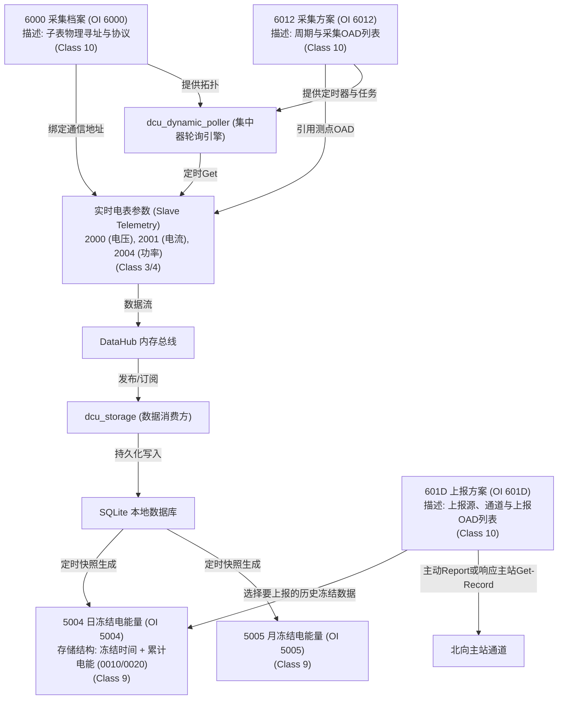

# DL/T 698.45 OAD 逻辑关系与协同机制深度分析

在集中器 (DCU) 的实际业务中，所有的 OAD (Object Attribute Descriptor) 绝非孤立存在的数据点，它们之间存在着极强的**因果级联、时间协同和触发映射关系**。

如果不理清 OAD 之间的关系，代码将沦为死板的报文拼接，无法支撑真实的集中器主动抄表与数据存储逻辑。

---

## 一、 OAD 关系总览图

以下是集中器内部 OAD 之间的业务数据流向与配置级联关系：



---

## 二、 核心 OAD 间的三大逻辑关系

### 1. 档案与寻址的“拓扑级联”关系（Who & How）
*   **主体 OAD**：`OAD 60000200`（采集档案配置单元 - 属性 2：电能表配置信息）
*   **客体 OAD**：所有子表的实时数据 OAD（如 `OAD 20000200` 电压，`OAD 20010200` 电流）。
*   **逻辑因果**：
    *   `OAD 60000200` 包含一个结构体数组，每一个电能表条目具有：`TSA`（电能表通信地址）、`通信协议`（如 DLT645、DLT698）、`通道号`、`波特率`等。
    *   **没有 `6000` 里的电表注册，后续所有针对该表的 `2000`（电压）、`2001`（电流）物理采集都将因为“寻址无目标”而无法被 `bus_orchestrator` 执行。**

### 2. 轮询方案与目标参数的“绑定调度”关系（When & What）
*   **调度 OAD**：`OAD 60120200`（采集方案配置单元 - 属性 2：采集方案）
*   **目标 OAD**：需要采集的数据点 OAD 列表。
*   **逻辑因果**：
    *   `OAD 60120200` 定义了轮询的周期（如：`Interval = 15分钟`）以及该任务下关联的 **采集 OAD 队列**。例如：
        *   `Task A (15s)` $\to$ `[OAD 20000200 (电压), OAD 20010200 (电流)]`
        *   `Task B (1小时)` $\to$ `[OAD 00100200 (正向有功电能量)]`
    *   集中器的 `dcu_dynamic_poller` 根据该配置动态生成多个 `uv_timer_t`。
    *   每当定时器到期时，轮询器**遍历该任务绑定的 OAD 队列**，自动将多个离散的 OAD 打包成 DLT698.45 的 `GET-Request-NormalList`（如果是多个 OAD）或单个 `GET-Request-Normal` 报文发送给对应的从表。

### 3. 实时变量与历史冻结的“时空快照”关系（Instantaneous vs. Freeze）
这是“抄表业务”最难也是最核心的逻辑关系：
*   **源数据 OAD（实时）**：`OAD 00100200`（正向有功电能量）、`OAD 00200200`（反向有功电能量）等实时变化的值。
*   **冻结 OAD（历史）**：`OAD 50040200`（日冻结电能量）、`OAD 50050200`（月冻结电能量）。
*   **时间戳 OAD**：`OAD 20210200`（数据冻结时间）。
*   **逻辑因果**：
    *   `5004` (日冻结) 不是简单的数据，它在 DLT698 协议中属于 **Class 9 (冻结数据接口类)**，属性 2 的数据结构为 **Structure of (冻结时间, 数据结构体数组)**。
    *   **时空对齐**：当集中器检测到时钟走到了零点（如 24:00），或者接收到 `Action 8010` (强制冻结) 命令时，会触发**冻结行为**。
    *   **快照归档**：集中器会“拍摄一张照片”：把当前时刻的实时电能量 `0010` 和 `0020` 的当前最新值取出，与当前的冻结时刻时间戳 `2021` 捆绑打包，写入 SQLite 数据库中的 `dcu_freeze_data` 表。
    *   **关系映射表**：

| 实时 OAD (瞬时源数据) | 触发机制 (时间/事件) | 产生的冻结 OAD (历史断面) | 关联的时间戳 OAD |
| :--- | :--- | :--- | :--- |
| `00100200` (当前正向有功) | 每日零点 (24:00) | `50040200` (日冻结电能) | `20210200` (数据冻结时间) |
| `00100200` (当前正向有功) | 每月1日零点 | `50050200` (月冻结电能) | `20210200` (数据冻结时间) |
| `20000200` (当前电压) | 每隔15分钟采样 | `50000200` (曲线冻结数据) | `20210200` (数据冻结时间) |

---

## 三、 SQLite 数据库模型设计与 OAD 映射

为支持上述 OAD 关系及北向主站对历史冻结数据的 `GET-Request-Record` 查询，我们的数据库设计不再是传统的平面表，而是高度结构化的 **OAD 关系影射表**。

### 1. 档案表 (`dcu_meters`)
对应 `OI 6000` (采集档案配置单元)
```sql
CREATE TABLE dcu_meters (
    meter_address TEXT PRIMARY KEY, -- 电能表通信地址 (TSA)
    protocol_type TEXT,            -- 协议 (DLT645, DLT698)
    baud_rate INTEGER,             -- 波特率
    channel_id INTEGER             -- 通道 ID
);
```

### 2. 实时状态表 (`dcu_telemetry_latest`)
对应 `DataHub` 中的最新状态，承载 Class 1/2/3/4 的实时 OAD。
```sql
CREATE TABLE dcu_telemetry_latest (
    meter_address TEXT,
    oad TEXT,                      -- 例如 "20000200" (电压)
    value REAL,                    -- 标量浮点数值
    ts INTEGER,                    -- 最新更新时间戳 (UTC ms)
    PRIMARY KEY (meter_address, oad)
);
```

### 3. 历史断面冻结数据表 (`dcu_freeze_history`)
对应 `OI 5004` (日冻结) / `OI 5005` (月冻结) 等 Class 9 数据的持久化。
```sql
CREATE TABLE dcu_freeze_history (
    meter_address TEXT,
    freeze_oad TEXT,               -- 冻结OAD，如 "50040200" (日冻结), "50050200" (月冻结)
    freeze_time INTEGER,           -- 冻结发生时间戳 (对应 OAD 20210200)
    source_oad TEXT,               -- 源实时OAD，如 "00100200"
    frozen_value REAL,             -- 冻结时刻的电量快照
    PRIMARY KEY (meter_address, freeze_oad, freeze_time, source_oad)
);
```

---

## 四、 代码实现层面的因果逻辑转换

在具体编码时，我们需要将这些 OAD 逻辑关系转化为具体的业务处理函数：

### 1. 生产者链路：`dcu_dynamic_poller` -> DataHub
1. 定时器触发。
2. 依据 `6012` 配置的方案，获取当前方案的 `OAD 列表`（如 `20000200`, `20010200`）。
3. 查找 `6000` 中已注册的激活表计。
4. 打包 A-XDR `GET-Request`，驱动 IO 下发物理抄读。
5. 收到电表报文，解码出浮点数。
6. 将数据发布到 DataHub。

### 2. 消费与冻结链路：DataHub -> `dcu_storage` -> SQLite
1. `dcu_storage` 订阅 DataHub 的 `OAD 2000` / `OAD 2001` / `OAD 0010` 等更新消息。
2. 写入最新值表 `dcu_telemetry_latest`（实时消费）。
3. **时钟冻结触发器**：内置一个基于零点的 `uv_timer_t`，或者接收到特定的 Action (强制冻结)。
4. 当冻结触发时，查询 `dcu_telemetry_latest` 提取出当前的 `0010` (电能量)，并将其与当前的系统时间戳（作为 `20210200`）捆绑，执行 `INSERT INTO dcu_freeze_history`，归档为 `50040200` (日冻结) 或 `50050200` (月冻结)。

### 3. 北向查询（RSD 机制）：北向 -> `dcu_storage` -> A-XDR Response
1. 收到 `GET-Request-Record` 报文，查询的 OAD 为 `50040200` (日冻结)。
2. 报文具有 RSD (Record Selective Descriptor) 描述符，里面带有：
   *   `开始时间` 和 `结束时间`
   *   `要筛选的数据列 OAD`（如只要 `0010` 这一列）
3. `dcu_storage` 解析 RSD 过滤参数。
4. 转化为 SQL 语句：
   ```sql
   SELECT source_oad, frozen_value, freeze_time 
   FROM dcu_freeze_history 
   WHERE meter_address = ? AND freeze_oad = '50040200' 
     AND freeze_time >= ? AND freeze_time <= ?;
   ```
5. 执行 SQLite 查询，将行数据转成 A-XDR 的 Structure 数组，返回给北向。
