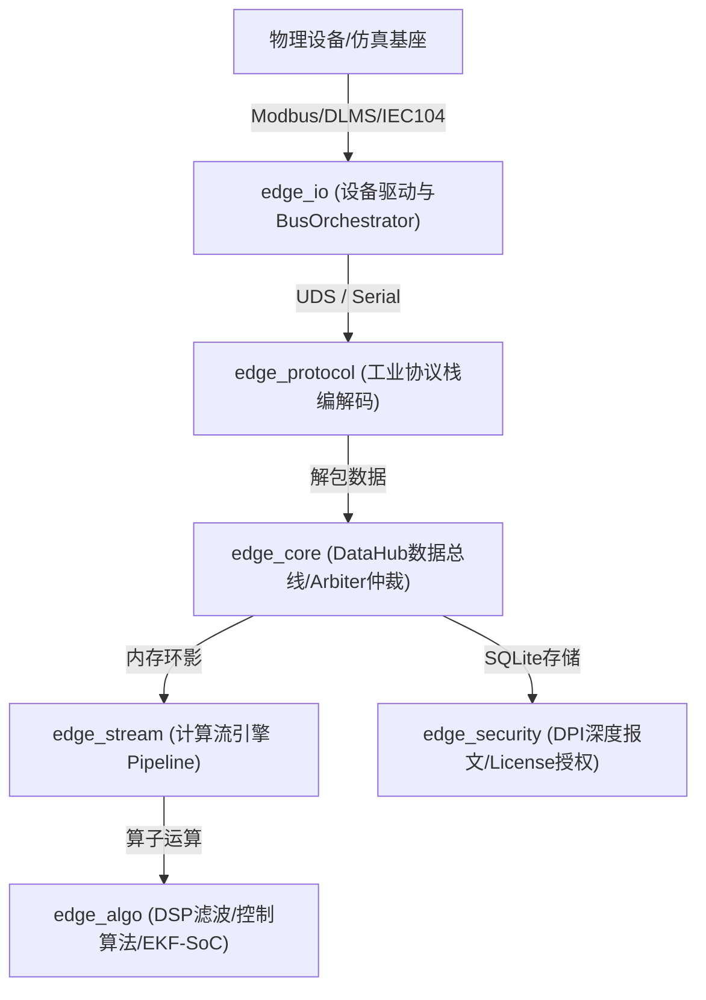

# EdgeOS / EdgeC 工业级边缘计算二开完全手册 (The Ultimate Developer's Handbook)

> [!NOTE]
> 本手册专为需要在 EdgeOS / EdgeC 项目上进行**二次开发、新增应用（cmd）、扩展驱动/协议、或编写计算算子**的研发人员编写。通过阅读本文档，你将深刻理解其核心哲学，并能在 10 分钟内完成首个商业化边缘应用的开发与测试。

---

## 1. 💡 边缘计算使命与设计哲学

EdgeOS / EdgeC 是一款专门针对多物理架构（x86_64、ARM64 等）设计的**确定性、轻量级、高性能、事件驱动的工业边缘计算 SDK**。它专注于解决工业 IoT 现场“断线缓存难、高频计算慢、物模型映射乱、运行死锁卡死”等行业痛点。

其核心设计哲学包含：
1. **物模型契约驱动（Contract-Driven）**：设备寄存器映射与系统运行时参数由 `YAML` 统一物理模型契约定义，通过 Go 语言编写的编译器在构建期编译为极致高效的 C 语言静态只读表（`contracts.c`），告别运行期反射与海量解析开销。
2. **事件驱动与确定性调度**：底层依靠 `libuv` 异步事件循环驱动网络、文件和总线，但在算子（Stream Pipeline）和数据交互上提供优先级抢占机制，确保高频瞬态保护（如 280V 过压拦截）能在毫秒内收敛。
3. **极简二开与非侵入性设计**：支持以 RTOS Module (如 Zephyr module) 和普通 Linux Daemon 两种双轨模式构建，对外部核心三方件采用非侵入性对接。

---

## 2. 🏛️ EdgeC 核心架构与核心组件

EdgeC 采用 Qt 与 Kconfig 混合风格的高度模块化结构，各核心组件相互独立，通过统一的 `edge_service` 机制进行组装：



### 核心模块职责拆解

*   **`edge_core` (基础骨架)**：
    *   **DataHub**：高性能内存数据总线，拥有高频发布订阅接口，支持实时“影子影子（Shadow）”状态，允许 UI 进程或其他多进程在零内存开销下通过 `ShmRing`（共享内存环）瞬时监听。
    *   **Arbiter**：优先级抢占与冲突解决机制。高频测点在发生瞬态变化时，自动按照优先级排队提交总线写命令。
    *   **SQLite Service**：内置本地可靠持久化服务，提供防止 SQL 注入的参数化查询外壳。
*   **`edge_io` (设备通道与驱动)**：
    *   **BusOrchestrator**：多路通信总线编排器，通过微秒级定时器驱动多路物理通道的并发轮询与控制反馈。
    *   **Store and Forward (SnF)**：断线缓存机制。当上北向通道断开时，遥测数据秒级落库；物理链路重建后，按时序合并回放上报，保证数据不丢。
*   **`edge_stream` (执行流引擎)**：
    *   动态执行流水线（Pipeline Loader）。通过加载 JSON 拓扑配置，以算子管道（Stage）的形式对数据进行滤波、统计及判定（如卡尔曼滤波、FIR 滤波器等）。
*   **`edge_algo` (纯算法逻辑)**：
    *   工业级数学运算，包括离散傅里叶（DSP）、矩阵运算（LinAlg）、卡尔曼滤波（EKF-SoC）、抗积分饱和 PID 控制器等。
*   **`edge_protocol` (工业协议栈)**：
    *   Modbus RTU/TCP、IEC104、DLT645、DLT698、DLMS 等各型协议的物理编解码，独立于底层 IO 传输层。

---

## 3. 📦 依赖关系与依赖构建系统

### 3.1 构建工具依赖
*   **本地 Python 虚拟环境** (`.venv`)：用于运行 Kconfig 生成脚本。
*   **契约编译器** (`tools/contract-compiler-v2/contract-compiler`)：由 Go 语言编写的专用物模型 codegen 编译器。
*   **外部库**：`libuv`、`sqlite3`、`cmocka`（单元测试必要）、`mbedtls`、`zlog`。

### 3.2 极速构建命令

#### x86_64 本地原生编译与单元测试
```bash
# 1. 清理并生成 Kconfig 预置配置 
./build.sh --clean

# 2. 静态检查、CMake 校验并使用 Ninja 编译
./build.sh

# 3. 运行全量 69 个 cmocka 单元测试
./test.sh
```

#### ARM64 (Aarch64) 交叉编译 (CPack 生成包)
```bash
# 进入构建目录，加载交叉编译工具链
mkdir -p build && cd build
cmake .. -GNinja -DCMAKE_BUILD_TYPE=Release -DCMAKE_TOOLCHAIN_FILE=cmake/toolchains/aarch64-linux-gnu.cmake
ninja

# 打包生成发布产物 .deb 安装包与 .tar.gz 压缩包
cpack -G DEB && cpack -G TGZ
```

---

## 4. 🚀 适合做什么工业产品？

基于 EdgeC 高内聚、低内存、微秒级响应的特点，它非常适合开发以下几类工业边缘计算核心产品：

| 产品名称 | 目标功能 | 核心组件联动 |
| :--- | :--- | :--- |
| **IEMS (综合能源管理系统)** | 监控光储直柔系统、实施微网协调控制、高频防逆流控制。 | `edge_io` + `edge_algo` (PID/EKF) + `edge_stream` |
| **DCU (智能配电终端)** | 遥信/遥测/遥控/遥调、谐波畸变率检测、过压保护瞬态切断。 | `edge_core` + `edge_protocol` (IEC104) + `edge_security` |
| **BMS 储能网关** | 电池健康度估算（SoC/SoH）、热失控早期预警。 | `edge_algo` (EKF) + `edge_io` + `edge_stream` |
| **VPP Agent (虚拟电厂终端)** | 动态响应电网调度指令、本地多策略负荷优化调节。 | `edge_core` + `edge_stream` + `edge_protocol` (MQTT) |

---

## 5. 🛠️ 快速上手实操（四大二开核心场景）

### 💡 Scenario A: 零起点新建一个商业边缘计算产品（在 `cmd/` 下）

想要在 `cmd/` 目录下创建一个名为 `micro_grid` 的储能控制程序，请遵循以下四步：

#### Step 1: 创建 `cmd/micro_grid` 目录并配置 `prj.conf` (编译开关)
在 `cmd/micro_grid/prj.conf` 中声明需要的系统模块：
```ini
CONFIG_EDGEC_TIER="ENTERPRISE"
CONFIG_EDGEC_ALGO_DSP=y
CONFIG_EDGEC_PROTO_MODBUS=y
CONFIG_EDGEC_WASM=n
```

#### Step 2: 编写 `CMakeLists.txt`
```cmake
# cmd/micro_grid/CMakeLists.txt
set(PROD_NAME micro_grid)

# 1. 挂载物理物模型契约自动 codegen 宏
edge_add_contract(
    contract_${PROD_NAME}
    "${CMAKE_SOURCE_DIR}/contracts/products/evse.yaml"  # 指向物模型
    "${CMAKE_CURRENT_SOURCE_DIR}/manifest.yaml"         # 本地扩展描述
)

# 2. 添加可执行目标并指定静态库链接 (使用 start-group 避免循环依赖)
add_executable(micro_grid main.c)
set_target_properties(micro_grid PROPERTIES
    RUNTIME_OUTPUT_DIRECTORY "${CMAKE_BINARY_DIR}/products/${PROD_NAME}/bin"
)
target_link_libraries(micro_grid PRIVATE 
    -Wl,--start-group
    edge_io 
    edge_stream 
    edge_algo
    edge_core
    edge_protocol
    -Wl,--end-group
    contract_${PROD_NAME}
)
```

#### Step 3: 编写应用框架 `main.c` (完美模板)
```c
#include <stdio.h>
#include <stdlib.h>
#include <uv.h>
#include "contracts.h"
#include "edge_service.h"
#include "edge_api.h"

// 全局服务结构体，便于生命周期托管
typedef struct {
    service_t *svc;
    datahub_t *hub;
    bus_orchestrator_t *orch;
} my_app_t;

static my_app_t g_app = {0};

// 数据通道轮询结束后的统一回调函数
static void on_data_arrived(int status, const pipe_msg_t *result) {
    if (status == 0 && result && g_app.hub) {
        printf("【数采总线】接收到测点数据: Tag=%d, Val=%.2f\n", 
               result->tag_id, result->payload.val.f);
        // 发布到本地 DataHub 实时总线，触发下游 Stream 流引擎过滤
        datahub_publish(g_app.hub, result);
    }
}

// 主轮询周期定时器回调
static void on_poll_timer(uv_timer_t *handle) {
    (void)handle;
    // 从自动生成的 contracts.h 静态只读表获取测点进行物理读取
    // 假设读取测点 1 (主变 A 相电压)，使用 ModbusRTU 协议，从站号 1
    edge_api_read_tag(0, "ModbusRTU", 1, 1, on_data_arrived);
}

int main(int argc, char **argv) {
    printf("🚀 Starting Micro Grid Controller...\n");
    
    uv_loop_t *loop = uv_default_loop();

    // 1. 初始化核心系统底座服务组件
    g_app.svc = service_create();
    g_app.hub = service_get_datahub(g_app.svc);
    g_app.orch = service_get_orchestrator(g_app.svc);

    // 2. 启动总线编排器（事件驱动）
    bus_orchestrator_run(g_app.orch);

    // 3. 挂接周期数采定时器 (1秒周期)
    uv_timer_t poll_timer;
    uv_timer_init(loop, &poll_timer);
    uv_timer_start(&poll_timer, on_poll_timer, 1000, 1000);

    // 4. 移交事件循环
    return uv_run(loop, UV_RUN_DEFAULT);
}
```

---

### 🔌 Scenario B: 编写并注册一个新的通信协议及驱动

如果你需要对接一种新的“高精温度采集模块”，你需要扩展 `bus_engine_t` 通道驱动，并在 `edge_io` 中完成注册。

#### Step 1: 声明新的设备通信驱动结构体与接口
在 `modules/edge_io/src/drivers/` 下新建 `my_temp_driver.c`：
```c
#include "bus_engine.h"
#include "net_buf.h"

typedef struct {
    bus_engine_t base; // 必须作为首个成员以实现 C 语言下的面向对象继承
    char serial_port[32];
    int baudrate;
} my_temp_driver_t;

// 通道打开动作
static int _temp_drv_open(bus_engine_t *self) {
    my_temp_driver_t *impl = (my_temp_driver_t *)self;
    printf("【设备驱动】成功打开高精温度采集物理通道: %s\n", impl->serial_port);
    self->state = BUS_STATE_CONNECTED;
    return 0;
}

// 核心命令处理接口 (例如发起读命令)
static int _temp_drv_run_command(bus_engine_t *self, cmd_msg_t *cmd) {
    if (cmd->action == CMD_ACTION_READ) {
        printf("【设备驱动】执行遥测读取，测点ID: %d\n", cmd->tag_id);
        
        // 模拟物理设备响应，直接将测量值通过驱动基类通知上层
        pipe_msg_t resp = {
            .tag_id = cmd->tag_id,
            .type = PIPEMSG_TYPE_SCALAR,
            .payload.val.f = 26.54 // 采集到 26.54 ℃
        };
        self->on_receive(self, &resp);
        
        // 命令成功处理后，触发命令的清理生命周期，避免内存泄漏
        if (cmd->on_cleanup) {
            cmd->on_cleanup(cmd);
        }
    }
    return 0;
}

// 驱动析构销毁防内存泄露
static void _temp_drv_destroy(bus_engine_t *self) {
    free(self);
}

// 驱动实例化创建注册接口
int my_temp_driver_register(driver_manager_t *mgr) {
    // 实例化基础引擎方法指针
    static const bus_engine_ops_t ops = {
        .open = _temp_drv_open,
        .run_command = _temp_drv_run_command,
        .destroy = _temp_drv_destroy
    };
    
    // 注册驱动工厂到设备管理器
    // 这样在 contracts.yaml 指定此协议时，系统便会自动实例化并装载该驱动
    return driver_manager_register(mgr, "TempSensor", &ops);
}
```

---

### 🌊 Scenario C: 开发一个新的数据流计算算子 (Pipeline Stage)

在 EdgeC 中，所有高频的数据处理（如滤波器、阈值判断）都被抽象成了流水线算子。你想扩展一个名为 `Lpf` (低通滤波器) 的计算 Stage：

#### Step 1: 在 `standard_stages.c` 中定义算子处理核心逻辑
```c
// modules/edge_stream/src/standard_stages.c

typedef struct {
    double alpha;     // 滤波系数 (0 ~ 1.0)
    double last_val;  // 上一次历史输出
} _lpf_state_t;

static stage_ret_t _lpf_proc(pipeline_stage_t *s, pipe_msg_t *ev) {
    // 仅处理标量浮点数值类型的消息流
    if (ev->type != PIPEMSG_TYPE_SCALAR) return STAGE_OK;
    
    _lpf_state_t *st = (_lpf_state_t *)s->priv_state;
    
    // Y(n) = a * X(n) + (1-a) * Y(n-1)
    double filtered = st->alpha * ev->payload.val.f + (1.0 - st->alpha) * st->last_val;
    st->last_val = filtered;
    
    // 篡改事件的值，向流水线后级传递平滑滤波后的数值
    ev->payload.val.f = (float)filtered;
    return STAGE_OK; // STAGE_OK 表示放行事件；若要拦截/抛弃，可返回 STAGE_DROP
}

// 释放分配的特有状态
static void _lpf_cleanup(void *p) {
    free(p);
}
```

#### Step 2: 绑定并注册该 Stage 工厂方法
在同文件的 `pipeline_stage_create` 中加入你的算子解析：
```c
pipeline_stage_t *pipeline_stage_create(const char *type, void *json_cfg) {
    pipeline_stage_t *s = calloc(1, sizeof(pipeline_stage_t));
    if (strcmp(type, "LowPassFilter") == 0) {
        _lpf_state_t *st = calloc(1, sizeof(_lpf_state_t));
        st->alpha = 0.25; // 从 json_cfg 解析出来的滤波强度参数
        st->last_val = 0.0;
        
        s->priv_state = st;
        s->process = _lpf_proc;
        s->cleanup = _lpf_cleanup;
    }
    return s;
}
```

---

### 📜 Scenario D: 设计新物模型定义并使用契约编译器

想要在系统里添加一个新的测点 `SOLAR_CURRENT` (光伏电流)：

#### Step 1: 修改物理契约文件 `contracts/products/iems_v5.yaml`
```yaml
# 在对应字段下追加测点描述
VOLTAGE_PHASE_A:
  id: 1
  type: float
  poll_interval_ms: 1000
  
# 新增光伏电流测点
SOLAR_CURRENT:
  id: 2
  type: float
  poll_interval_ms: 500  # 高频采集 (500ms)
  bindings:
    - protocol: ModbusRTU
      attributes: { addr: 14, scaler: 0.01, slave_id: 1 } # Modbus 地址 14，0.01 精度系数
```

#### Step 2: 执行重新配置编译，自动生成查表代码
```bash
./build.sh --clean
./build.sh
```
编译完成后，你就可以在 C 代码里通过 `SOLAR_CURRENT` 这个宏定义调用它：
```c
// 得到语义化寻址的元数据
const edge_tag_meta_t *meta = contract_tag_get_meta(SOLAR_CURRENT);
printf("高频测点采样率: %d ms\n", meta->poll_interval_ms);
```

---

## 🎭 6. 场景仿真演习（Omnis Plane）与自动化测试

EdgeC 提供了一套极度强大的**离线仿真演习基座 (Matrix Plane)**。在无任何硬件实体时，也能一键拉起虚拟物理背板和 Actor 来测试你的二开产品。

```
                        【仿真调试全闭环】
 +------------------+   模拟注入   +-------------------+
 |   Matrix Host    | -----------> |   Virtual Bus     |
 |  (仿真基座服务)  | <----------- | (UDS Domain Sock) |
 +------------------+   抓包检验   +-------------------+
          |                                  ^
          | 控制与监视                       | 轮询/控制
          v                                  |
 +------------------+                  +-------------------+
 |    Matrix CLI    |                  |  EdgeC (你的产品) |
 |  (命令行上帝视角)|                  | (如 iems 主进程)  |
 +------------------+                  +-------------------+
```

### 6.1 如何编写 YAML 演习场景描述
场景用来描述自动化演习中的物理参数注入步骤。在 `cmd/iems/scenarios/fault_test.yaml` 中新增：
```yaml
name: "过压继电器保护跳闸场景"
steps:
  - time_s: 2
    action: "inject"
    target: "METER_MAIN"
    field: "VOLTAGE_PHASE_A"
    value: 231.5 # 正常态
  - time_s: 5
    action: "inject"
    target: "METER_MAIN"
    field: "VOLTAGE_PHASE_A"
    value: 285.5 # 瞬态严重过压！预期应触发反射保护切断继电器
```

### 6.2 如何编写 Pytest 集成测试用例
在 `cmd/iems/matrix/` 目录下添加你的 Python 测试用例 `test_my_control.py`：
```python
import time
import pytest
from omnis_matrix import MatrixClient

def test_overvoltage_reflex_trip():
    # 1. 链接仿真基座客户端
    client = MatrixClient(port=50051)
    
    # 2. 注入正常电压并检验
    client.inject("METER_MAIN", "VOLTAGE_PHASE_A", 220.0)
    time.sleep(1)
    assert client.read_tag("SOLAR_RELAY") == 1 # 正常状态下继电器合闸闭合 (1)
    
    # 3. 突发注入过压电压 (285V)
    client.inject("METER_MAIN", "VOLTAGE_PHASE_A", 285.0)
    time.sleep(2) # 等待保护检测和总线提交
    
    # 4. 断言判定：继电器必须被安全切断为分闸断开状态 (0)
    assert client.read_tag("SOLAR_RELAY") == 0
```
#### 运行自动化集成演习：
```bash
./test.sh --omnis
```

---

## 🚦 7. CI/CD 系统与镜像打包流程

GitHub Actions 配置文件位于 `.github/workflows/ci.yml`。每次对主要分支的推送会经历以下三个严密阶段，开发者在二开时需注意兼容性：

1.  **静态检查与单元测试矩阵 (Build & Test)**
    *   在 x86_64 原生环境下编译，编译参数中注入 `-DENABLE_COVERAGE=ON`，自动拉起 69+ 个单元测试，收集并强制校验覆盖率必须达标。
2.  **多架构 Docker 镜像构建**
    *   在 Native 跑通后，拉起 `docker/Dockerfile.prod`，通过 `docker buildx` 并发构建支持 `linux/amd64` 和 `linux/arm64` 的跨架构轻量化 Docker 镜像，并推送至 GitHub 容器注册表（GHCR）。
3.  **GitHub Release 发布契约包**
    *   当触发以 `v*` 打头的版本标签推送时，CI 自动收集编译成功的交叉编译安装包（`.deb` / `.tar.gz`），创建 GitHub Release 并自动生成 ChangeLog。

---

## 🧩 8. Zephyr RTOS Module 适配与设计

为满足深层实时嵌入式需求，EdgeC 支持作为独立的 **Zephyr Module** 在微控制器（如 Vango V32F20x 等 SOC）上部署。

*   **组织结构**：`modules/hal/` 下的原厂 HAL 被组织成独立的 Zephyr Module，保证非侵入式对接。
*   **外设极高完整度**：SOC 适配需要将所有的外设 DTS 节点（UART0 ~ UART3、ADC、GPIO 等）与 Pinctrl 全部在 `soc/` 下写全并默认 `status = "disabled"`。应用只需在其 `app.overlay` 中显式指定 `status = "okay"` 即可无痛运行。
*   驱动以标准 Zephyr 驱动模型接口封装，方便任意 RTOS 和 Linux 原生应用层之间的跨平台代码复用。
