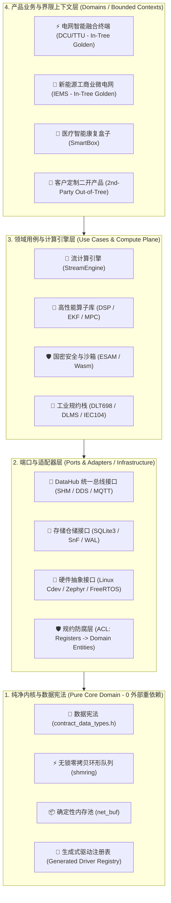

# ADR-0008: EdgeOS 15年防腐化工程架构白皮书与治理宪章 (Anti-Entropy Architecture Charter V5)

- **状态**: Proposed (待 Mr. WKT 终审签署)
- **日期**: 2026-08-16
- **决策者**: Mr. WKT & EdgeOS Architecture Committee
- **修订与继承关系**: 
  - **修订 ADR-0005**: 继承 `datahub_ops_t` 虚表设计，但将其中的 DDS 与 MQTT 后端实现从 `edge_core` 下沉至 `edge_infra`。
  - **继承 ADR-0007**: 完整保留 SQLite WAL、SnF 崩溃一致性与时序分表机制，将其迁移至 `edge_infra/storage`，保留原有全部韧性测试。

---

## 1. 业务背景与问题定义 (Context & The Entropy Problem)

在面向 10 ~ 15 年超长生命周期的工业嵌入式与边缘计算系统（如电网集中器、工商业储能、光储充微电网、智能辅助医疗设备）的演进过程中，随着**多人协作、多产品线并行、多团队二次开发**，系统极易在 2~3 年内迅速退化为不可维护的“代码屎山”。

### 💥 核心致腐反模式 (The 4 Deadly Sins of Embedded Entropy)
1. **散弹式中央注册反模式 (The Shotgun Registration Anti-Pattern)**：
   - 随产品线增加，若在 `main.c` 中不断堆叠特定驱动的手工 `extern int xxx_register()` 声明，会导致每增加一个驱动或产品都必须修改全局核心文件。
2. **基础设施反向侵入底座 (Dependency Inversion Inversion)**：
   - 底层基础库（如 `edge_core`）直接链接并硬编码依赖了 `SQLite3`、`PahoMQTT`、`CycloneDDS` 等外部重型第三方框架，导致内核无法轻量化移植，微服务无法单独使用纯净内存总线。
3. **二开污染核心 SDK (SDK Contamination by 2nd-Party Developers)**：
   - 外部二开工程师为了快速实现业务功能，直接在核心 SDK 源码树中修改底层代码，导致上游 EdgeOS 无法平滑升级。
4. **领域模型贫血与界限上下文混乱 (Bounded Context Entanglement)**：
   - 不同的业务垂直领域（电网 DCU、储能 IEMS、医疗 SmartBox）共享底层扁平的 Tag 空间，缺乏显式的领域实体（Domain Entity）与聚合根（Aggregate Root）。

---

## 2. 业界顶级工程底座对标 (World-Class Benchmarks)

```
+---------------------------------------------------------------------------------------------------------------+
|                                      四大世界级工业与开源架构对标矩阵                                         |
+---------------------------------------------------------------------------------------------------------------+
|  标杆对象             核心机制与借鉴原则                                         EdgeOS 落地映射               |
+---------------------------------------------------------------------------------------------------------------+
|  1. CDD / 编译器驱动 • 生成式驱动注册表 (Generated Driver Registry via YAML)   -> 契约编译器自动生成，0 手写 |
|                      • 纯非侵入式 Out-of-Tree 独立工程编译体系 (CMake Config)  -> 保护核心 SDK 0 修改        |
|                                                                                                               |
|  2. ROS 2            • 中间件抽象接口 (RMW - ROS Middleware Interface)          -> DataHub VTable 多后端解耦  |
|                      • 客户端库 (RCL) 与节点应用完全物理隔离                    -> 纯业务节点无感知底层通信   |
|                                                                                                               |
|  3. Clean / Hexagon  • 端口与适配器架构 (Ports & Adapters in C)                 -> 使用者制定接口 (Ops 虚表)  |
|                      • 纯领域内核 0 外部重依赖 (0 External Frameworks in Core)  -> SQLite/MQTT/DDS 下沉为插件 |
|                                                                                                               |
|  4. DDD 领域驱动     • 严格界限上下文 (Bounded Contexts) 物理隔离               -> 建立 CONTEXT-MAP 独立内聚  |
|                      • 防腐层 (Anti-Corruption Layer, ACL) 隔离第三方老旧协议   -> 保护核心业务模型不受污染   |
+---------------------------------------------------------------------------------------------------------------+
```

---

## 3. EdgeOS 终极防腐化架构模型 (Target Architecture)



---

## 4. 15年防腐化工程治理七大铁律 (The Governance Charter)

### 宪章第 1 条：开放-封闭原则与契约生成式注册 (Open-Closed Principle, OCP)
- **铁律**：核心 SDK（`/core`、`/modules`）为只读资产。新增任何一款新产品（Product）、新外设驱动（Driver）或新算法（Stage），**严禁在已有的核心文件中增加任何一行代码或手工 `extern`**。
- **技术实现机制**：由 `contract_compiler` 根据产品 YAML 自动生成 `edge_driver_registry.c`。
- **生成物可信链**：所有编译器生成的 C/Go/IDL 代码均带 `AUTO-GENERATED` 指纹，CI 自动化检测生成物漂移，**手改生成物直接阻断构建**。

### 宪章第 2 条：纯净内核白名单与定性/定量双重门禁 (Pure Core Whitelist & Gating)
- **定性约束（铁律）**：`edge_core` **零网络、零外部数据库、零文件系统重依赖**。
  - 允许白名单：基础 C 标准库 + `libuv`（事件驱动底座） + `zlog`（审计日志基座）；
  - 基础设施下沉：`SQLite3`、`PahoMQTT`、`CycloneDDS`、`cJSON` 全部下沉至 `modules/edge_infra/`。
- **定量门禁（长期硬约束）**：
  - 口径：`Release + -ffunction-sections -fdata-sections + --gc-sections + strip`；
  - 静态库尺寸门禁：`WARN > 120KB`，`ERROR > 150KB`。
- **CI 机械门禁**：通过 `scripts/check_core_symbols.sh`（`nm -u libedge_core.a`）自动化校验无未授权外部符号。

### 宪章第 3 条：树内参考样板与树外二开物理隔离 (In-Tree Golden vs Out-of-Tree Custom)
- **定位明确**：
  - `cmd/iems` 与 `cmd/dcu` 作为 **“树内参考样板产品 (In-Tree Golden Products)”** 保留在主仓库，用于核心 CI 回归、134/134 CTest 验证与 10/10 Matrix 端到端物理仿真。
  - 外部二次开发团队的产品（如 `custom_bess_v2`）**强制采用 Out-of-Tree 独立代码仓库**，通过 `find_package(EdgeOS REQUIRED)` 引用 SDK 预编译产物，严禁修改 EdgeOS 源码树。
- **二开便利性验收标准**：**新工程师从 git clone 到跑通 Hello-World 样例工程 $\le 30\text{分钟}$**。

### 宪章第 4 条：二开项目工具链赋能与平滑迁移 (Developer Ergonomics & Migration CLI)
- **工具链支持**：推出 `tools/edge-cli`，提供交互式工程生成与本地契约校验：
  ```bash
  edge-cli create-product my_station --template=iems
  edge-cli create-driver my_cooler --proto=modbus
  edge-cli lint-contract contracts/bindings/modbus/my_cooler.yaml
  edge-cli migrate --from=v1.0 --to=v2.0 # 跨大版本自动改写 API 与 CMake 依赖
  ```

### 宪章第 5 条：DDD 界限上下文、Tag 零破坏迁移与防腐层治理 (DDD & ACL)
- **界限上下文**：建立全局 `CONTEXT-MAP.md` 与各垂直域 `CONTEXT.md` 统一语言词汇表。
- **TagID 兼容与分域策略**：
  - 新增 Tag 严格走分域命名空间（`0x01xxxx` DCU, `0x02xxxx` IEMS, `0x03xxxx` SmartBox）；
  - 存量 Tag（1001/2001/12001）保留在 `legacy_aliases.yaml` 中，确保现有数据库与通信协议**零破坏平滑过渡**。
- **防腐层 (ACL)**：在 `modules/edge_infra/acl/` 中建立规约寄存器到领域实体的防腐映射，禁止原始寄存器物理地址穿透至业务算法决策层。

### 宪章第 6 条：行业合规、认证基线与需求追溯 (Compliance & Traceability)
为满足 10~15 年生命周期中医疗器械与电力入网硬性认证要求：
1. **医疗软件生命周期 (IEC 62304)**：SmartBox 核心算法与数据流必须建立变更分类与软件安全架构；
2. **工业网络安全 (IEC 62443-4-2)**：DCU 与 IEMS 固化安全等级（SL-2+），强制落地 SBOM 与安全回归基线；
3. **需求追踪矩阵 (RTM)**：维护需求 $\rightarrow$ 架构设计 $\rightarrow$ 单元测试 $\rightarrow$ 仿真证据全链路双向追溯表；
4. **MISRA C:2012 静态扫描**：在 CI 中建立核心模块 MISRA 规则检查门禁。

### 宪章第 7 条：15年时间维度长期防腐机制 (Temporal Anti-Entropy Engine)
1. **ADR 生命周期管理**：采用 `Proposed` $\rightarrow$ `Accepted` $\rightarrow$ `Superseded` 严格状态流转；每年执行一次“ADR 与代码实现一致性”审计。
2. **严格的 ABI/API 兼容性契约**：`PipeMsg` 结构体物理尺寸（64 字节）、`edge_tag_meta_t` 以及核心 VTable 虚表由 Golden Header 自动化测试锁定；ABI 变更必须提升主版本号。
3. **软件物料清单 (SBOM) 与依赖 EOL 日历**：建立第三方开源库（CycloneDDS, QuickJS, WAMR, open62541）的生命周期追踪与安全补丁跟踪表。
4. **代码所有权与只读门禁 (CODEOWNERS)**：核心内核与基础设施目录的改动必须经过双人签署，CI 只读门禁不可静默豁免。
5. **年度防腐健康审计**：每年度采集代码复杂度、模块耦合度、TODO 密度与 CI 构建红灯时长，输出《年度 EdgeOS 防腐健康报告》。
