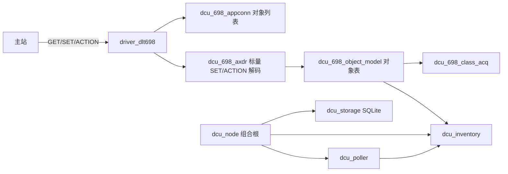
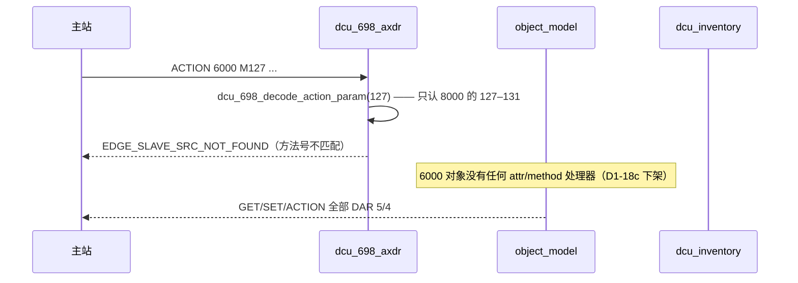

# 现状勘察：DCU Class 10 采集档案（D2-02）

基线：分支 `dcu/D2-02-class10`（worktree `/tmp/dcu-d2-02`）| 提交 `f0ec96fe` | 日期 2026-11-22 | 评审人 待定
形态：主干加配置（仅 DCU 产品）

置信度：**已验证** = 直接读代码/标准原文；**推断** = 由代码推导；**待验证** = 未确认。

## 1. 范围与方法

**本次勘察**：6000/6001 对象、对象表与 mask、档案容器 `dcu_inventory`、SQLite 存储 `dcu_storage`、北向 GET/SET/ACTION 入口、A-XDR 编解码能力、现有测试与验收对 6000 的约束。

**未勘察**：6012/6013 任务方法（D2-03）、601E/601F 规则表（D2-07）、`edge_acq` 迁移（D2-01，已按计划 §12.6 推迟）。

**方法**：静态阅读 + 标准原文（`docs/698_parsed.md`）对照。未编译、未跑测试，故运行时行为标为推断。

## 2. 上下文与依赖

依赖方向正常（`cmd/dcu` 内消费者定义端口 + 现有模块）；无 `edge_acq`、无第二套调度。

## 3. 执行上下文

| 上下文 | 路径 | 触发 | 证据 | 置信度 |
| --- | --- | --- | --- | --- |
| 北向 ACTION | `dcu_north_accept_action` → `dcu_698_call` | 主站帧 | `cmd/dcu/dcu_north_adapter.c:60` | 已验证 |
| 北向 GET | `dcu_north_resolve_axdr` → `dcu_698_value_for_oad` | 主站帧 | `cmd/dcu/dcu_698_var.c` | 已验证 |
| 北向 SET | `dcu_north_accept_axdr` | 主站帧 | `cmd/dcu/dcu_698_axdr.c:266` | 已验证 |
| 档案装载 | `dcu_node` → `dcu_inventory_load_from_db` | 启动 | `cmd/dcu/dcu_node.c:138` | 已验证 |

## 4. 共享数据与实际所有者

| 数据 | 写者 | 读者 | 一致性 | 违规? | 证据 |
| --- | --- | --- | --- | --- | --- |
| `dcu_inventory_t.meters/count/revision` | 循环线程（装载、6000 方法） | poller、快照 | 单线程 + `revision` | 否 | `cmd/dcu/dcu_inventory.h:43-57` |
| `meter_inventory` 表 | **只有装载读取，无写入路径** | `dcu_inventory_load_from_db` | 无 | 档案增删不落库 | `cmd/dcu/dcu_inventory.c:171-246` |
| `dcu_storage_t.db` | storage 自身 | 事务/冻结/事件 | 单连接 + 事务 | 否 | `cmd/dcu/dcu_storage.h:41,98-99` |

## 5. 资源清单

| 资源 | 使用者 | 分配者 | 证据 |
| --- | --- | --- | --- |
| `dcu_inventory_t`（4096 表，静态） | node、object model | 组合根（静态分配） | `dcu_inventory.h:8,52-57`；`dcu_node_storage_size` |
| `production_meter_t.slot_id` | 影子表 | `dcu_inventory_add` | `dcu_inventory.c:34-57` |
| SQLite 句柄 | storage | `dcu_storage_init` | `dcu_storage.c` |

## 6. 关键流程（现状）

- 6000 对象：`{.oi=6000, .class_id=IC_ACQUISITION(10), .scope=SHARED}`，无 handler（`cmd/dcu/dcu_698_object_model.c:11-13`）。
- 6001 对象：不存在（对象表 12 项，`dcu_698_object_model.c`）。
- 6000 A2 是只读数组（`采集档案配置单元`），当前 GET 回 DAR 5；验收明确断言这一点（`acceptance/dcu/tests/test_dcu_northbound.py:121-131`）。
- SET 通道只支持标量，标量种类在 `_write_kind_for` 里逐个列举（`dcu_698_axdr.c:178`）。
- ACTION 参数解码只有 8000 的 127–131（`dcu_698_axdr.c:139-174`）；`dlt698_decode_data` 能解出完整结构树（`foundation/include/dlt698_codec.h:427`），但没有任何 6000 方法的用法。

## 7. 测试与门禁基线

| 项 | 当前值 | 获取方式 |
| --- | --- | --- |
| DCU 相关 ctest | 35 项 | `ctest -R 'dcu\|dlt698'` |
| 全量 ctest | 338 项 | `ctest -j` |
| 6000 断言 | 对象表行 = 空 mask；acceptance 要求 A2 DAR 5 | `test_dcu_698_object_model.c:38`；`test_dcu_northbound.py:121` |
| DAR 规则 | 类定义未广告 → 5；未定义 → 4；对象缺失 → 6 | `foundation/include/edge_slave_plane.h:62-68`；`dcu_698_object_model.c:257-269` |

## 8. 客户差异

无（仅 DCU）。

## 9. 待验证项

| 问题 | 为什么重要 | 怎么验证 |
| --- | --- | --- |
| Class 10 的通用方法号到底存不存在 | 决定 127–134 之外的方法回 DAR 4 还是 5 | 标准 A.7 只列 127–134；`k_class_max_method[10]=3` 是项目假设，需对照 7.3.10 原文确认 |
| 6001 的接口类号 | 标准 A.7 写 IC 8（参数变量），产品目前无 6001 | 用 GET 6001 A2 的线上帧核对；影响 `dcu_698_class_defines_attr` |
| 档案写入与 storage 事务的边界 | 方法成功但落库失败时 DAR 必须如实 | 故障注入 SQLite 只读/满盘 |
| Annex_object（属性值数组）是否需要 | 不实现时 Update 130 只能拒绝 | 与主站联调需求确认 |

## 10. 需求映射与差距分析

| 需求 | 现状 | 差距类型 | 触碰模块 | 风险 |
| --- | --- | --- | --- | --- |
| 6000 A2 返回标准 `array 采集档案配置单元` | 无 handler，DAR 5 | 新增 + 替换 | `dcu_698_class_acq.c`、`dcu_698_object_model.c`、`dcu_north_resolve_axdr` 数组能力 | A-XDR 缓冲上限；空档案也要回空数组 |
| 6000 M127 Add | 无 | 新增 | ACQ handler + inventory + SQLite 写入 | 参数结构解码；地址重复 |
| 6000 M128 AddBatch | 无 | 新增 | 同上（原子性） | 批量中途失败的回滚策略 |
| 6000 M129/M130 Update | 无 | 新增 | 同上 | 按配置序号定位；扩展/附属信息为 NULL |
| 6000 M131–133 Delete | 无 | 新增 | 同上（按序号/基本信息/地址+端口） | 删除后 slot_id/影子表一致性 |
| 6000 M134 Clear | 无 | 新增 | 同上 | 清空后 poller 任务与影子表残留 |
| 6001 A2 配置单元结构 | 对象不存在 | 新增 | 对象表 + ACQ handler | 结构编码体积 |
| 档案持久化 | 只有装载 | 新增 | `dcu_inventory` 写路径 + `dcu_storage` 事务 | 与现有 RAM 语义兼容（revision、slot_id） |
| 验收 add/remove 闭环 | 只有 DAR 5 断言 | 替换 | `acceptance/dcu/tests/test_dcu_northbound.py` | 动态加表后被 poller 抄到 |
