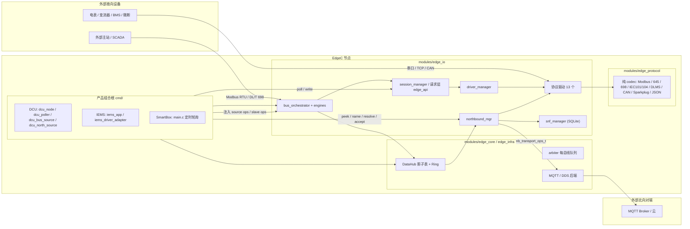
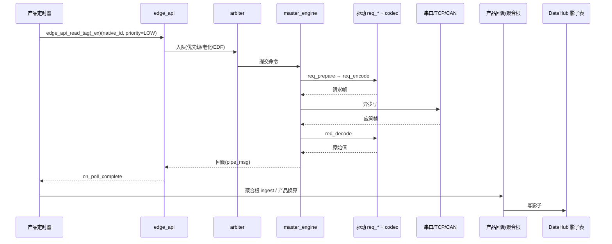
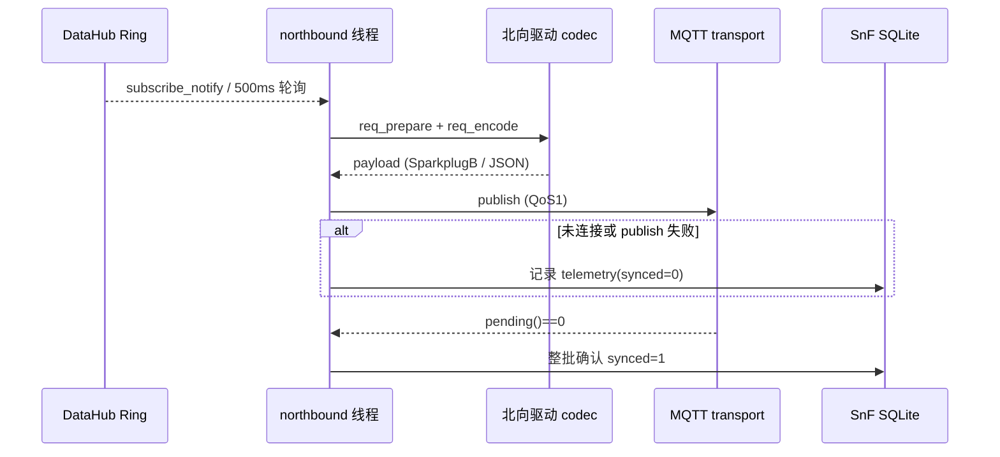
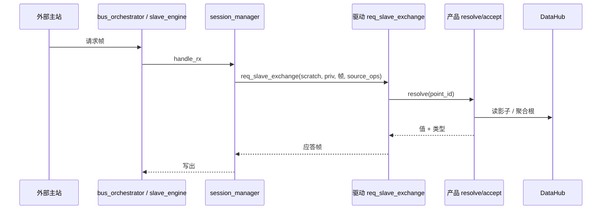
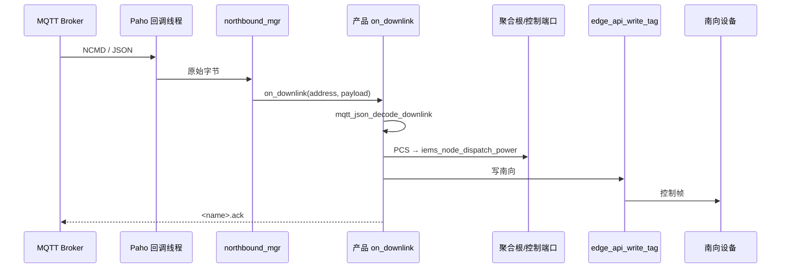

# 现状勘察：北向与南向通信

基线：分支 `main` | 提交 `78ea72107f32c8f1ec4fc3523610bc26e390e79e` | 日期 2026-11-02 | 评审人 待定
形态：主干加配置（涉及产品：`dcu`、`iems`、`smart_box`；`evse` / `hems` / `sg` 已从仓库删除）

置信度标注：**已验证** = 直接读代码或文档；**推断** = 由代码推导；**待验证** = 未确认。

---

## 1. 范围与方法

**本次勘察**：北向推送族（`northbound_mgr` + 传输 + SnF）、北向服务族（`bus_orchestrator` 从站 + `session_manager` + `req_slave_exchange`）、南向驱动与编解码（`modules/edge_protocol` + `modules/edge_io` 驱动/请求层/仲裁器）、三个产品（DCU / IEMS / SmartBox）的组合根、适配层与配置、相关测试与门禁。

**未勘察**：Matrix 场景引擎、`edge_algo`、Web UI / REST 管理面、MCP、存储子系统内部、NPU、WASM、DDS 后端细节。凡与上述链路无关的结论不写入本文。

**方法**：静态阅读；三条并行勘察线（南向、北向、构建/测试）；另开一个独立上下文抽查 12 条关键结论（11 条成立、1 条部分成立，已按下文修正）。**未编译、未运行测试**，故所有运行时行为标注为推断或待验证。

**范围外的事实**：仓库无 `CUSTOMER_*` 宏、无客户命名分支；产品差异靠 `cmd/<product>/` 组合根与静态表区分（已验证，见 §8）。

---

## 2. 上下文与依赖

### 2.1 C4 组件视图（L3，仅通信链路）

### 2.2 依赖方向

- `modules/edge_protocol` 只允许依赖 `edge_core`；`modules/edge_io` 允许依赖 `core/algo/protocol/stream/security/infra/mgmt`（门禁 `ci/scripts/check_plane_isolation.py:62-81`，已验证）。
- `cmd/<product>` 可以 include 协议 codec 头并直接使用 DataHub；`modules/` 内的驱动不得 include `cmd/` 或 `datahub.h`（`scripts/check_architecture_layers.sh:84-107`，已验证）。
- 北向取数与从站取数均通过消费方定义的端口注入：`edge_north_source_ops_t`（`modules/edge_io/include/edge_north_plane.h`）、`edge_slave_source_ops_t`（`edge_slave_plane.h`），实现在 `cmd/`。

### 2.3 现存违规依赖与文档漂移（只登记）

| 项 | 现状 | 证据 | 置信度 |
|---|---|---|---|
| `northbound_mgr` 仍直连 DataHub | 头文件 include `shmring.h`，并提供兼容入口 `northbound_source_from_datahub()` | `include/northbound_mgr.h:9,150-160`；`modules/edge_io/src/northbound_mgr.c` | 已验证 |
| 引擎/管理面直接用 DataHub | `session_manager` / `slave_engine` / `northbound_mgr` 等仍在 `modules/` 内调用 `datahub_*`；ADR-002 §5.1 已声明"下一个议题" | `docs/design/ADR002_MIGRATION_PLAN.md:589-618` | 已验证（文档自述） |
| 雷达驱动绕过驱动接口 | `driver_radar_fmcw.c` 直接 `datahub_write_shadow`，全仓无生产调用 | `modules/edge_io/src/driver_radar_fmcw.c:54-62` | 已验证 |
| CONTEXT-MAP 与 ADR-0010 冲突 | `CONTEXT-MAP.md` 仍写"全局唯一 TagID / 契约查表"，而 ADR-0010 与 README 已废除全局契约与 TagID | `CONTEXT-MAP.md:93-103`；`README.md:26-28` | 已验证 |
| 从站平面设计文档已过期 | 文档仍写 `driver_contract_injection_t` + `edge_driver_read_shadow`，两者已被 ADR-002 删除 | `docs/design/slave_plane_architecture.md:74-93` | 已验证 |

---

## 3. 执行上下文

| 上下文 | 优先级 / 线程 | 触发方式 | 证据 | 置信度 |
|---|---|---|---|---|
| 产品主循环 | 进程主线程，`uv_run` | 定时器回调：DCU 5 s 轮询、IEMS 每任务 `uv_periodic`、SmartBox 0.5–1 s 定时器 | `cmd/dcu/main.c:360-371`；`cmd/iems/iems_app.c:337-398`；`cmd/smart_box/main.c:568-597` | 已验证 |
| 北向推送线程 | 独立 `uv_thread` + 私有 `uv_loop` | 500 ms 兜底轮询 + `uv_async` 数据唤醒；SnF 5 s 定时器共用该 loop | `northbound_mgr.c:487-553,504-506,693-698`；`snf_manager.c:34-139` | 已验证 |
| Paho MQTT 回调线程 | 第三方库内部线程 | 连接/断连/消息到达回调；`on_downlink` 在此线程执行 | `mqtt_producer.c:109-127`；`northbound_mgr.c:247-262` | 已验证（线程归属）；线程安全为推断 |
| 从站应答 | 总线 IO 回调内同步执行 | 收到帧 → `session_manager_handle_rx` 遍历会话 → `req_slave_exchange` | `slave_engine.c:42-90`；`session_manager.c:119-148` | 已验证 |
| 主站调度 | 每总线 arbiter 队列（max 128，老化 50 ms，EDF） | `edge_api_*` 提交 → `master_engine` setup/encode/超时/异步写 | `modules/edge_core/src/arbiter.c:37-68,260-328`；`engines/master_engine.c:185-228` | 已验证 |
| 测试 | 宿主机 x86_64 CTest | 单元测试；无板级 / HIL 框架 | `tests/CMakeLists.txt`；`.github/workflows/ci.yml:27-30` | 已验证（静态） |

**关键结论**：南向主站请求是异步的（提交后回调）；从站应答与北向下行回调分别在 IO 回调线程和 Paho 线程同步执行，**不经过产品主循环**（推断：产品聚合根与回调之间没有显式加锁）。

---

## 4. 共享数据与实际所有者

| 数据 | 写者 | 读者 | 一致性手段 | 是否违反设计规则 | 证据 |
|---|---|---|---|---|---|
| DataHub 影子表 | 产品聚合根 / 轮询回调 | 北向 `resolve` / `peek`、从站 `resolve`、UI | SeqLock 快照 | 否（产品侧写入） | `iems_app.c:260-274`；`dcu_router.c`；`datahub.h` |
| 产品静态点表（DCU/IEMS/SmartBox） | 编译期只读 | 产品适配层、北向 name/scale | 无（只读） | 否 | `cmd/dcu/dcu_driver_adapter.c:43-135`；`cmd/iems/iems_driver_adapter.c:47-229`；`cmd/smart_box/smartbox_driver_adapter.c:46-78` |
| `northbound_mgr` 状态（订阅、传输、epoch、下行） | 北向线程；**Paho 回调线程也写下行路径** | 同上 | 无锁（推断） | **是**：同一聚合状态有两个所有者 | `northbound_mgr.c:247-262`；`mqtt_producer.c:109-127` |
| SnF SQLite（`telemetry.synced`） | 北向线程 | 北向线程 | 单线程 + 整批确认 | 否 | `snf_manager.c:98-136` |
| 驱动实例 ctx（≤1024 B） | `driver_manager` 创建 | 驱动 | 每实例固定槽、初始化清零 | 否 | `driver_manager.c:13-18,201-215` |
| 请求 scratch（128 B） | `session_manager` 每帧 memset | 驱动 `req_*` | 每帧清零 | **是**：从站交换不走 `req_prepare`，而 Modbus/DLT698 把 `slave_id`/SA 过滤放在 scratch；清零后过滤恒放行 | `session_manager.c:133-134`；`modbus_rtu_driver.c:54,174`；`driver_dlt698.c:91,206` |
| 产品档案（DCU SQLite / IEMS 静态表） | 组合根启动时加载 | 轮询器、适配层 | 单线程读 | 否 | `dcu_inventory.c:171-186`；`iems_driver_adapter.c:214-249` |

---

## 5. 资源清单

| 资源 | 使用者 | 分配者（组合根 / 模块自取） | 证据 | 置信度 |
|---|---|---|---|---|
| 主 `uv_loop` + 定时器 | 全部产品 | 组合根（栈上或静态） | `cmd/*/main.c`；`cmd/iems/iems_app.c` | 已验证 |
| 北向线程 / loop / timers | `northbound_mgr` | 调用方提供 loop 存储，模块内 `uv_thread_create` | `northbound_mgr.c:513-523`；`include/northbound_mgr.h:86` | 已验证 |
| MQTT 连接 / 内部线程 | `mqtt_producer` | 模块内创建（Paho） | `mqtt_producer.c:244` | 已验证 |
| UDS / 串口 / TCP 通道 | `bus_orchestrator` / `io_executor_linux` + 产品连接表 | 产品静态连接表；IEMS 另有 `OMNIS_BUS_<id>_DEV` 环境变量覆盖 | `iems_driver_adapter.c:254-313`；`bus_orchestrator.c` | 已验证 |
| 驱动槽位 32 / 实例 32 / ctx 1024 B | `driver_manager` | 模块内静态池 | `driver_manager.c:13-18` | 已验证 |
| 请求 scratch 128 B | `session_manager` | 模块内每帧清零 | `edge_driver.h:72`；`session_manager.c:133` | 已验证 |
| arbiter 队列 128 / 总线 | 每总线 | `bus_orchestrator` 创建 | `arbiter.c:37-68` | 已验证 |
| 北向传输槽 4 | `northbound_mgr` | 调用方可选注入，缺省 1 路 | `include/northbound_mgr.h:74,106-109` | 已验证 |
| SnF SQLite | `snf_manager` | 产品注入 `db` | `northbound_mgr.c:526-535`；`iems_app.c:720` | 已验证 |
| 静态点表 / 测点元数据 | 产品适配层 | 编译期静态数组 | `cmd/*/*_driver_adapter.c` | 已验证 |

**资源统一分配**：端口与句柄基本由组合根注入，但 `northbound_mgr` 自建线程、`mqtt_producer` 自建 Paho 连接、`datahub_router` 内 `calloc`（`datahub_router.c:158`）——属于模块自取资源。仓库无 `resources.yaml`，`ci/size-budget.json` 中的 `edge_io` 预算**没有脚本读取**（`ci/size-budget.json:19-24`，已验证）。

---

## 6. 关键流程

### 6.1 南向采集（DCU / IEMS）

- DCU：`dcu_bus_source._submit` 将 OAD 经 `dcu_driver_adapter_oad_to_proto()` 翻成协议原生 id，量纲也由 `dcu_driver_adapter_scale()` 在产品侧乘（`cmd/dcu/dcu_bus_source.c:136-176`，已验证）。
- IEMS：`uv_periodic` 每点提交，`edge_api_read_tag_ex` 带 `ARBITER_PRIO_LOW`，回调交 `iems_node_ingest_sample()`（`cmd/iems/iems_app.c:337-398`，已验证）。
- 驱动只做 codec，不知道点位表；这是 ADR-002 已落地的部分（`docs/design/ADR002_MIGRATION_PLAN.md:87-90`，已验证）。

**SmartBox 例外（重要）**：`timer_modbus_poll_cb` 直接 `open("/dev/ttyYS1")` 写死帧 `01 03 00 00 00 02 C4 0B`，然后把常量 `85.0` 写入影子表——**不走 driver_manager / bus_orchestrator，也不解析应答**（`cmd/smart_box/main.c:382-395`，已验证）。`main.c` 也没有调用 `smartbox_driver_registry_init`，不使用 `smartbox_node`；注册表与静态点表只被适配层符号和测试引用（`smartbox_driver_adapter.c:154-159`，已验证）。NFC/BLE 轮询同样是模拟路径（`main.c:357,489`，已验证）。

### 6.2 北向推送（族 A）

- 地址由编排层按模板渲染，每路传输一份；协议注册表含 `SparkplugB` / `MqttJson`（`northbound_mgr.c:437-442,609-617`，已验证）。
- 多传输数组存在（上限 4），但**无任何产品调用 `add_transport`**（`grep cmd/` 仅有 `set_north_source`，已验证）。
- SnF 只有 IEMS 接线；DCU 与 SmartBox 传 `db=NULL`（`cmd/dcu/main.c:316`；`cmd/smart_box/main.c:535`，已验证）。
- 已知缺陷：`req_prepare` 没有时间戳形参，SnF 回放时驱动用编码时刻的 `uv_hrtime()`，历史时间被改写（`northbound_mgr.c:167-175`；`driver_sparkplug_b.c:181`，已验证）。

### 6.3 北向服务（族 B）

- 实际接线的只有两条：IEMS 的 ModbusRTU 从站（总线 10，UDS `/tmp/iems_north_slave.sock`）与 DCU 的 DLT698 从站（`iems_app.c:683-687`；`cmd/dcu/main.c:262-270`，已验证）。
- 8 个驱动实现 `req_slave_exchange`：ModbusRTU/TCP、DLT645、DLT698、IEC101、IEC104、DLMS、CiA402；其中 CiA402 只消费 TPDO、不应答；IEC101 缺 `req_priv_size`，若经 `driver_manager_register` 会返回 -5——但全仓无 `iec101_driver_register` 调用、产品注册表也不含 IEC101，故这是**潜伏缺陷**（`driver_iec101.c:334-344`；`driver_manager.c:116-126`，已验证）。
- 从站地址过滤失效：`session_manager` 把每帧清零的 scratch 当 `priv` 传入（且实参顺序是 scratch→priv、`ctx->priv`→session），而 `slave_id`/SA 在 `req_prepare` 里写入、从站交换从不调用 `req_prepare`，于是过滤恒放行——IEMS Modbus 从站与 DCU 698 从站会应答任意地址（`session_manager.c:133-134`；`modbus_rtu_driver.c:54,174`；`driver_dlt698.c:91,206`，已验证）。
- 从站写 ACL 恒真（`slave_engine.c:36-40`，已验证）；从站引擎的写命令无条件返回 IO 错误（`slave_engine.c:124-127`，已验证）。

### 6.4 北向下行

- `accept()` 路径未被任何产品使用（`iems_app.c:230`；`dcu_north_source.c:128`；`smart_box/main.c:103`，已验证）；活路径是 `on_downlink`。
- 三个产品都只用 `mqtt_json_decode_downlink` 解析；SparkplugB 选中的 NCMD（protobuf）无法解码，必然拒绝（`iems_app.c:162`；`dcu_north_source.c:110`；`smart_box/main.c:87`，已验证）。
- IEMS 只有 PCS 控制点走聚合根；其余点位直接 `datahub_publish` 写影子后再下发（`iems_app.c:285-299`，已验证）——与 ADR-0011 决策 4"下行控制必须过聚合根"存在冲突。
- DCU / SmartBox 的 `on_downlink` 解析后明确返回 -1（不假装执行）（`dcu_north_source.c:104-121`；`smart_box/main.c:82-96`，已验证）。

---

## 7. 测试与门禁基线

| 项 | 当前值 | 获取方式 |
|---|---|---|
| CTest 注册数 | 259（258 个测试 + 1 个 fuzz 种子）；254 个无条件，5 个受 DDS/IDL 门控 | `tests/CMakeLists.txt`；`fuzz/CMakeLists.txt:10-13`（静态统计，已验证） |
| 触及南向的测试 | 约 57（47 个直接调用 codec/driver/bus/SnF + 9 个 DCU/IEMS 集成 + fuzz 种子） | 同上 |
| 触及北向的测试 | 7 | 同上 |
| 运行位置 | 宿主机 x86_64 CTest；arm64 仅交叉编译不跑测试；接受测试在 test-platform 模拟器 + mosquitto | `.github/workflows/ci.yml:27-33,74-78,96-114` |
| 板级 / HIL | 仓库内未找到 | 已验证（静态）；待验证（是否存在外部流水线） |
| 北向验收 | `acceptance/northbound/smoke_northbound.py`（BIRTH + 指标名）；IEMS 6 条、DCU 3 条正式用例由 `NB_E2E` 门控 | `acceptance/northbound/smoke_northbound.py:108-111`；`acceptance/iems/tests/test_iems_northbound.py`；`acceptance/dcu/tests/test_dcu_northbound.py` |
| 架构门禁 | 15 道，当前通过；债务 27 条（平面 5 / 聚合 5 / 组件 5 / OCP 1 / 内存 6 / 栈 5） | `scripts/check_architecture_layers.sh`；`ci/baseline/limits.txt:14-19`（仓库文档自述，已验证） |
| 构建形态 | 一棵构建树；顶层无条件构建 `cmd/smart_box`、`cmd/iems`、`cmd/dcu`（以及 `edge_mcp_server`、`nexus_lab`）；`CONF_FILE` 缺省 `cmd/iems/prj.conf` | `CMakeLists.txt:52-54,241-245`（已验证） |
| 三个 `prj.conf` | DCU 与 IEMS 逐字节相同；SmartBox 仅首行注释不同 | `diff`（已验证） |
| 尺寸门禁 | `scripts/check_binary_sizes.sh` 阈值存在；`ci/size-budget.json` 的 `edge_io` 预算无脚本读取 | 静态（待验证实际数值） |

**文档与基线不一致**：`QUALITY.md:36,49,56` 写平面债务 4、测试"206+"、债务 26；实测为 5、259、27（已验证）。提交 `f6a9c4fc` 记录"全量 ctest 260 项 / 8 红"，与静态注册数 259 有 1 项差异（待验证）。

---

## 8. 客户差异（本范围内）

**形态判定：主干加配置**（已验证）。依据：全仓无 `CUSTOMER_*` 宏；164 个远端分支中无客户命名分支；产品差异全部落在 `cmd/<product>/` 的静态注册表、点表与连接表；`prj.conf` 三份相同。

| 产品 | 南向注册 | 南向实际接线 | 北向推送 | 北向服务 | SnF |
|---|---|---|---|---|---|
| DCU | ModbusRTU / DLT645 / DLT698 | 档案协议主站；DLT698 从站 | MQTT（SparkplugB / MqttJson） | DLT698 从站 | 无（db=NULL） |
| IEMS | ModbusRTU / ModbusTCP / IEC104 / CAN / DLT645 | **全部 SOUTHBOUND 连接硬编码 ModbusRTU 主站**；ModbusRTU 从站 | MQTT | ModbusRTU 从站（总线 10） | 有 |
| SmartBox | ModbusRTU / ModbusTCP / CAN（注册表存在，`main.c` 未调用注册） | **定时器直接写串口 + 常量写影子，不走驱动栈** | MQTT | 无 | 无（db=NULL） |
| vpp_demo（examples） | 未见注册 | — | 仅 `northbound_mgr_init` 空传输，不发送 | 无 | 推断：有 db 时只积压不发送 |

配置面：

| 产品 | 南向配置 | 北向配置 |
|---|---|---|
| DCU | SQLite `meter_inventory`（协议/波特率/通道）；轮询周期硬编码 5000 ms；`manifest.yaml` 由模拟器读取，产品代码不解析 | `MQTT_BROKER` 默认 `tcp://127.0.0.1:1883`；group/node 默认 `EdgeOS` / `DCU_Node_A`；`MQTT_PROTOCOL`；`DCU_NORTH_SOCK` |
| IEMS | 静态连接表 + `OMNIS_BUS_<id>_DEV` 环境变量；`config/device_profile.json`；`manifest.yaml` / `world.yaml` / `omnis_manifest.json` 供模拟器与验收使用 | `mqtt_url` 默认 `tcp://localhost:1883`；`MQTT_PROTOCOL`；`IEMS_NORTH_SOCK` |
| SmartBox | 驱动注册表 + 静态槽位表；串口轮询硬编码 | `MQTT_BROKER`；`MQTT_PROTOCOL` |

**配置面现状**：三份 `prj.conf` 基本不生效；产品代码不解析各自 `manifest.yaml`；协议/端点大量通过环境变量与代码默认值决定（已验证）。这与"主干加配置"的目标形态存在差距，但属于产品排期问题，本文只登记。

---

## 9. 待验证项

| 问题 | 为什么重要 | 建议怎么验证 |
|---|---|---|
| SmartBox 的 DataHub `HYBRID` 后端是否真的启用了 MQTT 上联（`datahub_mqtt.c`，第四套上行） | 若启用，会与 `northbound_mgr` 重复上报，且不受 SnF/权限控制 | 运行 SmartBox，抓 broker 上 `edgeos/datahub/tags/#`；检查 `datahub_get_backend(MQTT)` 是否非空 |
| 实际 CTest 配置数、8 条红测试基线 | 影响"零新增红"的判定 | `cmake` + `ctest -N` / `ctest --output-on-failure` |
| 尺寸门禁与 `ci/size-budget.json` 的实际执行情况 | 重构会改变二进制大小，需知道基线 | 跑 `scripts/check_binary_sizes.sh`；确认 CI 是否读取 `size-budget.json` |
| Paho 回调线程与产品聚合根并发是否真实存在数据竞争 | 下行控制直接动安全相关状态 | TSAN 或加锁审计；至少确认 `on_downlink` 内是否只做原子/队列投递 |
| 是否存在仓库外的 HIL / 板级流水线 | 影响"已验证"的边界 | 询问 CI/测试负责人 |
| `services/northbound`、`cloud_sync_service`、`protocol_bridge`、`protocol_converter`、`edge_uns_engine`、`multibus_bridge`、`simd_cdd_codec` 是否被外部目标或脚本加载 | 决定能否删除 | 全仓与构建脚本 grep；运行时符号检查 |
| `origin/zephyr` 分支是否仍在维护、是否影响通信层合并 | 分支收敛成本 | 询问维护者；比较 merge-base `d4e22eff` 之后的通信层改动 |
| DLMS / IEC101 是否计划接产品 | 决定"未注册驱动"的处置（接线 / EXCLUDE_FROM_ALL / 删除） | 产品规划确认 |

---

## 10. 需求映射与差距分析

本次勘察服务于**重构铺垫**，因此"需求"取 ADR-002（消费者驱动重构）与 ADR-0011（北向两族）的已批准决策，以及仓库自述的工程宪法。差距类型沿用 change-discipline 第 2 节五类。

| 需求 ID | 需求摘要 | 现状是否满足（证据） | 差距类型 | 触碰的模块 | 风险 |
|---|---|---|---|---|---|
| R-01 | ADR-002 §0：驱动不查表、不读影子、不反向调用消费侧 | 满足；9 项已删，门禁第 14 道守住（`ADR002_MIGRATION_PLAN.md:7-58,90`） | 已满足 | `edge_io` 驱动、`edge_protocol` | 低 |
| R-02 | ADR-002 §5.1：`datahub` 只出现在 `cmd/`，`modules/` 一律经端口 | 未满足；`modules/` 仍有 77 个文件直接引用 DataHub，含 `northbound_mgr`、`session_manager`、`slave_engine`（`ADR002_MIGRATION_PLAN.md:594-618`） | 需修改（下一个议题） | `edge_io`、`edge_stream`、管理面 | 高：改动面大，须单独立项 |
| R-03 | ADR-0011 决策 1：推送族与服务族分开编排 | 满足；`northbound_mgr` 与 `bus_orchestrator` 分离 | 已满足 | `edge_io` | 低 |
| R-04 | ADR-0011 决策 2：驱动只做 payload，地址归编排层 | 推送族满足（地址模板）；下行解析仍在产品侧且只认 JSON（`iems_app.c:162` 等） | 部分满足 | `northbound_mgr`、产品 `on_downlink` | 中：换协议时下行失效 |
| R-05 | ADR-0011 决策 3：多传输并存 | 结构存在（4 槽），无产品装配，无第二传输实现（`grep add_transport` 为空） | 新增（未完成） | `northbound_mgr`、`mqtt_producer` | 中 |
| R-06 | ADR-0011 决策 4：下行必须过聚合根，禁止直接写影子 | PCS 满足；IEMS 其他控制点先 `datahub_publish` 写影子、再经 `edge_api_write_tag` 下发（`iems_app.c:293-299,320`）——**绕过的是聚合根校验，不是物理下发**；`accept()` 路径未使用 | 与现状冲突 | 产品组合根、聚合根 | **高**：绕过 SOC 包络/闭锁 |
| R-07 | ADR-0011 决策 5：SnF 整批确认、断网不丢 | IEMS 满足；DCU / SmartBox 无 SnF；回放时间戳被改写（`northbound_mgr.c:167-175`） | 部分满足 | `snf_manager`、产品组合根 | 高：静默丢数据/历史失真 |
| R-08 | ADR-0011 决策 6：第二协议 OPC UA | 未做；`opcua_engine_create` 无调用者，且是 `UA_Client` 不是 `UA_Server` | 新增（未完成） | `engines/opcua_engine.c` | 中 |
| R-09 | ADR-002 §2.1 南向读写能力表 | 大部分满足；**Modbus FC05 实际不支持**，与计划写"FC05/06"冲突；CAN 写显式失败；DLT698 缺 ACTION；DLMS/IEC101 无产品注册 | 与现状冲突 / 需求不清 | 驱动、产品适配层 | 中：控制类操作可能缺路径 |
| R-10 | 工程宪法：禁止 Mock 冒充物理数据 | SmartBox 南向以常量 `85.0` 写影子（`main.c:389-392`） | 与现状冲突 | SmartBox 主程序 | **高**：演示桩进入产品路径 |
| R-11 | 主干加配置：客户差异落在配置/组合根 | 满足形态判定；但 `prj.conf` 不生效、`manifest.yaml` 产品不解析、端点靠环境变量 | 部分满足 | 构建、产品组合根 | 中 |
| R-12 | 文档与代码同步 | `CONTEXT-MAP.md`、`slave_plane_architecture.md`、`QUALITY.md` 均有过期数字/已删符号 | 需修改 | `docs/` | 低（但会误导设计与评审） |

### 10.1 需要人裁决的冲突（agent 不自行取舍）

1. **ADR-0011 写 IEMS 北向是 Modbus TCP，代码/连接表是 Modbus RTU/UART**（`docs/adr/0011-northbound-two-family-model.md:19` vs `iems_driver_adapter.c:271-278`）。以哪个为准？
2. **ADR-0011 写 SmartBox 目前无北向，代码已接 MQTT 北向**（`0011:19` vs `smart_box/main.c:525-549`）。ADR 需要更新，还是 SmartBox 北向应撤下？
3. **ADR-002 计划写 Modbus 支持 FC05/06，驱动实际主站只发 FC06、从站只收 FC06/FC16，FC05 被拒**（`ADR002_MIGRATION_PLAN.md:99-100,502` vs `modbus_rtu_driver.c:66-71,148-229`；`modbus_tcp_driver.c:81-87,207-218`）。是计划过期，还是 FC05 是缺口？
4. **ADR-0011 称 8 个驱动具备从站应答能力；其中 CiA402 不应答、IEC101 无法注册**（`0011:16-17` vs `driver_cia402.c:58-95`、`driver_iec101.c:334-344`）。"8 个"是否要修订？
5. **SnF 的适用范围**：ADR-0011 决策 5 读起来是所有北向；当前只有 IEMS 接 DB。DCU / SmartBox 是否必须补 SnF？
6. **`accept()` 与 `on_downlink` 两条下行路径**：ADR 写 `subscribe → req_decode → accept()`，代码走 `on_downlink`。保留哪条？
7. **CONTEXT-MAP 仍以 TagID/契约为共享内核**，与 ADR-0010 及 README 冲突。哪份是权威？

### 10.2 重构候选（只登记，未立项）

| # | 候选对象 | 证据 | 建议类型（供评审） |
|---|---|---|---|
| C-01 | 四套上行路径：`northbound_mgr`、`services/northbound` 双轨、`cloud_sync_service`、`datahub_mqtt` | `services/northbound` 未进任何产品构建图（顶层无 `add_subdirectory(services)`），仅测试引用；`cloud_sync_service.c:59-71` 无调用者；`datahub_mqtt.c` 随 `HYBRID` 后端 | R2（结构纠正）或删除，需先裁决 |
| C-02 | `northbound_mgr` 与 DataHub 的兼容耦合（`northbound_source_from_datahub`、`shmring.h`） | `include/northbound_mgr.h:9,150-160` | R1 打开测试接缝 → R2 |
| C-03 | 下行线程与协议：Paho 线程直接调用产品 `on_downlink`；只认 JSON | `mqtt_producer.c:109-127`；`northbound_mgr.c:247-262`；产品解码点 | R1/R2，需先定线程模型 |
| C-04 | IEMS 非 PCS 下行绕过聚合根 | `iems_app.c:285-299` | R2（安全相关，优先） |
| C-05 | SnF 覆盖与时间戳 | `cmd/dcu/main.c:316`；`smart_box/main.c:535`；`northbound_mgr.c:167-175` | 功能补全 + 签名变更（`req_prepare` 加 ts） |
| C-06 | 三个产品各自维护静态点表与全局符号（`g_tag_metadata`、`contract_tag_get_meta`、`edge_driver_registry_init`） | `iems_driver_adapter.c:370-400`；`smartbox_driver_adapter.c:129-159` | R2：抽只读视图或保留产品隔离，需评审 |
| C-07 | 构建期配置基本不生效（三份 `prj.conf` 相同、manifest 不解析） | `CMakeLists.txt:52-54,241-243`；`diff prj.conf` | R2/R3，属产品排期 |
| C-08 | 死代码：OPC UA 引擎、`protocol_bridge`、`protocol_converter`、`edge_uns_engine`、`multibus_bridge`、`simd_cdd_codec`、`northbound_mgr_submit_req` / `set_rest_server` | 各文件及 grep 证据见 §2/§3；`ADR002_MIGRATION_PLAN.md:335-404` | R2（删除）或先确认外部加载 |
| C-09 | 驱动层遗留缺陷：`session_manager_tick` 无调用者（经 session_manager 的主站 IEC104/DLMS 的 `req_tick` 不跑；北向驱动的 `req_tick` 由 `northbound_mgr` 正常调用）、scratch 被当配置导致从站地址过滤失效、IEC101 注册潜伏失败、CAN 写失败、FC05 缺失 | `session_manager.c:133-134,150-162`；`northbound_mgr.c:363-366`；`driver_iec101.c:334-344`；`driver_can.c:39-45`；`modbus_rtu_driver.c:148-229` | 缺陷修复单独立项，不与重构混做 |
| C-10 | SmartBox 南向演示桩（硬编码帧 + 常量） | `smart_box/main.c:382-395` | 缺陷（Zero-Mock）单独立项 |

**约束**：IEMS 的 ModbusTCP 与 ModbusRTU 量纲约定相反，代码注释明确要求"不在这次改造里纠正"（`iems_driver_adapter.c:181-186`）。任何重构不得顺手统一，需单独立项并用现场数据验证。

---

## 附：本次勘察没有做的事

- 未编译、未跑 CTest / 验收 / 门禁脚本。
- 未审计 DDS / NPU / Matrix / Web 管理面与本文无关的路径。
- 未对运行时并发做 TSAN/锁审计；`on_downlink` 线程安全结论为推断。
- 未确认智能盒子 `HYBRID` 后端是否真的产生第四套 MQTT 上行。
