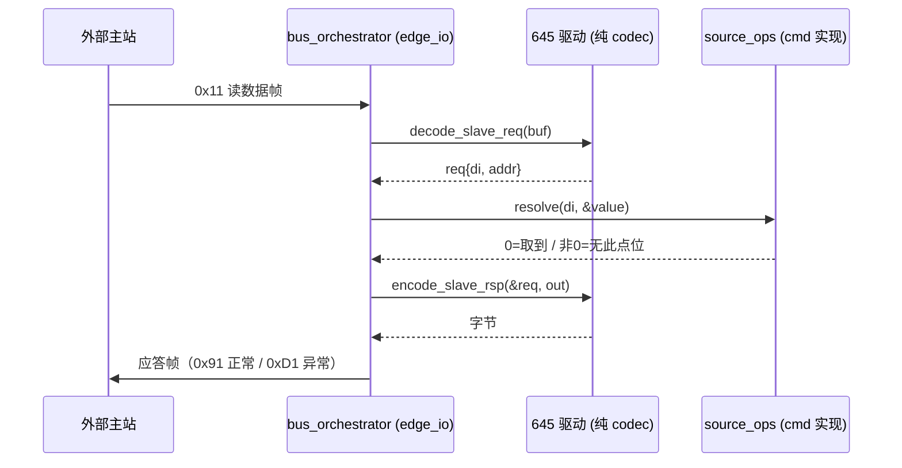

# DL/T 645 请求化改造 · S1 接口设计（待评审）

> 目标：把 645 驱动变成**纯 codec**——不查表、不读影子表、不碰全局符号。
> 范围：S1 只定驱动侧接口 + 一条可跑的样板路径；**不做** MasterEngine 的 in-flight 关联表（那是 S2）。
> 前置决策：ADR-002（`driver_contract_injection_t` 与 `edge_driver_ctx_t` 的 8 个回调全部删除）。

---

## 1. 现状：三处泄漏

| # | 位置 | 代码 | 问题 |
|---|---|---|---|
| L1 | `driver_dlt645.c:47` | `uint32_t di = tag_ids[0];` | **TagID 冒充 DI**。接口传 TagID，驱动原样写进报文。点位表一重排，现场所有报文全错且不报错 |
| L2 | `driver_dlt645.c:101` | `pipe_msg_init_scalar(&out_msgs[0], (edge_tag_id_t)di, ...)` | **DI 冒充 TagID**。解码后把 DI 当 tag_id 抛出去，等于要求 `TagID ≡ DI` |
| L3 | `driver_dlt645.c:134-141` | 从站应答 `return -1` | 注释写着"协议层禁止读 datahub，该路径尚未接入聚合根取数"——方向对，活没干完 |

L1/L2 是一体两面：驱动被迫用 TagID 和 DI 互相顶替，因为**它手里没有"点位"这个概念，只有一个数字**。

---

## 2. 目标接口

### 2.1 请求私有数据：把"点位"变成一等公民

```c
/* modules/edge_io/src/driver_dlt645.h（驱动私有，不进公开头） */
typedef struct {
    uint32_t di;            /* 数据标识，645 原生标识，来自点位模型 */
    uint8_t  addr_bcd[6];   /* 表地址（低字节先），来自设备配置 */
    uint8_t  ctrl;          /* 0x11 读 / 0x14 写 / 0x91 读应答 / 0x94 写应答 */
    double   value;         /* 写：待写值；读应答：解码结果（已标定） */
    int32_t  raw;           /* 解码出的原始整数（未标定），供上层决定量纲 */
    uint8_t  data_len;      /* 应答数据段字节数（2 或 4），由应答回填 */
} dlt645_req_t;
```

要点：**`di` 是行业原生标识，`tag_id` 不出现在驱动里**。上层（请求层）负责 `tag_id → 点位 → di` 的翻译，驱动只认 di。

### 2.2 纯函数 codec（无 ctx、无回调、无全局）

```c
/* 全部为纯函数：输入结构体 + 缓冲区，输出字节/值，无副作用 */
int dlt645_encode_read(const dlt645_req_t *req, net_buf_t *out);
int dlt645_encode_write(const dlt645_req_t *req, net_buf_t *out);

/* 返回：0=解出完整帧；EDGE_ERR_INCOMPLETE=帧未收全；<0=校验/格式错误 */
int dlt645_decode_read_rsp(dlt645_req_t *req, const uint8_t *buf, size_t len, size_t *consumed);
int dlt645_decode_write_rsp(dlt645_req_t *req, const uint8_t *buf, size_t len, size_t *consumed);

/* 从站侧：解请求 / 组应答，同样是纯函数 */
int dlt645_decode_slave_req(dlt645_req_t *req, const uint8_t *buf, size_t len, size_t *consumed);
int dlt645_encode_slave_rsp(const dlt645_req_t *req, net_buf_t *out);
```

错误码约定（沿用现有 `EDGE_ERR_*`）：

| 情况 | 返回 |
|---|---|
| 帧未收全 | `EDGE_ERR_INCOMPLETE`（保留缓冲，等下一包） |
| 校验和错 / 长度非法 | `-1`（丢弃该帧） |
| 前导垃圾字节 | 返回已跳过的字节数（`*consumed = skip`） |

### 2.3 挂到 `edge_driver_t`：新增两个槽位，与 legacy 互斥

```c
struct edge_driver_s {
    /* ... 现有 legacy 槽位保持不变 ... */

    /* --- 4. 纯编解码（request-native）。非 NULL 时 manager 优先走这条路 --- */
    int (*req_encode)(edge_req_t *req, net_buf_t *out);
    int (*req_decode)(edge_req_t *req, net_buf_t *in, size_t *consumed);
};
```

**为什么不在 S1 直接改 legacy 槽位签名**：`encode_request(ctx, tag_ids, ...)` 有 13 个驱动在用，改签名等于一次性重写全部，无法独立验收。新增槽位让 645 先走通，其余驱动保持现状，S3 逐个迁。

**互斥规则**：一个驱动要么实现 legacy 四件套，要么实现 `req_encode/req_decode`，不得混用。manager 在注册时校验并拒绝混用（防止迁移期出现"半新半旧"的驱动）。

### 2.4 与 `edge_req_s` 的衔接

`edge_req_s` 已经有 `priv_data` / `ops` / `on_finish` / `timeout`，够用，**不需要新增字段**：

```c
static int dlt645_req_encode(edge_req_t *req, net_buf_t *out) {
    return dlt645_encode_read((const dlt645_req_t *)req->priv_data, out);
}

static int dlt645_req_decode(edge_req_t *req, net_buf_t *in, size_t *consumed) {
    dlt645_req_t *p = req->priv_data;
    int rc = dlt645_decode_read_rsp(p, in->b.data, in->b.len, consumed);
    if (rc == 0) req->ops->on_finish(req, 0);   /* 值已在 p->value，由上层取走 */
    return rc;
}
```

驱动**不产生 `pipe_msg_t`**，也不再决定 tag_id——它只把值填回 `dlt645_req_t`，由上层组装成 `pipe_msg_t` 写影子表。

---

## 3. 从站应答：责任边界（谁干什么）

上一版这里写"上层取当前值"，含糊。按调用方逐层拆开：

| 步骤 | 归属平面 | 落点 |
|---|---|---|
| 收字节流、切帧、会话状态、超时 | 执行面（edge_io） | `bus_orchestrator.c` / `session_manager.c` |
| `decode_slave_req()`：字节 → `{di, addr}` | 协议层（纯 codec） | `driver_dlt645.c` |
| **`di` → 当前值** | **消费者定义的端口**（声明在 edge_io，实现在 cmd） | 声明：`modules/edge_io/include/edge_slave_plane.h`；实现：`cmd/<product>/` |
| `encode_slave_rsp()`：值 → 字节 | 协议层（纯 codec） | `driver_dlt645.c` |
| 端口的实现与注入 | 组合根 | `cmd/<product>/main.c` → `bus_orchestrator_setup_slave(..., source_ops, source_ctx)` |

### 3.1 消费者定义的接口长什么样

**消费方 = edge_io 的从站编排**：它需要"给我这个 di 的当前值"才能组应答，所以由它定义接口；
**实现方 = cmd**：只有产品认识自己的点位模型。组合根把两者接上。

```c
/* modules/edge_io/include/edge_slave_plane.h —— 由消费方（edge_io）定义 */
typedef struct {
    double   value;    /* 工程值 */
    uint8_t  quality;  /* 质量码，645 不用但 104 从站需要 */
    uint64_t ts_ms;    /* 取值时标 */
} edge_point_value_t;

typedef struct {
    /* 返回 0 = 取到值；非 0 = 无此点位/不可读 → 从站回异常应答 */
    int (*resolve)(void *ctx, uint32_t di, edge_point_value_t *out);
} edge_slave_source_ops_t;
```

### 3.2 三条边界纪律

1. **组帧留在协议层**：CS 累加、`+0x33` 偏移、控制码选择都是协议知识，cmd 不该知道，
   否则每加一个协议就要改一次产品代码。
2. **取数留在 cmd**：点位模型是产品有界上下文，edge_io 是通用执行面，不该认识 IEMS/DCU 的点位。
3. **接口不进驱动上下文**：如果把这个 ops 放进 `edge_driver_ctx_t`，驱动就又变成"自己取数"，
   等于把 `read_shadow` 换个名字请回来。**驱动连"谁提供值"都不该知道**——它只接收已填好的
   `dlt645_req_t`。

### 3.3 执行时序

```
从站帧到达 bus_orchestrator
   │
   ├─ dlt645_decode_slave_req(buf)            ← 协议层纯函数
   │      → req{di, addr}
   │
   ├─ source_ops->resolve(source_ctx, di, &v) ← 消费者定义端口，cmd 实现
   │      0  → 继续
   │      非0 → 跳过组帧，回异常应答 0xD1
   │
   └─ dlt645_encode_slave_rsp(&req, out)      ← 协议层纯函数
```

- **正常应答**：控制码 `DLT645_CTRL_READ_RESPONSE`（`0x91`），数据段为 4 字节 DI + N 字节 BCD（每字节 `+0x33`），CS 为前面所有字节和。
- **异常应答**：控制码 `DLT645_CTRL_ERROR_RESPONSE`（`0xD1`，即 `0x91 | 0x40`，D6 置位表示从站异常），数据段仅 4 字节 DI，无数据。
- **查不到 DI** → 走异常应答 `0xD1`，并计数上报。**不再返回 `-1`**：`-1` 会让上层以为"驱动坏了"，而实际上这是正常的协议行为。

> 顺带修正：这两个常量 `modules/edge_protocol/include/dlt645_codec.h:15,19` 里**早就定义好了**，
> 但 `driver_dlt645.c` 通篇用裸字面量 `0x68 / 0x11 / 0x91`。S1 顺手改成引用常量，
> 让"协议常量只有一个出处"。

这样 `handle_rx` 里那句注释就自然兑现了——协议层确实一次都没碰 datahub，值是从外面传进来的。

---

## 4. 数据流对比

**现在（查表式）**
```
poller → encode_request(tag_ids) → [di = tag_ids[0]] → 报文
                    ↑
              ctx->lookup_by_tag / meta_list（全局注入）
```

**改造后（请求式）**
```
请求层：tag_id → 点位模型 → di + addr  ──→ dlt645_req_t ──→ encode → 报文
                                                              ↑
                                             驱动只读 req，无任何查找
```

---

## 5. 迁移期规则（必须同时落地，否则 S3 永远做不完）

1. **门禁新增一条**：`modules/edge_io/src/driver_*.c` 不得引用 `ctx->lookup_by_key` / `ctx->lookup_by_tag` / `edge_driver_read_shadow` / `ctx->meta_list`。
   - 645 迁移完成后，把这 4 个名字加进黑名单；存量驱动挂 `ci/baseline/` 台账（沿用上游 #411 的棘轮机制），只减不增。
2. **注册期互斥校验**：`driver_manager_register()` 发现同时实现 legacy 与 request 槽位时直接失败。
3. 645 迁移后，legacy 槽位全部置 `NULL`，作为"样板驱动"。

---

## 6. 验收标准

| 项 | 方法 |
|---|---|
| 报文逐字节一致 | 用现网抓的 645 帧做 golden test：同样的 di/addr → 同样字节（含 CS） |
| 解码正确 | 2 字节量（L=6，电压/电流）与 4 字节量（L=8，组合有功）各一例，BCD 还原正确 |
| 从站正常应答 | 给 (di, value) → 组出 0x91 帧，CS 正确 |
| 从站异常应答 | 给不存在的 di → 组出 0xD1 帧，不崩 |
| 无回归 | `test_dcu_integration` 绿；645 相关用例绿 |

---

## 7. 三个需要你拍的点

1. **`addr_bcd` 放哪？**
   - A：随请求携带（`dlt645_req_t.addr_bcd`）——驱动彻底无状态，但每个请求多 6 字节。
   - B：作为设备级配置注入——更省，但要给"设备配置"一个正当的端口，不能再塞进 `meta_list`。
   - 我倾向 **A**，因为它是设备级信息却被塞进了点位级的注入包，这正是要清理的混乱；S1 先用 A 把路径打通，S3 再按需优化。

2. **645 的 `meta_list` 其实不是点位模型**
   现在 `_fill_addr()` 把 `ctx->meta_list` 当"6 字节 BCD 表地址数组，按 device_id 索引"用——这是**设备地址表**，不是点位模型。删 `driver_contract_injection_t` 会连带删掉这个通道，所以必须有替代（见第 1 点）。

3. **写操作（0x14）要不要在 S1 一起做？**
   现在 `encode_write` 是独立的 legacy 槽位。S1 只做读，写留到 S3，还是读写成对一起迁？我倾向**一起做**——否则 645 会出现"读走 request、写走 legacy"的混用，违反第 5 节的互斥规则。

---

## 8. S2 预览：MasterEngine 的责任边界

### 8.1 与从站的不对称

从站只需**一个**端口（给我值）；主站需要**两个**（要读什么 + 结果去哪）。

| 能力 | 归属 | 理由 |
|---|---|---|
| 读哪些点、多快读、优先级、变化上报 | **cmd（产品）** | 轮询策略是产品语义，DCU 与 IEMS 的节奏完全不同 |
| in-flight 表、超时、重试、并发窗口 | **edge_io（执行面）** | 协议无关的通用能力，不该每个产品重写一遍 |
| 点位 → di / 寄存器地址 | **cmd** | 点位模型在产品的有界上下文里 |
| 字节 ↔ 值 | **协议层** | 纯 codec |
| 值 → 影子表 / 领域事件 | **cmd** | 写哪个 tag、派发什么事件，都是产品语义 |

### 8.2 两个端口（同样由 edge_io 定义，cmd 实现）

```c
/* 入缝：cmd 决定接下来读什么（点位已解析成协议地址） */
typedef struct {
    uint32_t tag_id;      /* 数据面索引，仅 engine 可见，驱动看不到 */
    uint32_t proto_key;   /* di / 寄存器地址 / OAD */
    uint8_t  addr_bcd[6]; /* 设备地址（645 用） */
    uint8_t  ctrl;        /* 操作码 */
} edge_point_job_t;

typedef struct {
    /* 取下一批待读点位；返回 0 且 *n > 0 表示有活，*n == 0 表示空闲 */
    int (*next_batch)(void *ctx, edge_point_job_t *out, size_t max, size_t *n);
} edge_master_source_ops_t;

/* 出缝：读到的值交回 cmd（写影子表 / 派发领域事件由 cmd 决定） */
typedef struct {
    int (*deliver)(void *ctx, uint32_t tag_id, const edge_point_value_t *v);
} edge_master_sink_ops_t;
```

### 8.3 in-flight 关联靠协议内建，不靠通用 id

这是 S2 最容易做错的地方。有人会想给 `edge_req_s` 加个 `uint32_t correlation_id`，
但三个主力协议的关联机制各不相同：

| 协议 | 关联方式 | 并发度 |
|---|---|---|
| DL/T 645、Modbus RTU | 半双工，一问一答，靠表地址 + DI/寄存器校验 | 单 outstanding |
| IEC 104 | ASDU 发送序号（k/w 窗口） | 多 outstanding |
| DLMS/COSEM | invoke-id | 多 outstanding |

所以 `req_decode` 的返回值必须是**三态**，而不是现在的 0/-1：

```c
#define REQ_DONE      0   /* 是我的应答，值已填进 priv */
#define REQ_CONTINUE  1   /* 是我的，但帧未收全 */
#define REQ_NOT_MINE  2   /* 不是我的，engine 继续匹配其它 in-flight */
```

现在 `decode_response` 把"不是我的"和"出错"都返回 `-1`，导致 engine 无法区分
"该丢帧"和"该判这个请求失败"——这是 S2 必须改的第一件事。

### 8.4 一条纪律

**in-flight 表不许进 cmd，轮询周期不许进 edge_io。**

前者会让每个产品重写一遍超时/重试/并发控制；后者会让每加一个产品就改一次库。
两边都越界，MasterEngine 就退化成第二个 poller。

---

## 9. 与既有规范 AEP-403 的冲突（必须先解决）

`docs/design/slave_plane_architecture.md`（AEP-403）当前规定：

> 从站平面依赖 Consumer Ports 机制实现与底座的依赖反转（DIP）。底层驱动无需直接引用具体的
> DataHub，而是由装配层动态注入 `read_shadow` 与 `publish` 函数指针。
>
> ```
> Drv->>DM: edge_driver_read_shadow(ctx, tag_id, &shadow)
> ```

即：**驱动通过注入的 `read_shadow` 自己读影子表。**

这与 ADR-002（驱动纯 codec，删除 `read_shadow`）**直接冲突，两者不能并存**：

| 维度 | AEP-403 现状 | ADR-002 目标 |
|---|---|---|
| 谁读影子表 | 驱动（经注入的函数指针） | 从站编排（经 `resolve` 端口），驱动不参与 |
| 驱动的输入 | `tag_id` | `di`（行业原生标识） |
| 依赖反转落在哪 | 函数指针注入进**驱动上下文** | 端口注入进**会话层** |
| 驱动能否独立测试 | 需要先伪造影子表 | 纯字节进、纯字节出，无需任何桩 |

**本设计取代 AEP-403 的以下三处：**
1. §1 表格中「读数据源 = `edge_driver_read_shadow`」一行；
2. §2 序列图里 `Drv->>DM: edge_driver_read_shadow(ctx, tag_id, &shadow)` 这一步；
3. §3.2「驱动层实现 `handle_rx`」中的取数指引。

**修订不另开 issue**：`#403 [docs/sec] 补齐 Slave Plane` 本来就开着，这次修订并进 #403。

修订后的从站时序：



> 这条冲突也说明一件事：**AEP-403 当初把依赖反转做在"驱动上下文"里，
> 是把它当成了"注入点"，而不是"边界"**。函数指针注入进去了，耦合却没有解除——
> 驱动仍然要知道 `tag_id`、要知道影子表的存在。ADR-002 把它推到会话层，
> 驱动才真正对外部世界一无所知。
