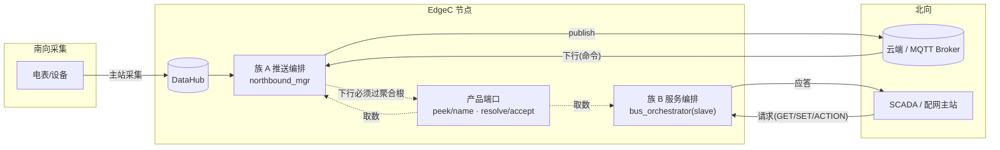
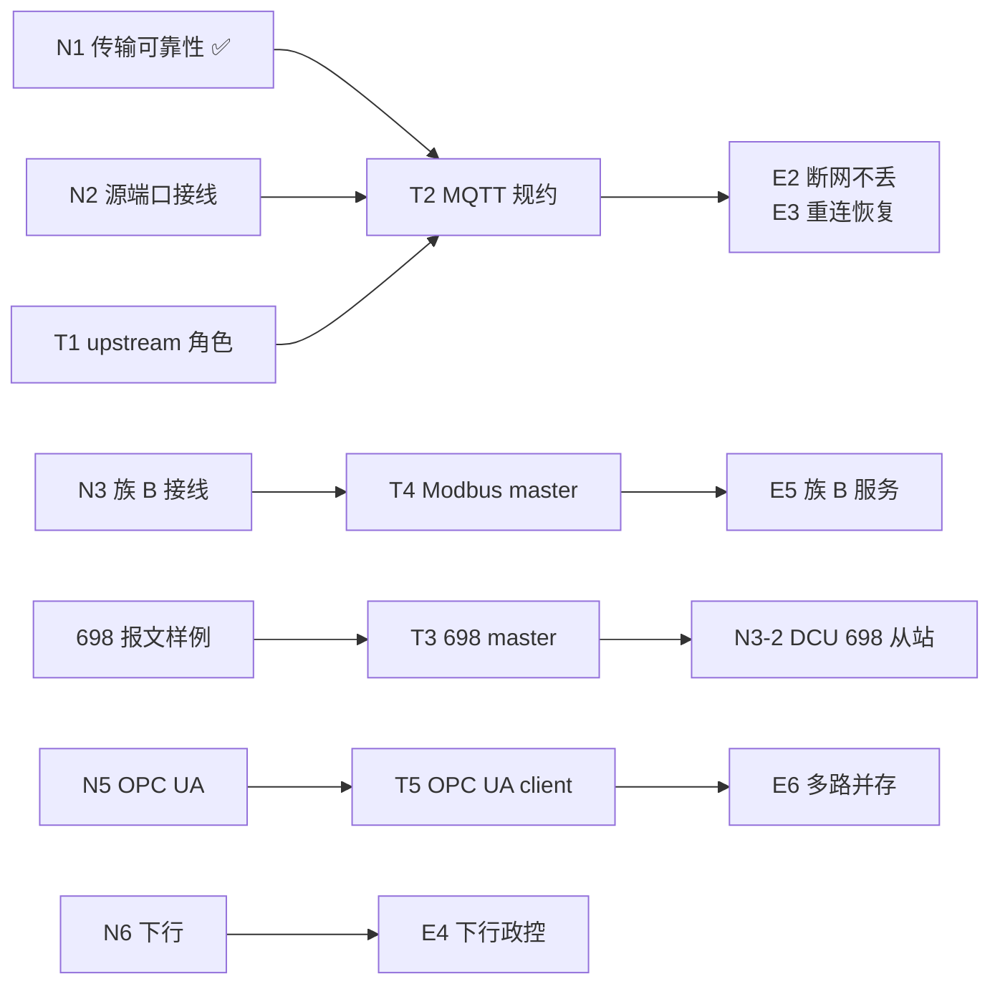

# 北向通信架构与实施计划

> **状态**：实施中（N1 已完成）
> **决策依据**：[ADR-0011 北向通信分两族](../adr/0011-northbound-two-family-model.md)
> **本文只写**：范围、业界参照、架构、现状、计划、风险。
> **决策理由与被否方案不在本文**——那是 ADR 的职责，避免两处说法不一致。

## 变更记录

| 日期 | 变更 | 触发 |
|---|---|---|
| 2026-10-31 | 初版，把北向写成"上云推送" | — |
| 2026-10-31 | **纠错**：DCU 北向是 DL/T 698.45，不是 IEC104 | 用户指出 |
| 2026-10-31 | 改为两族模型；决策抽到 ADR-0011 | 发现 IEMS 已用 Modbus 从站做 NORTHBOUND |
| 2026-10-31 | N1 传输可靠性实施完成 | — |

## 目录

1. [范围与 Non-goals](#1-范围与-non-goals)
2. [业界参照](#2-业界参照)
3. [架构](#3-架构)
4. [现状核对（可复现）](#4-现状核对可复现)
5. [实施计划](#5-实施计划)
6. [风险](#6-风险)
7. [相关文档](#7-相关文档)

---

## 1. 范围与 Non-goals

### 1.1 本文解决什么

让北向从"只有一个写死的 MQTT+SparkplugB、且只能上行"，变成
**协议可插拔、上下行双向、传输可替换、断网不丢数据**的边界。

### 1.2 Non-goals（明确不做，附理由）

| 不做 | 理由 |
|---|---|
| Kafka | 现有三个产品无诉求，PRD 未提 |
| BACnet/IP | 养老产品未提出；文档提及 3 次但无需求来源 |
| IEC 61850 MMS | 变电站场景，不在 DCU/IEMS/SmartBox 范围内（文档提 4 次，均为规划性描述） |
| CoAP / LwM2M | 低功耗场景，无诉求 |
| 引入新的编解码框架 | 复用 `net_buf` + 驱动 `req_*`，避免两套抽象 |
| 改 `PipeMsg` 64 字节契约 | `shmring.h` 有 `_Static_assert`，Go 侧逐字节镜像，动它会破坏跨语言 IPC |
| 让北向读影子表 | 取数由产品端口给（ADR-0010） |
| 不按标准猜 698 报文格式 | 编码器必须对着 `docs/698_parsed.md` 附录 H 的字节写（§4.5 已按标准校正三处缺陷） |

---

## 2. 业界参照

### 2.1 主流工业网关的北向能力

| 产品 | 推送型（edge → 云） | 服务型（SCADA → edge） | 出处 |
|---|---|---|---|
| Softing edgeGate | MQTT | **OPC UA** | 产品页："Access PLC, CNC, and OPC UA Data via **MQTT and OPC UA** for higher-level management applications" |
| EMQX NanoMQ | MQTT 3.1.1 / 5.0，**Sparkplug B aware**，**TCP/TLS/WebSocket** | — | 产品页明确列出三种连接方式 |
| Open Automation IoT Gateway | MQTT / **Azure IoT Hub / AWS IoT / Kafka** | —（另有 Data Route 做系统间桥接） | 产品页 |
| ThingsBoard | MQTT + Sparkplug B | OPC UA / Modbus（网关侧） | Sparkplug API 文档 |
| Ignition（Inductive） | MQTT + Sparkplug B | **OPC UA Server** 为核心 | ICC 议题："Ignition with MQTT/Sparkplug" |
| 电力配网终端（DCU/FTU/TTU） | — | **DL/T 698.45**（本项目 DCU 实际需求）、IEC 60870-5-104 | 项目内 `cmd/dcu/prd.md`、`CONTEXT.md` |

> 表里前五行是公开产品资料，最后一行来自本项目文档。
> **未标注出处的判断不写进表**——上一版有几条是我的印象，已删除。

### 2.2 三条规律

1. **推送型几乎必选 MQTT**，差异在**载荷**（Sparkplug B / 裸 JSON / 云厂商私有），
   不在传输层。
2. **服务型几乎必选 OPC UA**，其次是 Modbus TCP Server（最廉价通用）。
3. **电力行业例外**：DL/T 698.45 与 IEC 104 是刚需，且往往比 MQTT 更重要——
   配电主站不会为了一台终端改用 MQTT。

---

## 3. 架构

### 3.1 两族模型



### 3.2 族 A：推送型（edge 主动发）

| 层 | 负责 | 不负责 |
|---|---|---|
| 协议驱动（codec） | payload 编码：Sparkplug B protobuf / 裸 JSON | 地址、连接、重连 |
| transport | 连接、重连、发送、地址解释 | payload 内容 |
| `northbound_mgr` | 调度、地址模板渲染、SnF、多路 fan-out | 协议细节 |

**地址模板**（每路传输一个配置项）：

```
MQTT + Sparkplug B : spBv1.0/{group}/{kind}/{node}
MQTT + 裸 JSON      : edge/{node}/{point}
OPC UA              : ns=2;s={node}.{point}
```

`{kind}` ∈ `NBIRTH` / `NDATA` / `NDEATH`；`{point}` 来自 `north_src.name()`。
模板必须**按协议配**（Sparkplug 的 `{kind}` 语义与 JSON 不同），但换协议不改编排代码。

### 3.3 族 B：服务型（外部主站来读）

| 层 | 负责 |
|---|---|
| 协议驱动（codec） | 组应答帧（CS、+0x33、ASDU、A-XDR 都是协议知识） |
| `bus_orchestrator` / `session_manager` | 监听、会话、调度 |
| 产品（cmd） | `resolve` 给当前值、`accept` 收写入、`enumerate` 枚举点位 |

### 3.4 为什么两族不合并

见 [ADR-0011 被否方案 D](../adr/0011-northbound-two-family-model.md)。
一句话：IEC104 从站是"应答"不是"发布"。

---

## 4. 现状核对（可复现）

### 4.1 核对命令

以下命令在仓库根执行，输出与下文结论一一对应：

```bash
# 族 A：北向管理器是否写死协议
grep -n 'sparkplug_b_driver_register\|"SparkplugB"' modules/edge_io/src/northbound_mgr.c
grep -n '_nb_topic' modules/edge_io/src/northbound_mgr.c

# 族 A：北向源端口有没有被注入（预期：只有读，没有写）
grep -rn 'north_src' --include=*.c --include=*.h modules/ cmd/

# 族 B：哪些驱动有从站应答能力
grep -ln 'req_slave_exchange' modules/edge_io/src/*.c

# 族 B：哪些产品真的接了从站
grep -rn 'setup_slave' --include=*.c cmd/

# DCU：698 服务端有没有接（预期：无输出）
grep -rn 'NORTHBOUND' cmd/dcu/manifest.yaml
grep -n 'setup_slave' cmd/dcu/main.c
```

### 4.2 族 A 缺口

| 编号 | 问题 | 证据 | 状态 |
|---|---|---|---|
| A-P0-1 | `connected` 只升不降（没注册 `onConnectionLost`） | `mqtt_producer.c` | ✅ N1 已修 |
| A-P0-2 | 重连后不重发 NBIRTH（Paho 只走 `setConnected`） | `mqtt_producer.c`、`driver_sparkplug_b.c` | ✅ N1 已修 |
| A-P0-3 | `publish` 返回 0 被当"已送达"，SnF 静默丢数据 | `snf_manager.c` | ✅ N1 已修 |
| A-P0-4 | 未连接时 `printf` + `return 0`（假成功） | `northbound_mgr.c` | ✅ N1 已修 |
| A-P1-1 | 北向源端口从未注入 → metric 名恒为 `tag_%u` | `include/northbound_mgr.h:54` 无 setter | ❌ N2 |
| A-P1-2 | 下行完全没接（`subscribe` 空指针） | `mqtt_producer.c` | ❌ N6 |
| A-P1-3 | 协议写死、topic 写死 | `northbound_mgr.c:251`、`_nb_topic` | ❌ N4 |
| A-P1-4 | 只推 SCALAR，BATCH/EVENT 静默丢弃 | `northbound_mgr.c:155` | ❌ N4 |
| A-P2-1 | 100ms 轮询而非事件驱动 | `northbound_mgr.c:201` | ❌ N6 |
| A-P2-2 | 单 transport，不能多路并存 | `northbound_mgr_t.transport` | ❌ N4 |

### 4.3 族 B 缺口

| 编号 | 问题 | 证据 | 状态 |
|---|---|---|---|
| B-P1-1 | 8 个驱动有从站能力，只有 IEMS 1 个接了线 | `setup_slave` 唯一调用点 `iems_app.c:535` | ❌ N3 |
| B-P1-2 | OPC UA 是死代码（`opcua_engine_create` 无人调用） | `opcua_engine.c:68` | ❌ N5 |
| B-P1-3 | DCU 无任何北向从站（而 698 正是它的北向） | 见 §4.4 | ❌ N3 |
| B-P2-1 | `enumerate` 只有部分产品实现 | — | ❌ N3 |

### 4.4 DCU 北向 = DL/T 698.45：需求 vs 现状

**需求**（`cmd/dcu/prd.md`、`cmd/dcu/CONTEXT.md`、`docs/698_OAD_LOGICAL_RELATION.md`）：
DCU 是国网/南网台区配电智能融合终端（TTU），北向对**配网主站**走 698.45，
DCU 是**服务端**。

三条数据路径：

| 路径 | 服务 | 用途 |
|---|---|---|
| 主站召测实时值 | `GET.request`（OAD） | 电压/电流/功率/档案/参数 |
| 主站召测历史 | `GET.request`（Record） | 5004/5005 日/月冻结电能 |
| **DCU 主动上报** | `REPORT.notification` | 3011 停电、601D 上报方案 |

prd 划分的 7 个模块：对象字典路由 / 通信与安全（F100 ESAM、F101、**4400 应用连接**、
F200-209）/ 实时数据 / 采集调度（6000·6012·6014）/ 冻结（5000-5011）/
异常事件（3xxx、class 14）/ 负荷控制（8000·8001·81xx）。

**现状**：

| 需求项 | 代码现状 | 结论 |
|---|---|---|
| 对象字典 + 路由 | `dcu_router.c` 有 9 个 OI，`get_attr`/`set_attr`/`action` 齐备 | ✅ 模型在 |
| 上述入口的调用方 | 只有测试与 `main.c` 本地 demo | ❌ 产品路径无调用 |
| 698 服务端接总线 | `manifest.yaml` 0 条 NORTHBOUND；`main.c` 只 `setup_master` | ❌ 没接 |
| 从站取数端口 | `dcu_driver_adapter.c` 无 `edge_slave_source_ops_t` | ❌ 没实现 |
| `GET` | `dlt698_req_slave_exchange` 只处理单 OAD，固定回 2 字节 | ⚠️ 半成品 |
| `SET` / `ACTION` / `GET-Record` / `REPORT` / 4400 | 无 | ❌ |
| OI 8000 遥控 | `_oi_8000_execute` 明确 `return -4` | ❌ 控制断链 |
| 异常应答 | 出错静默，主站只能超时 | ❌ |

**一句话**：对象模型齐了、服务端只做了 GET 一半、通道没配、控制断链。

### 4.5 698 报文：已按标准原文校正（曾存疑）

**卡点解除**：协议原文在 `docs/698_parsed.md`（Q/GDW《面向对象的用电信息数据交换协议》
报批稿），附录 H 带完整报文举例。之前"没有样例不敢动编码器"的判断，是把"没有现场样例"
误当成"没有权威依据"——标准本身就是依据。

按附录 H 的字节核对，发现三处**既有实现缺陷**（`bc937bf9`）：

| 位置 | 原来 | 标准 | 后果 |
|---|---|---|---|
| 长度域 L（codec 三处） | 帧长 − 1 | 帧长 − 2（5.1.2） | 对端按错误长度取数据，解析错位。附录 H.1 登录帧：32 字节 → L=30 |
| SET-Request 尾部 | 无 | 时间标签 `00`（H.4.1） | 服务器把 Data 最后一个字节当时间标签，报"类型不匹配" |
| GET-Response 服务码 | `0x81` | `0x85` = [133]（H.3.6） | `0x81` 是 [129] LINK-Response，主站按服务码分发会直接丢掉 |
| GET-Response 尾部 | 无 | FollowReport `00` + 时间标签 `00` | 主站去读"跟随上报"，读到的却是后续字节 |

同时补齐 **ACTION 服务**（拉合闸等对象方法操作要用）：

- `dlt698_encode_action_request`：`07 | 01 | PIID | OMD(4) | Data | 时间标签`
- `dlt698_encode_action_response`：`87 | 01 | PIID-ACD | OMD(4) | DAR | Data OPTIONAL | FollowReport | 时间标签`

`DAR` 必须如实填：操作失败回 0 就是"假成功"，主站会以为继电器动了。

**测试方式**：`tests/test_dlt698_action.c` 的期望值全部抄自附录 H，不是用本实现输出
反推——后者只能证明"代码没变"。`tests/test_driver_dlt698.c` 里原先那条
`L == 帧长 − 1` 的断言，正是把 off-by-one 当成"codec 的约定"锁进了测试。

**已完成**：DCU 的 698 从站（N3-2）已接上，GET 能读实时量与档案计数，
A-XDR 类型标签由产品给（`edge_point_value_t.type`）。ACTION 走 `accept_action`，
当前明确回 DAR=2（参数结构未实现，见 §4.9）。

### 4.6 类型适配：OAD → `edge_point_value_t`

`dcu_router_get_attr(oad, out_val)` 的 `out_val` 是裸指针，类型由各 OI 的
`read_attr` 决定：

| OI / 属性 | 写入类型 |
|---|---|
| 2000 / 2001 属性 2 | `float*`（`_oi_variable_read`） |
| 6000 属性 2 | `uint16_t*`（`_oi_6000_read`） |
| F200 | 结构体（`_oi_f200_read`） |

而 698 应答需要 A-XDR 类型标签，`edge_point_value_t` 现有字段
（`value`/`raw`/`width`/`quality`/`ts_ms`）**推不出标签**——`width=2`
可能是 `long` 也可能是 `unsigned`。

**方案**：给 `edge_point_value_t` 加 `uint8_t type_tag`（0 = 未指定，驱动按 width 推断）。
类型是行业原生知识，归产品（ADR-0010）；驱动只负责编进报文。

### 4.7 端到端闭环：现在通到哪一步

问题：**平台（主站）→ 北向 → 南向 → 南向设备**这一圈，现在闭合了吗？

**上行（南向设备 → 平台）已闭合**，IEMS 上被断言过：台架 Modbus 从站给 231.7V →
iems 轮询 → datahub 影子 → 北向 Modbus 从站镜像 → 平台主站读回，
用例断言"读到的 == 台架给的"（`test_northbound_image_carries_the_bench_voltage`）。

**下行（平台 → 南向设备）2026-11-01 才打通**（`E4a`）：

```
平台 meter.write("电压", 220.0)
  → 北向 Modbus 从站（iems，FC06 写寄存器 0）
    → iems _iems_north_accept：addr → map → tag，raw → 工程值
      → _iems_stream_submit_control：tag → 原生 id + raw，过聚合根/控制端口
        → 南向 Modbus 主站写台架从站（FC06 寄存器 0 = 2200）
          → 台架记到这一帧写，回读 220.0
```

用例 `test_master_write_reaches_the_southbound_device` 的判据刻意**不看写应答**：
Modbus 0x06 的应答就是回显，设备什么都没做也会回一模一样的帧 —— 只看应答，
"产品把写吞了"和"产品写下去了"完全一样。

**仍未闭合的部分（E4b）**：写的是**镜像寄存器本身**，不是业务设定值。
真正的下行政控要产品给出「名字 → 聚合根方法」的映射（`_iems_nb_on_downlink` 现在
解析成功但明确返回 -1）。DCU 侧 698 从站已接（GET 通、ACTION 回 DAR=2）。

#### 这次顺手发现的一个真缺陷

`_iems_stream_submit_control` 原来把 **tag_id 当寄存器地址、工程值当原始值** 直接下发。
读路径（`_iems_north_resolve`）一直是换算过的，写路径漏了 —— 一读一写不对齐。
后果是"发到寄存器 1001、原始值 220"，而正确是"寄存器 0、原始值 2200"；
**设备照样回显**，所以从应答上看不出任何问题。已修（tag → `map->key` + `value / scaler`）。

### 4.8 test-platform 现状（E2E 前置）

| 项 | 现状 | 缺口 |
|---|---|---|
| 角色模型 | `DEVICE_ROLES = (dut, support)` | **无"北向对端"角色** |
| 拓扑语义 | `via:` = 下游挂在终端后面（平台当从站） | 北向方向相反 |
| 协议层 | `protocol/` 纯编解码，主站侧函数已有 | 缺 698、OPC UA、Sparkplug 解码 |
| `PROTOCOL_ACCESS` | mqtt/http/ssh 被标"传输已实现、规约未放行" | 要放行 |
| MQTT | `RealMqttTransport` 已实现（paho） | **venv 里没装 paho-mqtt** |
| Broker | 容器内 `mosquitto` 已装 | 需纳入 E2E 编排 |

---

### 4.9 DCU 698 从站（族 B）与仍未做的 ACTION 参数

**已接上**：`cmd/dcu/main.c` 的 `_northbound_slave_attach()` 建 698 从站引擎、
绑 `DCU_NORTH_SOCK`（缺省 `/tmp/dcu_north_slave.sock`）、accept 后 attach_io。
点位由产品给：`_dcu_nb_resolve()` 按 OI 决定 A-XDR 类型标签
（2000/2001/2004 → float32，6000 → long-unsigned），驱动只负责编码。

**验收**：`acceptance/dcu/tests/test_dcu_northbound.py` 三条。前两条走**设备模型**
（`drivers/dlt698_master_driver.py` + `configs/devices_north.yaml`，
`meter.read_all().readings`），第三条因为"操作"不是"读一个点"，直接用协议层发一帧：

| 用例 | 断言 |
|---|---|
| 读电压 | 20000200 → float32 231.7±0.5（台架喂的就是这个值） |
| 读档案计数 | 60000200 → long-unsigned 40（类型标签必须是 0x12，不是别的） |
| 跳闸 | OI 8000/129 → **DAR=2 暂时失效**，不许回 0 |

第三条是刻意"验失败"：参数结构没实现，如果回 0，主站会以为继电器动了。

**南向控制已打通（2026-11-01）**：`docs/DLT_645-2007_多功能电能表通信协议2010.pdf`
到位后，645 控制帧不再靠猜：

- `dlt645_build_ctrl_request()`：控制码 `1CH`，`68 addr 68 1C L PA P0P1P2 C0..C3 N1..Nm CS 16`，
  `L = 8 + m`，数据域每字节 +33H（标准 7.13 / 5.2.5）。N1 = `1AH` 跳闸、`1BH` 合闸允许。
- `dcu_node_execute_control()` 原来**只派发领域事件就返回 0**，总线一个字节都没有；
  现在真的经 `edge_api_raw_io` 下发，返回码以"帧是否交给总线"为准。
- 路由到聚合根之间加了 `dcu_router_set_control_sink()` 端口：路由只认识对象，
  发控制帧是领域动作，必须过聚合根（在线、白名单、闭锁）—— 架构原则 3。
- 验收：`test_dcu_sends_trip_control_frame` 断言台架收到 `1CH / N1=1AH / 密级 02H` 的帧。

**仍未做（E5b）**：698 ACTION 的**参数**解析。标准表 A.9 规定方法 129/130 的参数是
`array<structure{继电器 OAD, 告警延时, 限电时间, 自动合闸}>`，而 698 原文里
**没有这个结构的报文举例**（附录 H.5.1 只给了标量参数的例子），OAD 作为结构字段的
A-XDR 编码需要现场样例才能确定。所以 698 侧仍回 DAR=2，不猜。
南向这一段已经能用，缺的只是"从 698 参数里取哪个继电器"这一层。

## 5. 实施计划

每项都带**可执行验收**，不写"功能正常"这种没法判的句子。

### N1 传输可靠性 ✅ 已完成

| # | 事项 | 验收 |
|---|---|---|
| N1-1 | 注册 `onConnectionLost` + `MQTTAsync_setConnected`；重连重订阅 + 重发 NBIRTH | 断网重连后 `is_connected()` 与实际一致，主站看到新 NBIRTH |
| N1-2 | `nb_transport_ops_t` 加 `pending()` | 断网时 `publish` 后 `pending() > 0` |
| N1-3 | SnF 整批确认 | 断网期间数据恢复后全补发，一条不少 |
| N1-4 | 删 `printf` 假成功 | 未连接时 `publish` 返回 -1 |
| N1-5 | 回归测试 | `ctest -R test_snf_delivery_confirm` 3 条绿；`test_sparkplug_b` 加 1 条绿 |

**落地记录**：

| 改动 | 落点 |
|---|---|
| 断连/重连回调 | `mqtt_producer.c`（注意 `onConnectionLost` **不在** `connectOptions`，要用 `MQTTAsync_setCallbacks`） |
| 在途计数 | `mqtt_producer.c`：`inflight` 原子计数 + 每条消息 `responseOptions` 回调 |
| 会话代数 | `nb_transport_ops_t.session_epoch`，`_on_reconnected` 里 +1 |
| 驱动会话复位 | `edge_driver_t.req_session_reset`；sparkplug 清 `birth_sent`/`seq` |
| 整批确认 | `snf_manager.c`：按 `(ts, tag_id)` 主键对标记（表是 `WITHOUT ROWID`，无 rowid） |

两个实现坑：① `onConnectionLost` 不在 `connectOptions` 里；② 在途计数必须**先加再发**
（本地 broker 的 PUBACK 可能在 `sendMessage` 返回前回调，顺序反了计数永久停在 1）。

### N2 源端口接线 ✅ 已完成

| # | 事项 | 验收 | 状态 |
|---|---|---|---|
| N2-1 | `northbound_mgr_set_north_source()`，组合根注入 | 有 setter 且被调用 | ✅ |
| N2-2 | `edge_north_source_ops_t` 拆到 `edge_north_plane.h` | 编译通过，无循环依赖 | ✅ |
| N2-3 | DCU 实现 `peek`/`name`（16 个实时 OAD） | metric 名不再是 `tag_<数字>` | ✅ |
| N2-4 | IEMS 实现 `peek`/`name`（复用 `iems_get_tag_meta`） | 同上 | ✅ |
| N2-5 | `session_manager` 未注入北向源时传 `NULL` | 见下方说明 | ✅ |

**N2-5 原本想的是"删掉无人调用的 setter"，查下来发现它不该删**：
`session_manager` 会把 `&sm->north_src` 无条件传给 `req_tick`，而 setter 从未被调用，
所以传出去的是一个**全零结构体**——驱动里 `if (!src) return -1;` 的守卫因此失效
（指针非 NULL，但 `peek` 是 NULL）。

目前只有 `ccsds` / `cia402` / `hl7_fhir` 用这个端口，它们都额外检查了 `!src->peek`，
所以没有活跃 bug；但"传空壳"会让下一个照抄的人踩坑。改成 `north_src_set` 标志 +
未注入时传 `NULL`。

**落地记录**：

| 改动 | 落点 |
|---|---|
| 新头文件 | `modules/edge_io/include/edge_north_plane.h`（从 `edge_slave_plane.h` 拆出） |
| 注入 API | `include/northbound_mgr.h` + `northbound_mgr.c` |
| DCU 端口 | `cmd/dcu/dcu_north_source.{c,h}`（新文件），`main.c` 注入 |
| IEMS 端口 | `cmd/iems/iems_app.c`，复用 `iems_get_tag_meta()` 取名字 |
| 空壳修复 | `session_manager.c`：`north_src_set` 标志 |

### N3 族 B 接线（不写新协议，只配置化）

| # | 事项 | 验收 |
|---|---|---|
| N3-1 | `setup_slave` 协议名从配置读 | 改 manifest 即可换协议 |
| N3-2 | **DCU 接 698 从站**：GET 已通（A-XDR 类型标签由产品给）；ACTION 回 DAR=2 | 698 主站 GET 到 231.7V / 40 只表 |
| N3-3 | IEMS 增加 Modbus TCP 从站 | Modbus 主站读得到寄存器 |
| N3-4 | 产品实现 `enumerate` | 总召唤/批量读拿到全点位 |

### N4 族 A 多协议

| # | 事项 | 验收 | 状态 |
|---|---|---|---|
| N4-1 | 地址模板 + 删 `_nb_topic()` | `grep 'sparkplug_b_identity' northbound_mgr.c` 为空 | ✅ |
| N4-2 | 协议名参数化 + transport 数组 | `set_protocol` 未知名返回 -1；`add_transport` 最多 4 路 | ✅ |
| N4-3 | MQTT over WebSocket | 配 `ws://` 能连上 | ⬜ |
| N4-4 | 裸 JSON 驱动 | topic 走 `edge/{node}/{kind}`，载荷 `{"p":"<name>","v":<value>}` | ✅ |
| N4-5 | 门禁 15：编排不得写死协议与地址 | 故意插 `sparkplug_b_identity` 判红（已负样本验证） | ✅ |

**落地记录（N4-1/N4-2/N4-5）**：

| 改动 | 落点 |
|---|---|
| 地址模板 | `northbound_mgr_t.address_template` + `_render_address()`，支持 `{group}/{node}/{kind}/{point}` |
| 模板可单测 | `northbound_mgr_render_address()`（诊断/测试用） |
| 协议注册表 | `NB_PROTOCOLS[]` 表，加协议只加一行 |
| 驱动延后创建 | 从 `init_ex` 移到 `north_thread_entry`，这样 `set_protocol` 可在 `start` 前随时调用 |
| 多传输 | `transports[NB_MAX_TRANSPORTS]` + `_any_connected` / `_publish_all` / `_pending_total` / `_epoch_signature` |
| 线程生命周期 | `thread_started` 标志：驱动建不起来时线程提前退出，`stop` 仍要 join，否则句柄泄漏 |
| 门禁 | `scripts/check_architecture_layers.sh` 第 15 道 |

三个设计细节值得记：

1. **会话代数用"求和"不用"取最大"**：取最大时，代数低的那一路重连会被高的一路盖住，
   BIRTH 就不重发了。求和单调不减，任一路重连都会变大。
2. **在途数用"求和"（保守）**：任一路还有在途就不确认，宁可晚一轮（at-least-once
   允许多发一次），也不要在某一路没送达时就标已同步。
3. **未知占位符原样保留**：`{ponit}` 拼错时输出 `{ponit}` 而不是空串——
   让主站看到一个显眼的错，好过静默拼出一个"看起来正常"的错误主题。

**已知缺口（A-P2-3，本轮未修）**：`_push_to_transport_direct` 收到 `ts` 但用不上——
`req_prepare` 签名里没有时间戳，驱动编 payload 时自己取当前时间。
实时路径影响不大，但 **SnF 回放会打上"现在"的时间戳，历史曲线就假了**。
修法是把 `ts` 加进 `req_prepare`（13 个驱动各多一个形参），属跨模块签名变更，单独一次做。

### N5 OPC UA Server

| # | 事项 | 验收 |
|---|---|---|
| N5-1 | 明确 `publish` 对 OPC UA 的语义（= 更新节点值） | 文档 + 代码注释一致 |
| N5-2 | 救活 `opcua_engine_create()` | 有调用方 |
| N5-3 | 地址空间映射 `ns=2;s={node}.{point}` | UaExpert 能浏览到节点 |
| N5-4 | 写入回调 → `accept()` → 聚合根 | 写入后继电器状态变化 |

### N6 下行 + 补齐

| # | 事项 | 验收 | 状态 |
|---|---|---|---|
| N6-1 | MQTT `subscribe` + 重连后重订阅 | 真 broker 集成测试通过 | ✅ |
| N6-2 | 驱动 `req_decode` → `accept()` → 聚合根 | 非法命令被聚合根拒绝 | ⬜ 待定方案（见下） |
| N6-3 | 回执上行（命令 ID + 结果，失败也回） | 云端收到成功与失败两种回执 | ⬜ |
| N6-4 | 防重放：命令 ID 去重窗口 | 同一命令重复投递只执行一次 | ⬜ |
| N6-5 | SmartBox 接北向 | `cmd/smart_box/main.c` 有 `northbound_mgr_init_ex` + 源端口 | ✅ |
| N6-6 | 配置从 profile 读 | 去掉 `MQTT_URL`/`MQTT_GROUP_ID` 环境变量 | ⬜ |
| N6-7 | 事件驱动替代 100ms 轮询 | 唤醒后 400ms 内发出（兜底轮询是 500ms） | ✅ |

**N6-1 落地记录**：

| 改动 | 落点 |
|---|---|
| 订阅表 + 重连重订 | `mqtt_producer.c`：`subs[]` + `_resubscribe_all()`，`_on_success` / `_on_reconnected` 都调 |
| 下行回调 | `MQTTAsync_setCallbacks(..., _on_message, ...)`，应用侧负责 `freeMessage`/`free` |
| 契约修正 | `nb_transport_ops_t.subscribe` 增加 `void* user` 参数 —— 没有它，订阅方只能在回调里用全局变量找回自己，多实例就废了 |
| 端口扩展 | `edge_north_source_ops_t` 增加 `resolve_name()`（名字→标识）与 `accept()`（收下行，**必须走聚合根**） |
| 集成测试 | `tests/test_mqtt_subscribe.c`：起真 mosquitto，验"订得到 / 通配匹配 / 重复订阅不重复投递" |

> **为什么这条用真 broker 而不是 mock**：mock 只能验证代码路径，验证不了"到底通不通"。
> 订阅这条路上"回调注册对不对""通配匹配符不符合 broker 规则"只有真 broker 能证。
> 找不到 `mosquitto` 时整组跳过（打印 SKIP），不让缺 broker 把测试套件搞红。

**N6-2 已拍板：下行解析放组合根，编排层只送字节**

用户拍板（2026-10-31）：**下行点位的识别与执行映射放组合根，后续在组合根慢慢填空**。

落地形态：

```
transport.subscribe ──► northbound_mgr（不解析，原样转交）
                              │
                              ▼
                   north_src->on_downlink(ctx, address, payload, len)
                              │
                              ├─ 格式所有者解析（mqtt_json_decode_downlink / dlt698_decode_frame）
                              └─ 字段 → 聚合根方法（产品填空）
```

| 层 | 负责 | 不负责 |
|---|---|---|
| `northbound_mgr` | 订阅、把 `(address, payload)` 原样转交、记日志 | 解析任何字节 |
| 格式所有者（驱动 / `edge_protocol`） | 字节 → 结构化字段 | 哪个聚合根方法 |
| 组合根（`cmd/<product>`） | 字段 → 聚合根方法、值域/闭锁校验 | 字节解析 |

**分层纪律（写进端口注释）**：产品可以调协议层的解析函数，
但**不要**把字节解析复制进 `cmd/`——那是协议知识。

**为什么不是方案 A/B**：
- 方案 A（主题带 `{point}`）要求 Sparkplug NCMD 偏离规范，风险在外部
- 方案 B（驱动 `req_decode` 返回 `(name,value)`）要改 13 个驱动签名，
  而且编排层被迫理解"name"这个概念
- 放组合根：零签名变更、协议知识不越界、填空点明确

**当前填空状态**：

| 产品 | `resolve_name` | `accept` | `on_downlink` |
|---|---|---|---|
| DCU | ✅ 16 个实时 OAD 反查 | ⬜ 待 698 ACTION 语义 | ✅ 解析 + 明确拒绝（不假装执行） |
| IEMS | ✅ 走 `g_tag_metadata` | ⬜ 待 SOC 包络映射 | ✅ 解析 + 明确拒绝 |

> **DCU/IEMS 的 `on_downlink` 现在返回 -1 是刻意的**：解析通了但**不执行**。
> 拉合闸要动物理继电器、IEMS 要过 SOC 包络，在语义没确认前"猜一个执行路径"
> 比"明确拒绝"危险得多。日志里写清了缺哪张映射表。

**顺带修掉的隐藏耦合**：`on_data_notify_timer` 原来第一句就 `if (!mgr->user_data) return;`，
而 `user_data` 由 `service_new` 设置。结果"服务还没接上"会连带把**下行订阅**也停掉——
两件不相关的事被绑在一起。现在订阅与会话跟踪移到门禁之前。

### T 系列（test-platform 侧，E2E）

> **分工边界**：北向的**发起方（主站/云侧）由平台模拟，用例与判据也由平台编写**。
> EdgeC 只提供"能被测"的确定性行为（固定的报文格式、可预期的重连语义），
> **不自己写北向 E2E 断言**——否则就成了"自己判自己合格"。

#### T-1 交付物形态

平台不是"跑个脚本"，它有自己的任务与门禁体系：

```
tasks/northbound-<场景>.yaml          # 任务声明（设备清单 + 用例选择 + 判据集）
  ↓ python tools/run_task.py <任务> --root . --evidence-dir reports/<任务>
reports/<任务>/summary.json           # 证据与四档结论
  ↓ python tools/gate.py reports
退出码                                # 0 合格 / 1 不合格 / 2 无效 / 3 未完成 / 4 平台错误
```

**EdgeC 侧接入点**：`acceptance/run.sh`（已有），
平台版本锁在 `acceptance/testplatform.sha`——**升级平台 = 改这一行的一次 PR**，
不允许跟着平台 main 漂。

#### T-2 归因规则（北向特有问题）

平台现有四档结论：设备不合格 / **测试无效** / 平台错误 / 证据损坏。

北向场景要新增一条归因：**北向对端（broker / 主站模拟器）挂掉 = 测试无效**，
不是 EdgeC 不合格。理由与现有 `UpstreamFault` 一致（`composition/root.py:137`）：
对端没起来，被测设备的结论无从谈起。

反面例子必须避免：把"broker 没启动"记成"EdgeC 推送失败"，会让人去查错地方。

> **注意与平台既有 `via:` 的区别**：平台 ADR-0009 的 `via:` 是"support 经 dut 接入"
> （平台当主站、dut 当通路），方向与北向相反。族 B（dut 当从站）**天然适配**
> 现有设备模型——只是多一个主站侧驱动；只有族 A（dut 推给 broker）需要新东西。

#### T-2b 已落地（2026-10-31）

| 项 | 内容 |
|---|---|
| 模块 | `src/testplatform/protocol/mqtt_json.py`（纯函数，遵循 ADR-0004 协议知识独立成层） |
| 能力 | `parse_downlink()` / `parse_birth()` / `is_birth()`，与 EdgeC `driver_mqtt_json.c` 同一套规则 |
| 规则表 | `DOWNLINK_RULES`——**C 侧与 Python 侧必须逐条一致**，改一边就改另一边 |
| 单测 | `tests_unit/test_protocol_mqtt_json.py`，31 条全绿（含"缺 v 不能当 0""bool 不能当数字"） |
| 观察器 | `tests_support/northbound_probe.py` + `tests_unit/test_northbound_probe.py` 18 条全绿 |
| 导出 | `protocol/__init__.py` 加 `mqtt_json` |

**`NorthboundProbe` 是什么**：E2E 断言的公共底座。北向用例的断言点都是
「设备发了什么」——发了没有、名字对不对、顺序对不对、断网恢复后有没有补发。
这些不是"一次请求一次应答"，而是**一段时间窗内收到的序列**。

它只做三件事：收集、等待、解码；**不判断**（判据是设备手册的事）。关键 API：

| 方法 | 用途 |
|---|---|
| `wait_for(pred, timeout)` | 等到第一条满足条件的消息；超时消息里带"实际收到了什么" |
| `wait_count(n, timeout)` | 补发场景断言"一条不少" |
| `wait_quiet(quiet_for)` | **反证**"不该再发"——必须先安静下来才能说明确实停了 |
| `points()` | 解成 `名字 → 最新值`（同一名字多次上报取最新；数次数请用 `messages`） |
| `birth_count()` | 上线帧条数，断网重连用例的断言点 |

> 设计时踩到并修掉的一个坑：**注入的假时钟不能用在 deadline 上**。
> 假时钟不走、真实 `time.sleep` 照走，超时永远不到，测试直接挂死。
> 现在 `clock` 只用于 `Observed.at`（决定先后），等待与超时一律用真实单调时钟。

> **平台改动尚未提交**：平台是独立仓库，`acceptance/testplatform.sha` 锁在
> `d2f0a0a`（= 当前 HEAD）。一旦在平台仓库提交，HEAD 就偏离 pin，
> `acceptance/run.sh` 的版本校验会红。所以改动留在工作区，
> **上游合并后再单独一次 PR 改 pin**——这与 pin 文件里写的升级流程一致。

两条边界：

1. **`bool` 不是数字**：Python 里 `True` 是 `int` 的子类，不单独排除就会被当成 1，
   静默把开关打开。
2. **缺 `v` 不能当 0**：「关到 0」和「没给值」是两件完全不同的事。

#### T-3 工作项与依赖

| # | 事项 | 依赖 | 交付物 |
|---|---|---|---|
| T1 | 新增角色 `upstream`（语义：DUT 主动连出去的对端，不判合格；挂掉 → 测试无效） | — | `config/manifest.py` 角色枚举 + 校验 |
| T2a ✅ | MQTT 放行：`paho-mqtt` 已装、`mqtt_json` 规约（上行解码 + 下行编码）、`NorthboundProbe` 观察器、`mqtt_broker` 一次性 broker | — | `protocol/mqtt_json.py` / `tests_support/northbound_probe.py` / `tests_support/mqtt_broker.py` |
| T2b ⬜ | Sparkplug B 解码（protobuf） | 需 `.proto` schema | `protocol/mqtt_sparkplug.py` |
| T3a ✅ | 698 编解码（GET / ACTION 请求构造，响应解析含 DAR；帧层 L/HCS/FCS 校验、帧长计算） | — | `protocol/dlt698.py` + `tests_unit/test_protocol_dlt698.py`（12 条，向量抄自标准附录 H） |
| T3b ✅ | 698 主站**驱动**：`("meter", "dlt698")` 工厂，GET 读属性走设备模型（类型标签与点表不符即报错） | T3a | `drivers/dlt698_master_driver.py`（DCU 北向 3 条用例已在用） |
| T3c ⬜ | GET-Record（一次读多个 OAD）与 REPORT 接收 | T3b | 按需，今天没有设备要求 |
| T4 | Modbus TCP master 驱动（复用 `protocol/modbus_tcp.py` 的 `build_read_request`） | — | `drivers/modbus_master_driver.py` |
| T5 | OPC UA client | EdgeC N5 | `drivers/opcua_client_driver.py` |
| T6 | E2E 用例 | T1–T5 对应项 | `tests_scenario/northbound_*.py` + `tasks/*.yaml` |

**依赖图**（T 与 N 的先后）：



#### T-4 E2E 必覆盖场景（平台设计）

| # | 场景 | 断言点 | 依赖 |
|---|---|---|---|
| E1 ✅ | 采集 → 推送 | 南向注入值 → 北向收到对应 metric，**名字正确**（非 `tag_123`） | N2 ✅, T2a ✅ |
| E2 | 断网不丢 | 断开 broker → 持续产数 → 恢复 → **全补发且时间戳保序** | N1 ✅, T2a ✅；**DCU 缺 SnF** |
| E3 | 重连恢复 | 重连后 `is_connected()` 真、**重发 NBIRTH**、订阅恢复 | N1 ✅, T2a ✅；需"重启产品"场景 |
| E4a ✅ | 下行**通路 + 回执**：平台写 → DUT 下到南向设备 → 回执上行（IEMS 闭环） | 台架记到同一帧写 + 回读一致 + 回执 1/0 | N6 ✅, T2a ✅ |
| E4b 🟡 | 下行**业务**：IEMS 已通（名字→点位→控制端口→回执）；DCU 的 OI 8000 参数结构待实现 | 非法点位回失败回执；DCU ACTION 回 DAR=2 | 见 §4.9 |
| E5a ✅ | 族 B **读**：698 主站 GET → DCU 的实时量与档案计数正确（含 A-XDR 类型标签） | 231.7±0.5V / 40 只表 | N3-2 ✅ |
| E5b ⬜ | 族 B **操作**：GET-Record / ACTION 跳闸合闸 | 继电器状态变化 | OI 8000 参数结构（标准表 A.9） |
| E6 | 多路并存 | MQTT 与 OPC UA 同时在线，数据一致 | N4, N5, T5 |
| E7 | 重复投递 | PUBACK 延迟下验证 at-least-once 不丢（允许重复） | N1 ✅, T2a ✅ |

> **E2/E3 是核心**：现有代码在这两个场景会静默丢数据，用例必须**先红后绿**，
> 不允许用例跟着实现改判据。

#### T-5 环境前置（实测）

| 项 | 状态 | 动作 |
|---|---|---|
| MQTT broker | 容器内 `mosquitto` 已装（`/usr/sbin/mosquitto`） | 纳入 E2E 编排，随机端口避免冲突 |
| paho-mqtt | ✅ 已装进平台 venv（`pyproject.toml` 的 `mqtt` extra 本来就有） | — |
| 平台仓库位置 | 容器 `/workspaces/test-platform`，**宿主不存在** | CI 与本地都要能定位（`TESTPLATFORM` 环境变量） |
| 平台版本锁 | `acceptance/testplatform.sha` | 平台侧改动需同步升级该 pin（一次 PR） |

---

## 6. 风险

| 风险 | 触发条件 | 影响 | 应对 |
|---|---|---|---|
| Paho 回调与 uv_loop 跨线程 | 多线程同时 publish | 数据竞争 | 回调只置原子标志 + `uv_async_send` |
| 整批确认导致 SnF 积压 | broker 持续慢于产生速率 | 数据库膨胀 | 保留策略（按时间/条数），超限丢最旧并计数告警 |
| at-least-once 重复 | PUBACK 丢失重发 | 云端重复计数 | 遥测按 `(ts, tag_id)` 幂等；文档写明语义 |
| 下行控制被滥用 | 未鉴权 | 安全事故 | 必须过聚合根五防闭锁/SOC 包络 + N6 鉴权 |
| 族 B 监听端口暴露 | 默认监听 0.0.0.0 | 攻击面 | 默认只监听内网 |
| 698 编码器猜错 | 无样例硬写 | 主站不认、排查成本高 | §4.5：样例到位前不写 |

---

## 7. 相关文档

| 文档 | 关系 |
|---|---|
| [ADR-0011](../adr/0011-northbound-two-family-model.md) | 本文的决策依据与被否方案 |
| [ADR-0010](../adr/0010-eliminate-global-contracts-and-tagid.md) | 产品用行业原生标识，不建全局名表 |
| [ADR-0005](../adr/0005-three-backend-datahub-shm-dds-mqtt.md) | `nb_source_ops_t` 不直接依赖 `shm_ring_t` 的由来 |
| [ADR002_MIGRATION_PLAN.md](ADR002_MIGRATION_PLAN.md) | 南向完成度（§2.1） |
| [slave_plane_architecture.md](slave_plane_architecture.md) | 族 B 的取数端口设计 |
