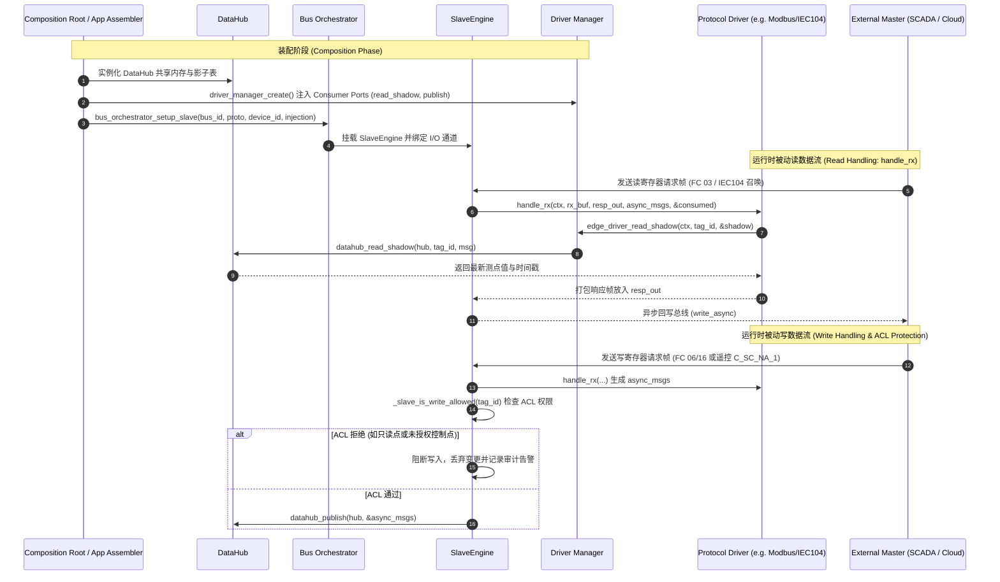

# Slave Plane 工业从站/对端平面架构规范 (AEP-403)

> **版本**: V1.0  
> **所属模块**: `modules/edge_io/` & `modules/edge_protocol/`  
> **关联 Issue**: #403

---

## 1. 概念模型：Master Plane 与 Slave Plane 对称性

在工业边缘网关与储能/配电系统中，协议引擎具有明确的对偶角色：

| 维度 | Master Plane (主站调度平面) | Slave Plane (从站响应平面) |
|---|---|---|
| **驱动角色** | `PROTOCOL_ROLE_MASTER` | `PROTOCOL_ROLE_SLAVE` |
| **触发机制** | 主动定时/事件触发 (`edge_req_t` 事务调度) | 被动物理帧接收 (`_slave_io_cb` → `handle_rx`) |
| **典型协议** | Modbus Master 轮询, DL/T 698 抄读, DLMS Client | IEC104 Slave 对调度上送, Modbus RTU/TCP Slave |
| **读数据源** | 南向物理表计/变流器响应帧 | DataHub 影子寄存器 (`edge_driver_read_shadow`) |
| **写数据流** | 本地控制策略下发 (`edge_api_write_tag`) | 外部上位机下发遥控 (`handle_rx` → ACL → Domain) |
| **执行引擎** | `MasterEngine` (`bus_orchestrator_setup_master`) | `SlaveEngine` (`bus_orchestrator_setup_slave`) |

---

## 2. 数据流与序列图 (Data Flow & Sequence Diagram)

从站平面依赖 Consumer Ports 机制实现与底座的依赖反转（DIP）。底层驱动无需直接引用具体的 DataHub，而是由装配层动态注入 `read_shadow` 与 `publish` 函数指针。



---

## 3. Slave Plane 核心接入指南

### 3.1 挂载 Slave 通道
在应用程序组装阶段（如 `iems_app.c` 或 `main.c`）：
```c
// 针对北向总线通道配置为从站模式
if (strcmp(conn->category, "NORTHBOUND") == 0) {
    const driver_contract_injection_t* inj = iems_get_driver_injection("ModbusRTU");
    if (inj) {
        bus_orchestrator_setup_slave(app->orch, conn->id, "ModbusRTU", 1, inj);
    }
}
```

### 3.2 驱动层实现 `handle_rx`
驱动实现模板需提供 `handle_rx` 回调（参见 `modules/edge_io/src/modbus_rtu_driver.c`）：
```c
int modbus_v3_handle_rx(edge_driver_ctx_t *ctx, net_buf_t *in, net_buf_t *resp_out,
                        pipe_msg_t *async_msgs, int *async_count, size_t *consumed) {
    // 1. 解码接收帧
    // 2. 如果是读指令 (FC 03 / FC 04)：
    pipe_msg_t shadow;
    if (edge_driver_read_shadow(ctx, map->tag_id, &shadow) == 0) {
        // 将影子寄存器数值缩放后填入响应报文 resp_out
    }
    // 3. 如果是写指令 (FC 06 / FC 16)：
    // 打包成 async_msgs，交由上层 SlaveEngine 统一进行 ACL 与 Edge-Guard 校验
}
```

---

## 4. 安全防护与控制写路径 ACL (Security & Write ACL)

根据 ADR-0010 与《整洁架构守卫规范》：
1. **点表级读写权限隔离**：测点元数据明确区分 `READ_ONLY` 与 `READ_WRITE`；
2. **禁止旁路控制下发**：外部上位机通过 Slave 下发的遥控、有功设定值等写操作，不得直接改写底层寄存器，必须经由 `_slave_is_write_allowed` ACL 鉴权，或通过事件总线流入领域聚合根（如 `iems_node_dispatch_power`）；
3. **Edge-Guard 深度报文检测 (DPI)**：在 `slave_engine.c` 中，所有写操作必须通过 `dpi_validate_telemetry` 进行数值上下限、突变斜率检查，防止逻辑炸弹攻击。
