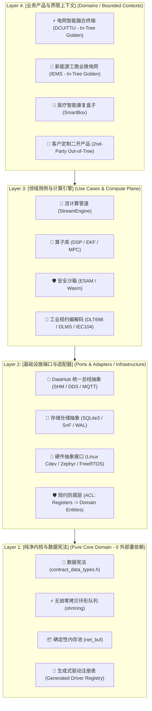

# EdgeOS / EdgeC 15年防腐化工程治理与 Clean/DDD 重构实施总计划 (Master Plan V5.1 - Final Compliance Edition)

- **文档编号**: PLAN-2026-08-16-ANTI-ENTROPY-V5.1
- **决策与审批人**: Mr. WKT & 专家评审团
- **生效日期**: 2026-08-16
- **设计生命周期**: 10 ~ 15 年工业嵌入式与边缘计算系统
- **核心基调**: **吸收一审至五审（R1~R5）全部判定；补齐合规认证与 RTM 追踪；AEP-001~516 共 54 个原子工单；Phase 0 基线冻结先行；按工单原子推进**

---

## 1. 方案背景与五审合规对标总结 (Executive Summary & R5 Audit)

根据 Codex 五审（`2026-08-16-clean-architecture-anti-entropy-review-r5.md`）独立复核与覆盖度审计：
- **评级提升**：计划可执行性由四审 C+ 跃升至 **B+（合规可执行版）**；
- **五审 5 大关键缺口已全部闭环**：
  1. **ADR-0008 V5 本体同步**：状态设为 `Proposed`，补齐长期治理与合规章节；
  2. **AEP-001 决策机制明晰**：给出未提交 WIP 代码的 3 种处理方案，由 Mr. WKT 明确拍板；
  3. **TagID 存量零破坏迁移策略**：存量 Tag 保持原有 ID 并引入 `legacy_aliases.yaml`，新 Tag 走严格分域；
  4. **补齐行业合规与认证体系**：引入 IEC 62304（医疗）、IEC 62443（工控安全）、MISRA C:2012 与需求追踪矩阵（RTM）；
  5. **增补 AEP-511 ~ AEP-516**：全案工单扩展为 **54 个原子 Ticket**。

---

## 2. 修正后的现状剖析与 3 处冲突纠正 (Forensic Audit & Conflict Resolution)

```
+---------------------------------------------------------------------------------------------------------------+
|  冲突项                  五审纠偏与事实澄清                                 处理方案                          |
+---------------------------------------------------------------------------------------------------------------+
|  1. 旧 `src/` 目录性质   • 顶层 CMake 已不再 `add_subdirectory(src)`，`src/`  • Phase 1 是“删除死树 + 平移 4 个 |
|                            大部分代码已是死代码，仅 4 个文件被 `edge_io` 引用。 仍被引用的存活文件”。           |
|                                                                                                               |
|  2. 头文件真实路径       • `edge_driver.h` 真实位置在 `modules/edge_io/include/`• 修正所有文档路径引用，杜绝路径悬空。|
|                            并非顶层 `include/`。                                                              |
|                                                                                                               |
|  3. 基线漂移风险         • 工作区当前存在 DCU 12 个、IEMS 7 个新交付模块等约    • 必须执行 Phase 0（AEP-001~003） |
|                            25 个未提交文件，基线尚未建立物理快照。              先原子收口并打基线 Tag。       |
+---------------------------------------------------------------------------------------------------------------+
```

---

## 3. 目标四层洋葱与 Ports & Adapters 架构模型



---

## 4. 全量 AEP 工单实施清单 (The 54 Executable Tickets)

```
========================================================================================================================
  工期总估算: 6 ~ 8 周 (2~3人/Agent 并行)
  依赖推进流: Phase 0 (基线冻结) ──► Phase 1 (源码树清理) ──► Phase 2 (核心解耦)
                                   │                           │
                                   ├──► Phase 3.5 (领域建模) ◄┘ (可并行)
                                   └──► Phase 3 (生成式注册) ──► Phase 4 (SDK导出) ──► Phase 5 (长期治理与合规)
========================================================================================================================
```

### 4.0 Phase 0：基线冻结与止血 (P0，2~4 人天)
| 工单 ID | 任务内容 | 前置依赖 | 机械化验收门禁 (DoD) | 估时 |
|:---|:---|:---|:---|:---:|
| `AEP-001` | **收口未提交 WIP**：根据 Mr. WKT 指令（全部提交/部分提交/移出），清理日志并建立快照 | 无 | `git status` 干净，创建 Tag `baseline-2026-08-16` | 0.5d |
| `AEP-002` | **基线证据归档**：复跑 `./build.sh && ./test.sh && ./test.sh --omnis` | `AEP-001` | 产出 `docs/baselines/2026-08-16-base-134.log`，CTest 134 + Omnis 10 全绿 | 0.5d |
| `AEP-003` | **修复 CI 覆盖率参数**：将 `-DENABLE_COVERAGE=ON` 改为 `-DCOVERAGE=ON`，确认 ASan/TSan 矩阵 | `AEP-002` | CI 覆盖率产出 gcda，ASan job 跑完 134 项 | 0.5d |
| `AEP-004` | **R3 未闭合项收口**：T-002 剩余（HMAC 外置、DataHub 回写、去硬编码 DTC） | 无 | `go test` 新增用例全绿，`rg` 扫描无硬编码密钥 | 1.0d |
| `AEP-005` | **评审意见双向映射**：建立 R1~R5 评审意见与 AEP/T-xxx 历史工单映射表 | 无 | `docs/plans/TICKET_MAPPING.md` 落盘 | 0.5d |
| `AEP-006` | **核心目录只读门禁原型**：配置 CODEOWNERS 与 PR 路径检查规则 | `AEP-001` | 改动 `modules/edge_core` 的 PR 触发警告标记 | 0.5d |

---

### 4.1 Phase 1：双重源码树清理 (P1，3~5 人天)
| 工单 ID | 任务内容 | 前置依赖 | 机械化验收门禁 (DoD) | 估时 |
|:---|:---|:---|:---|:---:|
| `AEP-101` | **平移存活文件**：将 `northbound_mgr.c`、`sched_engine.c`、`sched_port.c`、`io_executor_linux.c` 平移至 `modules/edge_io/src/` | `AEP-001` | `rg 'src/main_loop\|src/platform' modules/` 输出为 0 | 1.0d |
| `AEP-102` | **重构 edge_io CMake**：移除所有 `${CMAKE_SOURCE_DIR}/src/...` 路径 | `AEP-101` | `edge_io/CMakeLists.txt` 无跨目录路径；CTest 134 保持通过 | 0.5d |
| `AEP-103` | **死代码审计报告**：确认 `src/` 其余文件（旧 core/stream_engine 等）无外部引用 | `AEP-101` | 输出 `docs/reports/dead_code_audit.md` | 0.5d |
| `AEP-104` | **安全物理删除旧 src/**：删除根目录 `src/`（含 `src/CMakeLists.txt`） | `AEP-103` | 删除后全量构建通过，CTest 134 + Omnis 10 保持 100% 通过 | 0.5d |
| `AEP-105` | **添加路径与符号回归门禁**：建立 `scripts/check_no_old_src.sh` 与 `nm -g` 关键符号对比脚本 | `AEP-104` | 门禁脚本加入 CI，任何跨目录引用直接阻断构建 | 0.5d |

---

### 4.2 Phase 2：核心依赖解耦与 edge_infra (P1，10~15 人天)
| 工单 ID | 任务内容 | 前置依赖 | 机械化验收门禁 (DoD) | 估时 |
|:---|:---|:---|:---|:---:|
| `AEP-201` | **定义存储/总线抽象虚表**：定义 `storage_ops_t`、`datahub_ops_t` 纯抽象接口与依赖注入点 | `AEP-105` | `include/storage_ops.h` 落盘，接口评审通过 | 1.0d |
| `AEP-202` | **实现迁移 storage 模块**：迁移 `sqlite_service` 到 `modules/edge_infra/storage/`（保留 WAL/SnF 语义） | `AEP-201` | ADR-0007 专项测试 100% 变绿 | 2.5d |
| `AEP-203` | **实现迁移 bus 模块**：迁移 `datahub_dds.c`、`datahub_mqtt.c` 到 `modules/edge_infra/bus_*` | `AEP-201` | DDS 与 MQTT 单元测试 100% 通过 | 2.0d |
| `AEP-204` | **内核依赖白名单收窄**：`modules/edge_core/CMakeLists.txt` 移除 SQLite3/MQTT/DDS/cJSON 链接 | `AEP-202/203` | `scripts/check_core_symbols.sh` 校验 `nm -u` 无数据库/网络库符号 | 1.0d |
| `AEP-205` | **尺寸门禁脚本落地**：定义 `Release + strip` 测量口径，CI 增加尺寸报告与阈值告警 | `AEP-204` | CI 生成库尺寸 artifact，超出阈值告警 | 0.5d |
| `AEP-206` | **清理 35 个 SQLite 调用点**：重定向 35 个 C/H 文件的 include 路径与 CMake 链接 | `AEP-202` | 全局搜索 `sqlite_service.h` 无遗留旧包含路径 | 1.0d |
| `AEP-207` | **Kconfig 重排**：产品按需配置 `CONFIG_EDGE_INFRA_SQLITE` / `DDS` / `MQTT` | `AEP-204` | iems、dcu、smart_box 三种产品配置均可独立编译通过 | 1.0d |
| `AEP-208` | **专项韧性回归与 Omnis 验证**：复跑 SQLite WAL 压实、断线缓存 SnF 与 Omnis 10/10 物理仿真 | `AEP-202~207` | 专项日志归档，100% PASS | 1.0d |

---

### 4.3 Phase 3：契约生成式驱动注册与 edge-cli (P1，5~10 人天)
| 工单 ID | 任务内容 | 前置依赖 | 机械化验收门禁 (DoD) | 估时 |
|:---|:---|:---|:---|:---:|
| `AEP-301` | **编译器实现驱动注册表生成**：`contract-compiler-v2` 增加读取 YAML 生成 `edge_driver_registry.c` | `AEP-204` | 自动生成包含驱动 VTable 的 C 数组，`nm` 检查符号完整 | 2.5d |
| `AEP-302` | **产品消灭手工 extern**：将 iems(4个)、dcu(2个) 手工 extern 注册迁移为生成式注册表 | `AEP-301` | `main.c` 无任何 `extern ..._register`，Omnis 仿真全绿 | 1.0d |
| `AEP-303` | **编写 edge-cli 脚手架**：实现 `create-product`、`create-driver`、`lint-contract`（集成 validator） | `AEP-301` | 一键生成的工程与驱动模板可直接通过编译并运行 | 2.0d |
| `AEP-304` | **DX 自动化集成测试**：编写 `tests/test_dx_scaffolding.c`，验证新增驱动仅需 YAML 声明即可被调度 | `AEP-303` | 自动化集成测试变绿 | 1.0d |
| `AEP-305` | **生成物可信链校验**：CI 增加 `check_generated_drift.sh`，手改生成物阻断构建 | `AEP-301` | 故意篡改生成代码触发 CI 报错 | 0.5d |

---

### 4.4 Phase 3.5：DDD 领域建模与契约治理 (P1，5 人天，可与 Phase 3 并行)
| 工单 ID | 任务内容 | 前置依赖 | 机械化验收门禁 (DoD) | 估时 |
|:---|:---|:---|:---|:---:|
| `AEP-351` | **建立 CONTEXT-MAP 与领域词汇**：编写根目录 `CONTEXT-MAP.md` 与 DCU/IEMS/SmartBox 各域 `CONTEXT.md` | 无 | 四大上下文统一语言词汇表落盘 | 1.0d |
| `AEP-352` | **TagID 兼容分域与别名映射**：新域走 `0x01xxxx` 分域，存量 Tag 建立 `legacy_aliases.yaml` 零破坏映射 | `AEP-351` | 编译器校验通过，存量数据库与通信零回归 | 1.0d |
| `AEP-353` | **ACL 防腐层模块落地**：在 `modules/edge_infra/acl/` 中实现规约寄存器到领域实体的双向映射 | `AEP-352` | 单元测试验证原始物理寄存器地址不穿透业务层 | 1.5d |
| `AEP-354` | **核心业务场景用例固化**：为 DCU（冻结抄读）与 IEMS（防逆流孤岛）固化 DDD 场景测试 | `AEP-351` | Matrix 仿真用例全绿 | 1.0d |
| `AEP-355` | **跨产品同名 Tag 冲突查重**：在 validator 中加入全局契约查重引擎 | `AEP-352` | 注入冲突 YAML 触发编译器报错 | 0.5d |

---

### 4.5 Phase 4：Out-of-Tree SDK 导出与工程闭环 (P2，5~10 人天)
| 工单 ID | 任务内容 | 前置依赖 | 机械化验收门禁 (DoD) | 估时 |
|:---|:---|:---|:---|:---:|
| `AEP-401` | **导出 CMake Targets**：编写 `cmake/EdgeOSConfig.cmake.in` 并实现 `install(EXPORT EdgeOSTargets)` | `AEP-204` | 安装目录产出 `EdgeOSConfig.cmake`，`find_package(EdgeOS)` 可用 | 1.5d |
| `AEP-402` | **建立独立二开示例工程**：在 `examples/out_of_tree_bess/` 中建立完全脱离源码树的独立工程 | `AEP-401` | 在纯 SDK 安装环境下独立构建并运行成功 | 1.0d |
| `AEP-403` | **SDK 依赖与许可审查 (SBOM)**：梳理 CycloneDDS/QuickJS/WAMR/open62541 许可与头文件分发策略 | 无 | 输出 SBOM 清单与合规审查报告 | 1.0d |
| `AEP-404` | **ABI Golden Header 回归断言**：编写 `tests/test_abi_stability.c`，锁定 `PipeMsg` 64B 与 VTable 布局 | `AEP-401` | 结构体内存偏移量断言测试变绿 | 1.0d |
| `AEP-405` | **开发 edge-cli migrate 工具**：实现跨 SDK 大版本的契约与 API 自动扫描改写向导 | `AEP-303` | 模拟升级用例执行通过 | 1.5d |
| `AEP-406` | **编制《EdgeOS 二开工程师手册》**：覆盖脚手架、调试、契约编写与发布交付完整旅程 | `AEP-402` | 手册文档正式落盘发布 | 1.0d |

---

### 4.6 Phase 5：15年长期防腐化、合规认证与性能预算 (P2，持续建设)
| 工单 ID | 任务内容 | 前置依赖 | 机械化验收门禁 (DoD) | 估时 |
|:---|:---|:---|:---|:---:|
| `AEP-501` | **ADR 生命周期治理规范**：落实 Proposed $\rightarrow$ Accepted $\rightarrow$ Superseded 状态流转 | 无 | ADR 规范文档生效 | 0.5d |
| `AEP-502` | **API/ABI 兼容性发布政策**：制定 SemVer 语义化版本与破坏性变更至少提前 2 版本 Deprecation 规则 | `AEP-404` | 政策文档发布并加入 CI 检查 | 1.0d |
| `AEP-503` | **年度防腐健康审计工具**：编写 `tools/audit_entropy.py`，采集代码复杂度、模块耦合度与 TODO 密度 | `AEP-105` | 产出《2026 年度 EdgeOS 防腐健康报告》 | 1.0d |
| `AEP-504` | **CODEOWNERS 与只读门禁**：配置 GitHub CODEOWNERS，核心模块修改强制双人评审且不可静默豁免 | `AEP-006` | CI 门禁生效 | 0.5d |
| `AEP-505` | **LTS 分支与固件升级矩阵**：定义 LTS 支持周期、老设备 DFU 双分区升级与回滚保障矩阵 | 无 | 升级矩阵文档落盘 | 0.5d |
| `AEP-506` | **构建工具链容器化与 EOL 日历**：建立 Docker 构建镜像与 Python/CMake/Node 工具链 EOL 追踪表 | 无 | Dockerfile 验证可复现构建 | 1.0d |
| `AEP-507` | **安全扫描与密钥轮换管线**：配置 CVE 自动化扫描与国密/ESAM 密钥轮换机制（承接 T-001） | 无 | CI 安全扫描 job 生效 | 1.0d |
| `AEP-508` | **Docs-as-Code 强制机制**：配置 PR 模板，代码变动必须同步更新上下文词汇表与文档 | 无 | PR 门禁生效 | 0.5d |
| `AEP-509` | **防表演式全绿门禁**：配置核心文件独立覆盖率阈值（非全局平均）与变异测试抽查机制 | `AEP-003` | 门禁生效 | 1.0d |
| `AEP-510` | **知识传承制度**：输出系统架构 Playbook、新人上手指引与架构决策记录规范 | 无 | 知识传承手册落盘 | 0.5d |
| `AEP-511` | **ADR-0008 V5 修订与闭环**：同步 ADR-0008 内容至 V5 版本，经 Mr. WKT 签署后转为 Accepted | 无 | ADR-0008 V5 生效 | 0.5d |
| `AEP-512` | **产品合规矩阵与认证基线**：建立 IEC 62304/62443、GDPR/PIPL 与 OpenHarmony 送检基线 | 无 | 每产品一页合规矩阵 | 1.0d |
| `AEP-513` | **需求追踪矩阵 (RTM) 工具**：建立需求 $\rightarrow$ 架构 $\rightarrow$ 测试 $\rightarrow$ 证据链双向追溯表 | `AEP-512` | 认证类产品 RTM 报告生成 | 1.0d |
| `AEP-514` | **性能基线与资源预算门禁**：建立 DataHub 延迟、Ring 吞吐、内存峰值自动化性能回归 CI | `AEP-105` | 性能基准报告与阈值告警生效 | 1.0d |
| `AEP-515` | **二开上游贡献与同步规范**：输出 Fork $\rightarrow$ Upstream PR 规范与 SDK 更新推送机制 | `AEP-405` | 规范文档发布 | 0.5d |
| `AEP-516` | **MISRA C:2012 静态扫描试点**：在 `modules/edge_core` 试点启用 MISRA 静态合规扫描 | `AEP-204` | 试点模块扫描报告无致命违规 | 1.0d |

---

## 5. 风险控制与应急回滚预案 (Risk Control & Rollback Playbook)

```
+---------------------------------------------------------------------------------------------------------------+
|  潜在风险点              风险等级      防范与监控手段                        应急回滚预案                      |
+---------------------------------------------------------------------------------------------------------------+
|  1. 移动源码导致符号缺失   中        • 每次移动前后对比 `nm -g` 符号表；    • 严格单 Ticket 原子 Commit，变红 |
|     (Missing Symbols)                • 运行 CTest 全量 134 项测试。            一键 `git checkout` 零残留回滚。|
|                                                                                                               |
|  2. CMake 包含路径断裂     低        • 保持顶级 `include/` 对外暴露不变；   • CMake 检查 `target_include_directories`|
|     (Header Path Break)              • 采用 `-Werror=missing-include-dirs`。   的 INTERFACE 传递。            |
|                                                                                                               |
|  3. 存储崩溃一致性破坏     高        • 严格执行 2a->2b->2c 拆分；           • 继承 ADR-0007 专项测试，出现    |
|     (WAL / SnF Drift)                • 运行 WAL 压实与断线缓存专项测试。       时序偏差立即回退。             |
|                                                                                                               |
|  4. 物理仿真时序偏差       高        • 每次重构后强制运行 `./test.sh --omnis`• 保护 `contracts/` 目录与 DataHub 内存 |
|     (Simulation Drift)               验证 10 项端到端时序仿真。                偏移量计算规则绝对不被篡改。   |
+---------------------------------------------------------------------------------------------------------------+
```

---

## 6. 审批与批复建议 (Approval Recommendation)

建议 Mr. WKT 批复：
1. **拍板 AEP-001 中 25+ 未提交 WIP 的处理方案**：
   - **方案 A (推荐)**：将本轮已验证通过（134/134 + 10/10 仿真变绿）的 DCU 与 IEMS 高级交付代码做原子 Commit，作为当前正式基线；
   - **方案 B**：仅提交评审过的文件；
   - **方案 C**：移出工作区挂起。
2. **正式批准 ADR-0008 V5 架构白皮书与治理宪章**；
3. **首期仅下达执行指令：【Phase 0 基线冻结（AEP-001~006）】与【Phase 1 源码树清理（AEP-101~105）】共 11 个原子工单**；
4. **首期 11 个 Ticket 全部变绿验收后，再由您开启 Phase 2！**
