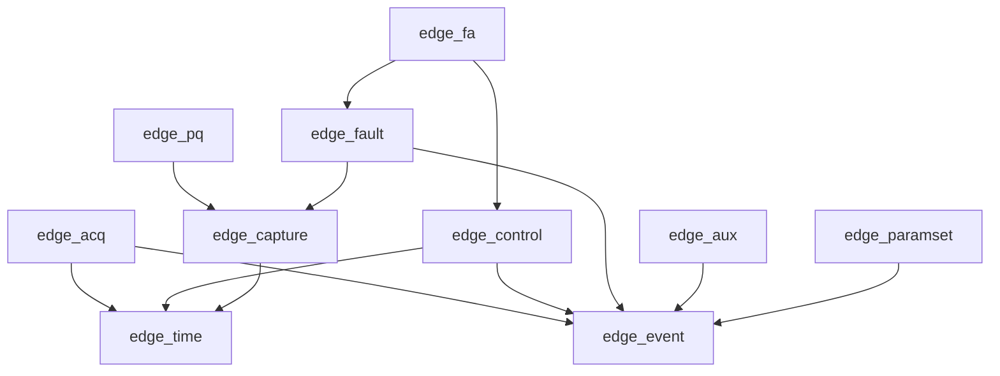

# 终端公共组件规划与采集子系统差距评估

> 日期：2026-11-21　状态：草案，待评审
> 读者：架构、C 开发、验证、产品
> 关联：`docs/plans/2026-11-21-distribution-terminal-plan.md`、`docs/plans/2026-11-21-webui-live-dynamics-plan.md`

## How to read this

一个任务行就是一个工作单元。每行都写了负责角色、估时、依赖、交付物和出口证据。一个任务就是一个工作单元，每个工作单元都写明检查它的证据。出口证据必须是能复现的东西：测试输出、报文抓包、验收报告、PR 链接或提交 SHA。

测试通过只是必要条件。完成定义是仓库口径：静态分析、测试、运行时验证证据三者齐全。

## 1. 结论

现有采集子系统能覆盖轮询型采集。对 DCU、TTU、融合终端、负荷管理与新能源监测，它够用，缺的只是调度逻辑的统一与事件化的表皮。

对 FTU、DTU、故障指示器与电能质量监测，它不够。原因不是驱动少，而是采集模型只有一种：按周期问、拿到值、写影子。保护相邻的终端要的是另一套：带时标的状态变位、确定性的控制链路、可触发的采样窗口。这四件事在现有采集子系统里都没有对应结构。

公共组件按能力切，不按终端名切。同一个 `edge_event` 服务 FTU 的 SOE、故障指示器的翻牌记录与辅控的门禁事件；同一个 `edge_control` 服务 FTU 的分合闸、DTU 的多间隔操作与负荷管理的限电下发。按终端名切会出现十套相似组件，这是本规划要避免的。

## 2. 终端家族与能力需求

必需记为 M，可选记为 O，不需要留空。

| 能力 | DCU/TTU/融合 | FTU | DTU | 故障指示器 | 配电房辅控 | 负荷管理 | 光伏与储能监测 | 电能质量 |
| --- | --- | --- | --- | --- | --- | --- | --- | --- |
| 周期采集（表计、测控） | M | M | M | | O | M | M | M |
| 带时标状态变位（SOE） | M | M | M | M | M | O | O | O |
| 遥控与选择执行 | O | M | M | | O | M | M | |
| 定值与定值区 | O | M | M | O | | M | O | |
| 对时 | M | M | M | M | M | M | M | M |
| 高采样与触发录波 | | M | O | M | | | O | M |
| 故障检测与判定 | O | M | M | M | | | | M |
| 馈线自动化 | | M | M | | | | | |
| 辅控 IO（门禁、环境、消防） | | | O | | M | | | |
| 多主站与备份通道 | O | O | O | O | O | O | O | O |
| 断点续传 | M | M | M | M | O | O | M | O |
| 应用容器 | M | | O | | O | O | O | O |

两列值得注意。FTU 与 DTU 的需求几乎重合，差异在安装形态与点数，不在能力集合。电能质量与故障指示器对高采样与触发录波的要求最高，这两列是目前差距最大的地方。

## 3. 现有采集子系统盘点

### 3.1 已具备

| 能力 | 落点 | 证据 |
| --- | --- | --- |
| 主从双角色引擎 | `modules/edge_io/src/engines/master_engine.c`、`slave_engine.c`、`bus_orchestrator.c` | `setup_master`、`setup_slave`、`add_slave_protocol` |
| IO 抽象 | `modules/edge_io/include/io_executor.h` | UART、UDS、TCP、UDP、HTTP、MQTT |
| 轮询策略 | `adapters/io_drivers/include/driver_manager.h` | 周期、超时、重试、优先级、断路器 |
| 工业协议驱动 | `adapters/io_drivers/src/` | Modbus RTU/TCP、IEC101、IEC104（主从双角色）、DLT645、DLT698、DLMS、CAN、MQTT JSON、Sparkplug B |
| 数据面 | `modules/edge_core/include/datahub.h` | 发布、影子读写、订阅、WAL、快照 |
| 断点续传 | `modules/edge_north/include/snf_manager.h` | 至少一次投递 |
| 高频采样入口 | `adapters/io_drivers/src/adc_driver.c` | 多缓冲 mmap 读取 |
| 信号处理积木 | `modules/edge_stream/src/stage_dsp_rms.c` 等 | RMS 与 DSP 阶段 |

### 3.2 缺口，按影响排序

| 缺口 | 现状 | 为什么现有的结构补不上 |
| --- | --- | --- |
| 采集调度重复 | `cmd/dcu/dcu_poller.c` 与 `cmd/iems/iems_poll_scheduler.c` 各写一套 | 两套调度各自演进，第三个产品会写第三套。调度是公共能力，不该按产品复制 |
| 事件级时标与 SOE | 轮询读到的值写影子，只有「读到时刻」 | 状态变位的真实时刻在边缘，轮询周期内的先后会丢失；SOE 需要变位触发与硬件或驱动层时标 |
| 控制语义 | 控制走产品适配器，104 驱动的选择与执行分支存在但未统一 | 选择执行、闭锁、操作票、双确认分散在产品里，新终端要重写一遍 |
| 对时 | IEC104 只有 `C_CS_NA_1` 枚举；无 SNTP | 无对时的 SOE 没有意义 |
| 高采样与触发录波 | 有 ADC 读取与 DSP 阶段，没有触发的采样窗口与录波存储 | 现有链路是持续处理，不是「故障前 N 周波、故障后 M 周波」的环形捕获 |
| 电能质量 | 无谐波、闪变、暂降聚合 | 依赖上一项的采样窗口，单靠轮询拿不到 |
| 多主站 | `cmd/iems/iems_north_iec104.c:52` 单客户端 | 主站与联调工具不能同时在线，备份通道更不可能 |
| 辅控 IO | 可用 Modbus 接，但没有去抖、事件化与环境量聚合 | 门禁、水浸这类信号要的是事件不是轮询值 |
| 定值区 | 参数在 `edge_core` 与 `edge_mgmt` 各自存 | 保护定值要成组切换与审计，现有参数模型没有组的概念 |

### 3.3 判定

- **DCU、TTU、融合终端**：满足。补 `edge_acq` 统一调度、`edge_event` 与对时即可。
- **负荷管理与新能源监测**：满足。控制路径已有，调度统一后即可复用。
- **FTU、DTU**：部分满足。要补 SOE、控制语义、对时、录波与 FA，驱动与数据面不用动。
- **故障指示器与电能质量**：不满足。核心是采样与触发录波这条链路不存在。

## 4. 公共组件清单

新增组件按仓库规则登记 `component.meta`：subdomain、ports、ROM/RAM/栈预算、owner、maturity。预算先给初值，实现后按归档尺寸回填。

| 组件 | 类型 | 解决什么 | 端口 | 初始预算 | 复用人 |
| --- | --- | --- | --- | --- | --- |
| `modules/edge_acq` | module | 统一采集计划与调度，替代产品内的两套循环 | `acq_plan_repo`、`acq_sink` | ROM 28 KB | 全部终端 |
| `modules/edge_event` | module | 有界事件缓冲与持久化，SOE 的落点 | `event_store` | ROM 12 KB | 全部终端 |
| `modules/edge_time` | module | 对时策略与时间质量分级 | `time_source` | ROM 6 KB | 全部终端 |
| `modules/edge_control` | module | 选择执行、闭锁、操作记录的统一状态机 | `control_port` | ROM 20 KB | FTU、DTU、负荷 |
| `modules/edge_capture` | module | 触发式采样窗口与录波环形缓冲 | `sample_source`、`capture_sink` | ROM 24 KB | FTU、故障指示器、电能质量 |
| `modules/edge_pq` | module | 谐波、闪变、暂降聚合 | `pq_source` | ROM 16 KB | 电能质量 |
| `modules/edge_fault` | module | 过流、零序、突变检测与故障记录 | `fault_source`、`fault_sink` | ROM 20 KB | FTU、DTU、故障指示器 |
| `modules/edge_fa` | module | 馈线自动化状态机 | `fa_control`、`fa_signal` | ROM 24 KB | FTU、DTU |
| `modules/edge_aux` | module | 辅控信号去抖、环境量聚合 | `aux_io` | ROM 10 KB | 辅控、DTU |
| `modules/edge_paramset` | module | 定值区、成组切换与审计 | `param_store` | ROM 12 KB | FTU、DTU、负荷 |
| `adapters/iec104_transport` | adapter | 104 从站与多客户端，含对时 | `iec104_server_ports` | ROM 16 KB | 全部终端 |

依赖方向不变：`cmd` 依赖 `modules` 与 `adapters`，`modules` 只依赖 `foundation` 的端口头。新组件必须过组件元数据、边界、平面隔离、公开结构体、无动态内存、调用方分配与 SRP 门禁。

## 5. 组件依赖

## 6. 分阶段计划

角色：A 架构，C C 开发，D 驱动或数据侧，Q 验证。人日为估算。

### C0 契约与差距确认（5 人日，第 1 周）

| ID | 任务 | 角色 | 人日 | 依赖 | 交付物 | 出口证据 |
| --- | --- | --- | --- | --- | --- | --- |
| COM-C0-01 | 采集与事件端口契约冻结 | A | 2 | 无 | 端口头与状态机图 | 评审通过 |
| COM-C0-02 | 终端能力矩阵与优先级确认 | A+Q | 2 | 01 | 本文件的评审版 | 评审记录 |
| COM-C0-03 | 现有两套调度的差异清单 | D | 1 | 无 | 行为差异表 | 差异表逐条有测试对照 |

### C1 统一采集（15 人日，第 2 到 3 周）

| ID | 任务 | 角色 | 人日 | 依赖 | 交付物 | 出口证据 |
| --- | --- | --- | --- | --- | --- | --- |
| COM-C1-01 | `edge_acq` 组件与计划仓储端口 | C | 8 | C0-03 | 组件与 `component.meta` | 两产品的调度用例迁移后全绿 |
| COM-C1-02 | iEMS 迁移到 `edge_acq` | C | 4 | 01 | 删除 `iems_poll_scheduler` 的重复逻辑 | iEMS 全量用例绿 |
| COM-C1-03 | DCU 迁移到 `edge_acq` | C | 3 | 01 | 删除 `dcu_poller` 的重复逻辑 | DCU 用例与验收绿 |

### C2 事件与对时（15 人日，第 4 到 5 周）

| ID | 任务 | 角色 | 人日 | 依赖 | 交付物 | 出口证据 |
| --- | --- | --- | --- | --- | --- | --- |
| COM-C2-01 | `edge_time` 与对时端口 | C | 4 | C0-01 | 组件与 SNTP 适配 | 时间质量分级用例 |
| COM-C2-02 | `edge_event` 组件 | C | 6 | C0-01 | 环形缓冲与存储端口 | 排序、溢出、重启不丢 |
| COM-C2-03 | 104 对时与事件上送接入 | D | 5 | 01、02 | `C_CS_NA_1` 处理与 SOE 上送 | 模拟主站执行对时并收到 SOE |

### C3 控制语义（15 人日，第 6 到 7 周）

| ID | 任务 | 角色 | 人日 | 依赖 | 交付物 | 出口证据 |
| --- | --- | --- | --- | --- | --- | --- |
| COM-C3-01 | `edge_control` 状态机 | C | 8 | C2-01 | 选择、执行、闭锁、记录 | 全分支单测 |
| COM-C3-02 | 104 选择执行接入 | D | 4 | 01、C2-03 | 选择与执行两步 | 时序用例 |
| COM-C3-03 | 操作记录与审计 | C | 3 | 01 | 记录结构 | 记录可查询、可导出 |

### C4 采样与故障（25 人日，第 8 到 10 周）

| ID | 任务 | 角色 | 人日 | 依赖 | 交付物 | 出口证据 |
| --- | --- | --- | --- | --- | --- | --- |
| COM-C4-01 | `edge_capture` 与采样端口 | D | 10 | C2-01 | 环形窗口与触发 | 触发前后窗口用例 |
| COM-C4-02 | `edge_fault` 组件 | C | 8 | 01、C2-02 | 检测与记录 | 注入采样用例 |
| COM-C4-03 | `edge_pq` 组件 | C | 7 | 01 | 谐波、闪变、暂降 | 标准波形输入用例 |

### C5 终端专属组件（20 人日，第 11 到 13 周）

| ID | 任务 | 角色 | 人日 | 依赖 | 交付物 | 出口证据 |
| --- | --- | --- | --- | --- | --- | --- |
| COM-C5-01 | `edge_fa` 组件 | C | 8 | C3-01、C4-02 | FA 状态机 | 两开关故障场景 |
| COM-C5-02 | `edge_aux` 组件 | C | 5 | C2-02 | 去抖与聚合 | 门禁与水浸用例 |
| COM-C5-03 | `edge_paramset` 组件 | C | 7 | C0-01 | 定值区与审计 | 切换与越权用例 |

合计约 95 人日，13 周。C3 与 C4 可并行，C5 依赖两者。

## 7. 每类终端的最小组合

| 终端 | 组件组合 | 说明 |
| --- | --- | --- |
| DCU、TTU、融合终端 | `edge_acq` + `edge_event` + `edge_time` + `iec104_transport` 或 698 北向 | 现有产品改装配，不新写域名逻辑 |
| FTU | 上面一组 + `edge_control` + `edge_fault` + `edge_fa` + `edge_capture`（可选） | 录波可选，SOE 与控制必需 |
| DTU | 上面一组 + `edge_aux` + `edge_paramset` | 间隔多，辅控信号多 |
| 故障指示器 | `edge_event` + `edge_capture` + `edge_time` + 104 上送 | 采集面很小，事件面很重 |
| 配电房辅控 | `edge_aux` + `edge_event` + REST 或 MQTT 北向 | 不需要 104 从站 |
| 负荷管理 | `edge_acq` + `edge_control` + `edge_time` | 与 IEMS 控制路径共用 |
| 光伏与储能监测 | `edge_acq` + `edge_event` + 现有 IEMS 控制组件 | 不新写采集 |
| 电能质量 | `edge_capture` + `edge_pq` + `edge_event` | 采样窗口是前提 |

## 8. 风险与开放问题

需人拍板：

1. 统一调度是否接受行为变化。两套现有调度在超时与重试上有差异，迁移时会有一次对齐。
2. `edge_capture` 的采样来源：目标是 ADC 直采还是驱动透传，决定端口形态与硬件依赖。
3. 录波存储规则：内存环形还是落盘，容量与保留时长。
4. 控制语义是否要覆盖五防与操作票，还是只做选择执行与闭锁。
5. 对时主备策略：104 对时与 SNTP 的优先级与降级。

技术风险：

- 驱动会话私有区 1024 字节，`edge_capture` 若在驱动内缓存会超限，必须放在组件侧。
- 两套调度迁移期间的测试覆盖必须按目录下限进台账，否则回归会漏。
- 高采样链路对 CPU 与内存的占用要按硬件基线回填预算。

## Appendix A. 参考

- `docs/design/slave_plane_architecture.md`
- `docs/design/NORTHBOUND_ARCHITECTURE.md`
- `docs/plans/2026-11-21-distribution-terminal-plan.md`
- `adapters/io_drivers/include/driver_manager.h`、`modules/edge_io/include/bus_orchestrator.h`
- `cmd/dcu/dcu_poller.c`、`cmd/iems/iems_poll_scheduler.c`（待迁移的两套调度）
