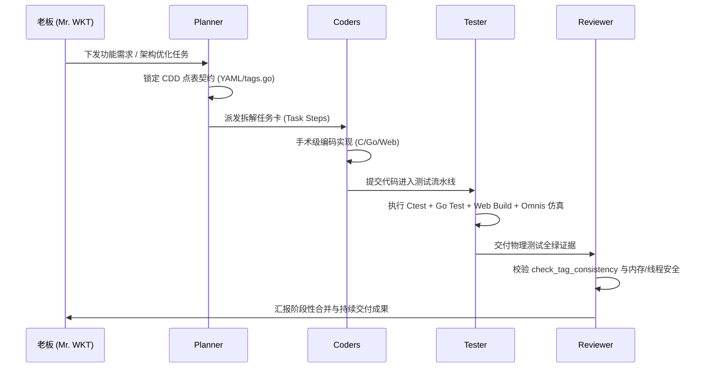

# EdgeC 团队 Workflow 持续迭代与整体整合规程

> **版本**：v1.0  
> **日期**：2026-07-25  
> **团队架构**：Planner + Coders + Tester + Reviewer  
> **最高指挥**：Mr. WKT (老板)  

---

## 1. 团队角色与职责划分 (Roles & Responsibilities)

| 角色名称 | 核心职责 | 交付产物 / 验证闸口 |
| :--- | :--- | :--- |
| **Planner (架构规划师)** | 负责契约定义 (`contracts/schema/`), YAML 点表设计, Task 级计划拆解 | `.edgec` 契约配置, 明确的 Step 规划 |
| **Coders (开发小队)** | 负责 C 底层驱动、Go Gateway 平面、Wasm 算子及 Vue3 4K Web HMI 实现 | 增量 C/Go/Web 源码, 物理寄存器/总线对接 |
| **Tester (测试工程师)** | 负责执行 C Ctest 套件、Go 单元/集成测试、Web Bundle 构建及 `./test.sh --omnis` 物理仿真 | 单元测试报告, 物理仿真覆盖率, 内存泄漏检查 |
| **Reviewer (代码审查员)** | 负责点表一致性校验 (`check_tag_consistency.sh`)、静态分析与代码规范审计 | 代码审查报告, 质退拒绝 / 合流批准 |

---

## 2. 标准迭代工作流 (Standard Iteration Workflow)

---

## 3. 流水线阶段与质量闸口 (Pipeline Stages & Quality Gates)

### 阶段一：契约锁定 (Contract Lock)
- **执行者**：Planner
- **质检点**：`contracts/schema/` YAML 定义包含唯一 Tag ID，不修改原厂 HAL 与 RTOS 依赖。

### 阶段二：手术级并行编码 (Surgical Coding)
- **执行者**：Coders (C, Go, Web)
- **质检点**：严禁硬编码占位符 (Zero Mock)，真实对接 `/dev/i2c-1`, `/dev/spidev0.0`, `/dev/ttyYS1`, `/tmp/smart_box_ipc.sock`。

### 阶段三：自动化测试与物理仿真 (Automated Testing & Omnis Simulation)
- **执行者**：Tester
- **质检点**：
  1. C 语言 `ctest` 100% 通过；
  2. Go 语言 `go test -v ./...` 100% 通过；
  3. Web 前端 `npm run build` 0 错误 0 警告；
  4. Matrix 全矩阵物理仿真（`./test.sh --omnis`）无死锁无丢包。

### 阶段四：静态分析与点表一致性审查 (Static Review & Tag Consistency)
- **执行者**：Reviewer
- **质检点**：`./scripts/check_tag_consistency.sh` 运行结果 `PASSED`（C 语言 Tag 数量等于 Go 语言 Tag 数量）。

### 阶段五：老板审查与最终交付 (Boss Approval & Delivery)
- **执行者**：全员向老板汇报
- **质检点**：汇报必须以“老板”或“Mr. WKT”开头，附带确切数据证据。

---

## 4. 20 项架构增强首期 Workflow 落地路线图

- **Iteration 1 (Phase 1)**: 共享内存相对指针引擎 (`shmring.c`) + YAML 动态点表解析 + SQLite 级联 WAL + DeviceTwin 离线状态机。
- **Iteration 2 (Phase 2)**: 100Hz 滑动窗口算子 + WAMR 调度看门狗 + Protobuf IPC 适配器 + Zephyr Driver Model。
- **Iteration 3 (Phase 3)**: mDNS P2P 无网组网 + BLE Plugin Slot 动态驱动桶 + Chunk 日志积攒压缩 + 远程 Canvas 触控注入。
- **Iteration 4 (Phase 4)**: DeviceTree 静态 Lint 校验 + eBPF SOS 报文打标 + MCUBoot 双 Slot OTA + SPSC 无锁队列。
- **Iteration 5 (Phase 5)**: MicroTVM C 算子编译 + MbedTLS 加密芯片绑定 + CDP 远程 HMI 诊断 + Proactive 自愈健康得分。
