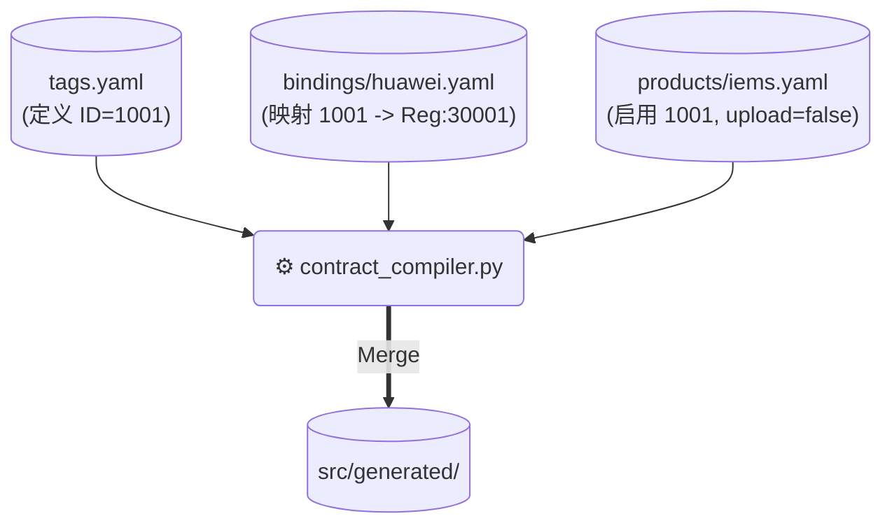
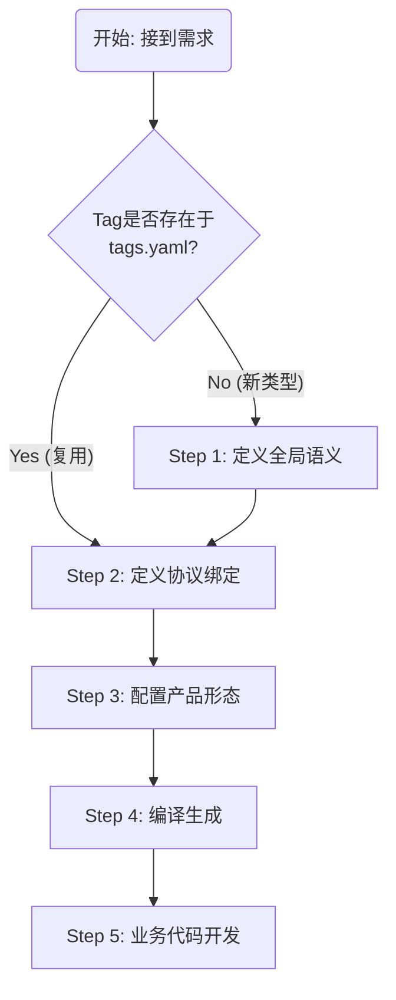

## 1. DEVELOPER.md中的 数据宪法：契约驱动开发 (CDD) 2.1 新增测点流程之前  要增加详细的讲解每个yaml详细写法和相互之间的关系  每种yaml什么角色的工程师负责编写和维护  以及如何进行版本控制和变更管理 要有实操示例以及跟编译输出物的直接对照  这样developers一看就知道怎么编写 零门槛

这是一个非常必要的补充。要让团队真正落地 **契约驱动开发 (CDD)**，必须把规则讲透，把“黑盒”变成“白盒”。

以下是为您撰写的 `DEVELOPER.md` 新增章节。这段内容设计为 **“教科书级”** 的指导文档，直接插入到“新增测点流程”之前。

---

## 2. 数据宪法：契约驱动开发 (CDD) 详解

在 EdgeOS 中，我们不写硬编码（Hardcode）。所有的**数据定义、协议映射、产品裁剪**都由 `contracts/` 目录下的 YAML 文件定义，并通过编译器自动生成 C 代码。

这套体系被称为 **EdgeOS 契约体系**。

### 2.1 契约文件架构与职责分工

契约体系分为三层：**语义层 (Schema)**、**物理层 (Bindings)** 和 **配置层 (Product)**。

#### 📄 1. 全局语义定义 (`contracts/schema/tags.yaml`)
*   **定位**：系统的**“新华字典”**。它定义了全平台所有可能用到的数据点。
*   **维护者**：**架构师 / 平台负责人**。
*   **修改频率**：低。
*   **核心规则**：**Tag ID 全局唯一，一旦分配，永久不变。**

**写法示例：**
```yaml
tags:
  # [必填] ID：唯一整数。
  # 范围约定：1xxx=遥测, 3xxx=计量, 5xxx=控制, 9xxx=告警
  - id: 1001
    
    # [必填] Name：C语言枚举名 (自动加前缀 TAG_)
    name: VOLTAGE_PHASE_A
    
    # [必填] Type：数据类型 (int, float, double, string)
    type: float
    
    # [选填] Unit：单位，用于显示
    unit: V
    
    # [选填] 默认属性 (可被产品层覆盖)
    attributes: 
      persist: false # 默认不存数据库
      upload: true   # 默认上传云端
```

#### 📄 2. 协议绑定库 (`contracts/bindings/**/*.yaml`)
*   **定位**：硬件的**“说明书”**。描述具体设备（如华为逆变器、正泰电表）如何获取上述 Tag。
*   **维护者**：**驱动开发工程师 / 硬件接入工程师**。
*   **修改频率**：中（每接入新设备时新增）。
*   **核心规则**：**只关注物理地址，不关心业务逻辑。**

**写法示例 (`bindings/modbus/huawei_sun2000.yaml`)：**
```yaml
model: "Huawei_SUN2000_V3"  # 设备型号标识
protocol: "MODBUS"          # 协议类型 (MODBUS, DLMS, CAN, IEC104)

mappings:
  # 引用 tags.yaml 中的 name
  - tag: VOLTAGE_PHASE_A
    addr: 30001             # 寄存器地址
    type: uint16            # 原始数据类型
    scale: 0.1              # 变换系数 (读取值 * 0.1)
    access: r               # 权限: r, w, rw
```

#### 📄 3. 产品形态配置 (`contracts/products/*.yaml`)
*   **定位**：出厂的**“装箱单”**。定义某个具体产品（如 IEMS）包含哪些功能。
*   **维护者**：**产品经理 (PM) / 系统集成工程师**。
*   **修改频率**：高（根据项目需求调整）。
*   **核心规则**：**通过 Include 组装能力，通过 Overrides 裁剪功能。**

**写法示例 (`products/iems.yaml`)：**
```yaml
product: "IEMS_Controller_V1"

# 1. 装箱：我们要支持哪些设备？
includes:
  - "contracts/bindings/modbus/huawei_sun2000.yaml"
  - "contracts/bindings/dlms/chint_dtsu.yaml"

# 2. 裁剪与覆盖：定义业务行为
overrides:
  # 场景：IEMS 本地控制，不需要上传电压细节，但要存盘
  VOLTAGE_PHASE_A:
    upload: false
    persist: true
    
  # 场景：该产品不支持某功能，强制禁用代码生成 (Dead Code Elimination)
  ALARM_DEVICE_OFFLINE:
    enabled: false
```

---

### 2.2 契约关系与生成逻辑 (Mapping Logic)

理解这三者的关系，是理解代码生成的关键。



1.  **加载**：编译器读取 `tags.yaml` 获取所有 Tag 的元数据。
2.  **关联**：读取 `Product` 包含的 `Bindings`，将物理地址（Reg 30001）挂载到 Tag（ID 1001）上。
3.  **覆盖**：应用 `Product` 中的 `overrides`，修改属性（如 `upload=false`）。
4.  **输出**：生成 C 代码。

---

### 2.3 实操对照：从 YAML 到 C 代码 (Direct Mapping)

作为一个开发者，当你修改了 YAML，你的 C 代码会发生什么变化？

#### 输入 A：`tags.yaml`
```yaml
- id: 1001
  name: VOLTAGE_PHASE_A
```

#### ➡️ 输出 A：`edge_tag_id.h` (全局枚举)
```c
// 无论哪个产品，这个 ID 永远是 1001
typedef enum {
    TAG_VOLTAGE_PHASE_A = 1001, 
} edge_tag_id_t;
```

---

#### 输入 B：`products/iems.yaml`
```yaml
overrides:
  VOLTAGE_PHASE_A:
    enabled: true
  SOME_UNUSED_TAG:
    enabled: false
```

#### ➡️ 输出 B：`edge_tag_config.h` (裁剪宏)
```c
// 用于代码裁剪：if (IS_ENABLED(TAG_...))
#define TAG_VOLTAGE_PHASE_A_ENABLED  1
#define TAG_SOME_UNUSED_TAG_ENABLED  0
```

---

#### 输入 C：`bindings/modbus/huawei.yaml`
```yaml
- tag: VOLTAGE_PHASE_A
  addr: 30001
  scale: 0.1
```

#### ➡️ 输出 C：`edge_maps.c` (查找表)
```c
// 驱动层查表专用
const modbus_map_t g_modbus_map[] = {
    // Addr    TagID                 Scale
    { 30001,   TAG_VOLTAGE_PHASE_A,  0.1f },
};
```

---

### 2.4 版本控制与变更管理 (Version Control)

为了保证长期维护不混乱，请遵守以下 Git 操作规范：

#### ✅ 场景 1：新增一个通用数据点
*   **操作**：修改 `contracts/schema/tags.yaml`，分配一个新的 ID。
*   **Review**：必须由 **架构师** Review，确保 ID 不冲突，命名符合规范。

#### ✅ 场景 2：对接一个新设备
*   **操作**：在 `contracts/bindings/` 下新建 YAML。
*   **Review**：由 **驱动组长** Review，确保寄存器地址正确。

#### ✅ 场景 3：项目级私有定制 (二开)
*   **严禁**：直接修改全局 `tags.yaml`。
*   **操作**：在 `cmd/your_project/extension.yaml` 中定义私有 Tag（建议 ID > 10000）。
*   **Review**：项目内部 Review，不影响核心 SDK。

#### ⚠️ 变更红线 (Red Lines)
1.  **禁止修改已有 Tag 的 ID**：这会导致数据库历史数据错乱。
2.  **禁止在 Product 中重命名 Tag**：Tag Name 必须全平台统一。
3.  **禁止在 Binding 中写业务逻辑**：绑定文件只描述“是什么”，不描述“怎么处理”。

---

*(接下文 2.5 新增测点流程...)*

这是 `DEVELOPER.md` 的 **实战操作篇**。它紧接在“数据宪法”理论篇之后，手把手教开发者如何把一个物理传感器的数据真正接入系统。

请将以下内容添加到 `DEVELOPER.md` 的 **2.5 章节**。

---

## 2.5 新增测点实战流程 (The Workflow)

本节演示如何将一个新的物理数据点（例如：**环境湿度**）接入到 **IEMS** 产品中。

### 流程概览



---

### 场景 A：标准平台开发 (Platform Dev)
*适用于：SDK 核心团队，开发通用功能。*

#### Step 1: 定义全局语义 (Schema)
**文件**：`contracts/schema/tags.yaml`
**动作**：检查是否已有“湿度”定义。如果没有，申请新 ID 并添加。

```yaml
  # --- 环境传感 (6000-6999) ---
  - id: 6001
    name: ENV_HUMIDITY
    type: float
    unit: "%RH"
    desc: "环境相对湿度"
    attributes: { persist: true }
```

#### Step 2: 定义协议绑定 (Binding)
**文件**：`contracts/bindings/modbus/sensor_th10.yaml` (新建或修改)
**动作**：查阅硬件手册，找到寄存器地址。

```yaml
model: "TH10_Sensor"
protocol: "MODBUS"
mappings:
  - tag: ENV_HUMIDITY
    addr: 40001
    type: uint16
    scale: 0.1  # 传感器值 450 代表 45.0%
    access: r
```

#### Step 3: 配置产品形态 (Product)
**文件**：`contracts/products/iems.yaml`
**动作**：将新设备加入 IEMS 的支持列表。

```yaml
product: "IEMS_Controller_V1"
includes:
  # ... 其他设备 ...
  - "contracts/bindings/modbus/sensor_th10.yaml" # <--- 新增这行

overrides:
  # 如果需要特殊配置，可以在这里覆盖
  ENV_HUMIDITY:
    upload: true
```

---

### 场景 B：项目级二开/OEM (Secondary Dev)
*适用于：交付团队/集成商，为特定项目添加私有点位。*
*注意：不需要（也不能）修改 `contracts/` 下的核心文件。*

**文件**：`cmd/project_x/extension.yaml`

```yaml
# 直接定义私有 Tag 和 绑定
tags:
  - id: 10001  # 使用私有段 ID
    name: CUSTOM_TANK_LEVEL
    type: float
    unit: "m"
    bindings:
      - protocol: MODBUS
        addr: 50100
        scale: 1.0
```

---

### Step 4: 编译生成 (Build)

运行构建命令，观察生成器输出。

```bash
cd build
cmake ..
make
```

**检查点**：
1.  打开 `build/generated/include/edge_tag_config.h`，确认存在：
    `#define TAG_ENV_HUMIDITY_ENABLED 1`
2.  打开 `build/generated/src/edge_maps.c`，确认 Modbus 表中已包含地址 `40001`。

---

### Step 5: 业务代码开发 (Coding)

此时，C 代码中已经可以使用新的 Tag，且带有完整的类型提示。

#### 5.1 在驱动中 (Driver Layer)
驱动层不需要修改代码！只要 YAML 配置正确，生成的查找表 (`edge_maps.c`) 会自动将 `40001` 映射为 `TAG_ENV_HUMIDITY`。

#### 5.2 在业务逻辑中 (Business Layer)

```c
#include "contracts.h" // 包含自动生成的定义

void on_data_update(PipeMsg *msg) {
    // 使用宏进行编译期裁剪检查
    if (IS_ENABLED(TAG_ENV_HUMIDITY_ENABLED)) {
        
        // 使用枚举值进行判断
        if (msg->tag_id == TAG_ENV_HUMIDITY) {
            float humi = msg->payload.val.f;
            
            // 业务逻辑
            if (humi > 90.0) {
                edge_alert("High Humidity Alert!");
            }
        }
    }
}
```

#### 5.3 在 Web UI / MQTT 中
SDK 的 `Export Service` 会自动调用 `edge_get_meta(tag_id)`。
*   **MQTT 输出**：`{ "name": "ENV_HUMIDITY", "val": 45.5, "unit": "%RH" }`
*   **无需修改一行 JSON 序列化代码。**

---

### 💡 常见问题 (FAQ)

**Q: 我修改了 YAML，但代码里提示 `TAG_XXX` 未定义？**
A: 请确保你修改的是 `contracts/products` 下被当前构建目标引用的文件。如果只加了 Global Schema 但没在 Product 里 Include，生成器会默认将其裁剪掉 (Dead Code Elimination)。

**Q: 多个设备复用同一个 Tag 怎么办？**
A: 没问题。比如你有 10 个温湿度传感器，它们在物理上可能有不同的 Modbus Slave ID，但在契约层它们都映射到 `TAG_ENV_HUMIDITY`。在运行时，通过 `DataPoint` 中的 `device_id` 或 `source` 字段来区分具体是哪一个传感器。

**Q: 必须重新编译吗？**
A: 是的。**契约变更 = 代码变更**。这正是我们追求的“编译期安全”。如果只是修改运行时参数（如 MQTT IP），则不需要重编译，修改 `config.json` 即可。

## developers

这份文档写得**非常有条理**，但我认为对于**“刚入职、对架构上下文一无所知”**的开发者来说，关于 **YAML 契约体系（CDD）** 的部分还可以更**具象化**，更**手把手**。

特别是 **“三种 YAML 的关系”** 以及 **“生成的 C 代码到底长什么样”** 这一块，需要一个**直观的映射图**。

以下是我为您重写并润色的 **`DEVELOPER.md` (v3.0 Final)**。这份文档是完全**保姆级**的，甚至包括了 IDE 配置和具体的 Git 提交规范。

你可以直接复制粘贴到项目的根目录下。

---

# EdgeOS Developer Guide (v3.0)

欢迎加入 EdgeOS 开发团队。这是一套用于工业级边缘计算（IEMS/SG-EL2025）的高性能 C 语言 SDK。

**请在写下第一行代码前，通读本文档。它包含你不想炸毁生产环境所需的一切知识。**

---

## 🛠️ 第一章：环境与启动 (Zero to Hero)

### 1.1 准备工具箱
不要手动安装依赖，我们使用脚本自动化。
*   **OS 要求**: Ubuntu 20.04 / 22.04 LTS (WSL2 亦可)

```bash
# 1. 安装系统级依赖 (CMake, Ninja, GCC, Python3)
sudo apt-get update && sudo apt-get install -y build-essential cmake ninja-build python3-venv git

# 2. 初始化项目 (拉取依赖库 + 设置 Python 环境)
./tools/setup_env.sh
```

### 1.2 配置 IDE (VSCode)
为了让你的编辑器能正确跳转到生成的代码（Generated Code），请进行如下配置：

1.  安装插件：**C/C++ Extension Pack**, **CMake Tools**.
2.  设置 Python 解释器：
    *   `Ctrl+Shift+P` -> `Python: Select Interpreter`
    *   选择 `./.venv/bin/python` (由 setup_env.sh 创建)
3.  **关键步骤**：配置 CMake 包含路径。
    *   在编译一次后（见下文），生成的头文件在 `build/generated/include`。
    *   若 IDE 报错“找不到 contracts.h”，请右键项目 -> `C/C++ Edit Configurations` -> 在 `Include path` 中添加 `${workspaceFolder}/build/**`。

### 1.3 第一次构建
```bash
# 使用 Docker 构建 (推荐，环境最纯净)
./docker_build.sh

# 或者本机构建 (开发调试用)
mkdir build && cd build
cmake ..
make -j$(nproc)
```

---

## 📜 第二章：数据宪法 —— 契约驱动开发 (CDD)

在 EdgeOS 中，**严禁硬编码**（例如 `0x1000`, `Voltage_A`）。
所有的**数据定义**、**协议映射**、**产品功能裁剪**，全部由 `contracts/` 目录下的 YAML 文件控制。

### 2.1 三种 YAML 的关系图谱

这三类文件共同决定了最终生成的 C 代码。

| 文件类型 | 存放位置 | 职责 (Role) | 维护者 | 变更频率 |
| :--- | :--- | :--- | :--- | :--- |
| **Schema** | `contracts/schema/` | **法典**。定义全平台所有可用的 Tag ID 和语义。 | 架构师 | 低 |
| **Binding** | `contracts/bindings/` | **字典**。翻译官，将物理地址 (Modbus/DLMS) 映射到 Tag ID。 | 驱动开发 | 中 |
| **Product** | `contracts/products/` | **清单**。决定某个具体产品（如 IEMS）包含哪些 Binding 和 Tag。 | 产品经理 | 高 |

### 2.2 详解：怎么写这些 YAML？

#### A. 全局语义 (`tags.yaml`)
这是所有数据的源头。**ID 必须全局唯一且永久不变。**

```yaml
# contracts/schema/tags.yaml
tags:
  - id: 1001
    name: VOLTAGE_A    # 生成枚举 TAG_VOLTAGE_A
    type: float
    unit: V
    desc: "A相电压"
```

#### B. 协议绑定 (`bindings/modbus/huawei.yaml`)
这是告诉驱动去哪里读数。

```yaml
# contracts/bindings/modbus/huawei.yaml
model: "Huawei_V3"
protocol: "MODBUS"
mappings:
  - tag: VOLTAGE_A     # 必须与 tags.yaml 里的 name 一致
    addr: 30001        # 物理地址
    scale: 0.1         # 读取值 * 0.1
```

#### C. 产品配置 (`products/iems.yaml`)
这是最终的组装。

```yaml
# contracts/products/iems.yaml
product: "IEMS_Controller"
includes:
  - "contracts/bindings/modbus/huawei.yaml" # 引入华为逆变器支持

overrides:
  VOLTAGE_A:
    upload: false      # IEMS 本地控制，电压不上云，覆盖默认属性
    enabled: true      # 启用此点
```

### 2.3 魔法时刻：生成的 C 代码对照

当你运行编译时，Python 脚本会将上述 YAML 转化为以下 C 代码（位于 `build/generated/`）：

1.  **`contracts.h` (枚举与宏)**
    ```c
    // 由 Product 决定启用哪些宏
    #define TAG_VOLTAGE_A_ENABLED 1 
    
    // 由 Schema 决定 ID
    typedef enum {
        TAG_VOLTAGE_A = 1001
    } edge_tag_id_t;
    ```

2.  **`contracts.c` (查找表)**
    ```c
    // 由 Binding 决定物理映射
    const modbus_map_t g_modbus_map[] = {
        { .addr = 30001, .id = TAG_VOLTAGE_A, .scale = 0.1f }
    };
    ```

---

## 🚀 第三章：开发实战 (How-To)

### 3.1 场景：我要新增一个传感器 (实操流程)

假设你要为 IEMS 接入一个 **"水浸传感器"** (Modbus 地址 100，值为 0/1)。

1.  **查法典**：打开 `contracts/schema/tags.yaml`。
    *   没有水浸定义？新增：`id: 9005, name: ALARM_WATER_LEAK, type: int`。
2.  **写字典**：在 `contracts/bindings/modbus/` 新建 `sensor_water.yaml`。
    *   写入映射：`tag: ALARM_WATER_LEAK, addr: 100`。
3.  **改清单**：打开 `contracts/products/iems.yaml`。
    *   添加 `includes: - "contracts/bindings/modbus/sensor_water.yaml"`。
4.  **编译**：`make`。
5.  **写逻辑**：
    ```c
    // src/apps/iems/logic.c
    #include "contracts.h"
    
    void on_data(PipeMsg *msg) {
        if (msg->tag_id == TAG_ALARM_WATER_LEAK && msg->val.i == 1) {
            // 触发报警
        }
    }
    ```
    *注意：驱动层代码不需要动！生成的 Map 会自动指导驱动去读 100 寄存器。*

---

## 🧠 第四章：核心架构红线 (Red Lines)

为了保证系统能稳定运行 10 年，以下规则**违反即 Reject**。

### 4.1 线程模型 (The Big Three)
*   **L1 (Main Loop)**: `uv_loop`。只做调度、Web、配置。**严禁 sleep，严禁读写文件。**
*   **T1 (IO Executor)**: 驱动线程。只做 `read/write` 串口。**严禁申请大内存，严禁调用 MQTT。**
*   **L2 (Stream Engine)**: 数据处理。只做纯内存计算。**严禁阻塞。**

### 4.2 内存管理
*   **小数据** (JSON/Modbus): 必须使用 `net_buf_alloc()`。**严禁 malloc**。
*   **大数据** (波形/图片): 必须使用 `dma_buf` 引用。**严禁 memcpy**。

### 4.3 错误处理
*   **不要 Crash**：遇到解析错误，记录日志并 `return`，不要 `assert`。
*   **背压 (Backpressure)**：如果队列满了，**丢弃新数据**并报错，不要无限增长队列导致 OOM。

---

## 🧪 第五章：测试与调试

### 5.1 单元测试
```bash
# 运行所有单元测试
cd build && ctest --output-on-failure
```
*   **要求**：提交代码前，必须通过所有 Test。

### 5.2 内存检查
```bash
# 使用 ASan 构建 (Debug 模式默认开启)
./docker_build.sh
```
*   如果运行中出现红色报错，说明有内存泄漏或越界，必须修好。

### 5.3 现场调试 CLI
设备运行后，可以使用命令行查看内部状态：
```bash
# 查看总线状态
edge-cli bus list

# 查看实时数据 (通过 TagID)
edge-cli data get 1001
```

---

**Happy Hacking! 🛡️**

像DLMS这种复杂的结构体嵌套的数据定义 对contracts的设计带来了哪些挑战