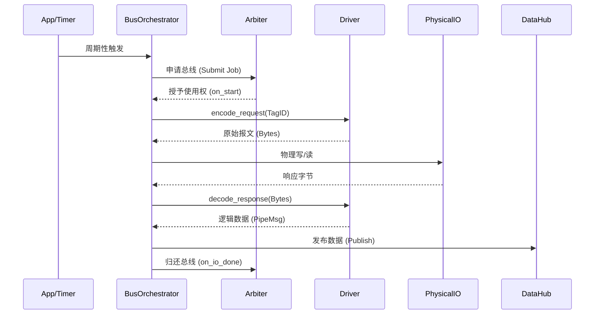

# EdgeOS Execution Plane: IO Executor & Protocol Stacks

## 1. 架构概述 (Architecture Overview)

执行平面（Execution Plane）负责 EdgeOS 与物理世界的交互。它将底层的工业通讯规约（Modbus, DLT645, CAN, IEC104等）抽象为统一的协议栈模型，并受控制平面（Control Plane）的仲裁调度。

### 核心组件
- **Protocol Stacks (协议栈)**: 定义在 `driver_*.c` 中，负责报文的编解码、状态维护和事务管理。
- **Driver Manager (驱动管理器)**: 负责协议模板的注册与运行时驱动实例（Instance）的分配。
- **IO Executor (执行器)**: 负责物理通道（串口、网络、CAN口）的异步 I/O 调度。
- **Bus Orchestrator (编排器)**: 业务逻辑与驱动之间的胶水层，负责发起周期性轮询请求。

---

## 2. 设计原理 (Design Principles)

### 2.1 事务状态机 (Transactional V3)
EdgeOS V3 驱动摒弃了传统的无状态解析模式，引入了 `edge_driver_ctx_t`。
- 每个驱动实例拥有独立的私有内存（`ctx->priv`），用于存储序列号、从站地址、握手状态等。
- 支持 Master（主动请求）和 Slave（被动响应）角色的无缝切换。

### 2.2 资源仲裁机制 (Contention Management)
所有涉及物理总线（如 RS485）的 I/O 请求必须经过 **Arbiter (仲裁器)** 授权。
1. **申请**：编排器向 Arbiter 提交 Job。
2. **授权**：Arbiter 根据优先级（Normal, High, Emergency）决定谁获得总线使用权。
3. **执行**：驱动在 `on_start` 回调中执行真实的编解码与物理收发。
4. **释放**：I/O 完成后，必须调用 `arbiter_on_io_done` 归还总线。

---

## 3. 交互流程 (Interaction Flow)



---

## 4. 二次开发指南 (Development Guide)

### 4.1 如何增加新协议
1. **定义私有上下文**：在驱动 C 文件中定义该协议所需的状态结构体。
2. **实现 V3 接口**：
   - `encode_request`: 构建请求帧。
   - `decode_response`: 解析响应帧并利用 `edge_lookup_...` 映射 TagID。
   - `handle_rx`: 处理突发上送数据（可选）。
3. **注册驱动**：在文件末尾提供 `XXX_driver_register` 函数并在系统启动时调用。

### 4.2 契约绑定 (Contract Binding)
驱动层禁止硬编码点位地址。必须使用由契约编译器生成的 O(1) 查找函数：
```c
float scaler = 1.0f;
uint32_t tid = edge_lookup_modbus(reg_addr, &scaler);
if (tid != TAG_INVALID) {
    // 处理逻辑...
}
```

### 4.3 最佳实践
- **非阻塞原则**：驱动内部严禁使用 `sleep` 或任何阻塞式系统调用。
- **内存安全**：优先使用 `net_buf` 提供的 `pull/push` 接口进行流式解析，杜绝缓冲区溢出。
- **错误质量位**：解析失败时应在 `PipeMsg` 中设置 `quality` 标志，让上层感知通信异常。

---
**EdgeOS Execution Plane - 精准感知，高效执行。**
