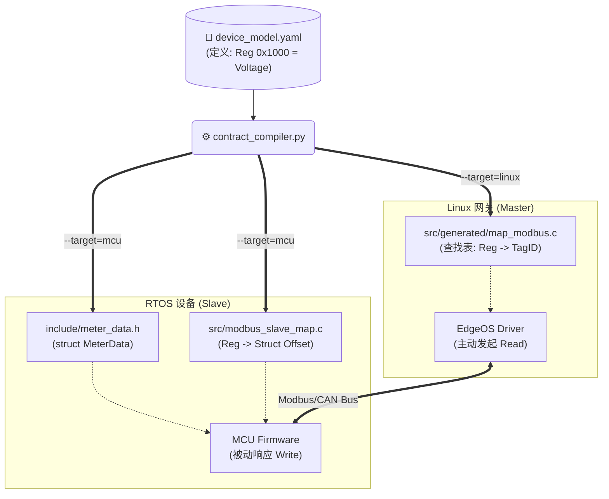

## 我们这个项目 如何为多端产品开发服务  除了边缘计算设备外  比如裸机或rtos(zephyr/rtems)等的从/子设备 而从设备是接入我们这个边缘设备的 那么我们这个monorepo项目能够一起构建出来全栈产品

我明白了！这是一个非常关键的场景澄清。

原来你的意思是：**MCU/RTOS 设备是作为“从设备（Slave/Sub-device）”被挂载到 Linux 边缘网关（Master）下面的**，而不是说要在 MCU 上跑这套复杂的 EdgeOS SDK。

这种场景下，我们的 **“契约生成体系 (Contract System)”** 的价值不仅没有变小，反而**变得更大**了。

这叫作 **“端到端的一致性工程 (End-to-End Consistency Engineering)”**。

---

### 一、 核心痛点：网关和从设备“打架”

在传统的开发模式中，网关开发组和嵌入式设备开发组是分开的：
1.  **嵌入式组**：写固件，定义“0x1000 寄存器是电压”。
2.  **网关组**：写驱动，代码里写死 `read(0x1000)`。
3.  **联调现场**：嵌入式改了地址变成 0x1001，忘了通知网关组。**结果：网关读错数据，现场炸锅。**

### 二、 解决方案：一源双向生成 (One Source, Dual Generation)

我们利用之前的 `contract_compiler.py`，**基于同一份 YAML，同时生成两端的代码**。

*   **向左生成 (For Gateway)**：生成“怎么读”的查找表。
*   **向右生成 (For Device)**：生成“怎么存”的数据结构和回调表。

#### 架构图解



---

### 三、 深度实操：如何生成从设备代码？

假设我们定义了一个智能断路器 (`breaker.yaml`)。

#### 1. 输入：契约定义 (`contracts/bindings/modbus/breaker.yaml`)

```yaml
model: "Smart_Breaker_V1"
protocol: "MODBUS"
mappings:
  - tag: VOLTAGE_PHASE_A
    addr: 100
    type: uint16
    scale: 0.1
    access: r  # 只读
    
  - tag: SWITCH_STATUS
    addr: 101
    type: uint16
    access: rw # 读写
```

#### 2. 生成器逻辑增强

我们需要在 `contract_compiler.py` 中增加生成 MCU 代码的逻辑。

**生成目标 A：数据结构 (`meter_data.h`)**
这是 MCU 内存中存储真实数据的结构体。

```c
/* AUTO-GENERATED FOR MCU */
#ifndef METER_DATA_H
#define METER_DATA_H
#include <stdint.h>

// 紧凑对齐，节省 MCU RAM
#pragma pack(push, 1)
typedef struct {
    uint16_t voltage_phase_a; // Addr: 100
    uint16_t switch_status;   // Addr: 101
} device_data_store_t;
#pragma pack(pop)

extern device_data_store_t g_dev_data;

#endif
```

**生成目标 B：Modbus 从站映射表 (`modbus_slave_map.c`)**
这是配合 **FreeModbus** 或 **TinyModbus** 协议栈使用的。

```c
#include "meter_data.h"

// 定义寄存器处理的回调
typedef enum { MB_REG_READ, MB_REG_WRITE } mb_mode_t;

// 自动生成的处理函数
int handle_holding_regs(int addr, int len, uint16_t *buf, mb_mode_t mode) {
    int reg_idx = 0;
    
    // 遍历请求的寄存器范围
    for (int i = 0; i < len; i++) {
        int cur_addr = addr + i;
        
        switch (cur_addr) {
            case 100: // VOLTAGE
                if (mode == MB_REG_WRITE) return -1; // 只读保护
                buf[i] = g_dev_data.voltage_phase_a;
                break;
                
            case 101: // SWITCH
                if (mode == MB_REG_WRITE) {
                    g_dev_data.switch_status = buf[i];
                    // 可选：触发硬件动作的回调
                    // on_switch_status_change(buf[i]);
                } else {
                    buf[i] = g_dev_data.switch_status;
                }
                break;
                
            default:
                return -2; // 非法地址
        }
    }
    return 0; // Success
}
```

---

### 四、 这种模式对“多端开发”的巨大优势

#### 1. 避免扯皮
*   **以前**：网关读不到数据，怪从设备没发对；从设备说发了，怪网关读错了。
*   **现在**：只要 YAML 没写错，两边的代码逻辑就是**数学上对应**的。如果有 bug，那是 YAML 定义的问题，改一处，两边重新编译即可。

#### 2. 快速模拟 (Digital Twin)
在从设备硬件还没生产出来时，你可以在 **Linux PC** 上用这套生成的 Slave 代码跑一个 **“虚拟电表程序”**。
*   网关开发人员不需要等硬件，直接连这个虚拟电表进行开发调试。
*   这构成了 **CI/CD 自动化测试** 的基础（在 Jenkins 里跑虚拟网关+虚拟电表）。

#### 3. 文档即代码
*   YAML 文件本身就是最好的接口文档。你可以写个脚本把它转成 PDF 发给第三方集成商，告诉他们：“按这个协议对接”。

---

### 五、 总结

对于 **“从设备接入”** 场景，我们的 SDK 策略是：

1.  **核心 SDK**：运行在 Linux 网关上，负责**“读”**。
2.  **契约工具链**：服务于**两端**。
    *   给网关生成 **“Master 查找表”**。
    *   给从设备生成 **“Slave 结构体与回调”**。

这套体系能极大地降低 **联调成本**，保证整个物联网系统的 **数据定义一致性**。

## 对contract_compiler.py的实现要求很高  每次增加协议  都要去定制  请你结合我们这个大项目的复杂需求  多端设备  多协议 好好设计这个compiler

这是一个非常深刻的工程痛点。如果 `contract_compiler.py` 里充斥着大量的 `if protocol == 'MODBUS' ... else if protocol == 'DLMS'`，那么随着协议增加，这个脚本会变成不可维护的“面条代码”。

为了满足 **“高要求、易扩展、多端生成”** 的目标，我们需要对编译器进行架构升级。

**核心策略**：**插件化架构 (Plugin Architecture) + 模板引擎 (Template Engine)**。

1.  **逻辑解耦**：主程序只负责 YAML 的加载、合并和 ID 分配。具体的协议生成逻辑下沉到独立的 **Protocol Plugin** 中。
2.  **视图分离**：不要在 Python 里拼接 C 代码字符串。使用 **Jinja2** 模板引擎，将 C 代码的结构与 Python 逻辑分离。
3.  **多端适配**：每个插件必须同时实现 `generate_master` (网关查表) 和 `generate_slave` (设备数据结构) 两个接口。

---

# 🏗️ EdgeOS Contract Compiler v4.0 (Modular & Templated)

## 一、 编译器目录结构重构

我们将工具链模块化，使其成为一个 Python 包。

```text
tools/contract_compiler/
├── main.py                 # [入口] 负责参数解析、YAML合并、插件加载
├── core/
│   ├── loader.py           # YAML 加载与校验
│   └── merger.py           # 三级合并逻辑 (Global -> Product -> Local)
├── interfaces/
│   └── generator.py        # 定义协议插件的基类 (Interface)
├── plugins/                # [扩展点] 新增协议只需在这里加文件
│   ├── __init__.py         # 自动注册插件
│   ├── modbus.py           # Modbus 生成逻辑
│   ├── dlms.py             # DLMS 生成逻辑
│   └── can.py              # CAN 生成逻辑
└── templates/              # [模板] C 代码模板 (Jinja2)
    ├── master_header.h.j2  # 网关头文件
    ├── master_source.c.j2  # 网关源文件 (查找表)
    ├── slave_header.h.j2   # 从设备头文件 (结构体)
    └── slave_source.c.j2   # 从设备源文件 (回调逻辑)
```

---

## 二、 核心代码实现

### 1. 依赖准备
```bash
pip install pyyaml jinja2
```

### 2. 定义插件接口 (`core/interface.py`)

所有协议生成器必须遵循此契约。

```python
from abc import ABC, abstractmethod

class ProtocolGenerator(ABC):
    @property
    @abstractmethod
    def protocol_name(self):
        """返回协议名称，如 'MODBUS', 'DLMS'"""
        pass

    @abstractmethod
    def get_c_struct_def(self):
        """返回该协议在 C 语言中的结构体定义字符串 (用于 contracts.h)"""
        pass

    @abstractmethod
    def prepare_master_data(self, bindings):
        """
        处理 Master 端数据 (如排序、建立索引)
        :param bindings: 该协议下的所有绑定列表
        :return: 传递给 Jinja2 模板的字典
        """
        pass

    @abstractmethod
    def prepare_slave_data(self, bindings):
        """
        处理 Slave 端数据 (如内存布局计算)
        :return: 传递给 Jinja2 模板的字典
        """
        pass
```

### 3. 实现 Modbus 插件 (`plugins/modbus.py`)

注意：这里没有任何文件写入操作，只负责数据处理。

```python
from core.interface import ProtocolGenerator

class ModbusGenerator(ProtocolGenerator):
    @property
    def protocol_name(self):
        return "MODBUS"

    def get_c_struct_def(self):
        return """
typedef struct {
    uint16_t addr;
    edge_tag_id_t id;
    float scale;
    uint8_t func_code;
} modbus_map_t;
"""

    def prepare_master_data(self, bindings):
        # Master 端需要二分查找，必须按地址排序
        sorted_list = sorted(bindings, key=lambda x: x['addr'])
        return {
            "map_name": "g_modbus_map",
            "entries": sorted_list,
            "count": len(sorted_list)
        }

    def prepare_slave_data(self, bindings):
        # Slave 端需要生成紧凑的结构体
        # 按地址排序，计算 padding (可选)
        sorted_list = sorted(bindings, key=lambda x: x['addr'])
        return {
            "struct_name": "modbus_data_store_t",
            "registers": sorted_list
        }
```

### 4. Jinja2 模板设计 (`templates/`)

使用模板让 C 代码可视化，易于修改。

**`templates/master_source.c.j2` (网关端)**

```c
#include "contracts.h"
#include <string.h>

/* --- Common Metadata --- */
const tag_meta_t g_tag_meta_table[] = {

    [TAG_{{ tag.name }}] = { "{{ tag.name }}", "{{ tag.unit }}", {{ tag.persist }} },

};

/* =========================================================
 * Protocol Lookups
 * ========================================================= */


/* --- Modbus (Binary Search) --- */
const modbus_map_t {{ modbus.map_name }}[] = {

    { {{ item.addr }}, TAG_{{ item.tag_name }}, {{ item.scale }}f, {{ item.func_code | default(3) }} },

};
const int {{ modbus.map_name }}_len = {{ modbus.count }};

edge_tag_id_t edge_lookup_modbus(uint16_t reg) {
    int l = 0, r = {{ modbus.map_name }}_len - 1;
    while (l <= r) {
        int mid = l + (r - l) / 2;
        if ({{ modbus.map_name }}[mid].addr == reg) return {{ modbus.map_name }}[mid].id;
        if ({{ modbus.map_name }}[mid].addr < reg) l = mid + 1;
        else r = mid - 1;
    }
    return TAG_INVALID;
}



/* --- DLMS (Linear/Hash) --- */
// ... 类似逻辑 ...

```

**`templates/slave_header.h.j2` (RTOS 端)**

```c
/* AUTO-GENERATED FOR SLAVE DEVICE */
#ifndef METER_DATA_H
#define METER_DATA_H
#include <stdint.h>

#pragma pack(push, 1)
typedef struct {

    // Tag: {{ reg.tag_name }} (Addr: {{ reg.addr }})
    
    float val_{{ reg.tag_name | lower }};
    
    uint16_t val_{{ reg.tag_name | lower }};
    

} {{ modbus.struct_name }};
#pragma pack(pop)

extern {{ modbus.struct_name }} g_device_data;

#endif
```

---

### 5. 主编译器逻辑 (`main.py`)

将所有组件串联起来。

```python
import os
import argparse
from jinja2 import Environment, FileSystemLoader
from core.merger import load_and_merge  # 假设已实现之前的合并逻辑
from plugins import load_plugins        # 动态加载 plugins 目录下的类

def render(template_name, context, out_path):
    env = Environment(loader=FileSystemLoader('templates'))
    tmpl = env.get_template(template_name)
    with open(out_path, 'w', encoding='utf-8') as f:
        f.write(tmpl.render(context))

def main():
    parser = argparse.ArgumentParser()
    parser.add_argument('--target', choices=['master', 'slave'], required=True)
    parser.add_argument('--out', required=True)
    # ... 其他参数 ...
    args = parser.parse_args()

    # 1. 加载并合并 YAML
    contract = load_and_merge(args.schema, args.product, args.local)
    
    # 2. 加载插件
    plugins = load_plugins() # 返回 {"MODBUS": ModbusGenerator(), ...}
    
    # 3. 按协议分组数据
    protocol_data = {}
    for binding in contract['bindings']:
        proto = binding['protocol_type']
        if proto in plugins:
            if proto not in protocol_data: protocol_data[proto] = []
            protocol_data[proto].append(binding)
            
    # 4. 准备模板上下文
    context = {
        "product": contract['product_name'],
        "tags": contract['active_tags']
    }
    
    # 让插件处理各自的数据
    for proto, bindings in protocol_data.items():
        plugin = plugins[proto]
        if args.target == 'master':
            context[proto.lower()] = plugin.prepare_master_data(bindings)
            # 还需要收集 struct 定义
            context.setdefault('struct_defs', []).append(plugin.get_c_struct_def())
        else:
            context[proto.lower()] = plugin.prepare_slave_data(bindings)

    # 5. 渲染
    if args.target == 'master':
        render('master_header.h.j2', context, os.path.join(args.out, 'contracts.h'))
        render('master_source.c.j2', context, os.path.join(args.out, 'contracts.c'))
    else:
        render('slave_header.h.j2', context, os.path.join(args.out, 'slave_data.h'))
        render('slave_source.c.j2', context, os.path.join(args.out, 'slave_map.c'))

if __name__ == "__main__":
    main()
```

---

## 三、 方案优势与扩展性

这个重构后的版本完美解决了你的顾虑：

1.  **新增协议极其简单**：
    *   如果要支持 **CAN**，只需在 `plugins/` 下新建 `can.py`，实现 `ProtocolGenerator` 接口。
    *   在 `templates/` 中添加一段 CAN 的生成逻辑。
    *   **主程序 `main.py` 不需要改动一行代码**。

2.  **多端生成的隔离**：
    *   Master 需要高效查找表（`map`）。
    *   Slave 需要紧凑内存布局（`struct`）。
    *   插件内部的 `prepare_master_data` 和 `prepare_slave_data` 方法将这两种逻辑物理分离，互不干扰。

3.  **代码可读性大幅提升**：
    *   C 代码的结构在 `j2` 模板中一目了然，不再被 Python 的字符串拼接逻辑掩盖。修改 C 代码格式只需要改模板。

4.  **支持复杂逻辑**：
    *   比如 DLMS 协议需要生成 Perfect Hash，你可以在 `dlms.py` 插件中调用 `gperf` 命令行，或者使用 Python 版的 perfect hash 算法生成查找表，然后传给模板。

这就是一个**工业级 DSL 编译器**的标准形态。